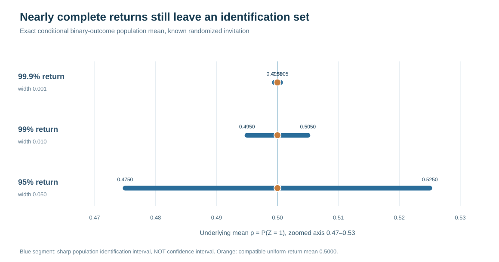

# Reading sharp identified sets for missing outcomes

Suppose the true value $Z$ is binary, but even an invited follow-up audit can fail to return a value. The crucial distinction is between **what is observed** and **what has been assumed about unreturned values**.

## What the observed audit actually tells us

Among people/curves invited for audit, let $q_0$ be the fraction with returned $Z=0$, $q_1$ returned $Z=1$ and $delta=1-q_0-q_1$ the fraction who do not return. The population share $p=P(Z=1)$ can be anywhere in the exact sharp set

$$
p \in [q_1,\,1-q_0].
$$

Why? The unreturned $delta$ fraction could all have $Z=0$, all have $Z=1$, or any mixture. An *invitation probability* tells us how often the audit was offered, not what the nonrespondents would have said.

## How an external assumption changes the answer

| Extra scientific information | Effect | Read more |
| --- | --- | --- |
| Nothing known about actual return by outcome | Retain full interval | [R93 exact observational equivalence](w3-r93-exact-observed-law-nonidentification.md) |
| Credible external lower completion probabilities by outcome | May narrow interval; incompatible floors falsify the conditional model | [R94](w3-r94-external-audit-completion-bounds.md) |
| Credible external knowledge that actual return favors $Z=1$ | Upper endpoint becomes $q_1/(q_0+q_1)$ | [R95](w3-r95-monotone-audit-return-identification.md) |
| Monotone response, *direction not known* | No narrowing | [R95 methods](w3-r95-monotone-return-sharp-set-methods.md) |

The assumptions require real justification from outside the observed returned-outcome likelihood. None is automatically supplied by this software.

## What not to claim

An identified set describes the **range of population parameter values** observationally compatible with a specified model. It is **not** a 90% confidence interval, a sample-size-adjusted bound, a reconstruction of lost gaze, or evidence for a particular selection mechanism. R95's 54 deterministic algebraic cells are not 54 independent empirical replications.

[Full methods and witnesses](w3-r95-monotone-return-sharp-set-methods.md) · [R95 original/independent ledger](../development/w3-r95-original-independent-evidence-ledger.md) · [Scientific claim ladder](evidence-vs-qualification.md)
