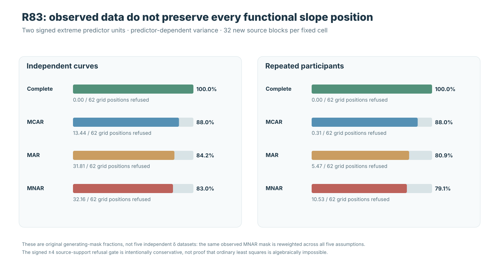
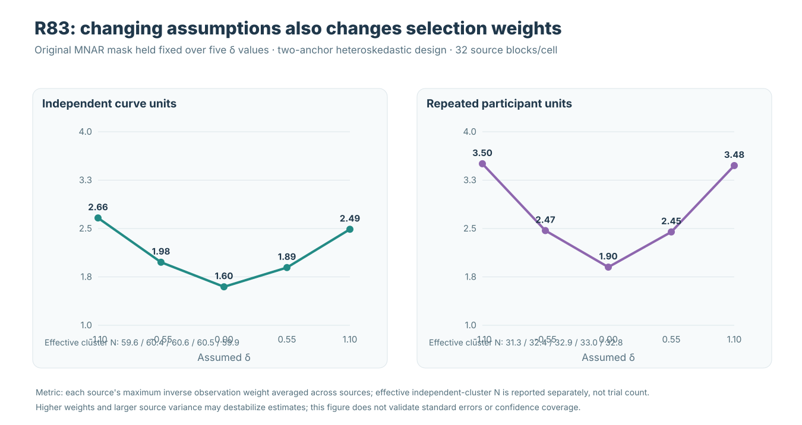

# Sensitivity analysis is not identification of missing gaze

**Methods companion · 21 October 2026 · W3 R83**

The independent [R83 source study](w3-mnar-selection-sensitivity-r83.md) tests a methodological boundary: one can vary a hypothetical *outcome-dependent observation model* and compute different pointwise slopes, yet still lack data that identify which missing-data model is correct. An independently reconstructed source experiment does not make its MNAR assumption empirically identified.

!!! warning "No missingness-adjusted simultaneous inference"
    The original common-grid function-on-scalar regression still refuses missing gaze. R83 fits only an **exploratory, separate pointwise weighted least-squares diagnostic**. It adds no supported imputation, observation likelihood, interval, covariance model or general nominal-90% calibration. Version 1.2 is unreleased and inference issues #289 and #296 remain open.

## 1. MCAR, MAR and MNAR are assumptions about unobserved values

MCAR means missingness is unrelated to data; MAR permits dependence on observed information after conditioning on it. MNAR permits dependence on the unobserved outcome itself. In R83's synthetic source, the true selection law is specified by the simulator, and the original complete trajectory is retained privately for scientific diagnosis.

For observed data, the missing response is **not available** to fit the dependence of its own probability of observation on its value. Identifying an MNAR mechanism generally requires additional constraints, instruments, repeated measurements with justified structure, or external validation; it is not achieved by merely increasing the number of observed gaze samples.

## 2. What R83 actually varies

Five precommitted hypothetical outcome-selection coefficients are \(\delta=-1.10,-0.55,0,0.55,1.10\). At a fixed observed time and coordinate, the pilot fitted mean is constructed only from the responses that remain observed. Each visible trial is then weighted by the inverse of an assumed observation probability whose logit includes recorded predictor, time, trial and a \(\delta\)-scaled function of the **visible outcome residual**.

Thus the pilot plus weighting is **computable from the observed subset**, but the chosen δ is an *externally supplied sensitivity assumption*, not an estimate with empirically identified validity. The true generating selection coefficient +1.1 and generating conditional mean are separately available only to the simulator for an oracle-reference calculation.

*Figure 1.* The same original MNAR-observed samples support several different pointwise slopes as δ changes. This is *assumption sensitivity*, not a confidence band or an identified range of valid estimates.

## 3. Why inverse-probability weights do not recover refused locations

The descriptive R83 pointwise weighted fit requires at least eight independent units, a rank-two local design, and one surviving **positive and negative x=±4 influential source unit** at each time and coordinate. Under the two-anchor design, a missing extreme can cause the entire local fit to be refused even when overall sample retention remains high.

*Figure 2.* Under the adverse two-anchor MNAR source, independent curves retained **83.0% of gaze coordinate samples** yet refused **32.16/62** local slope positions on average. Repeated-trial participants retained **79.1%** and refused **10.53/62** positions. These differences follow the prescribed native-independent-unit support and trial-aggregation rules.

Weighting an observed curve cannot fabricate an unobserved independent signed-anchor unit. Refused locations must remain missing in this diagnostic rather than being interpreted as an entire continuous estimated slope function.

## 4. Participant trials are not independent participants

R83 may use multiple observed trials from one participant in the same **pointwise weighted score**, but counts the participant only once when checking local independent-unit support and computing the descriptive effective independent-cluster sample size. Repeated trials provide measurement replication, not three new independent subjects.

*Figure 3.* Source-average maximum inverse observation weights vary with δ even when masks do not. Independent-cluster effective sample size and raw observed-trial count address different information concepts; neither is itself a frequentist confidence-interval guarantee.

## 5. A true-source propensity oracle is not a field-data estimator

The special simulator-only MNAR oracle knows both true δ and the **original conditional mean** at every point, including points subsequently missing. That privileged information permits evaluating the generating selection probability at *visible* samples, but is unavailable to an actual experimenter facing unknown biological processes and real eye-tracker dropout.

Even correct propensity weighting need not minimize one finite-sample absolute deviation from complete-source OLS, and no variance/band methodology is evaluated here. The oracle is a reference for a falsification study, not a candidate released to users.

## 6. Independent numerical verification and appropriate claims

Original [R83 #39575847765](https://github.com/stefanosbalaskas/eyetrajectoriespy/actions/runs/39575847765) passed **12/12 scientific jobs**; independently coded actual-archive [R83-A #39576738539](https://github.com/stefanosbalaskas/eyetrajectoriespy/actions/runs/39576738539) passed **4/4**. All **256 true X/Y source conditions, 1,024 paired masks and 3,328 individual pointwise sensitivity/oracle evaluations** were numerically reconstructed, with **32 independent primitive blocks per design/support/variance cell**.

That is evidence of numerical agreement for a **specified simulation**, not empirically identified MNAR dropout or valid interval estimation. Additional progress must come from a defensible observation model and sensitivity-based inference with source-independent calibration—not from interpreting the five R83 coefficients as probabilities learned from missing gaze.

[Read the full R83 research article](w3-mnar-selection-sensitivity-r83.md) · [Original evidence and plots](../development/w3-r83-mnar-sensitivity-evidence-ledger.md) · [Previous R82 observation-process study](w3-response-dependent-gaze-loss-r82.md)
