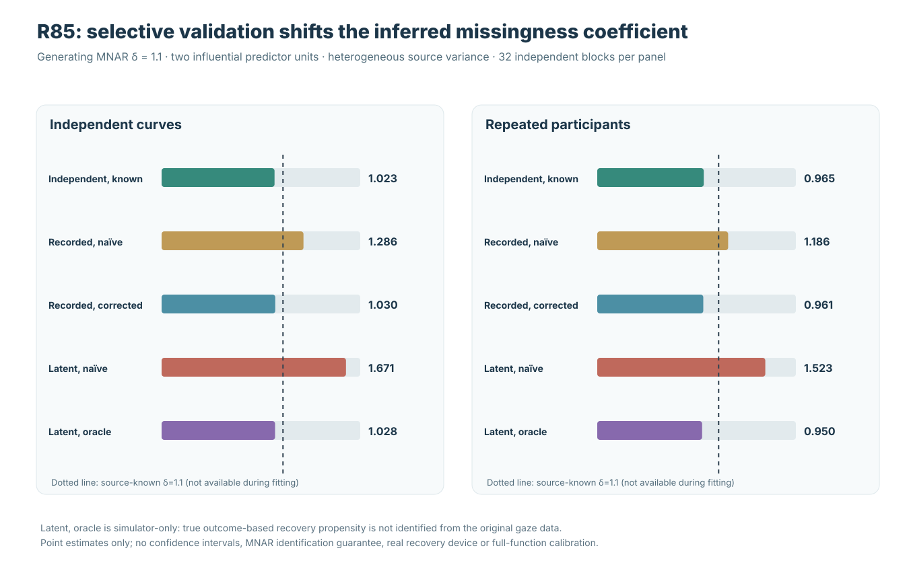
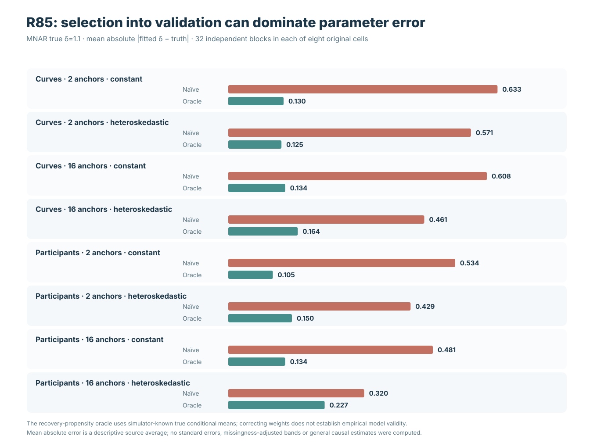
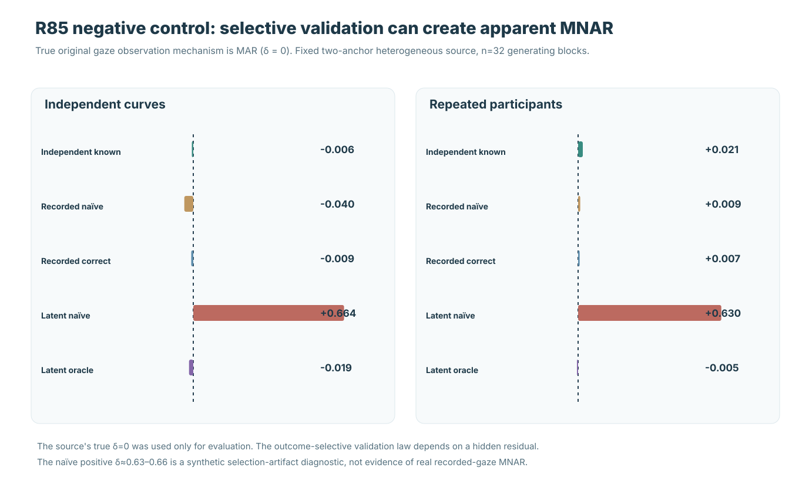

# When external validation is also selective: a falsification test for MNAR correction

**Research article · 21 October 2026 · R85 and independent original-source R85-A audit**

!!! danger "Simulated sources and an unavailable outcome-selection oracle"
    The reported data, original gaze loss and secondary validation procedures are **synthetic**. No external device capable of measuring real lost gaze has been established. R85 evaluates **one scalar source selection coefficient** under a prespecified logistic score; neither its weighting strategies nor the true-propensity oracle amount to an empirically identified general MNAR mechanism, a missingness-adjusted functional estimator, or calibrated nominal-90% confidence bands. Stable 1.1.0 is unchanged, research issues #289 and #296 stay open, and the version 1.2/PyPI release is on HOLD.

## Why R84 is not the final missingness question

[R82](w3-response-dependent-gaze-loss-r82.md) found that modest gaze loss can undermine independent-unit support over time and gaze coordinate. [R83](w3-mnar-selection-sensitivity-r83.md) showed that different outcome-selection assumptions can give different pointwise slopes from the same recorded gaze without identifying the missing-data law. [R84](w3-external-validation-mnar-identification-r84.md) introduced genuinely **new synthetic measurements** of a random fraction of otherwise missing outcomes, allowing estimation of a restricted scalar first-stage MNAR selection coefficient under a fixed model.

But R84 assumed that the external ascertainment of originally missing outcomes was **random within the missing stratum**, with known recovery probability. R85 asks what happens if the validation process is itself selective. This is a second observation process, not a modification to the same response observations. Applying inverse-recovery-probability weights as if ascertainment were random can change the fitted *first-stage* missing-gaze selection parameter even when the source process itself is MAR.

## Frozen original source, first-stage loss and second-stage recovery

The [R85 prospective protocol](https://github.com/stefanosbalaskas/eyetrajectoriespy/blob/research/w3-r85-validation-ascertainment-robustness-20261021/docs/development/w3-r85-prospective-validation-ascertainment-bias.md) was committed before R85 simulation results. The experiment uses **32 genuinely new primitive independent generating blocks** for every fixed cell in a factorial of two independent-unit designs (72 curves; 36 participants ×3 correlated trials), two predictor-support designs (2 or 16 signed extreme predictor units at x=±4) and two noise scales (constant or $s_i=1+0.75|x_i|$). That yields **256 complete synthetic X/Y source conditions**, each with a 31-time ×2-coordinate Gaussian/nonseparable source process, participant effects where relevant, independent-unit Student-t5 radial shocks and a rare centered asymmetric unit shock.

Two paired first-stage missingness masks are constructed per source: MAR with generating $\delta=0$ and MNAR with generating $\delta=1.1$, both using the fixed original selection equation

$$
\operatorname{logit}\{P(M=1\mid x,t,j,Y)\}
=-2.2+\frac{|x|}{4}+0.7t+0.2j+
\delta\tanh\left(\frac{Y-\mu_{\mathrm{true}}}{0.08}\right).
$$

The generating conditional mean $\mu_{\mathrm{true}}$ and true $\delta$ are withheld from all observed-only fits. Original data are incomplete, and the stable public common-grid regression continues to **refuse missing trajectory samples**.

For *originally missing observations only*, a newly generated independent uniform field is reused across three validation-ascertainment mechanisms:

| Validation law | Probability that an originally missing outcome is externally recovered | What can be known from observations? |
|---|---|---|
| Independent | Fixed .25 | .25 is specified by the experimental validation design |
| Recorded-input-selective | Logistic[logit(.25)+.7\|x\|/4+.7t] | Depends on recorded x and time, *provided the recovery law is correctly specified* |
| Hidden-outcome-selective | Logistic[logit(.25)+tanh((Y−true mean)/.08)] | Depends on the otherwise unknown residual; exact propensity is **simulator-only** |

Original MAR and MNAR masks are paired over source uniforms; all validation mechanisms share a separate recovery uniform field. The resulting 512 first-stage source/mask conditions are each evaluated under **five recovery-estimation strategies** for **2,560 strategy records**, but **only 32 independent primitive generating blocks per fixed factorial cell**.

## Five prespecified weighting strategies

The analysis fits one first-stage scalar δ using a pointwise visible-only conditional-mean pilot, the original visible outcomes and only the **newly recovered otherwise missing outcomes**. The visible-only pilot is estimated separately at each time and coordinate from trial-level originally observed responses and recorded predictor x. An inverse-ascertainment-weighted Bernoulli score receives weight 1 for original visible samples and $1/r$ for validated missing outcomes; δ is solved on the frozen [−4,+4] interval, with numerical refusal when a valid root/information is unavailable.

The five fixed comparisons are: correctly weighted independent validation; recorded-input-selective validation with incorrectly constant .25 weights; recorded-input-selective validation with its stipulated covariate-dependent propensity; hidden-outcome-selective validation with incorrectly constant .25 weights; and the **simulator-only** true-outcome validation propensity. The hidden-outcome oracle has privileged access to the source true mean *only to compute the recovery probability for weighting recovered outcomes*. It is **not** an observed-data recovery model.

## Results: outcome-selective recovery shifts the estimated first-stage coefficient

*Figure 1.* Original source means in the adverse two-extreme-unit heteroskedastic MNAR condition, n=32 independent generating source blocks/cell; generating first-stage δ=1.1. The dashed reference is simulator-known truth, not a fitted confidence threshold.

| Validation approach | Independent curves: fitted δ | Repeated participants: fitted δ |
|---|---:|---:|
| Independent ascertainment, correct weighting | 1.023 | .965 |
| Recorded-input ascertainment, naïve constant weighting | 1.286 | 1.186 |
| Recorded-input ascertainment, known covariate weighting | 1.030 | .961 |
| Hidden-outcome ascertainment, naïve constant weighting | **1.671** | **1.523** |
| Hidden-outcome ascertainment, true-propensity oracle | 1.028 | .950 |

The substantial shift under naïve hidden-outcome-selective ascertainment is consistent with selection into the validation data itself. Using the *known* source recovery propensity reduces the error for these particular source means, but **does not identify its hidden functional form from ordinary observed gaze**. Nor does an adjusted mean automatically imply lower source-wise absolute error for each design or each generating block.

## Eight-condition robustness: comparison with a nondeployable oracle

*Figure 2.* Mean $|\widehat\delta-1.1|$ under original MNAR source, with 32 new independent blocks per cell, comparing identical outcome-selective validation masks using a constant probability versus the simulator-known correct validation probability.

| Source design | Signed extreme units | Variance | Naïve error | Simulator-oracle error |
|---|---:|---|---:|---:|
| Curves | 2 | Constant | .633 | .130 |
| Curves | 2 | Heteroskedastic | .571 | .125 |
| Curves | 16 | Constant | .608 | .134 |
| Curves | 16 | Heteroskedastic | .461 | .164 |
| Participants | 2 | Constant | .534 | .105 |
| Participants | 2 | Heteroskedastic | .429 | .150 |
| Participants | 16 | Constant | .481 | .134 |
| Participants | 16 | Heteroskedastic | .320 | .227 |

This is evidence of pronounced sensitivity to the recovery law **in the frozen simulation**, not a calibrated variance estimate, confidence-interval comparison or proof that external ascertainment errors always act in the same direction.

For recorded-input-selective validation, modeling recovery with its correct known-x/time probability often improves source-level accuracy, but **not uniformly**. In the adverse repeated-participant MNAR cell, source-mean absolute δ error was about **.119 under naïve weighting** and **.139 under the stipulated corrected weighting**. The true propensity need not minimize finite-sample absolute estimation error, particularly with a visible-only pilot rather than the generating conditional mean.

## MAR negative control: false evidence of outcome-dependent original gaze loss

*Figure 3.* The original first-stage gaze loss is **MAR (source δ=0)**; n=32 blocks per native design, two influential predictor anchors and heteroskedasticity.

| Original MAR source | Independent recovery | Latent-selective naïve | Latent-selective simulator oracle |
|---|---:|---:|---:|
| Independent curves: mean fitted δ | −.006 | **+.664** | −.019 |
| Repeated participants: mean fitted δ | +.021 | **+.630** | −.005 |

Thus, an originally MAR source can acquire an apparently positive MNAR selection coefficient merely because the external recovery mechanism favors outcomes with particular unobserved residuals and the weighting strategy assumes random recovery. The source and first-stage missingness law are unchanged. This is a falsification of naïve secondary ascertainment assumptions **within the specified artificial process**, not an actual false-positive probability or hypothesis-test rejection rate.

## Independent numerical evidence and boundaries

Original [R85 science workflow #39629520741](https://github.com/stefanosbalaskas/eyetrajectoriespy/actions/runs/39629520741) passed **12/12 dedicated jobs**: three Python 3.11–3.13 source/recovery contracts, eight new four-block source shards and the immutable original aggregate. The [SHA256 original source artifact #12359490292](https://github.com/stefanosbalaskas/eyetrajectoriespy/actions/runs/39629520741/artifacts/12359490292) was produced at original PR-merge science checkout `39ed0ed74d5eb23dfee316a8b5dcd73d498a4a9e`.

The separately implemented [R85-A actual original archive audit #39630863879](https://github.com/stefanosbalaskas/eyetrajectoriespy/actions/runs/39630863879) passed **4/4 mandatory independent jobs**. Its [independent report #12359206531](https://github.com/stefanosbalaskas/eyetrajectoriespy/actions/runs/39630863879/artifacts/12359206531) confirms reconstruction of **all 256 source X/Y conditions, 512 original MAR/MNAR masks and 2,560 original source-strategy diagnostics**, including three recovered-sample propensity laws, visible-only pilots, masks and SHA256, fitted δ, original full-grid source identity and refusal/source denominators. The independent solver used Newton iteration rather than the original bounded bisection.

These tests validate computation under **one explicitly chosen source and three explicitly chosen validation-selection laws**. They do not establish whether a missing human gaze value can be independently remeasured, whether the secondary validation selection law can be estimated empirically, or whether first-stage functional slope estimands and uncertainty can be consistently recovered from irregular repeated trials.

**Release boundary:** No experimental model is added to the public inference API. W3 issues #289/#296 stay OPEN. Stable 1.1.0 remains unchanged and version 1.2/PyPI RELEASE HOLD continues.

[Read the secondary ascertainment methods companion](secondary-validation-selection-and-mnar.md) · [Full numerical evidence and figure ledger](../development/w3-r85-selection-validation-evidence-ledger.md)
