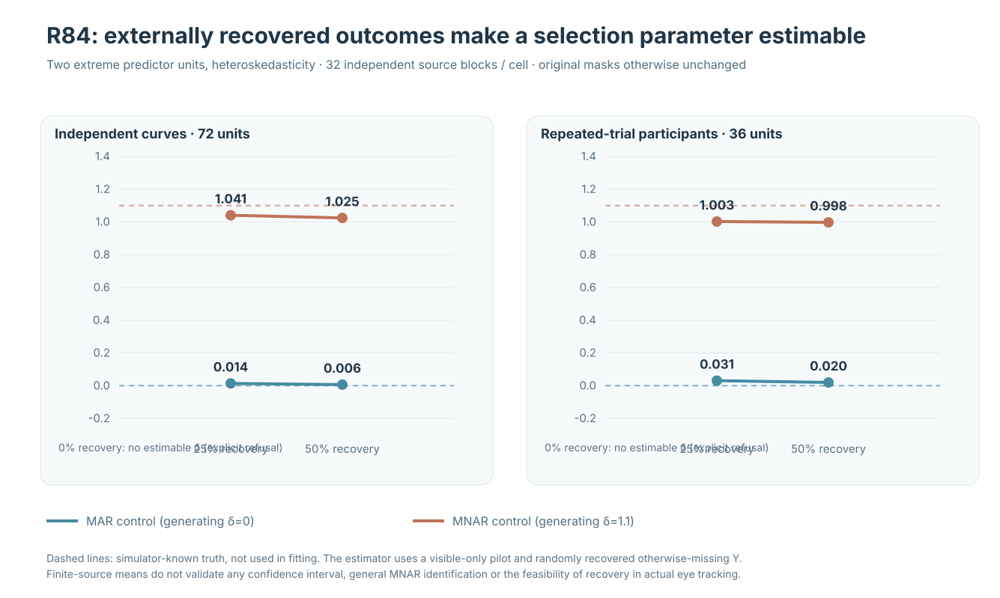
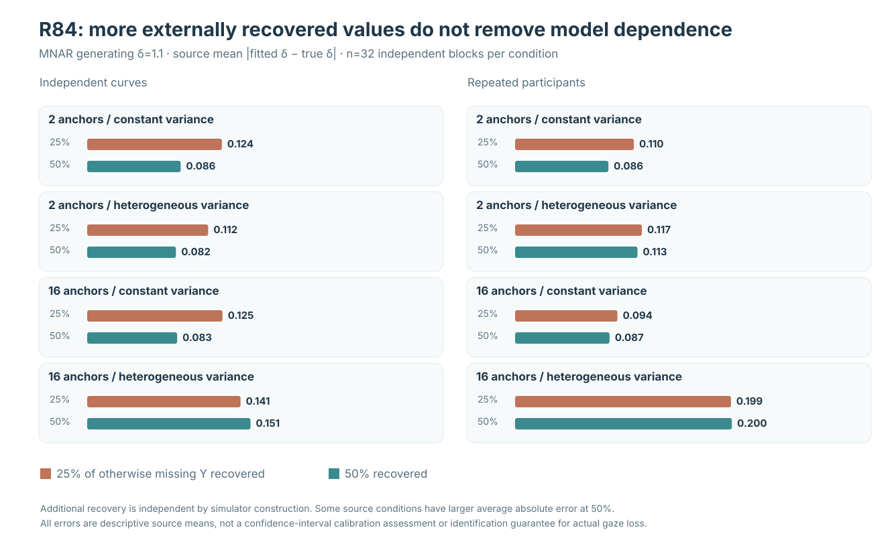
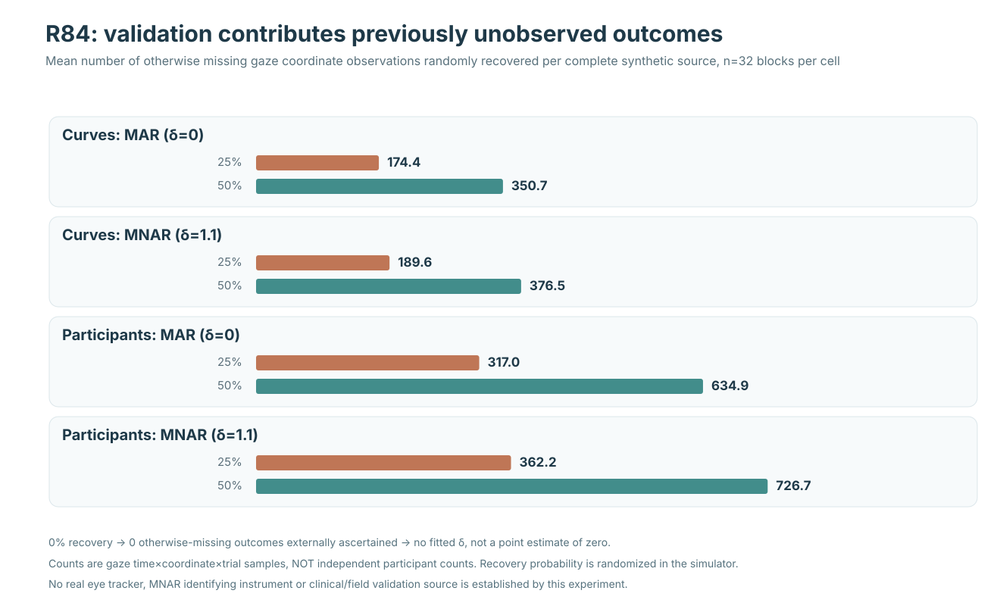

# Can independently recovered missing gaze identify an outcome-dependent selection parameter?

**Scientific research article · 21 October 2026 · W3 R84 original science and independent R84-A archive audit**

!!! danger "Conditional source-model learning, not general MNAR identification or confidence bands"
    The study introduces **artificially simulated external recovery of otherwise missing Y** in a complete synthetic gaze data generator. It estimates one scalar selection parameter only when independently ascertained missing values are supplied. This information does **not** exist in ordinary eye-tracker recordings merely because some gaze samples are observed. Results do **not** identify arbitrary MNAR mechanisms, validate a data-collection technique, introduce a supported estimation API, or establish any confidence interval or nominal-90% simultaneous band. W3 blockers #289 and #296 remain open; stable 1.1.0 and the unreleased version 1.2/PyPI hold remain unchanged.

## From sensitivity assumptions to additional information

In [R82](w3-response-dependent-gaze-loss-r82.md), losing a single extreme predictor unit at a particular time and gaze coordinate could make that grid position fail a prespecified functional-support gate, even when most observations remained. [R83](w3-mnar-selection-sensitivity-r83.md) then showed that five externally specified MNAR selection coefficients could generate different weighted pointwise slopes **from the same observed gaze values**. The R83 coefficients were sensitivity parameters, not fitted or empirically identified effects of missingness.

R84 changes the **information available**, not merely the weighting assumption. It simulates independent external ascertainment of a random subset of otherwise unobserved response values, separate from the gaze system's original observation process. We ask whether the resulting measured missing-outcome values help estimate a *prespecified, scalar outcome-selection coefficient* under a fixed logistic model and a visible-data-derived conditional-mean pilot. An ordinary incomplete gaze recording cannot furnish those independently recovered missing values.

The distinction is substantive: **zero validation means no estimated δ by design**, rather than an estimated δ=0. Positive recovery means new response information with independently known ascertainment probabilities is present; recovery does not by itself remove model dependence or guarantee finite-sample accuracy.

## Prospectively frozen source and validation design

The [R84 frozen protocol](https://github.com/stefanosbalaskas/eyetrajectoriespy/blob/research/w3-r84-external-validation-identification-20261021/docs/development/w3-r84-prospective-external-validation-mnar-identification.md) specified new random sources before observing results:

- **32 new independent primitive generating blocks per fixed cell**, separate from R79–R83.
- Two independent observational-unit designs: **72 independent curves** or **36 participants with three correlated trials each**.
- Two influential predictor supports: **2 or 16 distinct x=±4 units**, balanced over the two signed extremes.
- Two independent-unit scale laws: constant versus predictor-dependent $s_i=1+0.75|x_i|$.

The resulting **256 complete-source condition datasets** retain a 31-time ×2-coordinate source mean and the R81–R83 complete-source error structure: temporally AR(1) Gaussian trial errors (rho=.72), time-changing cross-coordinate dependence, participant-level latent Gaussian effects, a shared Student-t5 radial factor per independent unit, and a rare centered asymmetric Bernoulli unit shock.

Each complete X/Y condition receives two **paired source missingness mechanisms**: MAR with true source selection coefficient $\delta=0$ and MNAR with true source $\delta=1.1$. The synthetic missing-probability logit is

$$
\operatorname{logit}\{p_{\mathrm{miss}}(i,j,t,d)\}
=
-2.2+|x_i|/4+0.7t+0.2j
+\delta\tanh\left[
\frac{Y_{ijtd}-\mu_{\mathrm{true},itd}}{0.08}
\right].
$$

The generating mean and generating δ are **privileged simulator quantities** and are not supplied to the estimation algorithm.

A new independent random uniform field determines whether each *otherwise missing* Y becomes observable through external ascertainment, at nested probabilities **0%, 25% and 50%**. The recovered samples at 25% are contained within those at 50% for the same source. There are thus **512 original MAR/MNAR masks** and **1,536 source/selection/ascertainment diagnostic evaluations**, not 1,536 independently generated sources.

## The precisely restricted observed-data estimator

The algorithm first constructs a separate time×coordinate conditional-mean pilot using **only originally visible trial-level Y and recorded predictor x**. A local pilot is refused where fewer than eight distinct independent units or insufficient intercept/slope rank remain. No externally recovered Y, true conditional mean or generator-known δ enters this pilot.

When external recovery is zero, the parameter estimate is explicitly *missing*: no otherwise-missing residual is known and R84 does not fit the latent outcome-selection coefficient from the original incomplete data alone.

With positive recovery rate $r$, the algorithm evaluates the visible Y and *only the independently ascertained missing Y*. The latter receive inverse ascertainment weight $1/r$; originally observed samples receive weight one. Given pilot mean $\widehat\mu_{\mathrm{visible}}$, it solves a weighted Bernoulli selection score:

$$
\sum_{k\in\mathcal O\cup\mathcal V}
w_k h_k\left[
M_k-\operatorname{logit}^{-1}(b_k+\delta h_k)
\right]=0,\qquad
h_k=\tanh\!\left[
\frac{Y_k-\widehat\mu_{\mathrm{visible},k}}{0.08}
\right],
$$

where $\mathcal O$ denotes original visible outcomes, $\mathcal V$ independently validated missing outcomes, $M_k=1$ indicates the original sample was missing, $b_k$ is the fixed recorded-variable selection offset, and $w_k=1$ for original visible or $1/r$ for independently recovered missing.

The original estimator uses deterministic Newton iteration with frozen δ bounds [−4,4] and rejects nonconvergence, singular information and nonfinite scores. The independent auditor uses a **separately implemented bounded bisection score root**, not a copy of the original optimizer.

This is a **model-dependent scalar parameter point estimate**. The visible-only pilot can differ from the generator's true conditional mean and introduce specification error. Correctly measured additional Y does not guarantee an unbiased finite-source δ estimate or identify general nonparametric MNAR. No uncertainty model, participant-cluster standard error, confidence interval, continuous functional coefficient or simultaneous critical value is computed.

## Results: MAR negative and MNAR positive controls

*Figure 1.* Primary two-anchor predictor-heteroskedastic source, 32 new independent primitive blocks per fixed design. Dashed generating-truth coefficients **0 for MAR** and **1.1 for MNAR** are shown for scientific validation only and were not passed to fitting. At zero external ascertainment **no δ is fitted**.

| Source condition | True δ | 0% recovered | Mean fitted δ, 25% | Mean fitted δ, 50% |
|---|---:|---|---:|---:|
| Independent curves, MAR | 0 | Not estimable | 0.0138 | 0.0064 |
| Independent curves, MNAR | 1.1 | Not estimable | **1.0408** | **1.0247** |
| Repeated participants, MAR | 0 | Not estimable | 0.0306 | 0.0195 |
| Repeated participants, MNAR | 1.1 | Not estimable | **1.0025** | **0.9976** |

All 32 original sources in each of these positive-recovery cells yielded converged parameter estimates under the fixed source and selection model. The 0% arm had **0/32 fitted deltas**, by design, in every fixed cell.

The MAR control behaves comparatively close to zero, while the MNAR positive control is distinguishable from the MAR generator under both recovery rates. However, the MNAR source means at 50% are not automatically closer to the true +1.1 than at 25%. That behavior illustrates finite-sample and pilot-model dependence, not that more validation information has negative asymptotic value.

## All source configurations: absolute estimation error

*Figure 2.* Eight **MNAR** source design/support/variance conditions, each with 32 independent new primitive generating blocks. These are source means of $|\widehat\delta-1.1|$, **not standard errors or interval coverage**.

| Independent design | Extreme units | Variance law | Mean absolute δ error at 25% | At 50% |
|---|---:|---|---:|---:|
| Curves | 2 | Constant | .1242 | .0863 |
| Curves | 2 | Heteroskedastic | .1116 | .0818 |
| Curves | 16 | Constant | .1248 | .0830 |
| Curves | 16 | Heteroskedastic | .1414 | **.1506** |
| Participants | 2 | Constant | .1095 | .0861 |
| Participants | 2 | Heteroskedastic | .1169 | .1129 |
| Participants | 16 | Constant | .0944 | .0871 |
| Participants | 16 | Heteroskedastic | .1991 | **.1999** |

Some configurations show smaller mean absolute parameter error with higher recovery, but two 16-anchor heteroskedastic cells do not. Source covariance and the observed-only pilot remain part of the estimation problem. The modest 32 independent generating blocks per cell also limit precision, and the results concern just one generating source and selection family.

## How much genuinely new information was supplied?

*Figure 3.* Mean **gaze time×coordinate×trial** observations externally recovered for the adverse design, not the number of independent people or curves.

| Source design and mask | Missing values recovered, 25% | Missing values recovered, 50% |
|---|---:|---:|
| Curves, MAR | 174.4 | 350.7 |
| Curves, MNAR | 189.6 | 376.5 |
| Participants, MAR | 317.0 | 634.9 |
| Participants, MNAR | 362.2 | 726.7 |

At zero recovery, none of these otherwise missing outcomes enters the estimation score. At 25% or 50%, the estimator receives truly additional values absent from the original gaze observations. These numbers do not multiply the independent participant sample size, and the ability to collect them is a **simulator assumption**, not an established external sensor or participant-recontact method.

## Independent audit of the actual original source

The prospectively frozen [original R84 workflow #39581392688](https://github.com/stefanosbalaskas/eyetrajectoriespy/actions/runs/39581392688) passed **12/12 dedicated scientific jobs**: three Python-version original-law and nonidentification contracts, eight disjoint new four-block source shards and SHA256 original aggregate. The [original evidence artifact #12336507240](https://github.com/stefanosbalaskas/eyetrajectoriespy/actions/runs/39581392688/artifacts/12336507240) is pinned to the original synthetic PR-merge checkout **6170c5b5941f55a5083cf57dc11293a229d2f9e1**.

An independently coded [R84-A original immutable archive replay #39582618020](https://github.com/stefanosbalaskas/eyetrajectoriespy/actions/runs/39582618020) passed **4/4 dedicated audit jobs**. The independent [artifact #12338291302](https://github.com/stefanosbalaskas/eyetrajectoriespy/actions/runs/39582618020/artifacts/12338291302) confirms reconstruction of **all 256 original complete X/Y sources, 512 MAR/MNAR source masks and 1,536 nested external-ascertainment diagnostics**, independently regenerating source/recovery checksums, visible-only pilots, weighted selection scores and δ estimates by a different numerical root algorithm. It also verifies that no δ estimate exists without externally recovered missing values and that the simulator-known generating mean is not fed into fitting.

This audit establishes **numerical reproducibility for the artificial experiment**, not physical feasibility of remeasuring lost gaze values, external validity, consistent missing-data inference, or nominal-90% calibration.

## Interpretation and release boundary

R84 provides evidence that a **new independently ascertained subset of missing outcomes** can make one source-specific **parametric selection coefficient estimable under the stated recovery, positivity and selection-model assumptions**. Its major scientific qualification is also its limit: ordinary incomplete gaze measurements do not supply the missing response values required by that estimator. Even with additional information, the estimated visible-only pilot, parametric functional form, source covariance and randomized recovery mechanism require justification and uncertainty propagation before empirical application.

The next decisive research task is to determine what **real, ethically and technically feasible auxiliary information** could justify an observation model or sensitivity analysis in eye-tracking experiments; no such source is verified by this simulation.

**W3 #289/#296 OPEN; no public inference API change, stable 1.1.0 unchanged, version 1.2 and PyPI RELEASE HOLD.** The scientific implementations remain draft in [R84 PR #427](https://github.com/stefanosbalaskas/eyetrajectoriespy/pull/427) and [R84-A PR #428](https://github.com/stefanosbalaskas/eyetrajectoriespy/pull/428).

[Companion explanation of external validation and MNAR](external-gaze-validation-identifiability.md) · [Original numerical source and figure ledger](../development/w3-r84-validation-identification-evidence-ledger.md)
