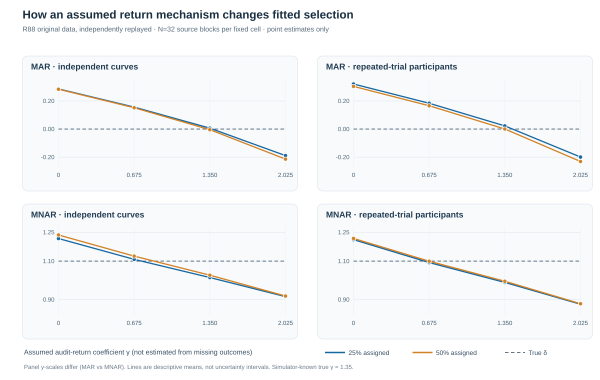
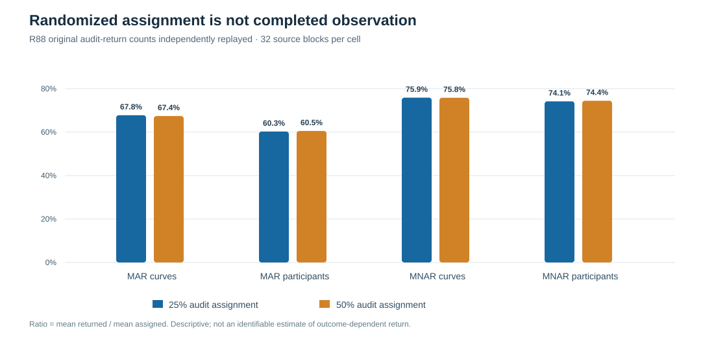

# When missing outcomes also fail to return: a calibrated sensitivity analysis of randomized gaze audits

*W3 R88/R88-A · Original synthetic sources and independent numerical audit · 21 October 2026 · Research-only evidence*

## Why randomized audits may be insufficient

A randomized validation audit can create an opportunity to measure outcomes that were initially unavailable. That is not equivalent to actually obtaining every assigned outcome. Participants may decline a follow-up, recorded data may remain unusable, and the chance of completing an audit may itself depend on the value of the outcome that is still missing. Randomized assignment identifies the assignment mechanism; it does not, by itself, identify the selective *return* mechanism.

The previous [R87 simulation](w3-selective-audit-return-r87.md) demonstrated a concrete failure when audits were assigned randomly but returned selectively. R88 asks the next, narrower question: **how much does a fitted selection coefficient change under different analyst-assumed strengths of outcome-dependent return**, with the observed returned sample held fixed?

R88 is a **conditional simulation sensitivity analysis**, not a validated correction for observed eye-tracking data.

## Design: independent sources, paired observation processes

The prospectively frozen [original R88 study](https://github.com/stefanosbalaskas/eyetrajectoriespy/pull/441) generated 64 independent complete synthetic source conditions: 32 primitive blocks in each of two native independent-unit designs. The first design uses 72 independent curves; the second uses 36 independent participants observed in three trials. Each source has 31 time positions and two gaze coordinates. The response generator includes temporally correlated variation, predictor-heteroskedastic errors, heavy-tailed unit scales and infrequent asymmetric unit shocks.

MAR and MNAR first-stage observation masks were paired on each complete source. The study then simulated secondary outcome validation followed by random audit assignment at 25% or 50%. The audit's *actual return* probability depended on recorded predictors and the unobserved outcome. Four assumed return-mechanism coefficients were fitted **to the exact same observed returned outcomes**.

| Design quantity | Frozen value |
|---|---:|
| Independent complete source conditions | 64 |
| Independent generating blocks per fixed design | 32 |
| First-stage MAR/MNAR source masks | 128 |
| Randomized audit assignment fractions | 0.25 and 0.50 |
| Assumed return coefficients, γ | 0, 0.675, 1.35, 2.025 |
| Source-by-method analysis records | 1,024 |

The 1,024 records are **repeated analyses of source blocks**, not 1,024 independent experiments. Neither previously unrecovered Y nor an imputed version of it enters the fitted estimating scores.

## What is being assumed—not identified

The assumed completion model is

$
\operatorname{logit}\Pr(R=1\mid A=1,X,t,Y)
=\operatorname{logit}p_0(X,t)+\gamma\tanh\!\left(\frac{Y-\hat\mu_{\mathrm{pilot}}(X,t)}{0.08}\right).
$

Here $A$ denotes randomized audit assignment, $R$ actual audit return, $p_0$ a stipulated recorded-input baseline, and $\hat\mu_{\mathrm{pilot}}$ a prediction fitted from outcomes visible before follow-up. Trial information is also incorporated into $p_0$.

**The baseline is calibrated from the simulator's specified law, not estimated or established in field data.** The true generating γ=1.35 is included among the four scenarios, but its value is known only because this is a simulation. Its apparent success cannot be construed as identification of γ from actually returned outcomes.

## Independently audited original results

The original [science workflow](https://github.com/stefanosbalaskas/eyetrajectoriespy/actions/runs/39672709750) passed all 12 dedicated jobs and archived the full 1,024-record ledger. The separate [R88-A workflow](https://github.com/stefanosbalaskas/eyetrajectoriespy/actions/runs/39674304705) passed all four mandatory jobs, including an original-archive replay by independently coded source and numerical estimators.

Figure 1 displays the mean fitted first-stage coefficient as the assumed return coefficient changes. The generating first-stage δ is zero under MAR and 1.1 under MNAR.

**Figure 1.** R88 original-data sensitivity profiles, independently replayed. Blue and amber series use the same underlying sources and observed returns within each native-design and missingness cell, with assignment fractions 25% and 50%. Grey dashed lines are simulator-known generating δ. The panels use visibly labeled, different vertical scales. These are *point estimates*, not confidence intervals or partial-identification bounds.

For the 25% audit assignment, the comparison between assuming no outcome-dependent return (γ=0) and imposing the simulator's generating coefficient (γ=1.35) is:

| First-stage law | Independent-unit design | Assumed γ=0 | Assumed γ=1.35 | Generating δ |
|---|---|---:|---:|---:|
| MAR | Curves | +0.286 | +0.007 | 0 |
| MAR | Repeated-trial participants | +0.321 | +0.022 | 0 |
| MNAR | Curves | +1.217 | +1.015 | 1.1 |
| MNAR | Repeated-trial participants | +1.212 | +0.989 | 1.1 |

Every cell shown contains 32 completed first-stage fits and no numerical refusals. The prespecified sensitivity sequence changes fitted estimates substantively while preserving the observed return records. Under MAR, using the simulator-known return coefficient brought the mean fitted δ close to zero in these sources. Under MNAR, even that privileged specification did **not** perfectly recover the generating δ. This is a finite-design descriptive comparison; it does not provide sampling uncertainty or demonstrate a general correction.

The 50% audit condition preserved the same qualitative sensitivity: for MAR, the mean estimates under γ=1.35 were −0.004 (curves) and +0.000 (participants), whereas under MNAR they were +1.027 (curves) and +0.995 (participants). Merely increasing the audit assignment fraction does not remove the need to specify the return mechanism.

## Assignment versus successful audit completion

**Figure 2.** Descriptive ratios of actual outcomes returned to outcomes assigned for audit, averaged within fixed cells. The rates differ between synthetic source designs and first-stage mechanisms. They cannot identify how return depends on unseen outcome values, nor should these point ratios be treated as independent-unit interval estimates.

The distinction between *being selected for an audit* and *returning usable outcome measurements* is empirically relevant to the simulation's observation process. A study that reports only audit assignment probabilities and omits return provenance conceals an additional selection stage.

## Interpretation and scientific boundaries

R88 advances the evidence from one observed failure scenario (R87) to a prospectively frozen **assumption sweep with paired observed returns**. It establishes that the simulated fitted coefficient depends meaningfully on the outcome-return assumptions. Numerical reconstruction of the frozen archive establishes computational reproducibility of those contrasts.

It does **not** establish general MNAR identification, that the simulator's return baseline or generating γ are available for actual gaze data, that missing historical sensor measurements can be recovered, or that nominal 90% simultaneous functional bands attain their stated coverage. The two relevant [missingness](https://github.com/stefanosbalaskas/eyetrajectoriespy/issues/296) and [simultaneous-band calibration](https://github.com/stefanosbalaskas/eyetrajectoriespy/issues/289) issues remain open.

For definitions, identification assumptions and reproducibility limits, see the [R88 methods companion](reading-assumed-audit-return-sensitivity.md) and the [original/independent evidence ledger](../development/w3-r88-original-independent-evidence-ledger.md). Research source and independent audit are isolated in draft PRs [#441](https://github.com/stefanosbalaskas/eyetrajectoriespy/pull/441) and [#442](https://github.com/stefanosbalaskas/eyetrajectoriespy/pull/442). **Stable package 1.1.0 is unchanged; version 1.2 and PyPI publication remain on hold.**
