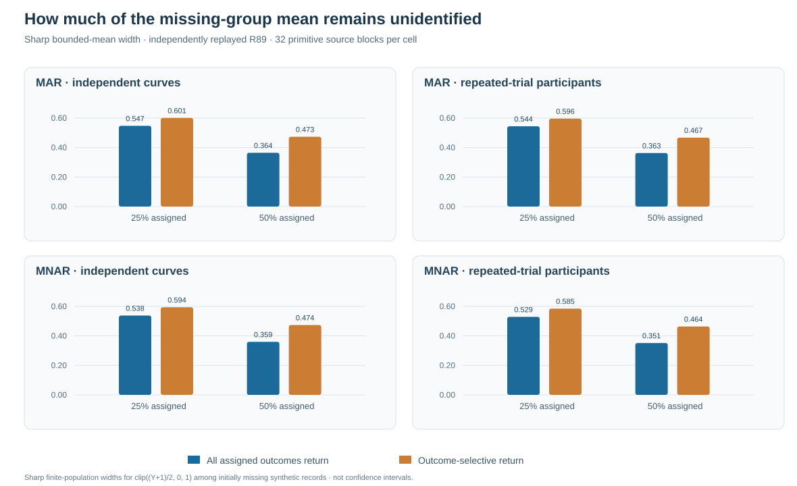
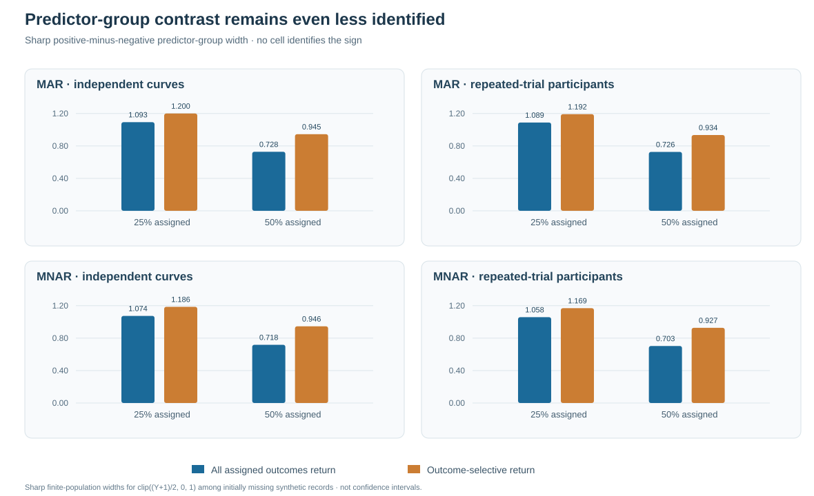

# What a randomized gaze audit cannot identify when outcomes fail to return

*W3 R89/R89-A · Prospective simulation with an independently reconstructed original archive · 22 October 2026 · Research-only evidence*

## The question: what remains knowable without an MNAR return model?

Random assignment creates a known chance of being selected for a validation audit. It does not force every assigned gaze measurement to return. The preceding [R87 study](w3-selective-audit-return-r87.md) showed that selective audit completion can distort fitted selection parameters, while [R88](w3-r88-return-audit-sensitivity.md) found that an assumed hidden-outcome return coefficient substantially changes those fitted estimates.

R89 deliberately avoids estimating that unavailable return coefficient. Instead, it asks: **if gaze outcomes are selectively missing, what is the most that the actual returned observations and a defensible bounded outcome range can identify?**

The answer is an explicitly narrower *finite-population partial-identification interval*. It is neither a missing-data correction for the public package nor an uncertainty interval for a regression slope.

## Original design and identifiable target

The frozen [R89 study](https://github.com/stefanosbalaskas/eyetrajectoriespy/pull/444) generated 64 independent complete synthetic gaze-source conditions, paired under first-stage MAR and outcome-dependent MNAR loss. Two native-unit designs were considered: 72 independent gaze curves, or 36 independent participants with three repeated trials. Each synthetic record has 31 time positions and two coordinates; the generator includes temporal dependence, unit heterogeneity, heavy-tailed scaling and asymmetric shocks.

After first-stage observation loss, an outcome-dependent secondary validation could recover some missing observations. Of the remainder, 25% or 50% were randomly assigned to an audit. Two actual return laws were compared: complete return of assigned audits and selective nonreturn related to the still-hidden outcome. All experiments used frozen, paired source and selection streams.

Because raw synthetic gaze coordinates are not known to have universal fixed bounds, R89 explicitly constructs the transformed outcome

$$
Z=\operatorname{clip}\left(\frac{Y+1}{2},0,1\right).
$$

The estimand is the *realized finite-population mean of $Z$ among observations that were initially missing in that source block*. A second estimand is the difference between those means for nonnegative and negative source-predictor groups. The transformation is part of the estimand; these are **not bounds on the original raw response or function-on-scalar regression coefficients**.

## Observed-only sharp bound

For $N$ initially missing records, suppose only $n$ are eventually measured, with transformed outcomes $Z_i$. When all that is assumed is $0\le Z_i\le1$ and the measured values are valid, the finite-population mean lies in the sharp interval

$$
\left[
\frac{\sum_{i\in\mathrm{measured}} Z_i}{N},
\quad
\frac{\sum_{i\in\mathrm{measured}} Z_i+N-n}{N}
\right].
$$

Its width is exactly $(N-n)/N$: the fraction of the originally missing population that has still not been recovered. No unreturned outcome, imputed observation or estimated missingness propensity enters these endpoints. The contrast interval subtracts the two groups' opposite endpoints.

These are worst-case *finite-population limits*, not frequentist confidence intervals. The simulator reveals the fully observed source only afterward to check the algebra.

## What the independently replayed evidence shows

The original [science run #39696542346](https://github.com/stefanosbalaskas/eyetrajectoriespy/actions/runs/39696542346) completed 12/12 dedicated jobs and archived all 512 source-method records. The separate [R89-A independent replay](https://github.com/stefanosbalaskas/eyetrajectoriespy/actions/runs/39697384391) passed 4/4, including mandatory reconstruction of the actual immutable original archive.

There are **32 independent generating blocks per fixed cell**. The 512 archived rows reflect repeated paired analysis combinations, not 512 independent datasets.

Mean sharp bounded-*mean* interval widths for outcome-selective audit returns:

| First-stage mechanism | Independent units | 25% assignment | 50% assignment |
|---|---|---:|---:|
| MAR | Curves | 0.601 | 0.473 |
| MNAR | Curves | 0.594 | 0.474 |
| MAR | Repeated-trial participants | 0.596 | 0.467 |
| MNAR | Repeated-trial participants | 0.585 | 0.464 |

Assignment increases reduced the range of unknown bounded outcomes, but did not eliminate it. The following figures compare these outcomes with the simulated ideal in which every assigned audit actually returns a value.

**Figure 1.** Source-mean interval widths for the initially missing bounded-transformed gaze outcome, by first-stage mechanism, native independent unit, randomized audit assignment fraction and actual return law. All bars are original-source descriptive means independently reconstructed by R89-A. No confidence intervals are shown.

**Figure 2.** Sharp interval widths for the positive-minus-negative predictor-group mean contrast among originally missing records. The contrast spans two partially identified group means and is consequently broader; no fixed cell identified the contrast sign in any of its 32 source blocks.

Across all fixed simulation cells, **0/32 blocks had a sharp contrast interval excluding zero**. This is a negative identifiability outcome for the specified source population and range assumption—not proof that meaningful group differences never exist.

## Implications and boundaries

R89 provides an algebraic diagnostic of information retained under incomplete recovery. It shows how actual completed measurements—not merely assignments—shrink the worst-case range. In the recorded simulation, selective nonreturn left substantial portions of the initially missing transformed-outcome distribution unrestricted.

The audit's independent numerical reconstruction establishes correctness of the archived simulation and bound calculations. It cannot validate nominal 90% simultaneous functional bands, identify outcome-dependent return parameters from observations alone, reconstruct historical missing gaze or establish valid inference for an unbounded regression slope.

For identification assumptions and denominator interpretation, consult the [methods companion](w3-r89-sharp-bound-methods.md) and [source/audit evidence ledger](../development/w3-r89-original-independent-evidence-ledger.md). Original source and independent audit remain isolated in draft research PRs [#444](https://github.com/stefanosbalaskas/eyetrajectoriespy/pull/444) and [#445](https://github.com/stefanosbalaskas/eyetrajectoriespy/pull/445).

Scientific issues [#296](https://github.com/stefanosbalaskas/eyetrajectoriespy/issues/296) and [#289](https://github.com/stefanosbalaskas/eyetrajectoriespy/issues/289) remain open. Stable 1.1.0 and the public API are unchanged; **version 1.2 and PyPI release remain on hold**.
