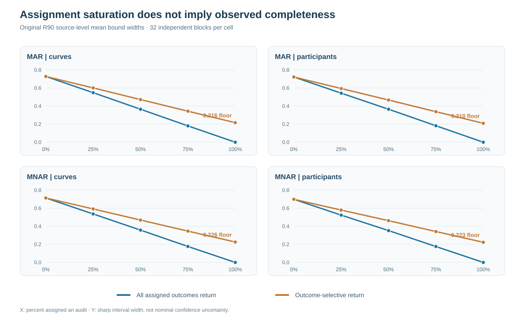
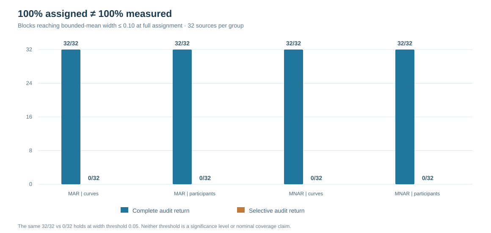

# When assigning every gaze audit is still not enough: completion and partial-identification limits

*W3 R90 · Frozen independent-source simulation · 22 October 2026 · Research-only evidence*

## The distinction between assignment and observed outcomes

Validation audits are often treated as a straightforward remedy for missing eye-tracking data: randomly select originally missing records and obtain their measurements. But a randomized assignment and a successfully **returned measurement** are two different events. Assigning everyone for follow-up need not recover everyone.

Earlier [R87](w3-selective-audit-return-r87.md) simulations documented this selective-return failure, [R88](w3-r88-return-audit-sensitivity.md) established sensitivity to an unobserved-outcome return assumption, and [R89](w3-r89-sharp-observed-only-bounds.md) derived sharp observed-only bounds for a deliberately bounded transformed outcome. R90 extends the last information-accounting experiment over the entire range from 0% to 100% audit assignment.

The question is deliberately narrow: **Does assigning 100% of eligible records eliminate the worst-case finite-population uncertainty when actual completion still depends on unseen outcomes?** It is not a test of whether an MNAR model can be identified or whether a particular functional regression estimator is calibrated.

## Frozen synthetic experiment

The [original R90 research PR](https://github.com/stefanosbalaskas/eyetrajectoriespy/pull/447) contains 64 fresh independent complete-source conditions: 32 generating blocks with 72 independent curves and 32 with 36 independent participants observed in three trials. Each synthetic source has 31 time points and two gaze coordinates, correlated errors, predictor heteroskedasticity, Student-t-like radial heterogeneity and infrequent asymmetric shocks.

Each complete source is given paired first-stage MAR and outcome-dependent MNAR loss masks and secondary validation. A third-stage audit is randomly assigned using a shared stream at five nested levels: **0%, 25%, 50%, 75% and 100%**. The same assigned observations are then subjected to two actual-return policies: ideal complete return versus outcome-selective completion.

| Design element | Count |
|---|---:|
| Independently generated complete synthetic sources | 64 |
| MAR/MNAR paired first-stage masks | 128 |
| Independent primitive blocks per fixed comparison | 32 |
| Nested assignment levels | 5 |
| Return policies | 2 |
| Repeated source × policy records | 1,280 |

The 1,280 records are matched analyses of the source conditions, **not 1,280 independent replications**.

As in R89, the estimand is the realized mean among originally missing records of an explicitly transformed bounded response:

$$
Z=\operatorname{clip}\left(\frac{Y+1}{2},0,1\right).
$$

For $N$ initially missing records, of which $n$ have actually been measured by validation or returned audits, the sharp finite-population bound width is

$$
U-L=\frac{N-n}{N}.
$$

This identity requires only valid measured outcomes, an observable target/measurement mask and the stipulated range $Z\in[0,1]$. It does not use hidden outcomes, imputation, inverse propensities or a fitted MNAR return coefficient. It is **not a confidence interval**.

## Original observed-only results

The frozen original [science run #39746751227](https://github.com/stefanosbalaskas/eyetrajectoriespy/actions/runs/39746751227) completed **12/12 dedicated jobs**, including all eight independent-source shards and the 1,280-record SHA256 archive. The separately implemented [R90-A independent audit](https://github.com/stefanosbalaskas/eyetrajectoriespy/actions/runs/39747852468) has now passed **4/4 dedicated jobs**, including the mandatory real-original full 1,280-record archive replay. These frozen synthetic computations are independently reproduced, without establishing field-data identification.

At 100% audit assignment, the original source means are:

| First-stage law | Source design | Complete-return width | Selective-return width |
|---|---|---:|---:|
| MAR | Independent curves | 0 | 0.216 |
| MNAR | Independent curves | 0 | 0.226 |
| MAR | Repeated-trial participants | 0 | 0.210 |
| MNAR | Repeated-trial participants | 0 | 0.223 |

Each is an arithmetic mean across 32 independent generating blocks within that fixed cell. The complete-return zero is not an estimated scientific effect; **measuring every member of a finite target population makes its finite mean known by definition**. Under the specified outcome-selective completion law, even assigning every unrecovered observation leaves some values unknown.

**Figure 1.** Source-mean sharp bounded-mean widths as audit assignment grows from zero to one. Blue: all assigned outcomes actually return. Amber: some assigned outcomes do not return, depending on their underlying synthetic value. The nonzero right-hand amber endpoints represent a *simulator- and policy-specific* residual unmeasured fraction, not a general MNAR parameter or a nominal confidence width.

## What even full assignment could not establish

The prospectively specified source-level descriptive criteria were whether the bounded mean width reached **0.10** and **0.05** on the finite five-step assignment grid. At full assignment, 32/32 independent blocks in each fixed cell met both widths under complete return, but **0/32** did so under selective return. These thresholds describe achieved information, not statistical significance or nominal coverage.

**Figure 2.** Counts of primitive generating blocks reaching width at most 0.10 under 100% assignment. The same 32/32 complete versus 0/32 selective contrast holds for width at most 0.05. These are original descriptive source counts, not inferential tests.

There is a corresponding distinction for the source-level positive-minus-negative predictor-group contrast of bounded means among originally missing records. Complete return at 100% assignment exactly identifies the *realized finite contrast*, and 32/32 original blocks excluded zero; with selective return at the same assignment, the bounds remained too wide to determine the contrast sign in all 32/32 blocks per fixed cell. These latter facts do not identify a regression slope or prove any population-level null hypothesis.

## Scientific interpretation

The result is best understood as **partial-identification bookkeeping** under a known bounded target, not as a novel validated estimator. Randomizing assignment is useful: it makes the probability of an audit invitation known and, under actual completion, recovers observations. But it cannot by itself force an outcome-dependent missing response to be observed. More assignment shrinks worst-case bounds, yet its limiting width is governed by the *realized nonreturn fraction*, which can remain positive at q=100%.

The experiment's fresh-source tests and immutable archive establish computational reproducibility of its frozen synthetic law; the separate independent replay is the additional software verification gate. Neither establishes that a true audit-return law is identifiable in field data, that arbitrary raw gaze can be reconstructed, or that simultaneous 90% functional slope bands attain nominal coverage.

See the [R90 methods companion](w3-r90-audit-saturation-methods.md) for sharpness, pairing and the exact meaning of the 0.10/0.05 thresholds, and the [source/audit evidence ledger](../development/w3-r90-original-independent-evidence-ledger.md) for reproducibility and failure-inclusive provenance.

Research [#289](https://github.com/stefanosbalaskas/eyetrajectoriespy/issues/289) and [#296](https://github.com/stefanosbalaskas/eyetrajectoriespy/issues/296) remain open. All experimental code stays on draft research branches. The public stable package 1.1.0 is unchanged; **v1.2 and PyPI publication remain on hold**.
