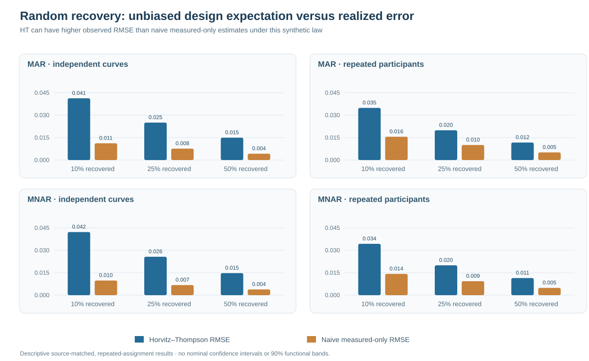
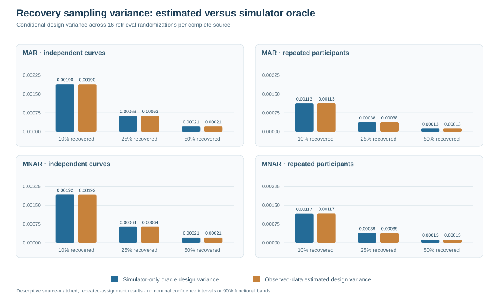

# Actually recovering randomized gaze outcomes: unbiased estimation is not low-variance estimation

*W3 R91 · Prospective synthetic source experiment · 22 October 2026 · Independent replication required before publication*

## From audit invitations to completed measurements

The preceding [R90 experiment](w3-r90-audit-saturation-selective-return.md) highlighted a sharp limitation of retrospective gaze audits: random assignment does not guarantee that missing outcomes actually become observed. Even with 100% assignment, selective nonreturn can leave substantive portions of a bounded missing-record target unidentified.

R91 examines a deliberately **stronger, hypothetical research design**. Suppose a second measurement procedure selects some otherwise unrecovered outcomes at random with a known probability, and **every selected outcome is actually measured**. Would this support a finite-population mean estimate without specifying the MNAR process that initially caused the gaze to be missing?

The answer is yes *in conditional design expectation*, under that completed-measurement assumption. But the same experiment demonstrates why this is not automatically preferable in root mean squared estimation error, nor a solution to functional confidence-band calibration.

## Frozen study design and estimand

The original [research PR #450](https://github.com/stefanosbalaskas/eyetrajectoriespy/pull/450) contains 64 newly generated independent complete synthetic source conditions, split between independent curves and repeated-trial participant designs, with 32 independently generated primitive blocks per design. Each source was paired under first-stage MAR and response-dependent MNAR missingness, followed by selectively successful secondary validation.

From records still unavailable after secondary validation, an idealized validator randomly selects each remaining outcome independently, with known probability **10%, 25% or 50%**, and completes measurement for all selected outcomes. Each fixed source and first-stage mask receives 16 distinct random recovery realizations, coupled by the same uniforms across the three retrieval probabilities.

| Source design feature | Prespecified count |
|---|---:|
| Independent complete X/Y source conditions | 64 |
| Paired first-stage MAR/MNAR mask conditions | 128 |
| Independent original source blocks per design | 32 |
| Randomized actual retrieval repetitions per source/mask | 16 |
| Guaranteed retrieval probabilities | 10%, 25%, 50% |
| Repeated source × retrieval records | 6,144 |

**6,144 is not an independent-source denominator.** The independent complete-source denominator remains 64, and within each fixed design there are 32 source blocks. The 16 randomization repetitions are conditional on the same latent source.

The target is the realized finite-population mean of a prespecified bounded transformed synthetic response among records that were *initially* missing:

$$
Z_i=\operatorname{clip}\left(\frac{Y_i+1}{2},0,1\right).
$$

This is neither the raw unbounded gaze series nor a functional regression slope. Bounded observation is a deliberate target definition, not a known universal property of all eye-tracking coordinates.

## Why random completed retrieval changes the estimating equation

Let $N$ denote the known count of originally missing target observations, $S$ the set already measured by secondary validation and $U$ those still unavailable. For each member of $U$, actual independent completed recovery is $G_i\sim\mathrm{Bernoulli}(g)$ with known inclusion probability $g>0$. The observed-only Horvitz–Thompson estimator is

$$
\hat{\mu}_{HT}=\frac{1}{N}\left[
\sum_{i\in S}Z_i+
\frac{1}{g}\sum_{i\in U}G_i Z_i
\right].
$$

Conditional on the fixed complete source and all earlier observation masks, this estimator has design expectation equal to the **realized finite missing-population mean**. This property follows because $\mathrm{E}(G_i/g)=1$. It does not require observing the values of unselected records, but it *does* require that **every selected record is actually recovered**. When only an invitation is randomized and actual completion remains outcome-dependent, that argument fails.

The conditional oracle design variance is $(1-g)/(gN^2)$ times the sum of squares of the still-unavailable transformed outcomes. The recorded experiment also calculates an unbiased *observed-data* estimate of this design variance from successfully randomized recovered values. The oracle is used for verification only; no hidden outcome is passed into the fitted HT estimate.

## What the original simulation actually found

All 12 dedicated jobs in the original [R91 scientific run #39766521032](https://github.com/stefanosbalaskas/eyetrajectoriespy/actions/runs/39766521032) passed, including the eight new-source shards and complete archive. The independent [R91-A audit](https://github.com/stefanosbalaskas/eyetrajectoriespy/pull/451) must replay the actual frozen original archive before these descriptive original source results are treated as independently verified.

Selected original-source RMSEs, with **32 independent blocks per fixed native-source design** and 16 within-source randomized recovery repetitions, were:

| Initial loss and source | Guaranteed retrieval | HT RMSE | Naive measured-only RMSE |
|---|---:|---:|---:|
| MAR · independent curves | 10% | 0.0413 | 0.0112 |
| MAR · independent curves | 25% | 0.0250 | 0.0076 |
| MAR · independent curves | 50% | 0.0149 | 0.0043 |
| MNAR · repeated-trial participants | 10% | 0.0343 | 0.0143 |
| MNAR · repeated-trial participants | 25% | 0.0199 | 0.0094 |
| MNAR · repeated-trial participants | 50% | 0.0115 | 0.0049 |

These values are source-matched descriptive errors for the frozen synthetic law, not uncertainty intervals. Here the naive estimator, which ignores the differential recovery probabilities, often has *lower empirical RMSE* despite its systematic signed error. This is possible because HT reduces design bias in expectation but can introduce considerable randomization variance at low retrieval fractions. A small bias does not necessarily imply a large RMSE in every scenario.

**Figure 1.** Original synthetic-source RMS errors for the design-based estimator versus a naive measured-only mean. Neither bar group establishes a general efficiency ranking across missing-data mechanisms; the results depend on this chosen generator, target and retrieval design.

The source-average observed-data design-variance estimates were close to the corresponding simulator-only variance oracles within the archived conditions, as illustrated below.

**Figure 2.** Mean estimated conditional design variance versus oracle variance. This reflects repeated randomized retrieval of the same fixed synthetic sources, not frequentist coverage of a constructed confidence interval. An unbiased variance estimator need not equal its oracle in one realization.

## Interpretation and nonclaims

R91 creates a useful conceptual separation between identification through hypothetical *completed* randomized measurement and statistical precision from only partial recovery. The analytic expectation property is exact under the design assumptions. The agreement of source-averaged means and variance diagnostics is computational evidence for a limited synthetic experiment, not independent empirical proof of general missing-data identifiability.

The experiment does not justify replacing a missing real gaze observation with a random value; it assumes an external process can **actually measure** a random subset of outcomes that would otherwise remain unavailable. That assumption may be impractical for unrecoverable historical sensor records. It does not identify the first-stage MNAR parameter, the audit-completion law of the prior R88 experiments, raw functional regression coefficients, or nominal 90% simultaneous slope-band coverage.

See the [methods companion](w3-r91-guaranteed-recovery-methods.md) and [failure-inclusive scientific evidence ledger](../development/w3-r91-independent-recovery-evidence-ledger.md). The scientific blockers [#296](https://github.com/stefanosbalaskas/eyetrajectoriespy/issues/296) and [#289](https://github.com/stefanosbalaskas/eyetrajectoriespy/issues/289) remain open. Research code stays draft/unmerged, stable public package 1.1.0 is unchanged, and **version 1.2/PyPI release remains on hold**.
