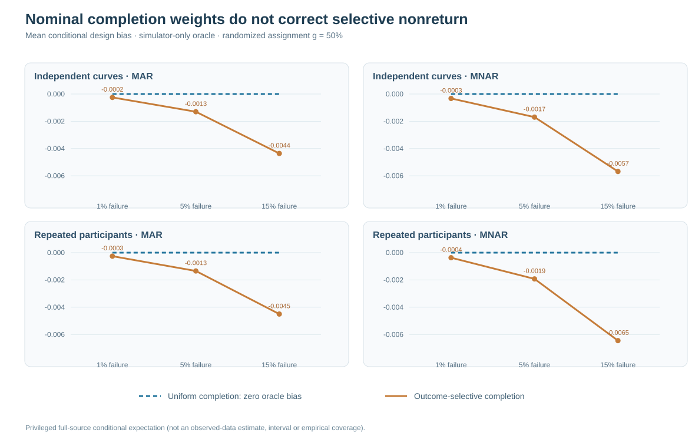
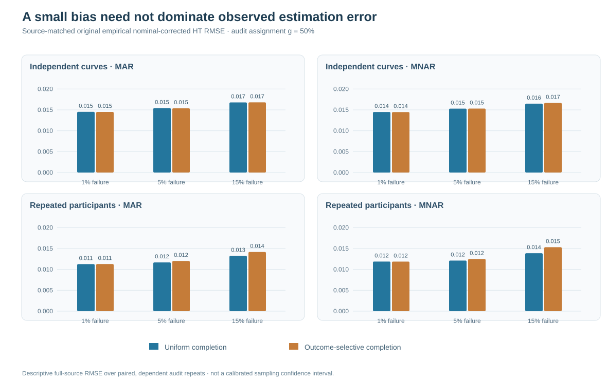

# When a nearly complete randomized gaze audit still fails: fragility of nominal response weighting

*W3 R92 · 22 October 2026 · Independently reproduced synthetic research*

## Randomized invitations are not randomized observed outcomes

The preceding [R91 experiment](w3-r91-guaranteed-recovery-design-ht.md) analyzed an intentionally strong intervention: a known-probability random subset of missing observations is **actually measured**, without noncompletion. Under this assumption, the Horvitz–Thompson (HT) estimator of a finite population mean is design-unbiased in expectation, although finite-draw estimation error can remain large.

Real validation procedures often randomize an invitation rather than measurement completion itself. A record may be selected for remeasurement and still fail to produce a usable outcome, possibly for reasons related to the unobserved value. R92 asks whether adjusting for an assumed, nearly complete **uniform** return rate retains the conditional design property when actual returns are instead selectively missing.

The result is a carefully bounded negative identification finding. The original synthetic source experiment and an independent replay show that even small departures from true uniform return leave conditional bias in nominally adjusted HT weighting. This is **not** evidence that the real return mechanism or missing gaze values are identified.

## Frozen factorial and estimand

The prospective [R92 original research PR #453](https://github.com/stefanosbalaskas/eyetrajectoriespy/pull/453) used 64 completely fresh synthetic generating conditions: 32 independent-curve primitive blocks and 32 repeated-trial participant primitive blocks. A common complete source was paired with an initial MAR or outcome-selective MNAR missingness mask. An outcome-selective secondary validation phase recovered some initially missing records.

For each complete source and first-stage mask, eight conditional random audit draws assigned 25% or 50% of still-unrecovered records. The study then paired seven actual return regimes on identical assignments: ideal return of all assigned records, uniform return probability $1-\delta$, and outcome-selective return probability $1-\delta(0.5+Z_i)$, where nominal failure $\delta$ was 1%, 5% or 15%.

| Frozen design | Count |
|---|---:|
| New independent complete generating sources | 64 |
| Paired MAR/MNAR first-stage masks | 128 |
| Conditional audit replicates per source-mask | 8 |
| Nested randomized invitation probabilities | 25%, 50% |
| Actual return regimes | 7 |
| Repeated source-method records | 14,336 |

The **independent source denominator is 32 per native design**, not 14,336. Each original primitive source contributes paired masks, assignments and response scenarios.

The finite target is the mean of a deliberately bounded transformed synthetic gaze outcome, $Z_i=\operatorname{clip}((Y_i+1)/2,0,1)$, among records originally missing. It is not raw gaze, an unknown actual sensor coordinate or a regression coefficient.

## The precise failure of nominal weighting

Let $S$ represent initially missing outcomes already observed through secondary validation, and $U$ those still unavailable. Let $I_i$ be the randomized audit assignment with known probability $g$, and $R_i$ the actual return indicator with probability $c_i$ potentially depending on the hidden outcome. The observed-data estimator cannot use $c_i$ when it is unknown.

The two compared weighting rules are an *assignment-only* HT estimate that divides observed audit responses by $g$, and a *nominal completion-adjusted* HT estimate that divides them by $g(1-\delta)$. In the fixed synthetic population, their conditional design biases are respectively

$$
B_{\mathrm{assignment}}=-\frac{1}{N}\sum_{i\in U}(1-c_i)Z_i,
\qquad
B_{\mathrm{nominal}}=\frac{1}{N}\sum_{i\in U}
\left(\frac{c_i}{1-\delta}-1\right)Z_i.
$$

Under genuinely uniform $c_i=1-\delta$, nominal adjustment has **exactly zero conditional design bias**. Under outcome-selective $c_i=1-\delta(0.5+Z_i)$, the same correction generally retains bias. These biases are privileged *simulator-oracle expectations* that require latent outcomes; they are not identified by the selectively observed data themselves.

## Verified synthetic results

The original [R92 science workflow #39837488254](https://github.com/stefanosbalaskas/eyetrajectoriespy/actions/runs/39837488254) passed **12/12 dedicated jobs**. A separately written [R92-A original-archive replay #39838411816](https://github.com/stefanosbalaskas/eyetrajectoriespy/actions/runs/39838411816) passed **4/4**, independently reconstructing all 14,336 source-method records and their original checksums.

At audit assignment $g=0.50$, mean simulator-only analytical nominal-adjustment biases under outcome-selective return were:

| Initial loss and independent-unit design | 1% nominal failure | 5% nominal failure | 15% nominal failure |
|---|---:|---:|---:|
| MAR · curves | −0.00025 | −0.00130 | −0.00436 |
| MNAR · curves | −0.00033 | −0.00169 | −0.00568 |
| MAR · repeated-trial participants | −0.00026 | −0.00134 | −0.00450 |
| MNAR · repeated-trial participants | −0.00037 | −0.00192 | −0.00645 |

These source averages are over 32 independent primitive blocks per native design. The oracle bias does not depend on the randomized assignment probability $g$ when $g$ is handled correctly in its **conditional expectation**; the estimator's realized randomization variance and observed empirical errors do depend on $g$. Every corresponding uniform-completion analytical nominal-adjustment bias is exactly zero by design.

**Figure 1.** The dashed reference is the zero conditional design bias under truly uniform completion with correctly specified nominal failure probability. The outcome-selective law leaves increasingly negative oracle bias over the prespecified failure grid. The plotted values are **not confidence intervals or estimable field response propensities**.

The empirical errors tell a different, complementary story. At $g=0.50$, an outcome-selective 5% failure regime produced nominally corrected HT RMSE of approximately 0.0154 for MAR independent curves and 0.0125 for MNAR repeated-trial participants; the matched truly uniform regimes yielded approximately 0.0154 and 0.0121. The nonzero conditional bias may be small compared with randomization noise, especially with eight retrieval replicates per original source. Consequently, **one finite realized estimate cannot reliably diagnose selective completion from a small observed error alone**.

**Figure 2.** Root mean squared errors of the nominally corrected finite-population estimator across paired source simulations. Similar RMSEs do not prove that the completion law is uniform, and any visual difference is descriptive rather than an inferential significance or interval-coverage claim.

## Implications

R92 distinguishes three logically separate operations: known randomized **audit assignment**, probabilistic **actual completion**, and an assumed or verified **completion probability** used in weighting. The second and third cannot be replaced by knowledge of the first. The simulator can calculate true response probabilities because it possesses the latent outcomes; an analyst faced with genuinely missing real eye-tracking outcomes typically cannot perform that calculation from the observed records alone.

The results therefore do not offer a deployable fix for MNAR missingness, identify actual return probabilities, reconstruct lost gaze sequences or calibrate functional-slope confidence bands. The observed-data source bounds remain valid under their explicit [0,1] transformed target assumption, but their width reflects the actually unreturned fraction; it is not a nominal confidence interval.

See the [R92 methods and analytic-bias appendix](w3-r92-selective-return-methods.md) and [original/independent evidence ledger](../development/w3-r92-original-independent-evidence-ledger.md). Both experimental implementation PRs remain open draft and unmerged. Scientific blockers [#296](https://github.com/stefanosbalaskas/eyetrajectoriespy/issues/296) and [#289](https://github.com/stefanosbalaskas/eyetrajectoriespy/issues/289) remain open. Stable 1.1.0 is unchanged, and **version 1.2/GitHub/PyPI release remains on hold**.
