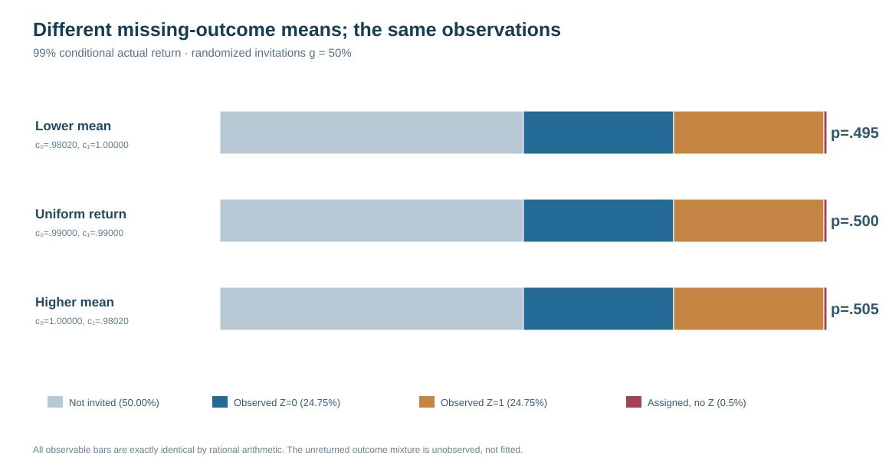

# When 99.9% audit completion cannot identify the missing outcome mean

*W3 R93 · Exact rational observational-equivalence proof · 23 October 2026*

## A narrower, stronger question

The [R92 investigation](w3-r92-near-complete-return-fragility.md) showed a limitation of nominal completion weighting in a specified synthetic gaze-return law: a model that assumes uniform successful audit return can remain biased when actual completion depends on the hidden outcome. This left a fundamental question. Could an analyst somehow recognize the correct latent outcome distribution and audit-completion mechanism from the observed data if the audit invitation probability is known and nearly every invited record returns?

R93 addresses that question with an **exact observational-equivalence construction**, not another empirical simulation. Within a binary, bounded-outcome submodel, it constructs different true population means and different outcome-specific completion mechanisms that produce **identical probability distributions for everything the analyst can observe**. The construction works even when actual return is 99.9% and even when every eligible record receives an invitation.

The result is narrow but logically conclusive: **randomized invitation and high actual completion alone do not point-identify the latent outcome mean in the class of unrestricted outcome-dependent return mechanisms.** It is not evidence of a large unidentified effect, an estimator's frequentist error, or failing 90% functional confidence bands.

## The exact observed-data experiment

Consider records in one fixed originally missing stratum with deliberately bounded response $Z\in\{0,1\}$ and underlying mean $p=P(Z=1)$. An audit invitation $I$ is independently randomized with **known** probability $g$. On invitation, actual outcome-return indicator $R$ has potentially unknown probabilities $c_0=P(R=1\mid I=1,Z=0)$ and $c_1=P(R=1\mid I=1,Z=1)$.

The analyst observes whether the record was invited, whether an invited record returned, and $Z$ only when it returned. For an invited record, define the two observed return-outcome probability masses

$$
q_0=(1-p)c_0,\qquad q_1=pc_1.
$$

The complete observable event distribution is therefore

$$
\begin{aligned}
P(I=0)&=1-g,\\
P(I=1,R=1,Z=0)&=gq_0,\\
P(I=1,R=1,Z=1)&=gq_1,\\
P(I=1,R=0)&=g(1-q_0-q_1).
\end{aligned}
$$

The observable probabilities determine $q_0$ and $q_1$ when $g>0$, but **not** their decomposition into $p$, $c_0$ and $c_1$ without additional restrictions.

Because both completion probabilities must lie in $[0,1]$, the latent binary population mean has the **sharp population identification region**

$$
\boxed{p\in[q_1,\,1-q_0].}
$$

Every point in that range is compatible with an admissible completion process. Its width $1-q_0-q_1$ is precisely the nonresponse fraction *among invited records*. This is a distribution-level identification set, **not** a finite-sample confidence interval and not the conditional finite-population observed-only interval from R89–R90.

## Three worlds, one observable dataset law

The exact study freezes overall invited-record completion at $1-\delta$ and equal observed return-outcome masses $q_0=q_1=(1-\delta)/2$. Three possible data-generating worlds then follow.

| Latent world | Underlying mean $p$ | Completion for $Z=0$ | Completion for $Z=1$ |
|---|---|---|---|
| Lower mean | $(1-\delta)/2$ | $(1-\delta)/(1+\delta)$ | 1 |
| Uniform return | $1/2$ | $1-\delta$ | $1-\delta$ |
| Higher mean | $(1+\delta)/2$ | 1 | $(1-\delta)/(1+\delta)$ |

The three underlying means differ. Their *observable* event distributions do not differ at all, because all three produce the same $q_0$, $q_1$, $g$ and invited nonresponse probability.

For the intuitive example $g=0.50$ and $\delta=0.01$, the four observable event probabilities are **0.50 not invited**, **0.2475 invited-and-returned $Z=0$**, **0.2475 invited-and-returned $Z=1$**, and **0.005 invited-but-not-returned**. Every one of these probabilities is identical in all three worlds. Yet the latent population means are **0.495, 0.500 and 0.505**, respectively.

**Figure 1.** Three exactly observationally equivalent mechanisms at 99% overall completion and $g=0.50$. The stacked observable-event probability bars coincide *by algebra*. The differently distributed hidden outcomes appear only in the underlying means and unobserved completion propensities.

## How much is still unidentified?

The prospective proof evaluates invitation probabilities **25%, 50% and 100%**, actual return **99.9%, 99% and 95%**, and each of the three distinct latent worlds. The resulting **27 exact rational parameterizations form nine observed-law-equivalence groups**, not 27 independent simulation replicates.

| Actual completion among invited records | Sharp binary mean region | Region width |
|---|---|---:|
| 99.9% | [0.4995, 0.5005] | 0.001 |
| 99% | [0.495, 0.505] | 0.010 |
| 95% | [0.475, 0.525] | 0.050 |

These example intervals **shrink as actual return becomes more complete**. A nearly complete audit does provide substantial information; the theorem says only that the remaining unknown responses prevent exact point identification without further conditions.

**Figure 2.** Sharp population identified regions for the binary originally-missing stratum under each response fraction. These are *not* confidence intervals, estimator uncertainty ranges, or evidence that typical real eye-tracking errors take these magnitudes.

Importantly, setting invitation probability $g=1$ does not change the ambiguity: every record was invited, but some invited outcomes still failed to return. The observable event law remains equal across the latent worlds. Equality of the single-record observed probability distribution implies equality of the probability of **every possible finite observed sample** under the stipulated independent binary submodel.

## Original evidence and independent mathematical replay

The original research [PR #456](https://github.com/stefanosbalaskas/eyetrajectoriespy/pull/456) passed **4/4 dedicated jobs** in [science run #39854975837](https://github.com/stefanosbalaskas/eyetrajectoriespy/actions/runs/39854975837), including Python 3.11, 3.12 and 3.13 tests and an exact-rational SHA256 proof artifact. An earlier run failed to load repository pytest configuration because its workflow installed only `pytest` without the repository's required `matplotlib` dependency; after changing only the test environment to install the repository's development dependencies, the entire proof gate passed. The failure is retained, not concealed.

The separately coded [R93-A independent audit run #39855518388](https://github.com/stefanosbalaskas/eyetrajectoriespy/actions/runs/39855518388) also passed **4/4**, including mandatory replay of all 27 parameterizations from the original immutable source artifact. R93-A independently derives each outcome-response factorization and matches all exact rational observed probabilities and the original SHA256 checksum. This supports independent numerical and algebraic **reproducibility of the constructed counterexample**, not a new finding about measured participants.

## Interpretation and boundaries

The binary construction belongs to a class of models with unrestricted outcome-specific response probabilities. Its observational equivalence therefore disproves *general* point identification in that model class based only on invitation randomization and observed returns. It does not show that all missing-data models are unidentified: correctly verified response uniformity, guaranteed completed randomized retrieval, external ground truth, strong auxiliary measurements, or credible restrictions can change the identified set.

Nor does the binary submodel yield exact identification regions for correlated, multitime, continuous gaze processes, slopes, scanpaths or physiological outcomes. It is not an empirical calibration study and does not repair the separate undercoverage of 90% simultaneous functional slope bands.

See the [R93 identification proof and assumptions](w3-r93-exact-observability-methods.md) and the [original/independent evidence ledger](../development/w3-r93-original-independent-equivalence-ledger.md). Both research PRs remain draft/unmerged; stable public 1.1.0 remains unchanged. Issues [#296](https://github.com/stefanosbalaskas/eyetrajectoriespy/issues/296) and [#289](https://github.com/stefanosbalaskas/eyetrajectoriespy/issues/289) remain open, and **v1.2/GitHub Release/PyPI publication is on hold**.
