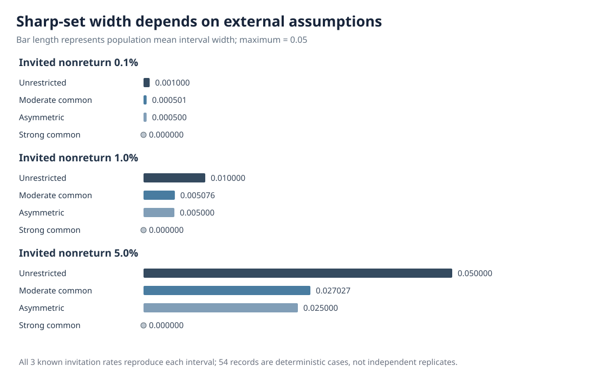

# Which external audit guarantees can narrow a missing-outcome identification region?

*W3 R94 · Independently verified exact sensitivity analysis · 23 October 2026*

## From observational equivalence to an explicit assumption

[R93](w3-r93-exact-observed-law-nonidentification.md) constructed three latent binary-outcome populations with the same observable audit likelihood, despite randomized invitations and 99.9% completion. Its conclusion concerned non-point-identification under unrestricted unknown, outcome-dependent completion. It did **not** say that external knowledge is useless or that uncertainty remains large when almost everything returns.

R94 asks a precise follow-up: **how strong must independently justified minimum completion guarantees be to narrow that population identified set?** The answer is an exact algebraic sensitivity calculation. It is not a new estimator, Monte Carlo experiment, or a claim that such guarantees are available for actual eye-tracking recordings.

## The observation and the unobserved assumption

Within one originally missing stratum, let $Z\in\{0,1\}$ be a bounded binary target; write $p=P(Z=1)$. Let $I$ be a known-probability randomized audit invitation and let $R$ denote successful actual return if invited. The two observed conditional-on-invitation return masses are

$$
q_0=P(R=1,Z=0\mid I=1),\qquad q_1=P(R=1,Z=1\mid I=1).
$$

R93's unrestricted sharp population mean interval is $[q_1,1-q_0]$. R94 *hypothetically* adds two outcome-specific lower response-probability guarantees

$$
P(R=1\mid I=1,Z=0)\ge\ell_0,\qquad
P(R=1\mid I=1,Z=1)\ge\ell_1.
$$

The guarantees must come from independently justified information or assumptions. **They cannot be established by the success rate among records whose hidden outcomes remain unobserved.** For nonzero floors, the sharp population mean interval becomes

$$
\boxed{
p\in\left[\max\left(q_1,\,1-\frac{q_0}{\ell_0}\right),
\ \min\left(1-q_0,\,\frac{q_1}{\ell_1}\right)\right].
}
$$

Omit the corresponding ratio when its floor is zero. If lower exceeds upper, no underlying binary population and response mechanism satisfies both the exact population observation law and the asserted floors. This is a *logical incompatibility under the stipulated law*, not a statistical rejection test for noisy finite data.

## Six predetermined sensitivity conditions

The fixed exact construction uses symmetric returned-outcome masses $q_0=q_1=(1-\delta)/2$ for invited nonresponse $\delta\in\{0.001,0.01,0.05\}$. Known audit invitation probability takes three values: 25%, 50% and 100%. There are six externally *stipulated* floor regimes, creating **54 deterministic rational records, not 54 independent empirical replicates**.

| Floor assumption | $\ell_0$ | $\ell_1$ | Identified-set consequence |
|---|---|---|---|
| No external guarantee | $0$ | $0$ | Width $\delta$, as in R93 |
| Weak, common | $1-2\delta$ | $1-2\delta$ | No additional tightening |
| Moderate, common | $1-1.5\delta$ | $1-1.5\delta$ | Narrower nonzero interval |
| Strong, common | $1-\delta$ | $1-\delta$ | Singleton $p=1/2$ within this construction |
| Asymmetric | $1-\delta$ | $1-2\delta$ | Width $\delta/2$, shifted upward |
| Incompatible, overstrong | $1-\delta/2$ | $1-\delta/2$ | Empty set; assumptions contradict the exact law |

These are illustrative strengths rather than estimated instrument performance rates.

## At 99% actual return

Under $\delta=0.01$, the original sharp region is $[0.495,0.505]$. Changing only the external floor assumption yields:

| Assumption | Exact-region decimal endpoints (rounded) | Width |
|---|---|---:|
| Unrestricted or weak | [0.495, 0.505] | 0.010000 |
| Moderate common | [0.497462, 0.502538] | 0.005076 |
| Asymmetric | [0.500, 0.505] | 0.005000 |
| Strong common | [0.500, 0.500] | 0 |
| Overstrong | Empty | Not defined |

**Figure 1.** Each horizontal interval is an exact population identified region, not a confidence interval. Incompatibility means no admissible model exists under the exact assumed observation law.

The widths for 99.9%, 99% and 95% response scale with the observed nonreturn fraction, but the moderate assumption does not simply halve width: its exact width is $\delta/[2(1-1.5\delta)]$.

**Figure 2.** Exact analytical widths for the stipulated binary model; invitation probability does not alter the conditional-on-invitation identified set. Three invitation settings repeat the same sets and must not be counted as independent replications.

## Why the bounds are sharp

A second, separately coded algebraic construction allocates the unreturned mass $\delta=1-q_0-q_1$ between hidden $Z=0$ and $Z=1$ units. At either permitted mean endpoint, the completion probabilities

$$
c_0=\frac{q_0}{1-p},\qquad c_1=\frac{q_1}{p}
$$

exactly reproduce the same visible returned-outcome masses. The auditor checks they satisfy every asserted response floor; **all 45 feasible settings** have valid endpoint witnesses, while **nine incompatible settings** have empty regions.

The original R94 [research PR #459](https://github.com/stefanosbalaskas/eyetrajectoriespy/pull/459) completed [4/4 science jobs](https://github.com/stefanosbalaskas/eyetrajectoriespy/actions/runs/39863137968), producing immutable artifact #12461918445. The independently implemented R94-A [audit PR #460](https://github.com/stefanosbalaskas/eyetrajectoriespy/pull/460) completed [4/4 independent jobs](https://github.com/stefanosbalaskas/eyetrajectoriespy/actions/runs/39863696029), including compulsory checksum validation and replay of the **actual original 54-record archive**; separate audit artifact #12462204809.

## What R94 does not establish

An external lower guarantee at precisely the observed aggregate completion rate implies uniform return in this *symmetric binary example*, because no outcome group can have a lower return probability without violating the guaranteed floor. This is an **assumption-dependent identification statement**, not evidence that real completion actually behaves uniformly.

R94 neither reconstructs missing raw gaze nor identifies unrestricted outcome-dependent nonresponse from observed outcomes. It does not give finite-sample confidence intervals, simulate sampling error, validate a clinical or measurement instrument, or calibrate W3's nominal 90% simultaneous functional confidence bands.

See [the mathematical methods](w3-r94-sharp-completion-floor-methods.md) and [the original and independent evidence ledger](../development/w3-r94-original-independent-evidence-ledger.md). Original research PRs remain draft and unmerged. Scientific blockers [#296](https://github.com/stefanosbalaskas/eyetrajectoriespy/issues/296) and [#289](https://github.com/stefanosbalaskas/eyetrajectoriespy/issues/289) remain open; stable 1.1.0 and development version 1.2's release hold are unchanged.
