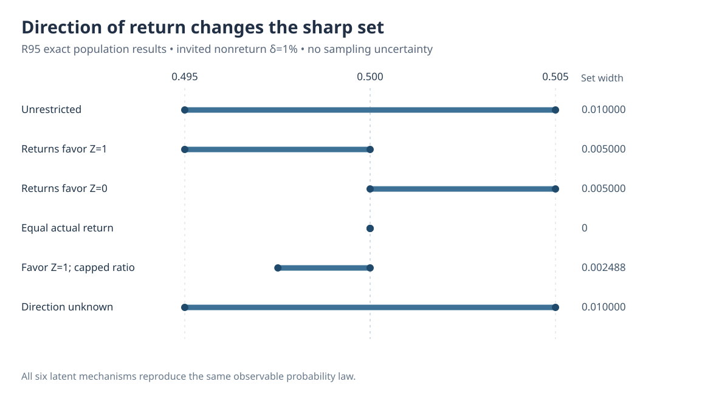
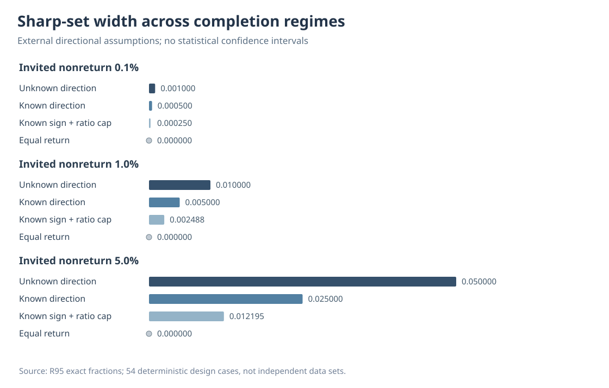

# Can the direction of selective audit return identify missing outcomes?

*W3 R95 · Exact binary population sensitivity analysis · 23 October 2026*

## The question after R93 and R94

The [R93 observational-equivalence proof](w3-r93-exact-observed-law-nonidentification.md) showed that randomized audit invitations and even 99.9% actual completion do not alone point-identify outcomes left unreturned. [R94](w3-r94-external-audit-completion-bounds.md) then derived how *externally supported numerical lower bounds* on completion probabilities could narrow the sharp binary population-mean set.

R95 tests a **weaker, qualitative assumption**: what if an independent study or physical measurement model justified knowing only which binary outcome is *at least as likely* to return? Can the direction of outcome-selective audit completion narrow the identification set without supplying a response probability?

The short answer is **yes, conditionally**, but merely saying there is some monotone direction **without knowing its sign provides no restriction at all**. Nothing in R95 establishes which direction holds in real eye-tracking data.

## Exact observable law

Within a fixed originally missing bounded binary stratum, define $p=P(Z=1)$ and actual return chances $c_0=P(R=1\mid I=1,Z=0)$, $c_1=P(R=1\mid I=1,Z=1)$. Known randomized invitation probability $g$ does not identify these latent completion probabilities. From completed returns we observe

$$
q_0=(1-p)c_0,\qquad q_1=pc_1,\qquad \delta=1-q_0-q_1.
$$

Without outcome-response assumptions, R93's sharp set is $p\in[q_1,1-q_0]$. A known monotone direction $c_1\ge c_0$ imposes

$$
\frac{q_1}{p}\ge\frac{q_0}{1-p}
\quad\Longleftrightarrow\quad
p\le\frac{q_1}{q_0+q_1}.
$$

The exact sharp region is therefore $[q_1,q_1/(q_0+q_1)]$. Reversing the externally known direction gives $[q_1/(q_0+q_1),1-q_0]$; assuming actual equality $c_0=c_1$ gives the shared endpoint alone. Finally, a numerical external cap $1\le c_1/c_0\le1+\delta$ raises the lower endpoint to $q_1/[q_1+(1+\delta)q_0]$.

All of these claims depend on which **externally stipulated** assumption is true, not on fitted missingness parameters.

## At 99% invited-record completion

Take the same frozen symmetric illustrative law as R93/R94, with $\delta=.01$, $q_0=q_1=.495$. The six R95 conditions are:

| Assumed shape of actual return | Sharp latent mean region | Width |
|---|---|---:|
| No restriction | [0.495, 0.505] | 0.010000 |
| Return more likely for $Z=1$ | [0.495, 0.500] | 0.005000 |
| Return more likely for $Z=0$ | [0.500, 0.505] | 0.005000 |
| Exactly equal return probabilities | [0.500, 0.500] | 0 |
| Return favors $Z=1$, ratio at most 1.01 | [0.497512, 0.500] | 0.002488 |
| Monotone but direction unknown | [0.495, 0.505] | 0.010000 |

**Figure 1.** Exact source-derived sharp *population* sets under different assumptions, not statistical confidence intervals. The returned observations have the **same probability law** in every scenario; the difference is entirely in the unverified latent directional restriction.

The unknown-direction region is the union of both directional sets, so it equals the unrestricted interval. Knowing that return is monotone in *some unspecified direction* does not distinguish those observationally equivalent mechanisms.

## Sensitivity to how much audit return fails

The prospective exact design fixes $\delta\in\{.001,.01,.05\}$ (actual invited completion 99.9%, 99%, 95%), $g\in\{.25,.5,1\}$, and six assumption regimes. This makes **54 deterministic rational parameterizations**, not 54 participants, datasets, simulation replications or evidence for sampling coverage.

In the symmetric observed law, known sign halves the unrestricted width from $\delta$ to $\delta/2$. An upper ratio cap $1+\delta$ gives width $\delta/[2(2+\delta)]$; exact equality gives zero width. All invitation rates yield the same conditional identified set.

**Figure 2.** Algebraic identification widths across three invited-response fractions. There is no Monte Carlo error bar because the experiment contains no random source sample.

## Independent original-archive verification

The original scientific [draft PR #462](https://github.com/stefanosbalaskas/eyetrajectoriespy/pull/462) passed [four dedicated exact-procedure jobs](https://github.com/stefanosbalaskas/eyetrajectoriespy/actions/runs/39872191344), archiving every one of the 54 deterministic source laws as [immutable artifact #12466408311](https://github.com/stefanosbalaskas/eyetrajectoriespy/actions/runs/39872191344/artifacts/12466408311).

A separate independently coded [R95-A draft auditor PR #463](https://github.com/stefanosbalaskas/eyetrajectoriespy/pull/463) derives the sharp sets by allocating the unreturned binary $Z=1$ mass rather than importing the original R95 formulas. Its independent evidence and exact original SHA256 replay are recorded in the [R95 evidence ledger](../development/w3-r95-original-independent-evidence-ledger.md).

## Interpretation and explicit boundaries

R95 establishes a **mathematical conditional-identification result** in a binary i.i.d. submodel. Neither monotone selection direction nor the relative success ratio is inferable from outcomes that remain missing, based on these returned data alone. Identification under an assumed sign is not empirical validation of that sign.

The result does not reconstruct true missing gaze trajectories, handle functional slopes or multitime dependent outcomes, supply finite-sample confidence intervals, or calibrate whole-function nominal 90% W3 confidence bands. See the [exact methods](w3-r95-monotone-return-sharp-set-methods.md). Research PRs remain draft/unmerged; issues [#289](https://github.com/stefanosbalaskas/eyetrajectoriespy/issues/289) and [#296](https://github.com/stefanosbalaskas/eyetrajectoriespy/issues/296) remain open. Stable 1.1.0, v1.2 release hold and the public API are unchanged.
