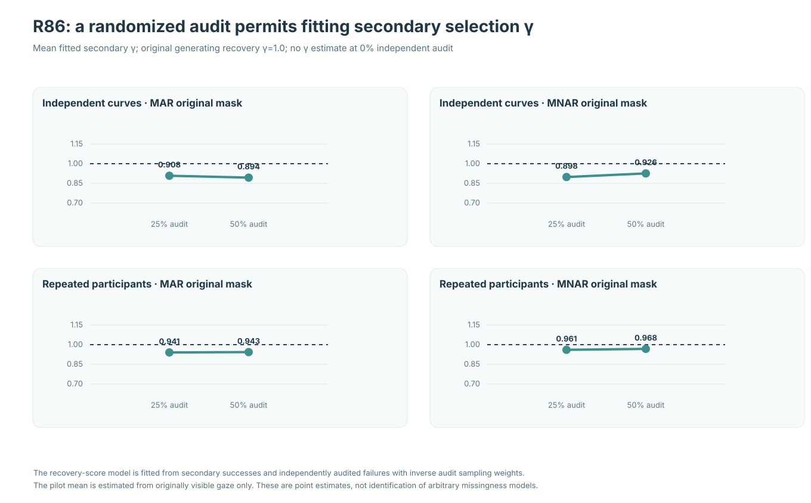
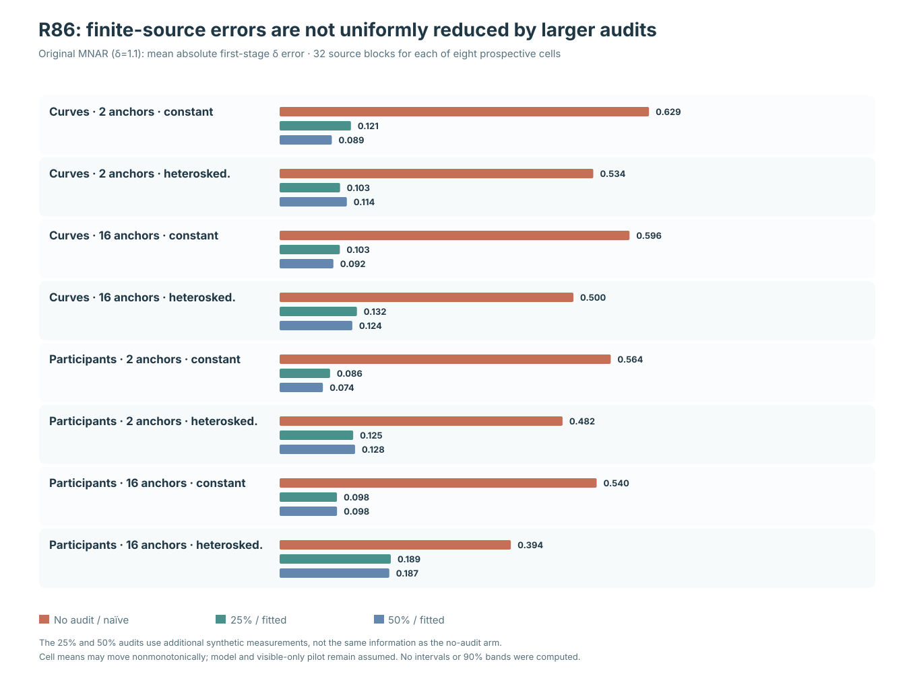

# Auditing the validator: randomized recovery of failures in outcome-selective gaze ascertainment

**Research article · 21 October 2026 · R86 original science and R86-A independent numerical audit**

!!! danger "A synthetic identification experiment, not a deployable gaze recovery method"
    Every outcome, missingness event, secondary validation failure and third-stage randomized recovery is simulated from complete synthetic gaze sources. The experiment does not demonstrate that lost historical eye-tracker samples can be remeasured. Its estimates depend on a frozen parametric selection family, a visible-only conditional-mean pilot and independently ascertained otherwise missing values. No confidence intervals or nominal-90% functional bands are validated; stable 1.1.0 remains unchanged, research issues #289 and #296 are OPEN, and version 1.2/PyPI is on RELEASE HOLD.

## Why the second measurement process matters

The [R82 observation-process study](w3-response-dependent-gaze-loss-r82.md) demonstrated that strong sample retention need not preserve independent predictor support at each functional position. [R83](w3-mnar-selection-sensitivity-r83.md) found that externally assumed MNAR coefficients can yield different slopes from the same observations without identifying the selection mechanism. [R84](w3-external-validation-mnar-identification-r84.md) introduced genuinely additional synthetic responses for a random subset of originally missing samples, allowing a restricted scalar selection coefficient to be fitted. [R85](w3-biased-validation-mnar-r85.md) then showed that an external validator's own outcome-selective failures can produce apparently MNAR first-stage estimates even when the generating original gaze process is MAR.

R85 evaluated an inaccessible true-propensity oracle. R86 asks whether an **independent randomized audit of outcomes missed by the secondary validator** can help identify that secondary failure mechanism within a specified selection model. This audit supplies true additional synthetic response information, not imputation, and is not available merely by fitting a more elaborate model to original incomplete gaze.

## Prospectively frozen new-source design

The [original R86 protocol](https://github.com/stefanosbalaskas/eyetrajectoriespy/blob/research/w3-r86-independent-audit-of-validation-failures-20261021/docs/development/w3-r86-prospective-random-audit-secondary-validation.md) froze all source and ascertainment streams before simulation outcomes. Each fixed design/support/variance cell comprises **32 new independent primitive source-generating blocks**. The design crosses 72 independent curves versus 36 independent participants with three correlated trials; 2 versus 16 signed influential predictor units at x=±4; and constant versus predictor-dependent unit variance. This yields **256 complete synthetic X/Y source-condition datasets** and two first-stage masks per source: original MAR (true selection coefficient delta=0) and MNAR (delta=1.1), totaling **512 paired source/mask conditions**.

The functional sources have 31 time positions, two coordinates, temporally and cross-coordinate correlated Gaussian trial innovations, shared Student-t5 radial effects per independent unit, and rare centered asymmetric shocks.

The original first-stage missingness logit is

$$
\operatorname{logit} P(M=1)
=-2.2+|x|/4+0.7t+0.2j+
\delta\tanh\{(Y-\mu_{\mathrm{true}})/.08\}.
$$

Among originally missing Y, a secondary validator recovers a sample with source-known probability

$$
r_{\mathrm{true}}(Y)=
\operatorname{logit}^{-1}\left[
\operatorname{logit}(.25)+
\tanh\{(Y-\mu_{\mathrm{true}})/.08\}
\right].
$$

The true generating conditional mean is never supplied to the observed-only fits. A separate third-stage audit randomly observes **0%, 25% or 50% of remaining secondary failures**, with nested samples. Consequently the probability that an originally missing outcome becomes observed under either recovery stage is

$$
\pi_q(Y)=q+(1-q)r(Y).
$$

Only 32 independent generating blocks exist per fixed source cell: the original source/mask/audit-strategy records are paired analyses, **not 4,608 independent experiments**.

## Three predeclared strategies

Each audit rate uses identical genuinely measured outcomes under three assumptions. The **naïve union** strategy assumes secondary recovery is constant .25, so union propensity is .25+.75q. The **audit-estimated** strategy uses the original-visible-only time/coordinate conditional-mean pilot, secondary recoveries as validation successes, and independently audited secondary failures as validation failures with inverse audit sampling weights. A two-parameter logistic score estimates secondary intercept and residual-dependence coefficient gamma; its fitted probability is then used in the union weight. At **q=0, gamma and the audit-fitted first-stage delta are explicitly unestimated**, rather than falsely identified. The **simulator-only oracle** uses the true secondary recovery probability for weighting, unavailable to a field analyst.

The first-stage scalar delta score uses original observed responses plus only genuinely recovered originally missing Y. Unrecovered responses never enter the fitted score or pilot. There is no participant-cluster covariance model or confidence-band construction.

## Results: the original MAR control no longer appears MNAR after randomized audit

*Figure 1.* Primary two-anchor heteroskedastic source. Each cell contains 32 independent primitive generating blocks. The dashed horizontal references are generating first-stage delta=0 for MAR or delta=1.1 for MNAR; source truth is not used for fitting.

| Original process | Audit q | Naïve fitted delta | Audit-fitted delta | Simulator oracle delta |
|---|---:|---:|---:|---:|
| Curves, MAR | 0% | +.657 | Not fitted | −.021 |
| Curves, MAR | 25% | +.290 | −.002 | −.003 |
| Curves, MAR | 50% | +.139 | +.003 | +.000 |
| Participants, MAR | 0% | +.668 | Not fitted | +.029 |
| Participants, MAR | 25% | +.294 | −.001 | +.008 |
| Participants, MAR | 50% | +.136 | −.003 | +.001 |
| Curves, MNAR | 0% | 1.634 | Not fitted | 1.007 |
| Curves, MNAR | 25% | 1.312 | 1.017 | 1.018 |
| Curves, MNAR | 50% | 1.154 | 1.008 | 1.010 |
| Participants, MNAR | 0% | 1.582 | Not fitted | .989 |
| Participants, MNAR | 25% | 1.269 | .979 | .986 |
| Participants, MNAR | 50% | 1.117 | .974 | .978 |

Under original MAR, naïve secondary-recovery weighting falsely produces a positive fitted first-stage coefficient near +.66 without an audit. At positive randomized audit fractions, fitting secondary recovery from new measured values gives source means near the generating zero. Under original MNAR, fitted estimates move towards the simulation oracle but remain somewhat below the true 1.1 in the adverse repeated-participant cell. These are **descriptive fitted coefficients**, not false-positive rates, coverage probabilities or proofs of consistent identification in real eye-tracking data.

## Estimating secondary selection itself

*Figure 2.* The secondary outcome-dependence coefficient is gamma=1.0 in the simulator. No audit-fitted gamma exists at q=0. At 25%/50% audit, source-mean gamma in the adverse curve design was .908/.894 (original MAR) and .898/.926 (original MNAR); in repeated participants it was .941/.943 (MAR) and .961/.968 (MNAR). All corresponding positive-audit fixed cells converged in 32/32 source blocks.

The residual offsets are compatible with finite samples and an originally visible-only pilot rather than the true conditional source mean. A larger audit does not necessarily reduce realized bias in these small source cells.

## Full factorial and error nonmonotonicity

*Figure 3.* Mean absolute fitted first-stage delta error with generating MNAR delta=1.1, over 32 independent primitive blocks per cell.

In the primary adverse curves, error was .534 with zero audit/naïve weighting, .103 with 25% audit-fitted secondary recovery and .114 with 50%. In the primary repeated participants, the values were .482, .125 and .128. Some other source cells likewise showed modest nonmonotonic changes between 25% and 50% audits. The zero-audit arm changes both available information and the weighting model relative to the fitted positive-audit arms; their differences are not controlled causal effects or uncertainty reductions.

## Independent numerical verification and unresolved applicability

The [original R86 scientific workflow #39639148930](https://github.com/stefanosbalaskas/eyetrajectoriespy/actions/runs/39639148930) passed **12/12 dedicated jobs**, preserving immutable [original archive #12365391336](https://github.com/stefanosbalaskas/eyetrajectoriespy/actions/runs/39639148930/artifacts/12365391336) pinned to scientific source checkout 21a3d42045f56d810d273c83f7e2be645a20160c.

The independently implemented [R86-A actual original-source replay #39640120223](https://github.com/stefanosbalaskas/eyetrajectoriespy/actions/runs/39640120223) passed **4/4 dedicated audit jobs**, preserving [independent evidence #12363264297](https://github.com/stefanosbalaskas/eyetrajectoriespy/actions/runs/39640120223/artifacts/12363264297). It reconstructed all **256 original X/Y sources, 512 first-stage masks and 4,608 source-strategy audit records**, source and mask SHA256, two independent random ascertainment streams, originally visible pilots, secondary alpha/gamma and first-stage delta roots. Its independent solver uses a multidimensional score root for recovery and Newton iteration for first-stage delta, rather than the original Newton/bisection sequence.

The result answers a tightly bounded scientific question: **independent ascertainment of secondary validation failures adds identifying information under an explicit synthetic selection law**. It does not show how to obtain the otherwise inaccessible historical gaze values in the field, identify arbitrary MNAR mechanisms, or calibrate functional uncertainty.

**Research implementations remain in draft [R86 PR #434](https://github.com/stefanosbalaskas/eyetrajectoriespy/pull/434) and [R86-A PR #435](https://github.com/stefanosbalaskas/eyetrajectoriespy/pull/435). W3 issues #289/#296 stay OPEN; stable package 1.1.0 and protected-main inference API are unchanged; version 1.2/PyPI RELEASE HOLD.**

[Methods companion](random-audit-of-validation-failures.md) · [Numerical evidence and original figures](../development/w3-r86-third-stage-audit-evidence-ledger.md)
