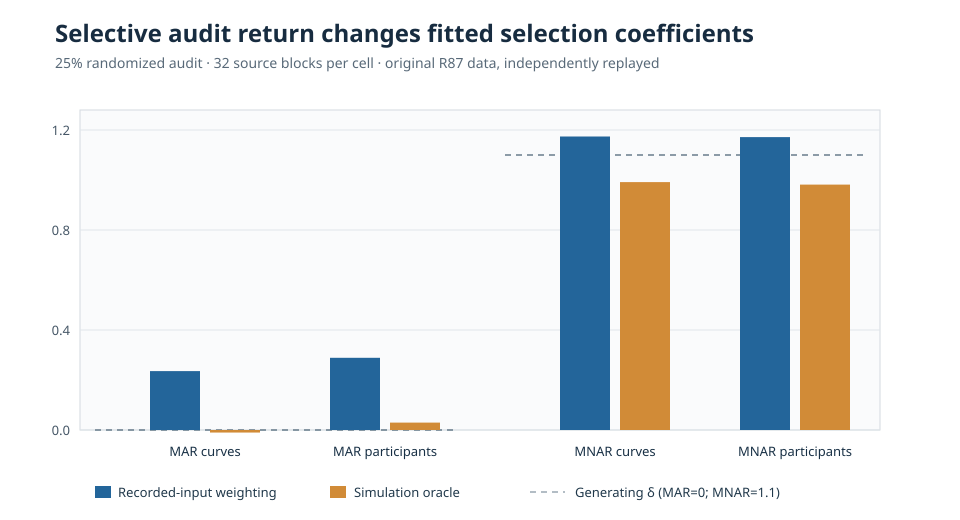

# When randomized gaze audits still fail: selection in the return process

*eyetrajectoriespy research article · W3 R87/R87-A · 21 October 2026 · simulated data only*

## Research question

Can random assignment of otherwise unavailable gaze outcomes to a validation audit identify a prespecified missingness mechanism when not all audited participants or curves actually return an outcome? **Not by random assignment alone.** The return of the assigned measurement can create a further selective observation stage. This research is about statistical identification assumptions and synthetic point-estimate diagnostics, **not** recovering historical sensor records.

## Design and audit

The prospectively frozen [R87 original research PR](https://github.com/stefanosbalaskas/eyetrajectoriespy/pull/438) generated 32 independent source blocks within each fixed design cell: independent curves versus participants with repeated trials, MAR versus MNAR first-stage loss, and paired audit-assignment fractions 0.25 versus 0.50. The archived source contains 64 complete X/Y generating conditions, 128 first-stage masks and 2,304 repeated-method analysis records. Three return mechanisms were compared: all assigned outcomes return; return depends on recorded predictors/time; and return additionally depends on an unobserved outcome. All fitted approaches within each cell used the same actually returned outcomes.

Three propensity treatments distinguished assignment probability alone, estimated recorded-input return probability, and a **simulator-only outcome-aware oracle**. An oracle that observes the hidden outcome is **not available** in ordinary observational gaze studies.

The original [science workflow](https://github.com/stefanosbalaskas/eyetrajectoriespy/actions/runs/39646565487) completed all 12 dedicated jobs. The independently implemented [R87-A audit](https://github.com/stefanosbalaskas/eyetrajectoriespy/pull/439) subsequently passed [all four mandatory audit jobs](https://github.com/stefanosbalaskas/eyetrajectoriespy/actions/runs/39648775920), including its exact original-archive replay with independent provenance, coefficient and refusal checks. This is a successful **independent numerical reconstruction**, not a proof of statistical identification.

## Observed source-estimation contrasts

The following are **original-source fitted mean first-stage selection coefficients** for 25% randomized audit assignment and outcome-dependent actual return, averaged across 32 independent source blocks per cell. The separately implemented replay passed; numbers are descriptive point estimates and do not include sampling confidence intervals.

| First-stage law | Unit | Recorded-input weighting | Simulator-only oracle | Generating δ |
|---|---|---:|---:|---:|
| MAR | Independent curves | +0.2356 | −0.0102 | 0 |
| MAR | Repeated-trial participants | +0.2889 | +0.0296 | 0 |
| MNAR | Independent curves | +1.1740 | +0.9915 | 1.1 |
| MNAR | Repeated-trial participants | +1.1716 | +0.9817 | 1.1 |

**Figure 1.** Estimates under outcome-selective third-stage audit nonresponse. Dashed horizontal references show the cell-specific generating δ; visually different magnitudes across MAR and MNAR cells must not be interpreted as separate independent sample sizes. The oracle is an *unavailable-in-practice simulation comparator*, not a recommended estimator.

In MAR cells, the recorded-input approach returned a nonzero average selection coefficient despite a zero generating coefficient. In MNAR cells the recorded-input and oracle approaches also diverged. These comparisons support a **failure-mode finding for the specified simulated outcome-dependent return law**, rather than a universal bias estimate or a correction guaranteed to work in applications.

## Mechanism and implications

Let A denote randomized assignment to audit, R actual outcome return conditional on assignment, Y the missing outcome and X observed predictors/time. Randomizing A does not force R to be independent of Y conditional on X and A. Consequently, modelling the audit using only A and X may leave outcome-dependent selection in the sample of recovered outcomes. The synthetic oracle can diagnose this failure because the simulator retains Y for observations that did not return.

In applied eye tracking, auditing must report assignment counts **and** successful return counts, reasons for nonreturn, predictors of return, time structure and the unverifiable assumptions required for any weighting analysis. Random audit assignment should not be described as an automatically identified solution to MNAR missingness.

## Scope, reproducibility and release status

The original R87 source is isolated in [draft PR #438](https://github.com/stefanosbalaskas/eyetrajectoriespy/pull/438). The independent numerical/provenance audit is isolated in [draft PR #439](https://github.com/stefanosbalaskas/eyetrajectoriespy/pull/439). The separately replayed source uses **32 independent primitive source blocks per fixed cell**; the 2,304 rows are repeated method evaluations, **not** 2,304 independent datasets.

This study does **not** identify unrestricted MNAR, estimate cluster-valid uncertainty for these tabulated contrasts, recover genuinely missing historical gaze, or establish valid nominal 90% simultaneous functional slope bands. The [simultaneous-band blocker #289](https://github.com/stefanosbalaskas/eyetrajectoriespy/issues/289) and [response-dependent loss blocker #296](https://github.com/stefanosbalaskas/eyetrajectoriespy/issues/296) remain open. Package 1.1.0 and the production API are unchanged; **1.2 release and PyPI publication remain on hold**.
