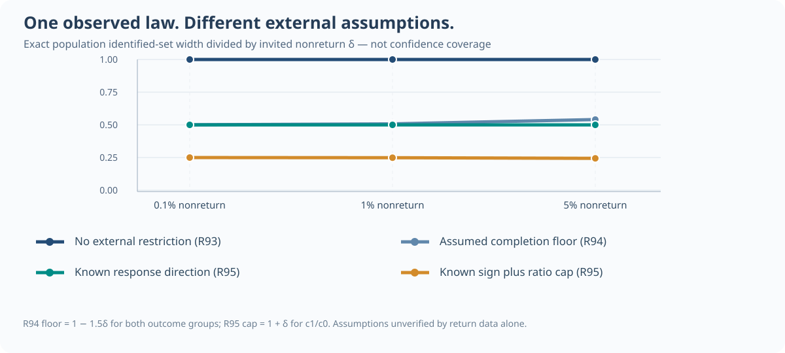

# Why narrower missing-gaze bounds need information from outside the returned data

It is tempting to treat high audit completion as evidence that missing outcomes can be accurately reconstructed. **R93 shows why that is insufficient:** different latent outcome populations can generate exactly the same observable audit-return distribution. R94 and R95 ask what *additional*, externally justified knowledge would change that result.

## Compare assumptions on a shared observed law

Within the deliberately simple frozen symmetric binary law, let invited nonreturn be $delta$, so $q_0=q_1=(1-delta)/2$. The population mean $p=P(Z=1)$ has different sharp sets depending **entirely** on an externally asserted restriction.

| Extra externally justified information | Width of sharp population set | Width divided by nonreturn $delta$ |
| --- | --- | --- |
| Nothing (R93) | $delta$ | $1$ |
| Both outcome-specific completion rates at least $1-1.5delta$ (R94 example) | $delta/[2(1-1.5delta)]$ | $1/[2(1-1.5delta)]$ |
| Actual return rate for $Z=1$ at least that for $Z=0$ (R95) | $delta/2$ | $1/2$ |
| Same known direction **and** return-rate ratio at most $1+delta$ (R95) | $delta/[2(2+delta)]$ | $1/[2(2+delta)]$ |
| Exactly equal return rates by outcome (R95) | $0$ | $0$ |

**Figure.** Original algebraic R93–R95 width formulae evaluated at $deltain{.001,.01,.05}$. All scenarios use the *same observed return law* but make **different latent assumptions**. A narrower bar or curve is not an empirical accuracy improvement, not a preferred estimator and not a confidence interval.

## What evidence would support a claim?

**Completion floors (R94)** require independently warranted minimum actual return probabilities for *each* latent outcome. Observed returned cases do not validate those floors, because the unreturned outcomes remain unknown.

**Return direction (R95)** requires credible external knowledge of which latent group returns at least as often. Unknown monotone direction is merely the union of both possibilities and leaves the full R93 set unchanged.

**Equality of actual completion (R95)** is a powerful, restrictive assumption. The resulting singleton is a property of the assumed population model—not empirical proof of equality or a calibrated sample estimate.

More simulations under the *same observed event law* cannot distinguish observationally equivalent latent mechanisms without new information. A field study seeking narrower, defensible bounds must document genuinely independent ascertainment, physically credible return guarantees or scientifically warranted restrictions, with uncertainty handled separately.

## Two distinct uncertainties

An **identified set** characterizes which *population parameter* values remain compatible with an observed law and assumed model. A **confidence region** accounts for finite-sample variability in estimating that observed law. Even a sharp exact population interval is not automatically a valid 90% statistical interval or functional band.

Read [R93 exact observational equivalence](w3-r93-exact-observed-law-nonidentification.md), [R94 completion floors](w3-r94-external-audit-completion-bounds.md), [R95 known response direction](w3-r95-monotone-audit-return-identification.md), and the [original/independent evidence ledgers](../research/studies.md). Nothing here qualifies the unresolved W3 simultaneous-band inference [#289](https://github.com/stefanosbalaskas/eyetrajectoriespy/issues/289) or real-gaze missingness [#296](https://github.com/stefanosbalaskas/eyetrajectoriespy/issues/296).
