# Original experimental research figures

!!! warning "Interpretation and provenance"
    These are **original source-verified research SVG assets**; the earlier figures were copied from their named draft branches and the newer long-chain plot was constructed from the original retained scientific case results, not generic stock illustrations. They visualize simulation evidence, not results from human-subject recordings. Their presence here does not make the underlying experimental methods available in the stable 1.1.0 installation.

## Sparse-group inference F1

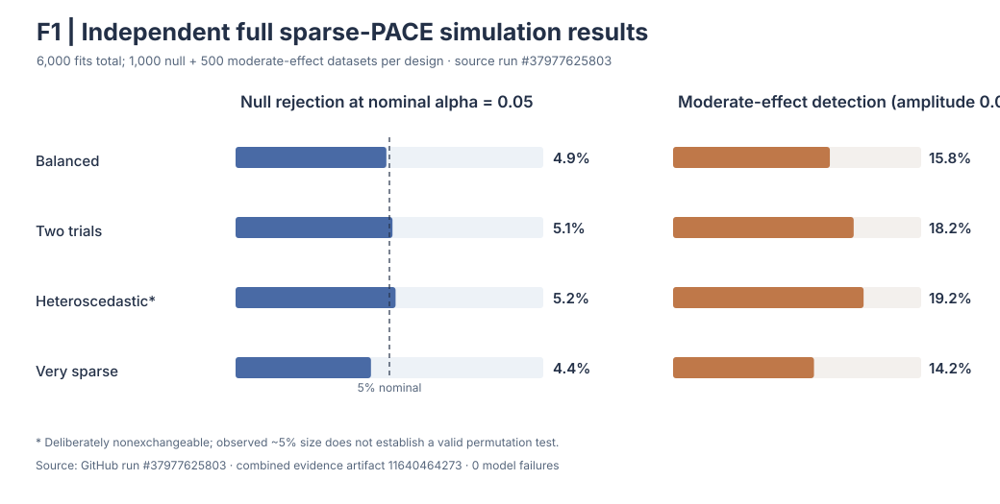

[Independent fitted F1 null/power study](f1-high-precision-native-null-power.md) · [Source run #37977625803](https://github.com/stefanosbalaskas/eyetrajectoriespy/actions/runs/37977625803)

## Bayesian B6/B7

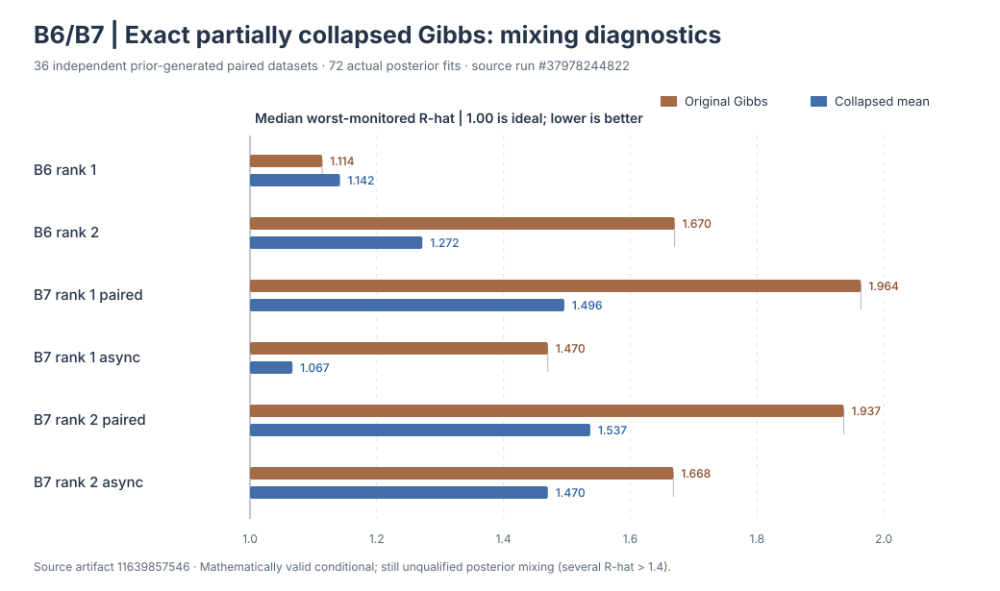

[Exact partially collapsed population-mean experiment](b6-b7-exact-collapsed-mean-gibbs.md)

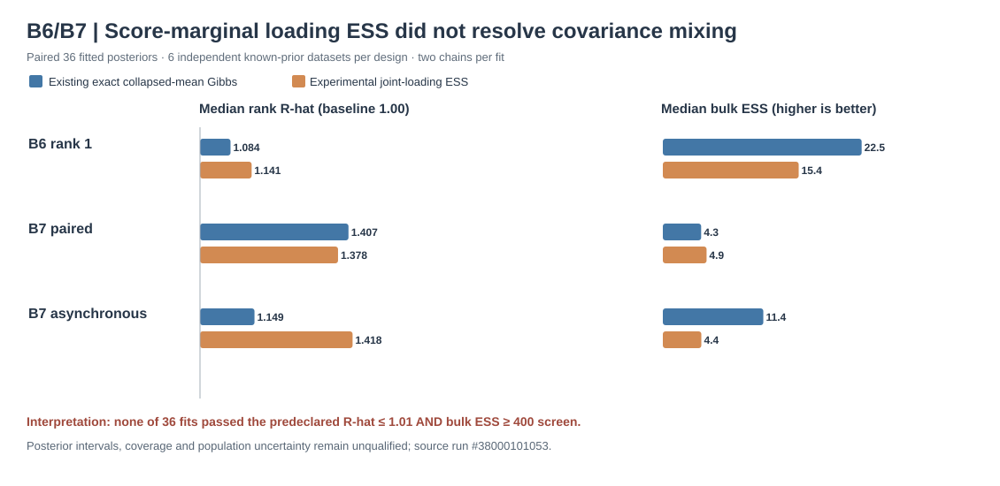

[Negative joint-loading sampler experiment](b6-b7-joint-score-marginal-loading-ess.md) · [Original source #38000101053](https://github.com/stefanosbalaskas/eyetrajectoriespy/actions/runs/38000101053)

### Longer-chain independent covariance reference: nine source fits

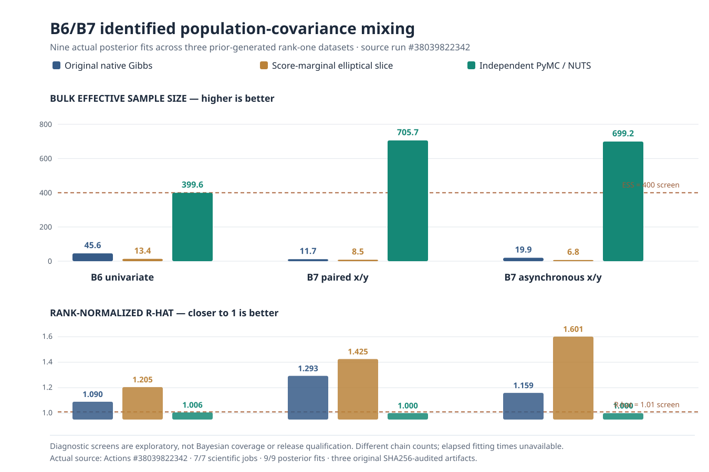

[Full original-source study, B6/B7 results and limitations](b6-b7-longchain-identified-covariance-geometry.md) · [Original workflow #38039822342](https://github.com/stefanosbalaskas/eyetrajectoriespy/actions/runs/38039822342) · Original artifacts: `11665746776`, `11665707552`, `11665607799`.

*This added scientific SVG is source-accurately constructed from the nine original fitted case results; it is not an independently collected dataset and does not establish posterior coverage.*

### Four-chain independent reference, two fresh datasets per rank-one design

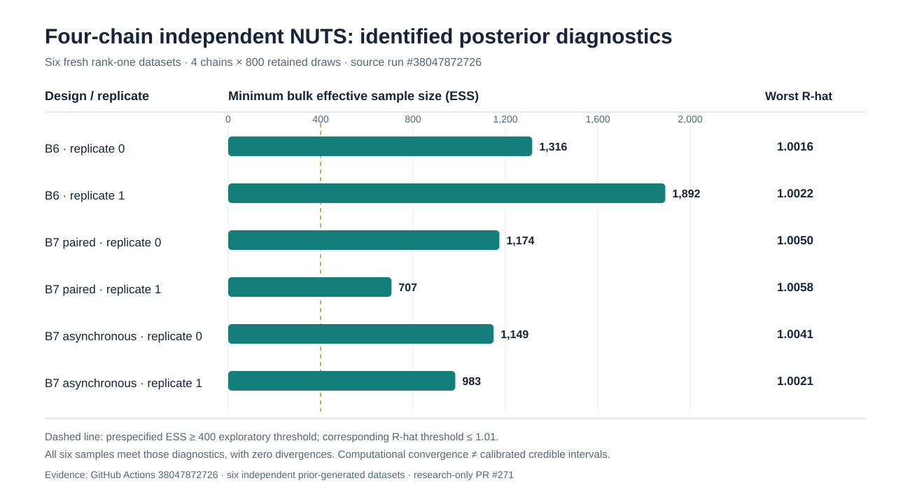

[Six-fit source results, full provenance and unqualified inference limits](b6-b7-four-chain-nuts-r1-reference.md) · [Original workflow #38047872726](https://github.com/stefanosbalaskas/eyetrajectoriespy/actions/runs/38047872726).

*All six four-chain fits passed the exploratory mixing diagnostics; this is not evidence of 90% interval coverage or rank-two validity. The plot depicts one rank-one fit per replicate (six independently generated datasets), not independent posterior interval calibration.*

### Rank-two actual PyMC log posterior and automatic-gradient contract (R2)

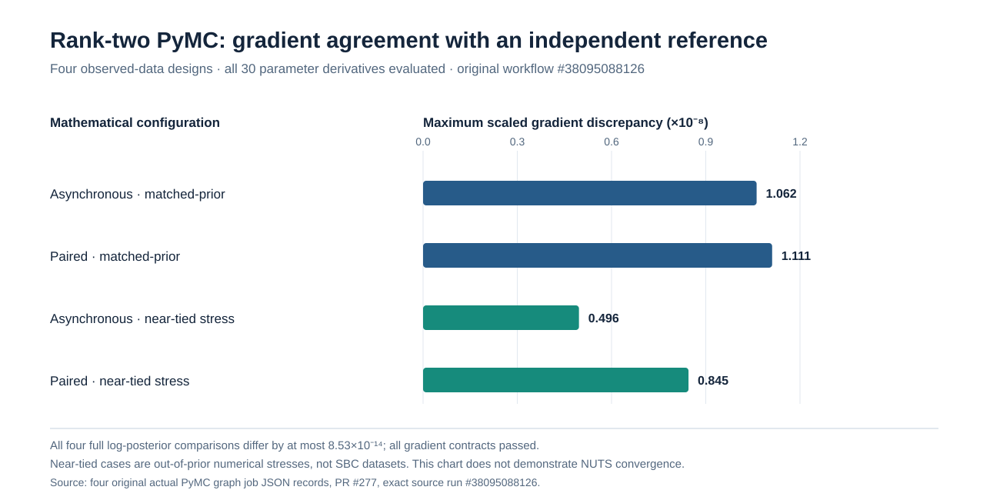

[Source-verified mathematical comparisons and four artifact identifiers](b6-b7-rank2-pymc-r2-research-protocol.md) · [Original scientific workflow #38095088126](https://github.com/stefanosbalaskas/eyetrajectoriespy/actions/runs/38095088126).

*This is an original plot of the four actual source-run numerical derivative comparisons. It is not a completed rank-two NUTS fit, inference validation, or an independent human eye-tracking study.*

### B6 SBC R2: same-data computational-screen rescue, not new calibration data

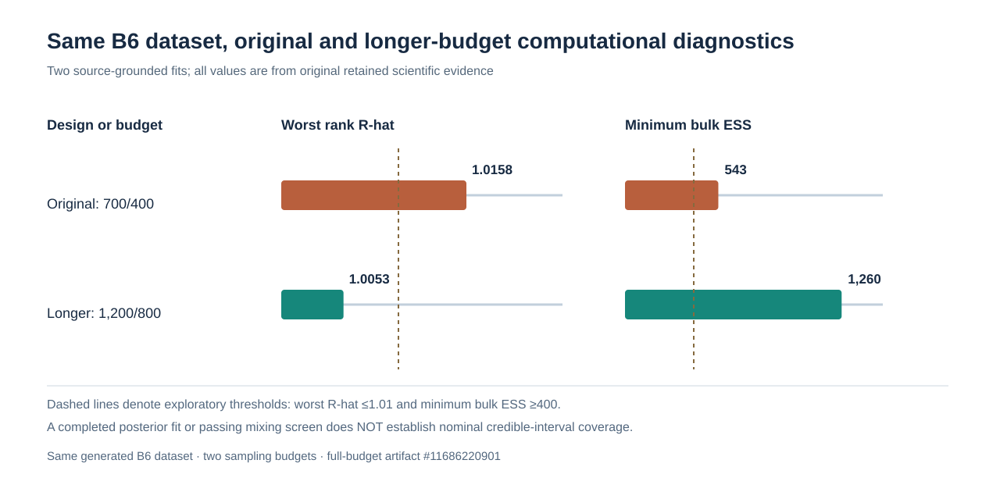

[Source B6 longer-budget refit and unchanged stage-zero failure](b6-rank1-sbc-r2-same-dataset-evidence.md) · [Original workflow #38095220518](https://github.com/stefanosbalaskas/eyetrajectoriespy/actions/runs/38095220518).

*The same prior-generated replicate is used twice. Do not count the longer refit as another independent SBC dataset or interpret its 90% interval inclusion as repeated coverage.*

### Rank-two NUTS R3: first real posterior computation on paired and asynchronous designs

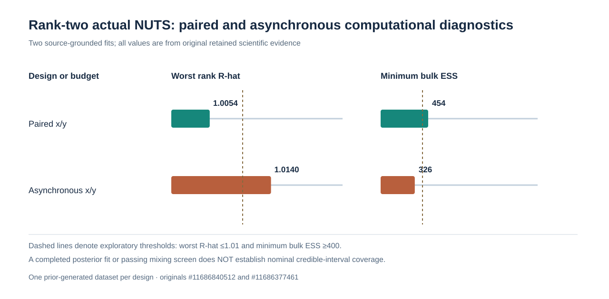

[Rank-two paired-versus-asynchronous pilot and numerical failure localization](b6-b7-rank2-four-chain-nuts-r3-evidence.md) · [Original scientific workflow #38096271285](https://github.com/stefanosbalaskas/eyetrajectoriespy/actions/runs/38096271285).

*Both fits completed; all six population-mean functionals in the asynchronous dataset failed an exploratory screen, while its nine covariance functionals passed. One dataset per design cannot establish a general asynchronous-data effect or interval calibration.*

### Rank-one prior-SBC pilot: original four-dataset midpoint ranks

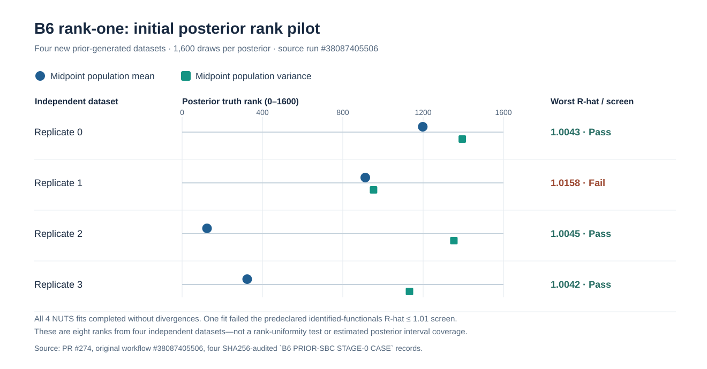

[Four-dataset SBC stage-0 report, original ranks and diagnostic failure](b6-rank1-prior-sbc-stage0.md) · [Source workflow #38087405506](https://github.com/stefanosbalaskas/eyetrajectoriespy/actions/runs/38087405506).

*The four datasets are insufficient for rank-uniformity or interval-coverage claims. One completed posterior fit failed the exploratory computational convergence screen; that failure is explicitly shown. The [rank-two mathematical validation](b6-b7-rank2-marginal-mathematics.md) is presented as a source-audited numerical contract, without an invented discrepancy plot because exact case-level differences must be read from the retained source artifacts.*

## F5 change-point null behavior

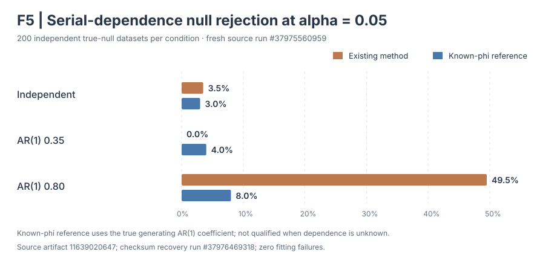

[External-baseline dependence testing](independent-core-computation-and-f5-ar1-reference.md)

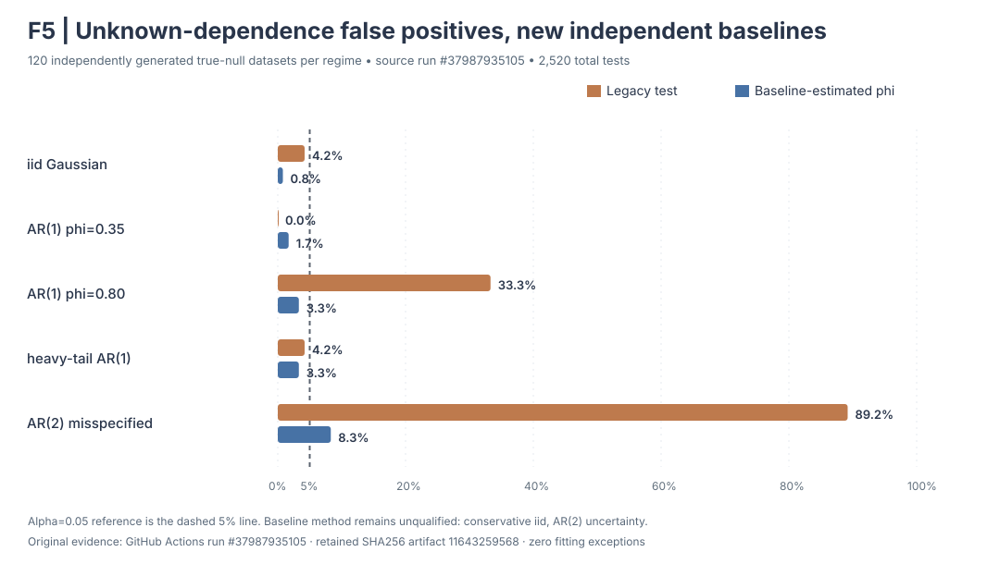

[Unknown-AR(1) external-baseline study](f5-independent-baseline-unknown-phi.md)

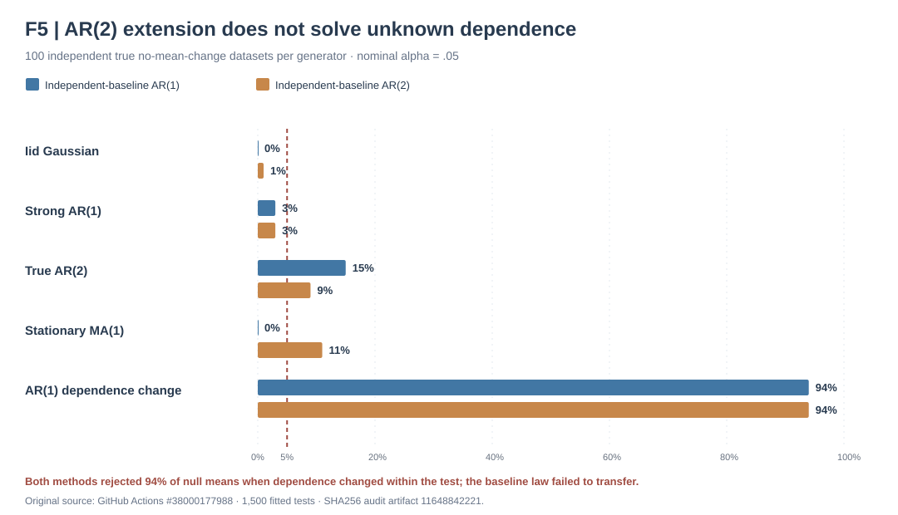

[AR(2) / MA(1) / nonstationary falsification](f5-independent-baseline-ar2-model-falsification.md) · [Source run #38000177988](https://github.com/stefanosbalaskas/eyetrajectoriespy/actions/runs/38000177988)

## W3 original known-truth functional regression validation

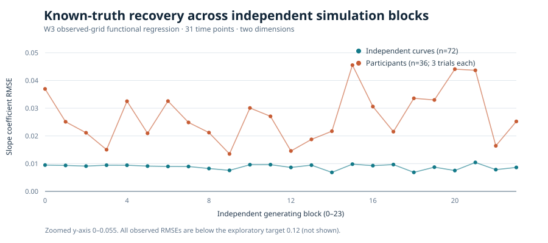

[Original W3 source-audited results, exploratory target, and study limits](w3-functional-regression-known-truth-results.md) · [Scientific workflow #38173426113](https://github.com/stefanosbalaskas/eyetrajectoriespy/actions/runs/38173426113) (source artifact `11715355738`).

*All 48 workflow fits completed across 24 generating seed blocks. The plotted values are original case-level recovery RMSE, not empirical eye-tracking recordings. Curve- and participant-level inference units have different simulated dependence structures; exact agreement with a numerical OLS oracle does not qualify statistical intervals.*

## W3 simultaneous-band falsification and leverage support (R71–R76)

The first new figure compares original separate source experiments (32 independent generating blocks per plotted condition) with a generating-law Gaussian benchmark. It is **not** a pooled estimator comparison or human-gaze result. [Read the article](../articles/when-w3-simultaneous-bands-undercover.md).

The R76 plots reproduce source-audited **2, 4, 8 and 16 separately independent ±4 predictor anchor** conditions using 32 independently generated blocks per design and anchor count. Source cases and 999-draw conditional bootstrap maxima are not independent replication counts. [R76 article](../articles/how-independent-leverage-support-affects-coverage.md) · [Full figure/count/source ledger](w3-r70-r76-evidence-plot-gallery.md) · [Original evidence and independent R76-A replay](https://github.com/stefanosbalaskas/eyetrajectoriespy/pull/403).

***All plotted confidence-band methods remain unqualified for general nominal coverage and W3 inference blocker #289 is open.***

## R77 — prospectively frozen estimated functional covariance regularization

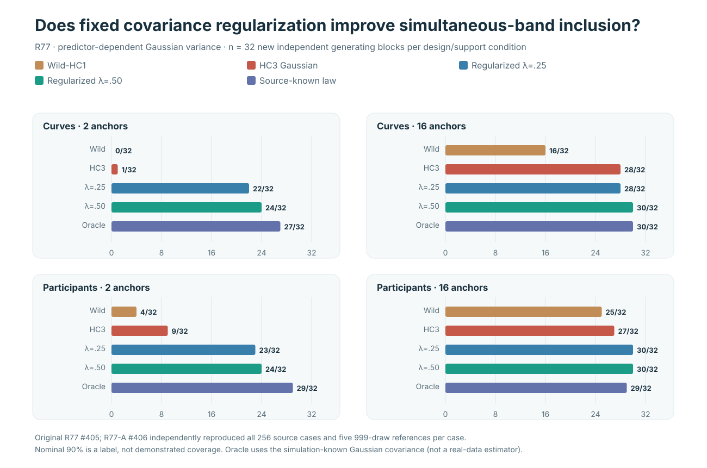

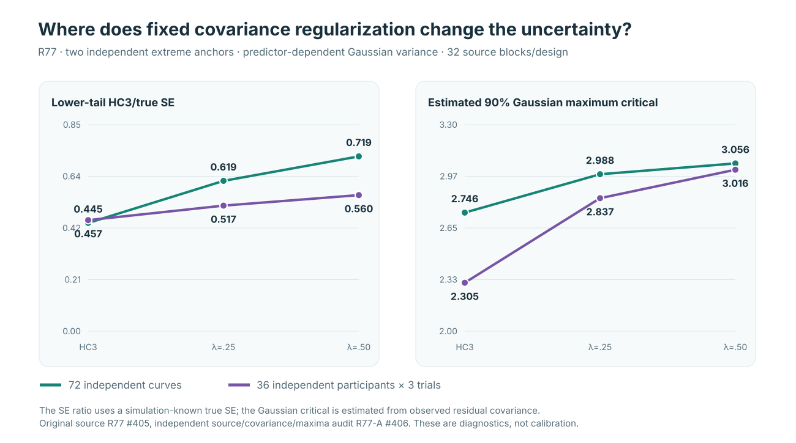

The two additional scientific SVGs depict **original new-source R77 computations independently reconstructed in R77-A**: 256/256 accepted synthetic Gaussian source cases, 1,278,720 original 999-draw maximum-statistic values, zero refusals, and a true unit of independence of 32 generating blocks per condition. Strengths λ=.25/.50 and a seven-time-point smoothing target were frozen before these results. These figures **do not** establish general nominal-90% calibration or product qualification. [Read the R77 research article](../articles/covariance-regularization-and-w3-coverage.md) · [R77 science](https://github.com/stefanosbalaskas/eyetrajectoriespy/actions/runs/39403101425) · [R77-A independent audit](https://github.com/stefanosbalaskas/eyetrajectoriespy/actions/runs/39403655264).

## R78 — independently audited temporal covariance robustness

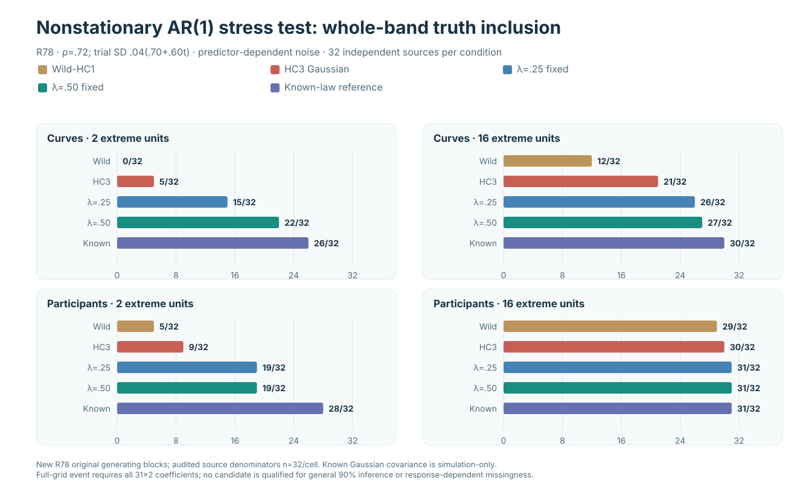

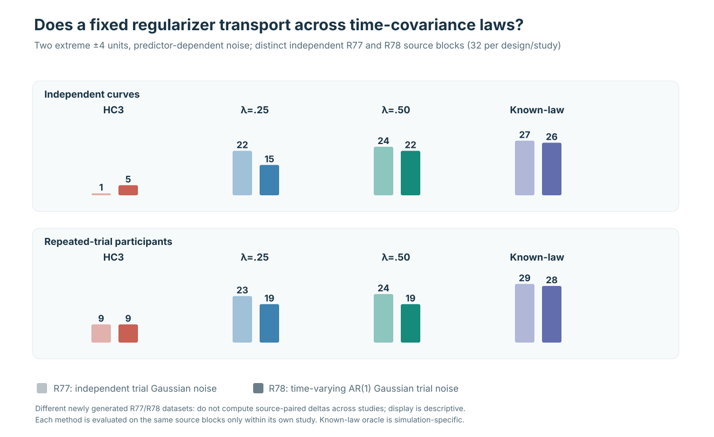

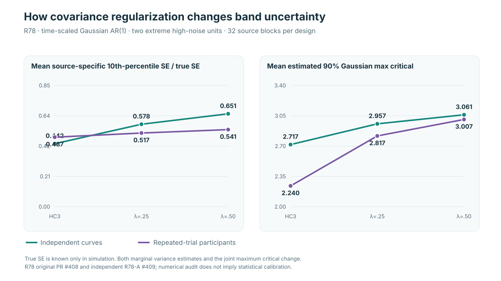

These new scientific figures retain source-level **n=32 independently generated primitive blocks per condition** and separate the Gaussian time-independent R77 source experiment from the **new Gaussian time-scaled AR(1) R78** stress. R78 original [12/12 science](https://github.com/stefanosbalaskas/eyetrajectoriespy/actions/runs/39477000929) and R78-A independent [4/4 source-audit jobs](https://github.com/stefanosbalaskas/eyetrajectoriespy/actions/runs/39477446946) verify **256/256 original source cases, 0 refusals and 1,278,720 original reference maxima**. The generating covariance remains **simulation-known only**, no candidate is generally nominal-90%-calibrated, and gaze loss/non-Gaussian errors remain untested here. [Read R78 article](../articles/w3-temporal-covariance-robustness-r78.md) · [Exact numeric plot ledger](w3-r77-r78-temporal-covariance-figure-ledger.md).

## R79: nonseparable cross-coordinate Gaussian covariance

All three original scientific figures are grounded in the [R79 12/12 original source workflow](https://github.com/stefanosbalaskas/eyetrajectoriespy/actions/runs/39483619384) and the separate [R79-A 4/4 mandatory independent source audit](https://github.com/stefanosbalaskas/eyetrajectoriespy/actions/runs/39483939543): **256/256 source cases, zero refusals, 1,278,720 original maximum statistics**, and 32 independently generated primitive blocks per design/support/variance condition. Candidate λ=.25/.50 values remain frozen, not selected from observed source inclusion. Fully synthetic Gaussian data, no MNAR or general coverage qualification. [Scientific article](../articles/w3-nonseparable-coordinate-covariance-r79.md) · [Detailed count/source ledger](w3-r79-nonseparable-covariance-evidence-ledger.md).

## R80: independent-unit Student-t5 heavy-tail Gaussian scale mixture

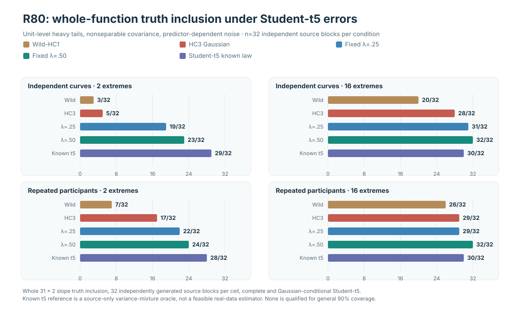

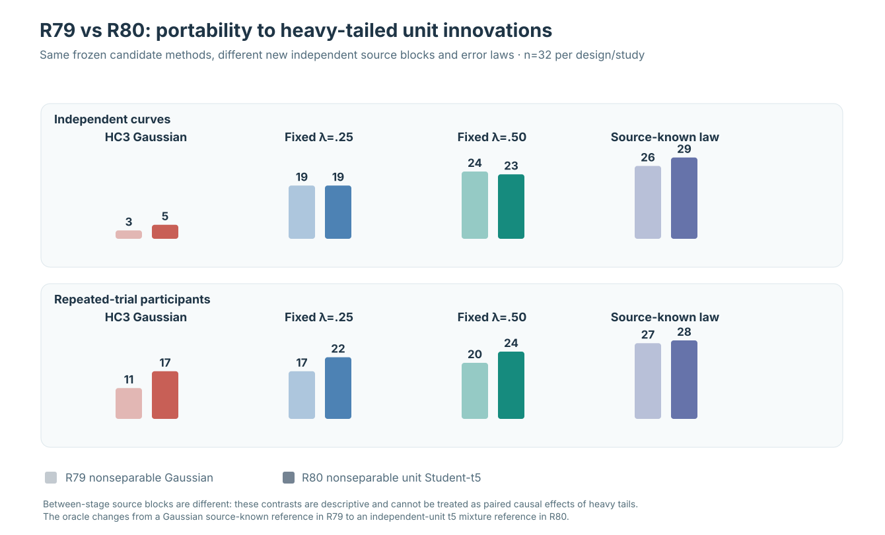

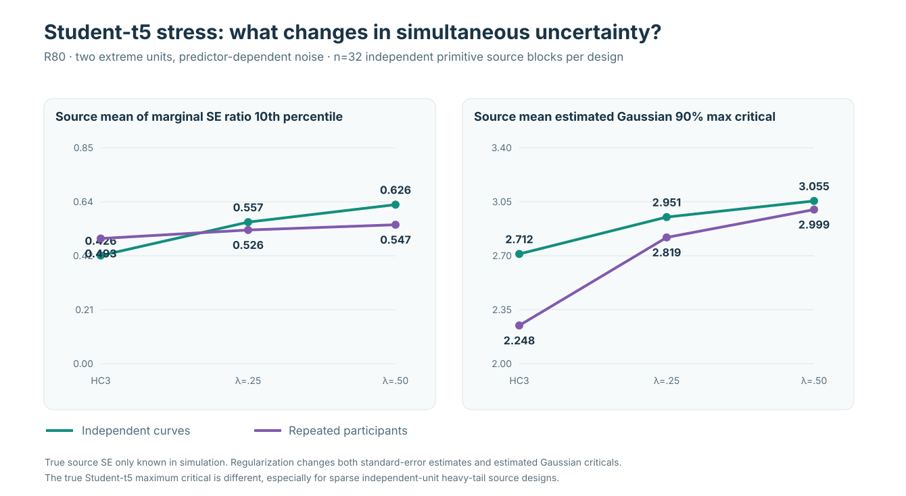

The new R80 original SVGs preserve **32 independent primitive Gaussian-conditional Student-t5 source blocks per cell**, 256/256 attempted and accepted factorial cases, and **1,278,720 original conditional maximum values** verified by separately coded source replay. [R80 original workflow #39487449656](https://github.com/stefanosbalaskas/eyetrajectoriespy/actions/runs/39487449656) **12/12 science PASS**; [independent R80-A actual archive #39487811433](https://github.com/stefanosbalaskas/eyetrajectoriespy/actions/runs/39487811433) **4/4 audit PASS**. The source-known Student-t5 mixture benchmark is available only in simulation, not a Gaussian observed-data estimator. **No general 90% calibration, no authentic gaze recordings, no MNAR claim**. [Read R80 article](../articles/w3-student-t5-heavy-tail-inference-r80.md) · [Figure provenance](w3-r80-student-t5-evidence-ledger.md).

## R81: asymmetrically contaminated Student-t5 independent units

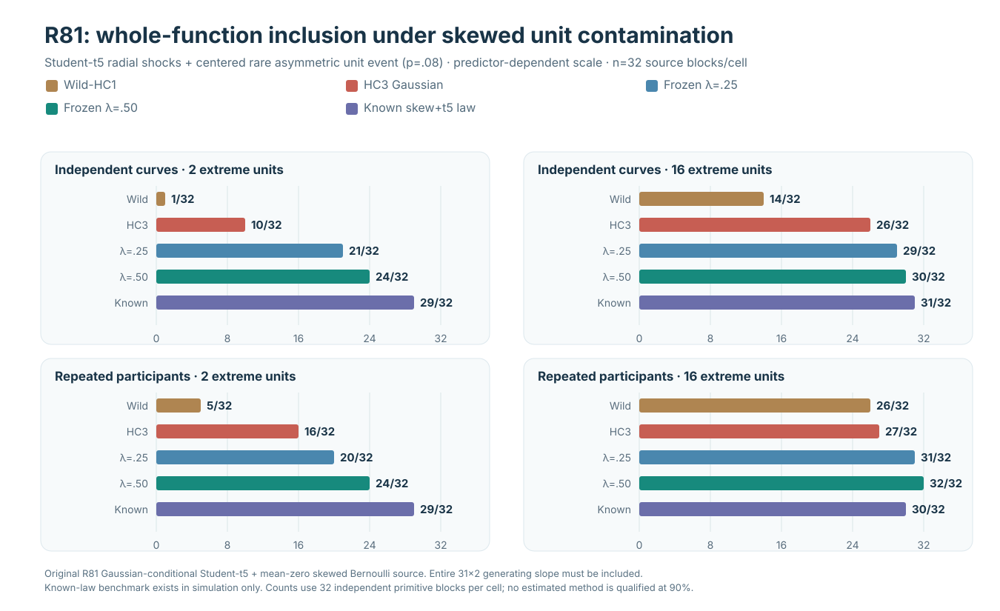

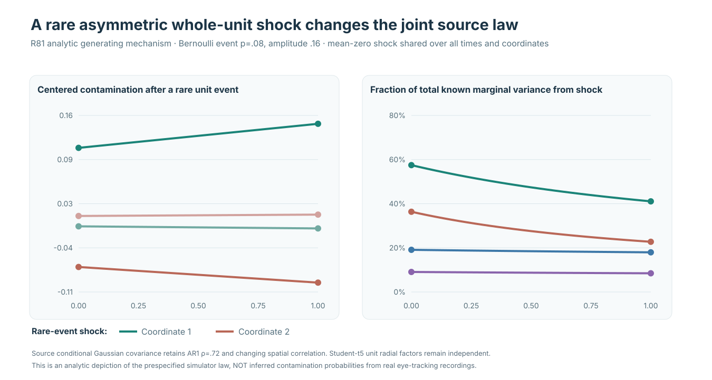

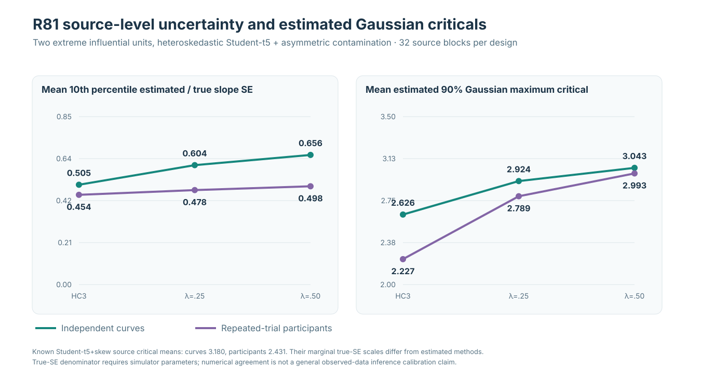

The original [R81 scientific run #39490888383](https://github.com/stefanosbalaskas/eyetrajectoriespy/actions/runs/39490888383) passed **12/12** original science jobs; separately coded [R81-A original archive audit #39491187099](https://github.com/stefanosbalaskas/eyetrajectoriespy/actions/runs/39491187099) passed **4/4**. Each of the **256/256 original new Student-t5 + centered skew Bernoulli X/Y source cases, zero refusals and all 1,278,720 conditional reference maxima** were independently replayed. Source n=32 **independent primitive generating blocks per fixed condition**. Frozen λ=.25/.50 methods are not nominal-90%-qualified; true Bernoulli contamination parameters are simulator-only, no field recordings or MNAR. [Full scientific article](../articles/w3-skew-unit-contamination-r81.md) · [Numerical figure/source ledger](w3-r81-skewed-unit-evidence-ledger.md).

## R82: complete/MCAR/MAR/MNAR observation-process falsification

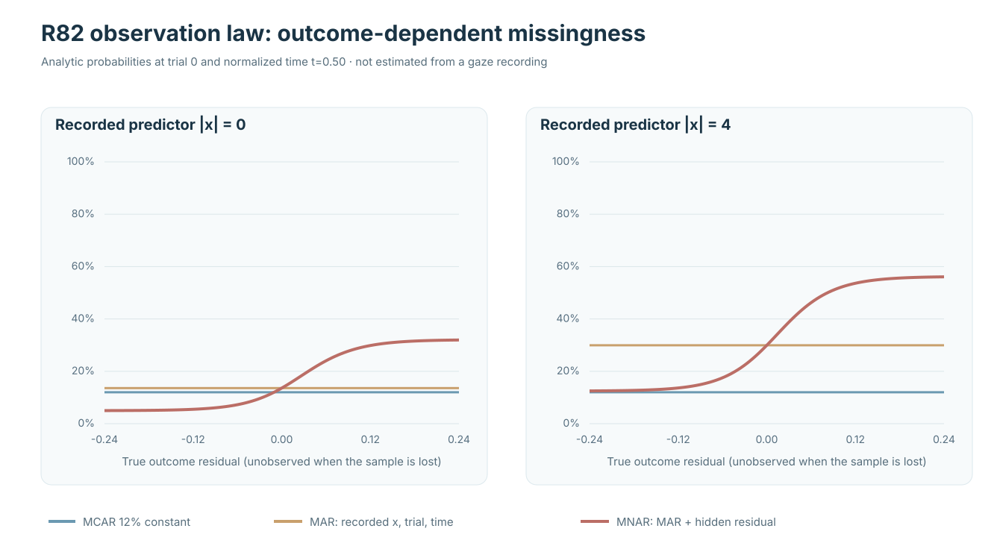

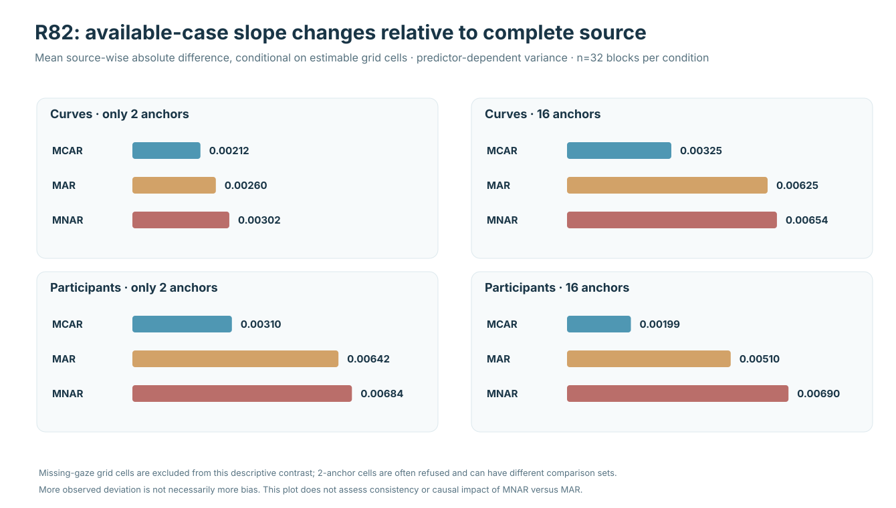

The original [R82 science workflow #39571308151](https://github.com/stefanosbalaskas/eyetrajectoriespy/actions/runs/39571308151) passed **12/12 dedicated source jobs**, and [independent original-archive replay #39572315409](https://github.com/stefanosbalaskas/eyetrajectoriespy/actions/runs/39572315409) passed **4/4**. Complete 256 original X/Y source conditions and all 1,024 paired MCAR/MAR/MNAR masks and grid diagnostics independently regenerated; **32 new independent source blocks per design/support/variance cell**. Under primary two-anchor heteroskedastic curve MNAR, **83.1% observed samples and 33.56/62 refused grid positions** coexist. This is *not* an MNAR correction or confidence band; public native missingness rejection is preserved, #289/#296 OPEN, version 1.2 HOLD. [Full article](../articles/w3-response-dependent-gaze-loss-r82.md) · [Evidence/figure ledger](w3-r82-observation-process-evidence-ledger.md).

## Reproducible provenance

These figures are version-controlled scientific assets in the research PRs, embedded **without regenerating simulated results using a different source state**. For source dataset counts, original workflow artifacts and SHA256 audit evidence, consult the [scientific dashboard](research-scientific-dashboard.md).

Figures for earlier E1–E4 workflows remain available through the existing [experimental gallery](../methods/experimental-e1-e4-gallery.md). Other proposed B5–B10 or F1–F6 demonstrations that lack an original committed SVG are not represented here as if they were completed research figures.
