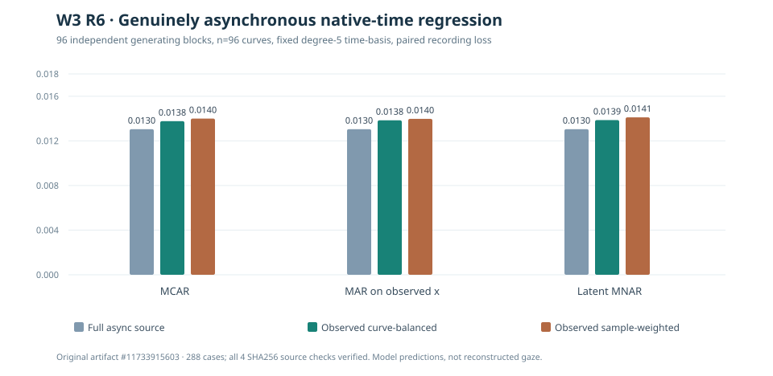
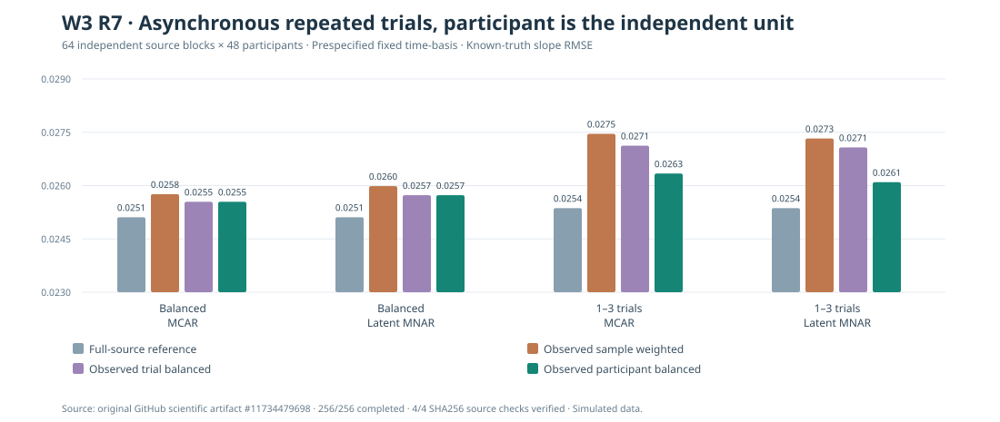
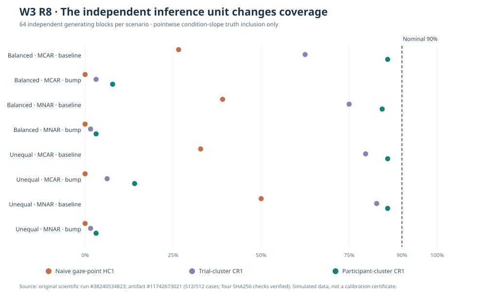
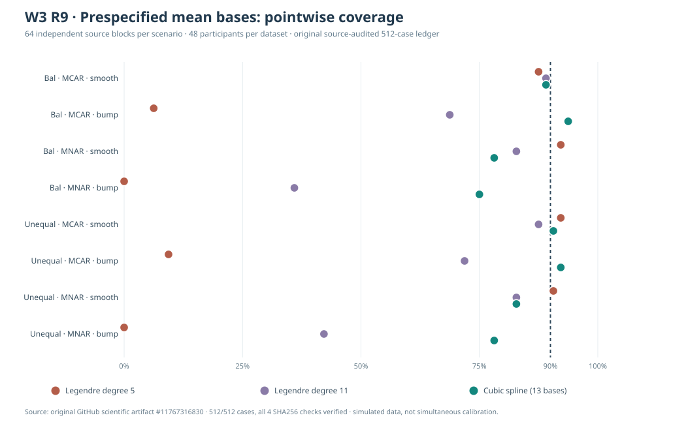
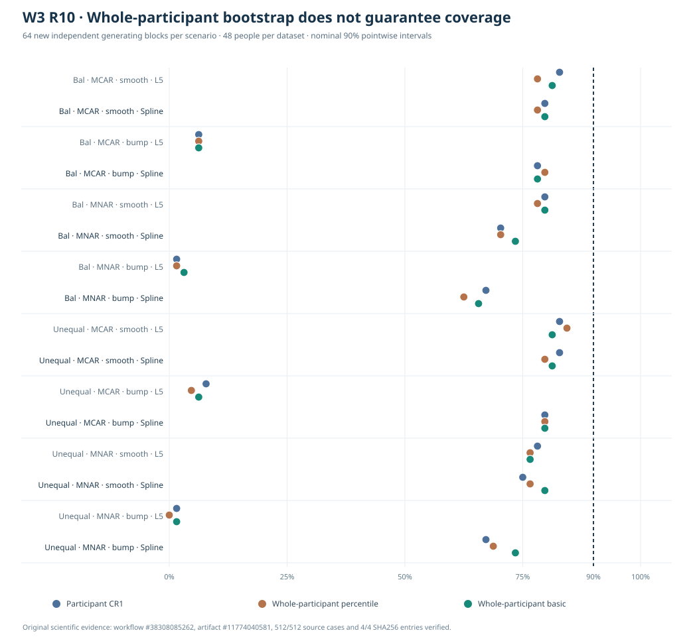
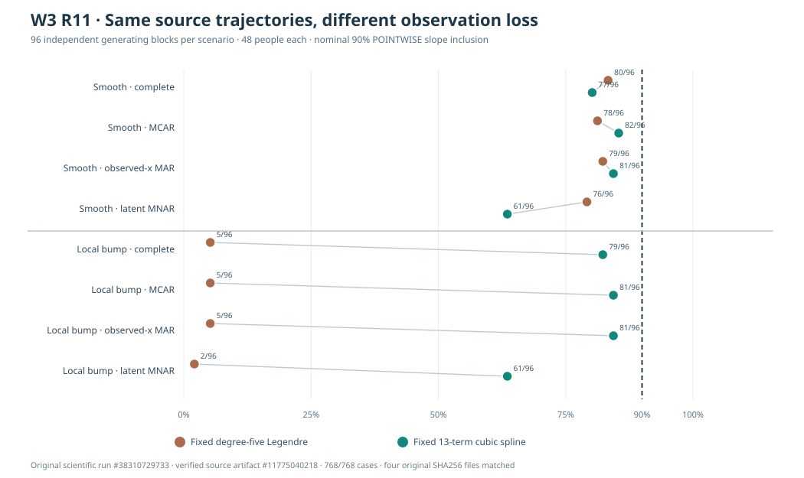
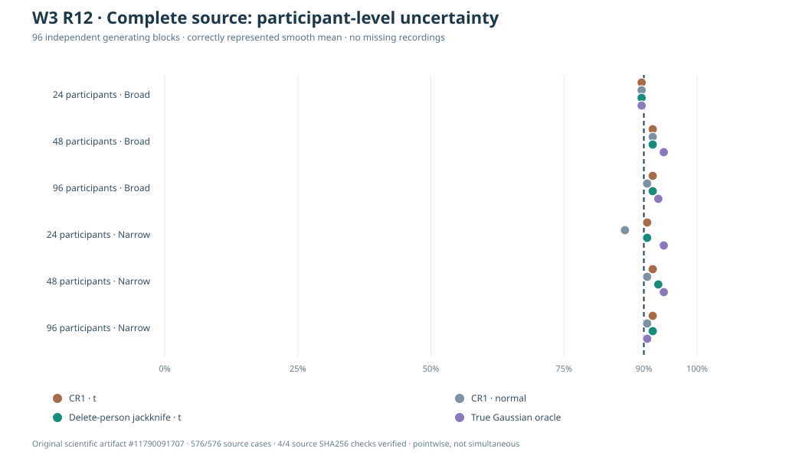

# Original experimental research figures

!!! warning "Interpretation and provenance"
    These are **original source-verified research SVG assets**; the earlier figures were copied from their named draft branches and the newer long-chain plot was constructed from the original retained scientific case results, not generic stock illustrations. They visualize simulation evidence, not results from human-subject recordings. Their presence here does not make the underlying experimental methods available in the stable 1.1.0 installation.

## Sparse-group inference F1

[Independent fitted F1 null/power study](f1-high-precision-native-null-power.md) · [Source run #37977625803](https://github.com/stefanosbalaskas/eyetrajectoriespy/actions/runs/37977625803)

## Bayesian B6/B7

[Exact partially collapsed population-mean experiment](b6-b7-exact-collapsed-mean-gibbs.md)

[Negative joint-loading sampler experiment](b6-b7-joint-score-marginal-loading-ess.md) · [Original source #38000101053](https://github.com/stefanosbalaskas/eyetrajectoriespy/actions/runs/38000101053)

### Longer-chain independent covariance reference: nine source fits

[Full original-source study, B6/B7 results and limitations](b6-b7-longchain-identified-covariance-geometry.md) · [Original workflow #38039822342](https://github.com/stefanosbalaskas/eyetrajectoriespy/actions/runs/38039822342) · Original artifacts: `11665746776`, `11665707552`, `11665607799`.

*This added scientific SVG is source-accurately constructed from the nine original fitted case results; it is not an independently collected dataset and does not establish posterior coverage.*

### Four-chain independent reference, two fresh datasets per rank-one design

[Six-fit source results, full provenance and unqualified inference limits](b6-b7-four-chain-nuts-r1-reference.md) · [Original workflow #38047872726](https://github.com/stefanosbalaskas/eyetrajectoriespy/actions/runs/38047872726).

*All six four-chain fits passed the exploratory mixing diagnostics; this is not evidence of 90% interval coverage or rank-two validity. The plot depicts one rank-one fit per replicate (six independently generated datasets), not independent posterior interval calibration.*

### Rank-two actual PyMC log posterior and automatic-gradient contract (R2)

[Source-verified mathematical comparisons and four artifact identifiers](b6-b7-rank2-pymc-r2-research-protocol.md) · [Original scientific workflow #38095088126](https://github.com/stefanosbalaskas/eyetrajectoriespy/actions/runs/38095088126).

*This is an original plot of the four actual source-run numerical derivative comparisons. It is not a completed rank-two NUTS fit, inference validation, or an independent human eye-tracking study.*

### B6 SBC R2: same-data computational-screen rescue, not new calibration data

[Source B6 longer-budget refit and unchanged stage-zero failure](b6-rank1-sbc-r2-same-dataset-evidence.md) · [Original workflow #38095220518](https://github.com/stefanosbalaskas/eyetrajectoriespy/actions/runs/38095220518).

*The same prior-generated replicate is used twice. Do not count the longer refit as another independent SBC dataset or interpret its 90% interval inclusion as repeated coverage.*

### Rank-two NUTS R3: first real posterior computation on paired and asynchronous designs

[Rank-two paired-versus-asynchronous pilot and numerical failure localization](b6-b7-rank2-four-chain-nuts-r3-evidence.md) · [Original scientific workflow #38096271285](https://github.com/stefanosbalaskas/eyetrajectoriespy/actions/runs/38096271285).

*Both fits completed; all six population-mean functionals in the asynchronous dataset failed an exploratory screen, while its nine covariance functionals passed. One dataset per design cannot establish a general asynchronous-data effect or interval calibration.*

### Rank-one prior-SBC pilot: original four-dataset midpoint ranks

[Four-dataset SBC stage-0 report, original ranks and diagnostic failure](b6-rank1-prior-sbc-stage0.md) · [Source workflow #38087405506](https://github.com/stefanosbalaskas/eyetrajectoriespy/actions/runs/38087405506).

*The four datasets are insufficient for rank-uniformity or interval-coverage claims. One completed posterior fit failed the exploratory computational convergence screen; that failure is explicitly shown. The [rank-two mathematical validation](b6-b7-rank2-marginal-mathematics.md) is presented as a source-audited numerical contract, without an invented discrepancy plot because exact case-level differences must be read from the retained source artifacts.*

## F5 change-point null behavior

[External-baseline dependence testing](independent-core-computation-and-f5-ar1-reference.md)

[Unknown-AR(1) external-baseline study](f5-independent-baseline-unknown-phi.md)

[AR(2) / MA(1) / nonstationary falsification](f5-independent-baseline-ar2-model-falsification.md) · [Source run #38000177988](https://github.com/stefanosbalaskas/eyetrajectoriespy/actions/runs/38000177988)

## W3 R6 genuinely asynchronous native timing and basis regression

[Full numerical results, independent source ledger and limitations](w3-r6-native-asynchronous-basis-results.md)
· [Original scientific workflow #38220034003](https://github.com/stefanosbalaskas/eyetrajectoriespy/actions/runs/38220034003),
artifact `11733915603`. **96 independent source blocks** gave 288
paired mechanism cases. Genuinely jittered native time samples
were retained, and the degree-five basis produced explicit
**model predictions, not reconstructed gaze measurements**.
Both observed-data weightings retained signed selection
effects under the simulated latent-response-dependent loss.
No new public irregular-W3 estimator or uncertainty method
was qualified.

## W3 R7 repeated trials: independent participants with native asynchronous times

[Full original R7 results and participant-level weighting limits](w3-r7-repeated-trial-asynchronous-results.md)
· [Scientific workflow #38222095846](https://github.com/stefanosbalaskas/eyetrajectoriespy/actions/runs/38222095846),
original source artifact `11734479698`. **64 independently
seeded blocks of 48 participants** are evaluated under four
paired trial-support and missingness conditions: **256/256**
completed with zero fitting/numerical/source-integrity failures.
Participant-balanced observed-time OLS showed somewhat lower
mean RMSE under unequal trials, but **does not** qualify
participant-level random-effects inference or remove the simulated
latent-MNAR midpoint shift. Full source and original SVG with 4/4
verified SHA256 digests retained.

## W3 R8 participant-cluster uncertainty and mean-basis failure

[Complete R8 source-audited results and coverage limitations](w3-r8-participant-cluster-model-stress-results.md)
· [Original science workflow #38240534823](https://github.com/stefanosbalaskas/eyetrajectoriespy/actions/runs/38240534823),
original artifact `11742673021`. **512/512** paired
scenario fits completed, zero source/reference failures,
and 4/4 original SHA256 checksums passed. Participant
clustering substantially improved *pointwise* 90% slope
truth inclusion under the baseline smooth data-generating
truth, but the **localized unmodelled slope bump exposed
catastrophic noncoverage even with participant CR1**.
This does **not** qualify simultaneous functional bands,
general participant-level variance calibration or a
production statistical API.

## W3 R9 richer fixed mean bases: pointwise slope inference under known misspecification

[Full original-source R9 results](w3-r9-prespecified-mean-basis-results.md)
· [Original scientific run #38292511576](https://github.com/stefanosbalaskas/eyetrajectoriespy/actions/runs/38292511576),
artifact `11767316830` (all four original SHA256 hashes verified).
**64 independently seeded source blocks × eight paired scenarios =
512 original source cases**, each evaluated with three
prespecified mean bases. The localized slope bump caused severe
undercoverage for degree five; a fixed 13-basis cubic spline
improved projection bias and pointwise truth inclusion,
but **latent-response-dependent recording loss still
prevented reliable nominal pointwise inference**.
No mean-model winner or simultaneous interval qualifies.

## W3 R10 whole-participant bootstrap: source-level uncertainty stress

[Full original W3 R10 research results](w3-r10-whole-participant-bootstrap-results.md)
· [Original scientific workflow #38308085262](https://github.com/stefanosbalaskas/eyetrajectoriespy/actions/runs/38308085262),
original artifact `11774040581`. **64 fresh independent
generating blocks × eight paired scenarios**, with
two fixed mean bases and **203,776 completed whole-participant
pairs bootstrap refits**, produced **512/512 original
science cases and zero fitting failures**. All 4/4
original SHA256 artifact hashes were independently
verified. Percentile and basic participant
resampling did **not** consistently improve
pointwise 90% truth inclusion relative to CR1;
neither mean projection bias nor selective
latent-response dropout was remedied.

## W3 R11 original complete-source vs matched MCAR/MAR/MNAR loss

[Full original matched-source W3 R11 findings](w3-r11-paired-observation-process-results.md)
· [Original 768-case scientific workflow #38310729733](https://github.com/stefanosbalaskas/eyetrajectoriespy/actions/runs/38310729733),
scientific artifact `11775040218` with **4/4 independently
verified source SHA256 checksums**. **96 genuinely fresh
independent participant-generating blocks** and two
paired true slope functions, with the same underlying
complete native gaze evaluated under full, MCAR,
observed-x MAR and latent-response-dependent MNAR
recording masks. Even with **complete source data**
the smooth-mean participant-CR1 pointwise interval
included truth only 80–83% of blocks. Fixed
degree-five truth projection drastically failed
under the narrow slope bump, and latent MNAR
lowered cubic-spline inclusion from 80.2% to
63.5% for smooth truth. This is **not** a calibrated
simultaneous functional interval nor missing
data reconstruction.

## W3 R12: fully observed native participant trials, known Gaussian variance

[Complete R12 original source results](w3-r12-complete-cluster-variance-oracle-results.md)
· [Original scientific run #38349342996](https://github.com/stefanosbalaskas/eyetrajectoriespy/actions/runs/38349342996),
artifact `11790091707` (all **4/4 SHA256 source checks independently verified**).
**96 freshly generated independent source blocks**, paired
predictor-spread regimes and nested 24, 48, 96 genuinely
independent participant sample sizes; **576/576 original
source cases**, three Python-version independent
numerical/covariance contracts passed. With complete
native recordings and a well-approximated Gaussian
mean, participant CR1/t **pointwise** 90% inclusion
was **89.6–91.7%**, including at n=48 where the
independent R11 study had lower complete-source
inclusion. Known Gaussian variance oracle was
**89.6–93.8%**. The observed difference across
studies is not proof of a systematic sample-size
or covariance-method effect. No simultaneous
functional interval or public estimator is qualified.

## W3 original known-truth functional regression validation

[Original W3 source-audited results, exploratory target, and study limits](w3-functional-regression-known-truth-results.md) · [Scientific workflow #38173426113](https://github.com/stefanosbalaskas/eyetrajectoriespy/actions/runs/38173426113) (source artifact `11715355738`).

*All 48 workflow fits completed across 24 generating seed blocks. The plotted values are original case-level recovery RMSE, not empirical eye-tracking recordings. Curve- and participant-level inference units have different simulated dependence structures; exact agreement with a numerical OLS oracle does not qualify statistical intervals.*

## Reproducible provenance

These figures are version-controlled scientific assets in the research PRs, embedded **without regenerating simulated results using a different source state**. For source dataset counts, original workflow artifacts and SHA256 audit evidence, consult the [scientific dashboard](research-scientific-dashboard.md).

Figures for earlier E1–E4 workflows remain available through the existing [experimental gallery](../methods/experimental-e1-e4-gallery.md). Other proposed B5–B10 or F1–F6 demonstrations that lack an original committed SVG are not represented here as if they were completed research figures.
