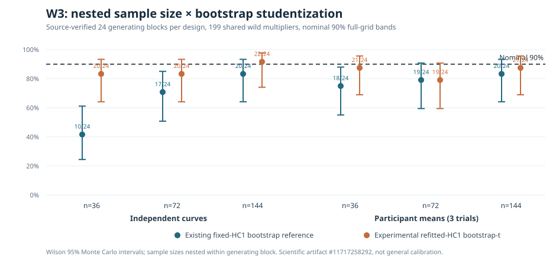

# W3 root cause: fixed HC1 versus refitted HC1 under nested sample sizes

!!! danger "Positive computational evidence but NOT validated 90% coverage"
    This independent-block pilot supports the hypothesis that
    bootstrap *studentization* materially changes finite-sample
    simultaneous-band behavior. It does **not** establish calibrated
    frequentist inference, motivate automatic replacement of the
    supported method, or authorize publication.

## Original source and evidence

[Scientific workflow #38179669438](https://github.com/stefanosbalaskas/eyetrajectoriespy/actions/runs/38179669438)
completed **144/144** actual W3 functional-regression datasets from
24 independently generated blocks per design, with **zero fitting or
numerical-contract failures**. The independent HC1, OLS and matched
package-band tests also passed on Python 3.11, 3.12 and 3.13.

Original artifact **`11717258292`**,
`w3-hc1-bootstrap-t-nested-n-original-evidence`, preserves all cases,
workflow-recorded `GITHUB_SHA` `98f5a8d1d9b44782e1680bb3768137203c311d1` (a transient pull-request checkout reference),
a full result ledger and the original SHA256SUMS. The artifact was
downloaded and **all three evidence/source checksum entries passed
independent verification**.

The two generating designs contain independent curve or independent
participant units; the participant version averages **three trials
per participant**. Counts 36, 72 and 144 are nested prefixes within
one generating block, not independent replications. Each design has
**24** independent generating blocks rather than 72.

## Nominal 90% simultaneous slope-function full-grid inclusion

| Source design and independent inference units | Fixed-HC1 reference | Refitted-HC1 bootstrap-t reference |
|---|---:|---:|
| Independent curves · n=36 | **10/24 (41.7%)** | **20/24 (83.3%)** |
| Independent curves · n=72 | **17/24 (70.8%)** | **20/24 (83.3%)** |
| Independent curves · n=144 | **20/24 (83.3%)** | **22/24 (91.7%)** |
| Participant means · n=36 | **18/24 (75.0%)** | **21/24 (87.5%)** |
| Participant means · n=72 | **19/24 (79.2%)** | **19/24 (79.2%)** |
| Participant means · n=144 | **20/24 (83.3%)** | **21/24 (87.5%)** |

*Wilson 95% Monte Carlo intervals are shown over 24 independent
datasets **per design and unit count**. The figure displays repeated
conditions on shared generating blocks, not independent binomial
observations across the six experimental cells.*

## Mechanistic interpretation

The reference quantities deliberately hold the original fitted
coefficient functions, original data, wild pseudo-responses and original
HC1 standard errors fixed. Only the denominator of the bootstrap
reference statistic changes:

- **Existing fixed-HC1 method:** bootstrap coefficient deviations are
  scaled by HC1 estimated from the original dataset.
- **Investigational bootstrap-t:** a fresh HC1 is recomputed from
  residuals **within every bootstrap pseudo-fit**, and its own
  maximum-studentized reference distribution is obtained.

The truth statistic is the same in both alternatives. Independent
source validation checked the package's current fixed-denominator band
critical value against identical supplied bootstrap coefficients.
No underlying estimator, feature architecture, confidence level or
source dataset was altered.

Average **bootstrap-t minus fixed-HC1 critical values**:

| Units | Independent curves | Participant means |
|---|---:|---:|
| n=36 | +0.841 | +0.486 |
| n=72 | +0.406 | +0.229 |
| n=144 | +0.199 | +0.106 |

The consistent increase in average reference critical values is
consistent with refitted studentization producing wider bands in
this simulation. The difference diminishes with greater independent
unit counts, making finite-sample studentization a plausible source
of the earlier undercoverage. Its benefit is heterogeneous:
for participant means at n=72 the full-grid inclusion count is
unchanged (19/24); this is not a universal correction.

## What is not established

There are only 24 generating blocks per design. For example, the
curve-level bootstrap-t inclusion of 20/24 at n=36 has a Wilson
95% Monte Carlo interval approximately **64–93%**, and 22/24 at
n=144 has an interval approximately **74–98%**. These are wide
uncertainty ranges. They do not demonstrate reliable nominal 90%
coverage or superiority across realistic gaze sampling conditions.

The same-sample, matched reference comparison answers a *conditional
computational* question but does not establish general calibration.
The pilot does not cover heteroskedastic and temporally correlated
errors, nonignorable missingness, irregular grids, unequal trial
counts or sampling with larger behavioral heterogeneity. A later
evaluation must use **fresh independent datasets** and separate
analytic/studentization fixes from empirical tuning.

The scientific blocker
[#289](https://github.com/stefanosbalaskas/eyetrajectoriespy/issues/289)
remains OPEN. Separate Bayesian blocker
[#255](https://github.com/stefanosbalaskas/eyetrajectoriespy/issues/255)
and F5 dependence-inference blocker
[#256](https://github.com/stefanosbalaskas/eyetrajectoriespy/issues/256)
are unaffected.

Stable **1.1.0** remains published; development is still
**`1.2.0rc2.dev0`**, no inferential backend has been promoted,
and `production_release_ready=false`.
