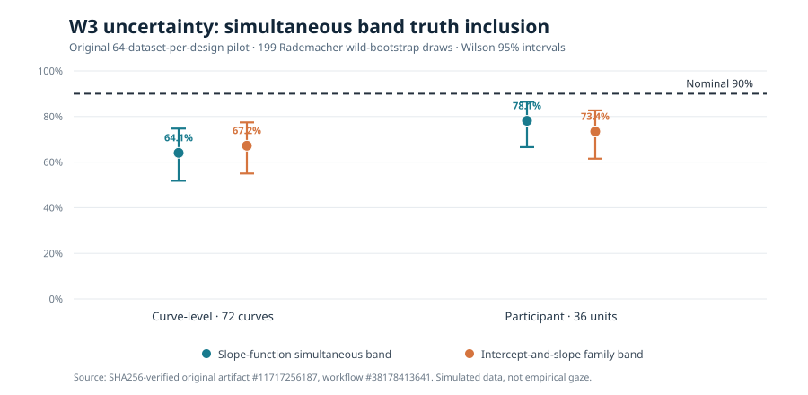

# W3 independent uncertainty pilot: substantive undercoverage

!!! danger "Negative finite-sample scientific evidence — do not promote 90% calibration"
    The tested function-on-scalar workflow's nominal **90% full-grid wild-bootstrap
    simultaneous confidence bands** under-cover known generating truth in this
    exploratory pilot. This is a fixed-truth frequentist simulation, **not**
    Bayesian SBC or an observational dataset. Passing numerical-oracle checks
    does not justify an inferential validity claim.

## Original source and audit

The original [Actions scientific workflow #38178413641](https://github.com/stefanosbalaskas/eyetrajectoriespy/actions/runs/38178413641)
generated the retained artifact **`11717256187`**,
`w3-fixed-truth-90pct-coverage-original-evidence`, under exact source
commit **`ea43e64080c16106ba9768f22995c3d70fa57c9a`**.
All four SHA256 fingerprints from the original archive were independently
verified for `case-ledger.json`, `evidence.json`,
`fixed-truth-coverage.svg` and `source-commit.txt`.

The experiment completed **128 of 128** prespecified datasets, with **zero
fitting exceptions** and passing NumPy coefficient, HC1 standard-error
and independent wild-bootstrap critical-value oracle checks. Each of
64 generating block indices carries a separate curve-level and
participant-level simulation, never counted as 128 replicates of
one homogeneous generating mechanism.

| Frequentist truth inclusion outcome | 72 independent curves (64 datasets) | 36 participants × 3 trials (64 datasets) |
|---|---:|---:|
| Nominal 90% slope simultaneous band, all 31 times × 2 dimensions | **41/64 (64.1%)** | **50/64 (78.1%)** |
| Wilson 95% interval for slope band coverage | 51.8–74.7% | 66.6–86.5% |
| Nominal 90% joint intercept/slope family band | **43/64 (67.2%)** | **47/64 (73.4%)** |
| Wilson 95% interval for family band coverage | 55.0–77.4% | 61.5–82.7% |
| Mean *pointwise* slope-cell truth inclusion | 88.5% | 87.8% |
| Fitted datasets, exceptions | 64, 0 | 64, 0 |

*Chart redrawn directly from the SHA256-verified source audit. The dashed
90% line is nominal coverage, not an accepted pass threshold.
Error bars are Wilson 95% Monte Carlo intervals across independent
datasets **within each generating design**. Correlated time×dimension
cells are not counted as independent binomial observations.*

## Scientific interpretation

Both coefficient-point estimates and their HC1 standard errors were
independently recomputed, and the Rademacher wild-bootstrap maximum
statistics and critical values were checked numerically. This supports
**formula-level implementation agreement** for the tested configuration
but not finite-sample validity of its sampling approximation.

The independent-curve generator uses Gaussian observation errors on
a complete common grid. The repeated-trial generator adds a smooth
participant-specific intercept plus trial errors; its **36 participants**
rather than its 108 source trajectories are the statistical units. These
differences can affect the distribution of the maximum studentized
statistic. They do not establish a comparative causal effect of dependence.

The approximately 88% average pointwise inclusion is a mean over
62 correlated slope time-by-dimension cells, **not** full-curve coverage
and not a proportion based on `64×62` independent datasets. The sharp
contrast between pointwise and simultaneous coverage is scientifically
informative.

The observed 64–78% simultaneous slope coverage is considerably below
90% for these designs, with sampling uncertainty shown above. The next
analysis should compare bootstrap multiplier choices, number of bootstrap
draws, participant sample size, and studentization using **the same
fixed generating datasets** when changing computational budgets. New
independent generating blocks are needed for confirmation. Do not tune
the nominal confidence level or retrospectively discard failures.

## Next-stage boundary

[Issue #289](https://github.com/stefanosbalaskas/eyetrajectoriespy/issues/289)
records this result as an open scientific inference blocker. It is
**separate from** [Bayesian interval undercoverage #255](https://github.com/stefanosbalaskas/eyetrajectoriespy/issues/255)
and [F5 dependent-data calibration #256](https://github.com/stefanosbalaskas/eyetrajectoriespy/issues/256).

See the [prespecified protocol](w3-fixed-truth-uncertainty-pilot-protocol.md).
No coverage-qualification flag, stable API or release authority was
promoted; published stable remains **1.1.0**, development remains
**`1.2.0rc2.dev0`**, and `production_release_ready=false`.
