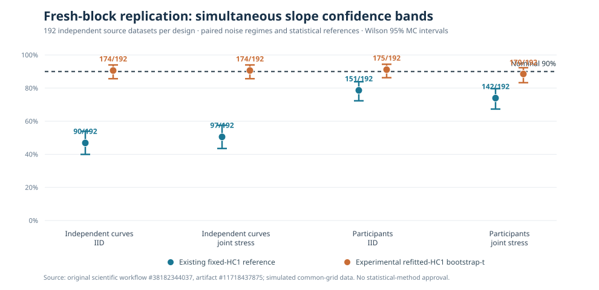

# W3 R3: fresh 192-block confirmation of fixed-HC1 undercoverage

!!! danger "Independent replication supports the inference concern, not general nominal calibration"
    The existing observed-grid function-on-scalar 90% wild-bootstrap
    simultaneous bands remain severely under-covering in this study.
    An investigational HC1-restudentized reference achieves near-nominal
    empirical coverage on these **specific simulated models**, but widens
    bands and is **not** approved for stable inference or publication.
    Scientific issue [#289](https://github.com/stefanosbalaskas/eyetrajectoriespy/issues/289)
    stays OPEN.

## Original source and design

Original [GitHub Actions scientific run #38182344037](https://github.com/stefanosbalaskas/eyetrajectoriespy/actions/runs/38182344037)
retained artifact **`11718437875`** (full `case-ledger.json`,
`evidence.json`, original `source-confirmation.svg`, workflow-recorded
`source-commit.txt` and `SHA256SUMS`). The original ZIP was
downloaded; **all four source checksums verified independently**.
The workflow recorded `GITHUB_SHA`
`692216c7bfcc69665af8ac9edaa4b3865abccbcc`, which may be a
temporary PR checkout commit; the source research branch implementation
was `025d7d6989784b580114edf018a2dbdb027d855a`.

**768/768 attempted fits completed, zero exceptions, zero missing
cases.** The independent NumPy OLS coefficient, HC1 standard-error and
actual fixed-HC1 package maximum-statistic references agreed.
Dedicated source-contract tests passed under Python 3.11–3.13.

Source seed family `202610122177` was **new** to this study,
rather than reused from R1/R2. There are 192 independent generating
blocks **per scientific design** (independent curves or independent
participant means), with the IID and joint-stress regimes generated
from *paired innovations within each block*. Therefore the 768 fitted
cases are **not 768 independent source replications**. Each dataset
has 36 independent inference units; participant datasets have three
repeated curves per participant but aggregate before inference.

## Complete full-grid truth-inclusion evidence

The nominal 90% target is simultaneous inclusion of the known slope
coefficient at **all 31 time points × two response dimensions**.
Both methods use identical original data, 199 common Rademacher wild
pseudo-responses and original HC1 truth studentization. The
experimental method recomputes HC1 in each wild pseudo-fit.

| Design and condition | Current fixed HC1 | Investigational bootstrap-t | Paired improvement |
|---|---:|---:|---:|
| Independent curves, IID | **90/192 (46.9%)** | **174/192 (90.6%)** | +43.8 pp |
| Independent curves, heteroskedastic + AR(1) | **97/192 (50.5%)** | **174/192 (90.6%)** | +40.1 pp |
| Participant means, IID | **151/192 (78.6%)** | **175/192 (91.1%)** | +12.5 pp |
| Participant means, heteroskedastic + AR(1) | **142/192 (74.0%)** | **170/192 (88.5%)** | +14.6 pp |

Wilson 95% Monte Carlo intervals for the **experimental** coverage
rates are respectively **85.7–94.0%**, **85.7–94.0%**,
**86.3–94.4%**, and **83.3–92.3%**; each contains 90%.
The corresponding fixed-HC1 intervals are **39.9–53.9%**,
**43.5–57.5%**, **72.3–83.9%**, and **67.3–79.7%**, each
substantially below 90% under these generating mechanisms.

*Source-audit-redrawn chart, not empirical eye-tracking recordings.
The two error regimes within a block are matched, not independent
sampling units. Error bars describe Monte Carlo uncertainty over
independently generated datasets **within each design and regime**.*

## Paired changes and width tradeoffs

Within each setting, fixed and experimental reference methods were
applied to the *same* 192 datasets. Independent-block paired bootstrap
intervals for the **experimental minus fixed truth-inclusion
proportion** were:

| Design and condition | Truth-inclusion rescue / loss | Paired improvement, 95% block-bootstrap interval | Mean of dataset median slope-band widths, fixed → experimental |
|---|---:|---:|---:|
| Independent curves, IID | 84 / 0 | +43.8 pp [37.0, 51.0] | 0.0681 → 0.0885 |
| Independent curves, joint stress | 77 / 0 | +40.1 pp [32.8, 46.9] | 0.0835 → 0.1129 |
| Participant means, IID | 24 / 0 | +12.5 pp [8.3, 17.2] | 0.1113 → 0.1337 |
| Participant means, joint stress | 28 / 0 | +14.6 pp [9.9, 19.8] | 0.1357 → 0.1690 |

Band widths are measured in the synthetic response coordinate units
and averaged **across datasets** after obtaining each dataset's
median slope band width. They are *not* real gaze-error magnitudes.
The experimental reference produces wider bands—roughly 20–35%
wider in these scenarios. That is an inferential precision cost,
not a detail to discard when evaluating improved coverage.

The zero rescue-to-loss reversals in these datasets reflect the
observed reference distributions; they do not prove universal
monotonicity or guaranteed improvement under other errors,
sample sizes or bootstrap constructions.

## What this qualifies—and what it does not

This is a strong **software/statistical falsification** of broad
nominal 90% coverage claims for the current fixed-HC1 simultaneous
band under the stated sample sizes. The new independent replication
also strengthens a **specific** computational hypothesis: using HC1
computed *inside each bootstrap pseudo-fit* materially changes
finite-sample maximum-statistic behavior, often toward nominal
coverage in these tested designs.

It still does **not** establish a generally calibrated inference
procedure. The full-grid simulation is complete and regularly
sampled; no missing gaze, unequal trial counts, irregular temporal
support, device-specific artifacts, time-varying covariates, or
nonignorable observation processes were tested. Only n=36 and two
prespecified error structures were used. The reference comparisons
concern the slope function, not the entire intercept+slope family.
More independent truth regimes, higher participant counts, family
coverage and Type-I-error diagnostics are needed before a method or
API can be qualified.

No estimator, root public API, source version, stable release,
Bayesian package or F5 statistical implementation was changed.
**Published stable 1.1.0 remains unchanged**, unreleased core
development stays **`1.2.0rc2.dev0`**, and
`production_release_ready=false`.

See the [prespecified original R3 protocol](w3-fresh-192-block-confirmation-protocol.md)
and [scientific blocker #289](https://github.com/stefanosbalaskas/eyetrajectoriespy/issues/289).
