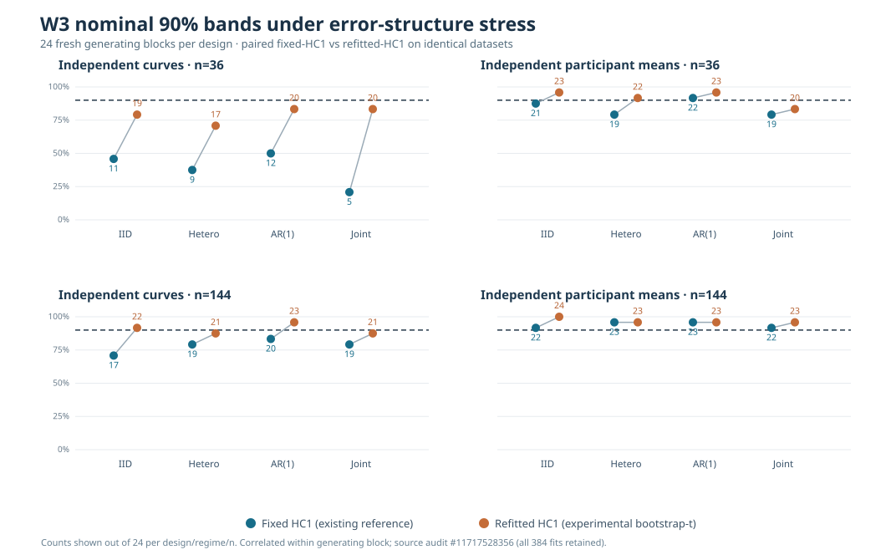

# W3 R2: fresh-block heteroskedasticity and AR(1) stress results

!!! danger "Experimental inference—not calibrated nominal coverage"
    Across this study, refitted-HC1 bootstrap-t bands generally contain
    known truth more often than the existing fixed-HC1 reference. This
    does **not** establish 90% frequentist calibration or authorize
    changing the public statistical implementation. Scientific blocker
    [#289](https://github.com/stefanosbalaskas/eyetrajectoriespy/issues/289)
    remains OPEN.

## Source, independence units and full audit

The original [scientific Actions run #38181728725](https://github.com/stefanosbalaskas/eyetrajectoriespy/actions/runs/38181728725)
retained artifact `11717528356`,
`w3-fresh-heteroskedastic-ar1-original-evidence`, containing the
full `case-ledger.json`, `evidence.json`, original
`source-stress-coverage.svg`, `source-commit.txt` and `SHA256SUMS`.
The ZIP was independently downloaded and **all four SHA256 entries
verified**. The scientific-run recorded PR-checkout SHA is
`11887b37522546059ac30cd72b958c6e5ece9f95` (which may be a
transient GitHub pull-request checkout reference).

**384/384** planned functional-regression fits completed, **zero
fitting/numerical-contract failures**, and none were removed from
the ledger. Every fit's coefficient functions and HC1 SEs agreed with
independent OLS/sandwich calculations; the fixed-denominator
bootstrap maximum statistic agreed with the actual library routine.

There are **24 independently seeded generating blocks per design**,
not 384 independent datasets. Within each block, the n=36 sample is
nested within n=144 and the four regimes reuse original condition
assignments and innovations. Participant analysis averages three
source trials to one independent participant observation; treating
trials as independent people is not allowed.

## Full-grid nominal 90% slope-function truth inclusion

Each count is out of **24 generating blocks per design, sample-size
and regime**. Columns compare the existing fixed-HC1 reference with
the experimental refitted-HC1 bootstrap-t reference on **identical
source data and identical 199 Rademacher multipliers**.

| Generative design and independent units | IID fixed → refitted | Heteroskedastic fixed → refitted | AR(1) fixed → refitted | Joint fixed → refitted |
|---|---:|---:|---:|---:|
| Independent curves, n=36 | **11 → 19** | **9 → 17** | **12 → 20** | **5 → 20** |
| Independent curves, n=144 | 17 → 22 | 19 → 21 | 20 → 23 | 19 → 21 |
| Independent participants, n=36 | 21 → 23 | 19 → 22 | 22 → 23 | 19 → 20 |
| Independent participants, n=144 | 22 → 24 | 23 → 23 | 23 → 23 | 22 → 23 |

*Figure reconstructed only from the verified original case ledger.
All observations plotted are experimental simulation outcomes, not
real eye-tracking recordings. Paired comparisons are matched within
source generating blocks. The 90% reference line is a target, not a
scientific pass/fail threshold.*

## Interpretation of the strongest negative case

With **36 independent curves** under joint condition-dependent
heteroskedasticity and within-curve AR(1) temporal errors:

- Existing fixed-HC1 band fully contains the true condition coefficient
  at 31 time points × two dimensions in **5/24 datasets (20.8%)**.
- Investigational refitted-HC1 bootstrap-t covers it in
  **20/24 datasets (83.3%)**.
- The matched per-dataset mean bootstrap reference critical-value
  increase is **+1.003**; the mean median slope-band width
  increases from approximately **0.0808 to 0.1107** (about **37%**).
- Only 24 independent generating blocks contribute to each coverage
  proportion. Wilson 95% Monte Carlo intervals are approximately
  **9–40%** for 5/24 and **64–93%** for 20/24.
  Even 20/24 does not establish nominal 90% calibration.

This pattern is consistent with the earlier n=36 fixed-HC1
undercoverage and a sizable finite-sample studentization effect.
It does **not** prove that one alternative dominates in all
settings. For example, at n=144 under heteroskedasticity,
the participant-level bands included known truth in **23/24 datasets
under both methods**, even though the refitted bands were wider.

The source-generating conditions intentionally isolate a narrow
2×2 factorial: condition-dependent error scale and within-curve
stationary AR(1) with `ρ=0.70`. The participant design also
includes a smooth participant random intercept. Neither model
replicates actual device artifacts, missing gaze, irregular
observations, unequal trial counts or covariate-driven missingness.

## Next inference boundary

A genuine claim that a refitted-HC1 bootstrap-t method attains nominal
90% simultaneous coverage requires more independently seeded source
datasets; realistic heteroskedastic and temporal dependence patterns;
explicit comparison of interval widths, type-I error and null/alternative
behavior; and failure-inclusive confirmation on new designs. The present
study is exploratory. No automatic method choice, estimator replacement,
API stability claim, posterior-calibration statement or release
authorization follows.

See the [predeclared protocol](w3-fresh-heteroskedastic-ar1-stress-protocol.md)
and [prior nested-n studentization evidence](w3-bootstrap-t-nested-unit-count-results.md).
Separate Bayesian #255 and F5 #256 scientific blockers remain unchanged.

Stable eyetrajectoriespy **1.1.0** remains available, development is
**`1.2.0rc2.dev0`**, and `production_release_ready=false`.
