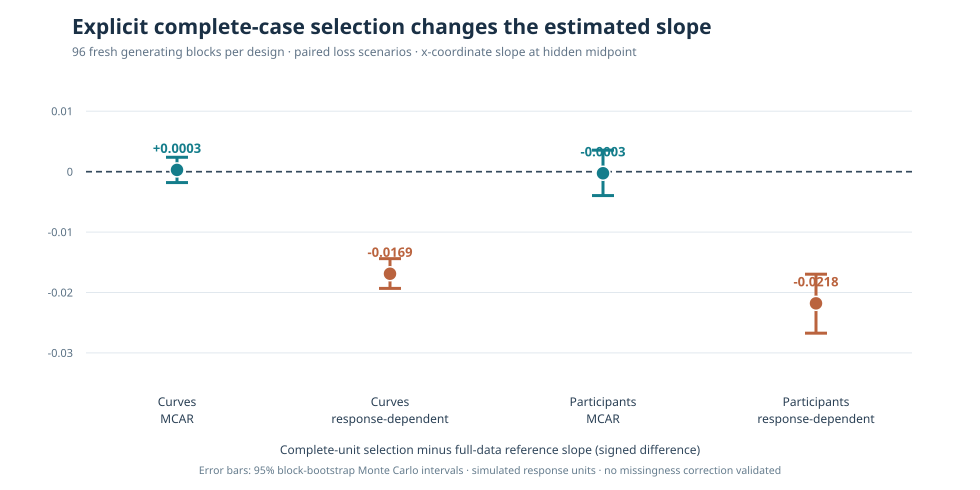

# W3 R4: source-verified missing-gaze selection sensitivity

!!! danger "Known-truth simulation and deliberately selected complete cases"
    The following results are **generated scientific benchmark evidence**,
    not observations from human eye-tracking participants. A simulated
    response-dependent observation process induced a substantial signed
    change in the estimated functional slope after explicitly excluding
    incomplete independent units. This is not a proof that all missing
    gaze behaves similarly, nor does the experiment qualify an MNAR
    correction, valid hypothesis testing or a new statistical API.

## Original data and provenance

The original [scientific workflow #38191587507](https://github.com/stefanosbalaskas/eyetrajectoriespy/actions/runs/38191587507)
completed **384/384** prespecified case evaluations, without missing
cases or fitting/numerical-contract failures. Original GitHub Actions
artifact **`11721253302`**,
`w3-mcar-latent-loss-original-case-ledger`, contains
`case-ledger.json`, `evidence.json`, original
`source-selection-errors.svg`, `source-commit.txt` and
`SHA256SUMS`. The source ZIP was independently downloaded;
**all four source SHA256 entries verified**.

The final original science implementation was on
`9e366353073bb03f6bd2f29b3c736d8ac168a19b`, with seed family
`202610124217` and **96 independent generating blocks per source
design**. The two loss mechanisms were paired using the same
underlying complete trajectories, experimental conditions and
uniform loss draws within each block; **384 case evaluations are
not 384 independent source-generating blocks**.

The two source designs are n=72 independent curves, or n=48
independent participants with three trials each. Incomplete
records contain an 8-sample contiguous mid-trial gap, across both
functional dimensions. One trial per affected participant is gapped;
complete-unit sensitivity deliberately removes that participant's
**entire three-trial cluster**. There is no silent trial-level
pseudo-replication.

## Effects of explicit complete-case selection

The focal outcome is the signed slope estimate in the first functional
dimension at the masked midpoint, compared with the same block's
**original fully observed** numerical-reference estimate.
Intervals are 95% Monte Carlo percentile bootstrap intervals
resampling **independently generated blocks**, not trials or
functional time locations.

| Source and recording-loss mechanism | Mean units retained | Mean complete-unit minus full-data slope difference | 95% block-bootstrap interval |
|---|---:|---:|---:|
| 72 curves · MCAR | 47.1 of 72 | **+0.0003** | −0.0018 to +0.0024 |
| 72 curves · Latent response-dependent | 43.1 of 72 | **−0.0169** | **−0.0193 to −0.0144** |
| 48 participants · MCAR | 31.4 of 48 | **−0.0003** | −0.0040 to +0.0036 |
| 48 participants · Latent response-dependent | 27.9 of 48 | **−0.0218** | **−0.0267 to −0.0170** |

*Redrawn from the verified original source audit. This figure is a
paired **complete-case minus complete-source estimate difference**,
not an effect of treatment, not a causal parameter, and not a
measurement-error correction. Original source-run figure and
all 384 case records remain in the artifact.*

The full-data reference showed small mean signed error relative to
known truth in the focal x-coordinate slope: +0.0016 for independent
curves and +0.0039 for participants. After deliberate complete-unit
selection, mean signed errors relative to true slope were:

| Source design | MCAR selected signed error | Response-dependent selected signed error |
|---|---:|---:|
| Independent curves | +0.0019 | **−0.0153** |
| Participants | +0.0037 | **−0.0178** |

Both response-dependent selected estimates changed negatively on
average, whereas MCAR produced a much smaller mean signed change
under this model. Their difference cannot be attributed to
independent samples, because the mechanisms share original
observations within generating blocks.

## Functional recovery and lost information

| Source design | Full-data slope RMSE | MCAR selected slope RMSE | Response-dependent selected slope RMSE |
|---|---:|---:|---:|
| Independent curves | 0.0139 | 0.0174 | 0.0189 |
| Participant means | 0.0233 | 0.0293 | 0.0318 |

Both complete-case scenarios lose independent units and exhibit
larger average functional slope RMSE than the complete-source
reference. Average *individual sample-value* masking fractions
are relatively small—approximately 8.9% and 10.4% for curve MCAR
and dependent loss, and 3.0% and 3.6% for participant MCAR and
dependent loss—because each selected unit loses a short recording
segment, not its entire original record. Yet the deliberate
complete-unit rule excludes whole independent units, including
participants whose other two trials may remain observed.

This distinction matters when interpreting missingness percentages:
a low fraction of masked gaze time points does **not** guarantee a
low fraction of independent participants lost under a complete-unit
analysis policy.

## Guardrails independently exercised in every source case

- Both `TrajectorySet` with `NaN` gaps and native
  `IrregularTrajectorySet` with preserved observed timestamps
  were explicitly **rejected by the W3 complete-grid regression
  workflow**. Neither representation triggered interpolation.
- Experimental descriptive `workflow_preflight` audited
  source support, missingness and participant structure without
  filtering curves.
- A *separate analyst-explicit* subset was constructed for the
  complete-unit comparison. Its input indices and unit counts
  were recorded, and both full-data and selected-data W3
  coefficients agreed with independent NumPy OLS numerical oracles.
- Zero outcome-sign, target-bias or significance thresholds
  determined CI success. All 384 attempted cases were retained.

## Interpretation and limits

The MCAR and latent response-dependent processes are **known because
we generated them**, not because they can be identified from a
recorded gaze dataset. Response-dependent loss used the *unobserved
latent midpoint residual* in its generating log-odds, making it a
specific nonignorable sampling mechanism. In empirical work,
that hidden quantity is unavailable to the analyst. This study
therefore neither estimates missingness probabilities from observed
records nor provides a viable weighting, imputation, interpolation,
joint modelling or MNAR identification procedure.

The comparison quantifies the consequence of **one deliberately
chosen complete-case policy**, not the bias of every defensible
missing-data analysis. W3 still does not fit irregular/native
gaze traces or automatically use incomplete trajectories. Handling
those cases scientifically requires a separately qualified
estimator and evidence under plausible observational processes.

[Predeclared protocol](w3-observation-loss-selection-protocol.md)
and [W3 nominal 90% band-calibration blocker #289](https://github.com/stefanosbalaskas/eyetrajectoriespy/issues/289)
remain distinct. This experiment does **not** solve the earlier
fixed-HC1 simultaneous band undercoverage.

Stable **1.1.0** remains published; development
`1.2.0rc2.dev0` and `production_release_ready=false`
remain unchanged. No release tag or PyPI publication is authorized.
