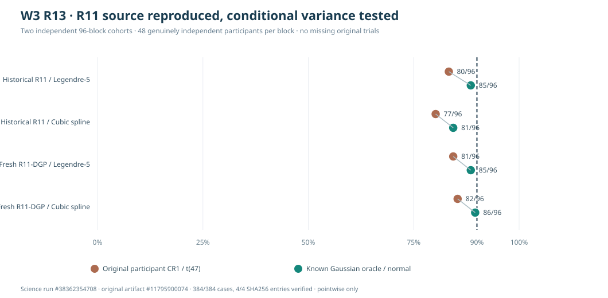

# W3 R13 — exact R11 source reproduction and conditional covariance oracle

!!! danger "Original reproducibility established; inferential calibration remains unqualified"
    R13 **exactly reproduced** the previously reported R11
    smooth complete-source participant-CR1 inclusion counts:
    **80/96** (degree-five Legendre) and **77/96** (fixed
    13-term cubic spline). A separate **96-block independent
    replication of the identical generating process** obtained
    **81/96** and **82/96**, respectively. The
    analytically known source Gaussian covariance improved
    observed pointwise inclusion, but neither this experiment
    nor the distinct R12 simulation qualifies a general
    estimator or simultaneous functional interval.

## Original source and engineering verification

The original [scientific workflow #38362354708](https://github.com/stefanosbalaskas/eyetrajectoriespy/actions/runs/38362354708)
completed **384/384 prespecified model-source cases**,
with **zero source, oracle, fitting, regression
reproducibility or ledger failures**. The workflow's
four dedicated jobs, including Python 3.11, 3.12
and 3.13 reference contracts, all passed.

The original source artifact
**`11795900074`**,
`w3-r13-original-exact-r11-conditional-oracle-evidence`,
contains `case-ledger.json`, `evidence.json`,
the unmodified original Matplotlib visualization
`source-r11-conditional-oracle.svg`,
`source-commit.txt` and `SHA256SUMS`.
The original archive was independently downloaded;
**4/4 recorded SHA256 checksums matched**.
The original scientific workflow recorded
checkout SHA
`98d06b54245be0d49bbffd929a856dcd2b91e160`,
which may be a temporary GitHub pull-request
checkout identity rather than a protected branch head.

R13 reused the unchanged [R11 original
generator](w3-r11-paired-observation-process-results.md),
master seed `202610131107`, for **96 historical
generating blocks**. Independently coded
source-generator reproduction was checked for
exact equality of original arrays
(including true native timestamps, observed
two-dimensional values, original
conditional means, participant predictors,
trial counts and missingness uniforms).
A separately seeded second cohort with master
seed `202610139137` reproduced the **same R11
design and Gaussian distributions** for
**96 new independently seeded blocks**.

Each block contains **48 genuinely independent
participants**, unequal 1–3 repeated trials,
complete source data and genuinely
asynchronous jittered trial timestamps.
The four source random components—the
participant intercept and participant slope,
trial intercept and independent sensor
noise—use Gaussian generating standard
deviations **0.08, 0.045, 0.025, 0.045**.
The true original smooth condition-slope
and original participant-balanced
regression weights are unchanged.
There are **192 independent generating
blocks across the two cohorts**,
each with **two paired fixed mean bases**.
The 384 fits are therefore not 384
independent Monte Carlo replications.

## Original 90% pointwise known-truth inclusion

Both procedures evaluate the **same** fitted
participant-weighted midpoint condition
slope at time 0.5, first response dimension.
They differ in the estimated variance
and reference quantile:

- **Original R11 participant CR1/t(47):**
  estimated cluster residual-sandwich
  variance and 47-degree t critical value.
- **Known conditional Gaussian oracle/normal:**
  simulation-known analytic covariance
  conditional on exact original participant
  predictors, trial supports, native
  timestamps, numerical weights and true
  four generating variance components.
  Normal critical value.

| Independent source cohort | Fixed mean basis | Participant CR1/t | Known Gaussian oracle/normal |
|---|---|---:|---:|
| **Exact historical R11** (96 blocks) | Degree-five Legendre | **80/96 (83.3%)** | 85/96 (88.5%) |
| Exact historical R11 | 13-term cubic spline | **77/96 (80.2%)** | 81/96 (84.4%) |
| **Fresh exact R11-DGP** (96 blocks) | Degree-five Legendre | **81/96 (84.4%)** | 85/96 (88.5%) |
| Fresh exact R11-DGP | 13-term cubic spline | **82/96 (85.4%)** | 86/96 (89.6%) |

*True-point inclusion for a single scalar
slope contrast, with separate denominators
of 96 independent original participant
datasets per cohort. The original Matplotlib
figure and case ledger are preserved unchanged
in the checked source ZIP. Dashed target:
90% **pointwise**, not whole-curve
simultaneous coverage.*

The original complete smooth-source result
was not a documentation mistake:
historical CR1 coverage exactly matched
**80/96 and 77/96**. Crucially, fresh
independent source data under **the same
generating distributions** produced
similar observed CR1 inclusion rates.
This reduces the plausibility of a
historical source-specific numerical
implementation accident and confirms
that the R11–R12 contrast warrants
a matched-design explanation.

However, the independent replication
also has only 96 source blocks. The
95% Wilson Monte Carlo intervals
for **80/96** and **82/96**
are approximately **74.6–89.5%**
and **77.0–91.1%**, respectively.
These overlap the nominal level or
its vicinity; the experiment does
not prove a systematic finite-sample
bias at all plausible generating
designs, covariate supports or
participant sizes.

## The analytical covariance isolates a variance-scale contribution

The R11 data generator draws participant
random intercepts and slopes shared
across that person's repeated trials,
independent trial intercepts and
timepoint innovations. The R13 oracle
computes the **exact covariance of the
WLS midpoint slope conditional on
the complete original observed design**,
using *known* source variances. In
particular, participant random-effect
score contributions are summed over
**all of a person's trials** before
their covariance outer products are
computed. An independent numerical
least-squares reference and original
R11 CR1 standard-error reference
agreed in every complete case.

Mean CR1/oracle standard-error ratios:

| Cohort and mean model | Mean CR1 SE | Mean oracle SE | CR1 / oracle |
|---|---:|---:|---:|
| Historical · Degree five | 0.02617 | 0.02703 | **0.969** |
| Historical · Cubic spline | 0.02675 | 0.02753 | **0.972** |
| Fresh · Degree five | 0.02636 | 0.02716 | **0.971** |
| Fresh · Cubic spline | 0.02673 | 0.02768 | **0.967** |

CR1 estimated standard errors were about
**2.8–3.3% lower on average** than the
analytically known Gaussian source
standard errors. Replacing the CR1/t
interval by the oracle/normal interval
increased true-point inclusion by
**4–5 of 96 blocks** per model/cohort.
These contrasts change *both* variance
and reference critical value:
their differences cannot be interpreted
as a variance-only causal effect.

The original source-block paired Monte
Carlo 95% interval for the oracle-minus-
CR1 coverage difference in the historical
degree-five cohort was approximately
**−1.0 to +11.5 percentage points**;
in both fresh cohorts the analogous
interval was approximately
**+1.0 to +8.3 percentage points**.
These are exploratory generator-specific
Monte Carlo contrasts; they do not select
a generally superior empirical method.

The known-mean slope projection errors
were essentially zero: mean absolute
midpoint projection deviations by
cohort/model were on the order of
**1e-10 to 4e-9**. The conditional-oracle-
standardized, known-projection-centered
slope errors had across-block standard
deviations approximately **1.05–1.08**.
These observed finite-sample patterns
help explain why this particular
generator's pointwise truth-inclusion
rate remained modestly below 90%
even under its known-variance oracle.

## Scientific resolution and remaining limitations

The result supplies three distinct pieces
of evidence, without selecting an estimator:

1. **R11's original complete-source
   counts reproduce exactly.** They
   were not caused by lost records,
   the localized mean bump or a
   hidden interpolation step.
2. **A new identical-DGP cohort behaves
   similarly.** This is stronger
   evidence of generator-specific
   pointwise uncertainty behavior
   than comparison against R12's
   distinct generating family alone.
3. **The known covariance oracle
   changes coverage, but does not
   make every original cohort hit
   exactly 90%.** Its underlying
   Gaussian variance is a
   simulation-known reference,
   not an empirically fitted
   mixed-effects estimator.

Next scientific work should make any
inference decision conditional on
**exact original design/leverage
and covariance assumptions** and
should test whether a higher number
of independent new source blocks
changes the apparent 3% standard-
error difference or residual
coverage deviations. More than one
mean truth, a richer set of participant
sizes, actual observation loss,
heteroscedastic clusters and
whole-function simultaneous coverage
remain outside R13.

The original known Gaussian covariance
parameters **are not available from
real gaze recordings**. R13 does
not qualify a native functional
mixed-effects likelihood,
cluster bootstrap,
latent-MNAR correction,
simultaneous inference,
automated model selection,
family-wise testing or
a public API promotion.

[Prespecified R13 protocol](w3-r13-exact-r11-conditional-variance-protocol.md)
· [Open simultaneous-inference issue #289](https://github.com/stefanosbalaskas/eyetrajectoriespy/issues/289)
· [Open native missingness issue #296](https://github.com/stefanosbalaskas/eyetrajectoriespy/issues/296).

Stable published **1.1.0** remains unchanged.
Development `1.2.0rc2.dev0`
is still unreleased,
`production_release_ready=false`,
and no root estimator, release tag,
RC or PyPI upload is authorized.
