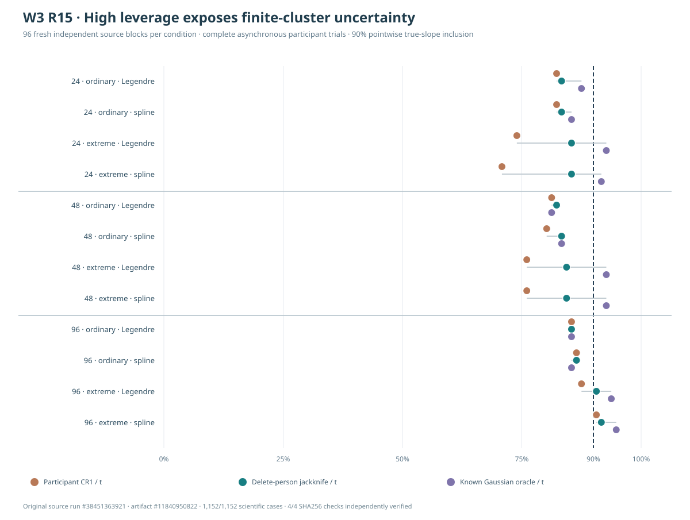

# W3 R15 — fresh finite-person and predictor-leverage uncertainty results

!!! danger "Source-verified stress evidence, not a production correction"
    This fully new source study found pronounced **participant-CR1
    standard-error underestimation under deliberately extreme
    participant covariates**, particularly with 24–48 independent
    people. A genuine whole-participant delete-one jackknife
    increased interval width and observed true-point inclusion
    under that stress, but did **not** consistently achieve 90%
    pointwise coverage. Neither a jackknife nor an oracle
    is qualified for the public package, and no whole-function
    simultaneous uncertainty has been tested.

## Original evidence and generating design

[Original scientific run #38451363921](https://github.com/stefanosbalaskas/eyetrajectoriespy/actions/runs/38451363921)
passed its four dedicated science jobs, including
Python 3.11, 3.12 and 3.13 tests. Its artifact
**`11840950822`**, `w3-r15-original-fresh-cluster-leverage`,
was downloaded independently and all **4/4 original
SHA256 file checks** passed. The original
`case-ledger.json`, `evidence.json`,
Matplotlib `source-fresh-cluster-leverage.svg`,
checkout identity and checksum ledger are preserved.
**1,152/1,152** planned original cases finished;
**zero** recorded fitting, numerical-oracle,
source-integrity or missing-ledger failures.

R15 uses **96 completely new, independently seeded
generating blocks** (`202610131515`), independent
of the R13/R14 original source families. Each block
has up to 96 independent people with complete,
genuinely asynchronous 1–3 original trials each.
Nested n=24/48/96 participant subsets are
compared against exactly the same source innovations,
trial allocation and native timing, crossed with
ordinary observed covariates versus two fixed
extreme-x people (**x=3.0, −2.5**). Responses
are **regenerated at the new observed x** while
keeping the same Gaussian latent effects and sensor
innovations; this is a paired covariate-design
comparison, not an identical-response trial.
Both fixed mean bases (Legendre-5 and
13-term cubic spline) adequately represent
the smooth original data-generating mean,
with mean midpoint projection error
near numerical zero in all 12 cells.

There are **12 condition/model cells × 96 independent
generating blocks = 1,152 fitted case evaluations**,
not 1,152 independent Monte Carlo blocks. Every
analysis uses all authentic source timepoints and
equal total numerical weight per **person**, not
per trial or gaze sample.

## Nominal 90% pointwise known-truth inclusion

Counts are out of **96 independently generated
source blocks per cell**. All intervals use
the same source midpoint condition-slope
estimate on first response dimension.

| Independent people | Original predictor support | Mean basis | Participant CR1/t | Delete-person jackknife/t | Known Gaussian oracle/t |
|---:|---|---|---:|---:|---:|
| 24 | Ordinary | Legendre-5 | 79/96 (82.3%) | 80/96 (83.3%) | 84/96 (87.5%) |
| 24 | Ordinary | Cubic spline | 79/96 (82.3%) | 80/96 (83.3%) | 82/96 (85.4%) |
| 24 | **Extreme x** | Legendre-5 | **71/96 (74.0%)** | **82/96 (85.4%)** | 89/96 (92.7%) |
| 24 | **Extreme x** | Cubic spline | **68/96 (70.8%)** | **82/96 (85.4%)** | 88/96 (91.7%) |
| 48 | Ordinary | Legendre-5 | 78/96 (81.3%) | 79/96 (82.3%) | 78/96 (81.3%) |
| 48 | Ordinary | Cubic spline | 77/96 (80.2%) | 80/96 (83.3%) | 80/96 (83.3%) |
| 48 | **Extreme x** | Legendre-5 | **73/96 (76.0%)** | 81/96 (84.4%) | 89/96 (92.7%) |
| 48 | **Extreme x** | Cubic spline | **73/96 (76.0%)** | 81/96 (84.4%) | 89/96 (92.7%) |
| 96 | Ordinary | Legendre-5 | 82/96 (85.4%) | 82/96 (85.4%) | 82/96 (85.4%) |
| 96 | Ordinary | Cubic spline | 83/96 (86.5%) | 83/96 (86.5%) | 82/96 (85.4%) |
| 96 | **Extreme x** | Legendre-5 | 84/96 (87.5%) | 87/96 (90.6%) | 90/96 (93.8%) |
| 96 | **Extreme x** | Cubic spline | 87/96 (90.6%) | 88/96 (91.7%) | 91/96 (94.8%) |

*These values concern one 90% **pointwise**
condition-slope interval, not 90% simultaneous
whole-function inference. The original 4-method-plus-oracle
source Matplotlib SVG remains in the independently
verified Actions ZIP.*

The complete JSON includes the additional
**CR1/normal and known oracle/normal** methods,
mean widths, 96-block Wilson 95% Monte Carlo
intervals and prespecified paired original-block
contrasts. Reference-value comparisons are not
model selection.

## How extreme participant leverage changed numerical behavior

The independent participant information-block
maximum leverage eigenvalue increased substantially
when the two observed covariates were made
extreme. For the fixed Legendre-5 mean:

| People | Ordinary mean maximum block leverage | Extreme-x mean maximum block leverage | Ordinary mean CR1/oracle SE | Extreme-x mean CR1/oracle SE |
|---:|---:|---:|---:|---:|
| 24 | 0.187 | **0.470** | 0.924 | **0.731** |
| 48 | 0.094 | **0.347** | 0.951 | **0.827** |
| 96 | 0.046 | **0.227** | 0.988 | **0.910** |

The cubic-spline results followed the
same broad pattern: the extreme-x
maximum original participant leverage was
approximately **0.492, 0.367 and 0.242** at
n=24, 48 and 96, respectively.
Source tests independently confirmed
that this manipulation increased both
the maximum and first-two-person
leverage eigenvalues, using authentic
participant WLS design information.

For extreme predictors, the mean
delete-person jackknife/oracle
standard-error ratios for Legendre-5
were approximately **1.079** (n=24),
**1.053** (n=48), and **1.026**
(n=96), whereas the corresponding
CR1/oracle ratios were **0.731**,
**0.827** and **0.910**.
This describes an observed
generator-specific **variance-scale
discrepancy**, not a proof that the
jackknife is generally calibrated.
The jackknife may be conservative
relative to the known source
variance in these conditions.

## Paired coverage contrasts with independent-block uncertainty

Holding the generating source block,
fixed basis, sample size and extreme-x
condition constant, the 90% pointwise
truth-inclusion difference
(**jackknife/t minus CR1/t**)
was:

- **n=24, extreme x, Legendre-5: +11/96
  = +11.5 percentage points**, 95% paired
  source-block bootstrap interval
  approximately **[+5.2, +18.8]** points.
- **n=24, extreme x, spline: +14/96
  = +14.6 points**, interval
  approximately **[+8.3, +21.9]**.
- **n=48, extreme x, both fixed bases:
  +8/96 = +8.3 points**, intervals
  approximately **[+3.1, +14.6]**
  and **[+3.1, +13.5]**, respectively.
- At **n=96, ordinary x**, both fixed
  bases had **identical inclusion counts**
  between CR1/t and jackknife/t
  (**82/96** and **83/96**).
  In the extreme-x cells the gains
  narrowed to **+3/96** and **+1/96**,
  respectively.

These are matched indicator
differences in specified new
simulated source blocks, and do
not establish a universal
jackknife advantage, a broad
Type-I error guarantee, or a
clinical/device validity statement.

## Interpretation across R13–R15

R14 showed that, on its historical
and fresh 48-person **ordinary
covariate** source, varying the
variance source explained more of
the observed pointwise inclusion
differences than varying the
normal/t(47) critical value.
R15 now demonstrates that
**participant leverage**, which
can be large when a few people
have extreme observed predictors,
materially changes estimated
CR1 versus Gaussian-oracle
variance in a new independent
source study. Increasing the number
of independent people reduced
the observed variance-scale
discrepancy in these particular
source regimes.

Importantly, ordinary source
cells themselves did not always
attain 90% even under the
Gaussian oracle. For example,
at n=48 ordinary Legendre-5,
**CR1/t and oracle/t both
included true slope in 78/96**.
This reinforces finite
Monte Carlo uncertainty and
the need not to diagnose every
shortfall as covariance
underestimation.

The source's true Gaussian
variance depends on parameters
known only because the data are
simulated. It cannot simply
replace a fitted standard
error on empirical gaze.
The delete-one-person jackknife
refits the complete source
after dropping all trials
belonging to each independent
participant; it has not been
qualified as a general functional
model or interval API.

## Limitations and qualification decision

No CR1 correction, cluster
jackknife or other variance
architecture has been selected
for production. The experiment
includes deliberately imposed
two-person leverage, a fixed
smooth Gaussian generating mean,
only one scalar contrast,
one original jitter mechanism,
complete observations, and
96 new independent simulation
blocks. It does **not** test
heteroscedastic or non-Gaussian
data, informative observation
gaps, latent missingness, a
functional random-effects
likelihood, calibrated
whole-trajectory simultaneous
bands or family-wise tests.
Any nominal pointwise coverage
in a single cell is
insufficient for promotion.

The [R15 prespecified protocol](w3-r15-fresh-leverage-cluster-jackknife-protocol.md)
and full archived original data
make these limitations
reproducible. Keep
[W3 simultaneous-band scientific blocker #289](https://github.com/stefanosbalaskas/eyetrajectoriespy/issues/289)
and [irregular/missing-source
blocker #296](https://github.com/stefanosbalaskas/eyetrajectoriespy/issues/296)
OPEN. Stable published **1.1.0**,
unreleased development
`1.2.0rc2.dev0` and
`production_release_ready=false`
remain unchanged. No public
estimator, protected-main merge,
release tag, RC or PyPI upload.
