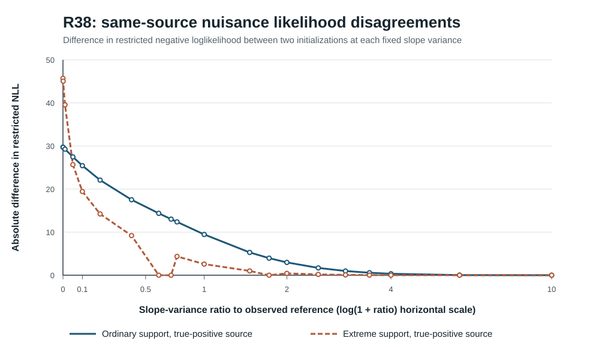

# R38 — dual-seed fixed-slope REML profile geometry: original-source results

**Research-only, negative numerical reproducibility result.** This is a deterministic diagnostic reuse of R37 source seed `202610163737`, generating block 2, not an independent source replication, boundary-likelihood significance test, or functional CR2 confidence-interval assessment.

Original [R38 scientific workflow #38814674706](https://github.com/stefanosbalaskas/eyetrajectoriespy/actions/runs/38814674706) passed both dedicated jobs. Original [artifact #12009578126](https://github.com/stefanosbalaskas/eyetrajectoriespy/actions/runs/38814674706/artifacts/12009578126) contains `cases.json`, `summary.json`, `source-commit.txt`, `SHA256SUMS`. All **3/3 original artifact SHA256 checks independently passed**. The recorded `GITHUB_SHA=45e64263d822801397dbbcced3f560d3be133624` is GitHub's **pull-request merge checkout**, not the source branch head `ed8261568f37b9fe133c554f0006693772a8e33f` used to initiate PR #340. The research study is isolated in [draft PR #340](https://github.com/stefanosbalaskas/eyetrajectoriespy/pull/340), stacked on R37 #339.

## Original prespecified study and outcome

R38 reuses one independently generated R37 primitive block with 24 participants, then four **paired** source conditions (ordinary/extreme predictor support × true zero/positive random slope variance). It evaluates **20 frozen slope ratios** (including mathematical zero and the neighborhoods of R37's two bad minima), each with **two nuisance reoptimizations** initialized from R37's best and worst converged outcomes: **160/160 fixed-slope nuisance fits completed, zero optimizer failures**. No independently generated R38 source blocks exist.

This is not 160 source replications: 160 is the **number of numerical optimizations on four paired versions of one source block**.

| R37 original paired condition | Dual-seed nuisance profile NLL disagreement >0.001 | R37 four-start objective spread | Best frozen-profile NLL improves over R37 selected best by >0.0001? |
|---|---:|---:|---|
| Ordinary support, true-zero slope | 0 / 20 | about 0 | No |
| **Ordinary support, true-positive slope** | **19 / 20** | **1.822897** | No |
| Extreme support, true-zero slope | 0 / 20 | about 0 | No |
| **Extreme support, true-positive slope** | **15 / 20** | **1.395040** | No |

Thus **34/80 distinct fixed-slope profile points** exhibited disagreement between nuisance fits from different initializations, despite 160/160 runs returning successful optimizer completion. The *nuisance* branch separation is especially severe at fixed slope ratio zero: the ordinary positive-source initializations differed in negative restricted loglikelihood by **29.7348**, and the extreme positive-source initializations differed by **45.7010**. At ratio 0.75, the differences were **12.3764** and **4.3615**, respectively.

Importantly, these are not estimates of an effect of true-positive slopes on optimizer reliability: all results reuse one realized Gaussian primitive block, with source states paired on those primitives. They are hard **within-source numerical counterexamples** to equating convergence success with a unique, fully optimized profiled likelihood.

## Original-source profile disagreement plot

The figure plots the absolute NLL difference between the two independently initialized nuisance fits at each fixed slope ratio for the **two positive-source conditions** in the original block 2. Both true-zero source controls had **0/20** material disagreements and are omitted from the overlaid positive-source curves for legibility. The horizontal axis uses `log(1+ratio)` spacing to expose the region near the zero boundary; the numerical differences are on the **untransformed** NLL scale. The graphic is derived from the original SHA-verified case ledger, not synthetic illustrative values.

## Exact-zero and projected first-order scores

All 16 original R37 continuous candidates were reconstructed and checked using the independently coded analytic Gaussian score and a projected box-KKT residual (at exact zero a nonnegative slope derivative can satisfy the correct lower-bound KKT condition). **Eight of the 16 reconstructed R37 starts exceeded the predeclared numerical tolerance 1e−4**. For the two particularly poor 10-times starts, the projected-KKT residual was **0.000914** (ordinary positive) and **0.000418** (extreme positive), despite solver success. Other selected and near-selected candidates also exceeded the same stringent threshold, so this is a *diagnostic tolerance*, not a binary certified solver-failure theorem.

The best four-start continuous R37 restricted negative likelihood **was not improved by any evaluated R38 fixed-profile grid point by more than 0.0001**. This limits—but does not eliminate—the concern that R37 missed the best *evaluated* basin. It **does not establish a global optimum** over slope ratios or nuisance coordinates: both competing nuisance fits may themselves terminate suboptimally, and a finite slope grid cannot certify the continuous optimum.

For example, under true-positive ordinary support, the best R37 fitted slope ratio was **0.74282**, versus **3.55363** for its bad 10-times start. Under true-positive extreme support, the corresponding ratios were **0.69619** versus **1.73204**. The original objective differences remained **1.822897** and **1.395040**. Their fixed-ratio nuisance profiles reveal substantially distinct local numerical solutions across much of the grid.

## Interpretation and next numerical gate

R37 established an independent exact-zero Gaussian REML objective/gradient, but its solver-success criterion is not a reliable uniqueness contract. R38 shows a more specific root problem: **nuisance-coordinate optimization can remain initialization-sensitive with the slope variance fixed**. A continuously optimized profile test cannot be calibrated just by choosing a better-looking R37 multistart solution and treating it as a global maximum.

Before a new-source continuous-profile calibration study, the next gate should investigate *nuisance parameter geometry* in the two positive-source problem cases: profile the participant intercept/trial/sensor components, examine active numerical bounds, compare more independent nuisance starts and alternative optimization algorithms, verify projected gradients at candidate basins, and retain all local solutions. A separately prespecified, failure-inclusive optimization procedure could then be applied to genuinely new independent true-zero/positive source blocks.

**Do not apply chi-square/mixture critical values or infer pointwise functional CR2 coefficient confidence intervals from R38.** There are no calibrated type-I error, power, covariance-estimation-uncertainty, function-wide coverage or simultaneous-band results. Keep scientific issues [#289](https://github.com/stefanosbalaskas/eyetrajectoriespy/issues/289) and [#296](https://github.com/stefanosbalaskas/eyetrajectoriespy/issues/296) **open**. Preserve the original R20/R22/R33/R34/R35/R36/R37 negative outcomes, protected main, supported API, release tags and PyPI unchanged. eyetrajectoriespy 1.2 is **not qualified for release**.
