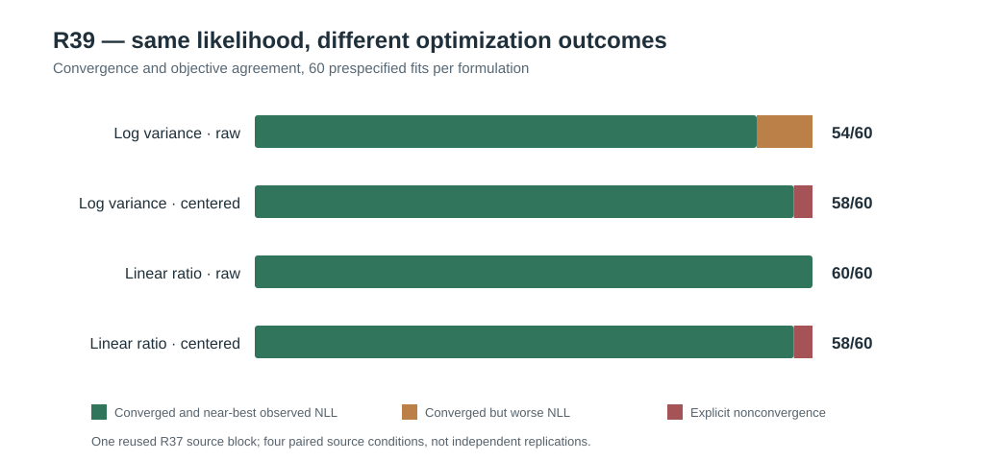

# W3 R39 — nuisance coordinate and NLL-centering experiment: original-source results

**Research-only numerical finding, not a new independent-source replication, certified global optimizer, variance significance test, or functional inference qualification.** [Draft PR #341](https://github.com/stefanosbalaskas/eyetrajectoriespy/pull/341) stacked on R38 #340. Original [science workflow #38818757085](https://github.com/stefanosbalaskas/eyetrajectoriespy/actions/runs/38818757085) completed both jobs. Original [case-ledger archive #12012491218](https://github.com/stefanosbalaskas/eyetrajectoriespy/actions/runs/38818757085/artifacts/12012491218) retains all case-level rows and all fit outcomes, including four nonconvergences. Its `cases.json`, `summary.json` and `source-commit.txt` independently passed all **three SHA256** checks. `source-commit.txt` records GitHub Actions' `GITHUB_SHA=35a6a4978772bc60de3f33529fa5ebf9f1d3b710`, a **pull-request merge checkout**, not an independently corroborated development branch tip.

## Prespecified numerical factorial

R39 reused **the exact R37 master seed `202610163737` and primitive generating block 2** also used by R38, 24 participants, irregular native repeated-trial Gaussian data. Four **paired** support/state source conditions (ordinary/extreme × generating zero/positive random-slope variance) do not constitute four independent experiments. **Zero new primitive generating blocks were simulated.**

At five prespecified fixed participant-slope variance ratios `0, 0.1, 0.75, 1.75, 3.5`, three nuisance-variance initializations (R37 best, R37 worst, log midpoint), two parameterizations (log variances versus direct positive linear variance ratios), and two NLL offsets (original raw restricted NLL versus subtracting an identical within-ratio reference constant), the prespecified design required **4 × 5 × 3 × 2 × 2 = 240** constrained optimization records.

The Gaussian likelihood, observed data, random-slope variance, nuisance components, strict original positive physical nuisance bounds and analytic scores were mathematically unchanged under the coordinate or objective representation. The dedicated numerical test workflow independently crosschecked exact-zero-slope objective agreement, coordinate gradient chain rule, centered objective invariance and interior finite differences. The same L-BFGS-B solver/settings were used, so differences reflect its numerical optimization behavior under each representation, not different statistical estimators.

## Original source numerical results

All **240/240** planned fit records were preserved; **236** reported optimizer convergence, and **four explicit nonconvergences** were retained. Six successfully converged raw-log fits stopped at inferior observed likelihoods. “Near-best” below means within `0.001` NLL of the **lowest successfully reported objective across all four formulations and three starts for that same case and fixed slope ratio**; it is a diagnostic comparison, not a global-likelihood reference or statistical significance threshold.

| Nuisance representation | Objective offset | Recorded / expected | Reported convergence | Converged near-best observed NLL | Converged worse NLL | Explicit nonconvergences |
|---|---|---:|---:|---:|---:|---:|
| Log variance | Raw restricted NLL | 60/60 | 60/60 | **54/60** | **6/60** | 0 |
| Log variance | Common-centered restricted NLL | 60/60 | 58/60 | **58/60** | 0 | **2/60** |
| Linear positive variance ratio | Raw restricted NLL | 60/60 | 60/60 | **60/60** | 0 | 0 |
| Linear positive variance ratio | Common-centered restricted NLL | 60/60 | 58/60 | **58/60** | 0 | **2/60** |

The **six raw-log successful-but-worse** local endpoints occurred only from the R37 *worst* nuisance initialization in the positive random-slope data states: **four** ordinary-support fixed ratios (`0, .1, .75, 3.5`) and **two** extreme-support ratios (`0, 3.5`). The original restricted-NLL losses were substantial under these conditions: at fixed slope ratio 0, ordinary support **29.73477** and extreme support **45.70101** above the best observed alternatives. This directly reproduces the large nuisance starting-basin discrepancies in R38, and isolates a numerical formulation that successfully crossed to a lower-NLL basin on all tested starts.

The poor raw-log fits commonly returned `CONVERGENCE: RELATIVE REDUCTION OF F <= FACTR*EPSMCH` despite very large **shared physical linear-ratio projected-KKT scores**, approximately **6.54–179.98** across the six wrong-basin fits. A small score with respect to log variance can conceal a large score with respect to the variance ratio when the ratio approaches its imposed small positive lower bound. This observation supports a **numerical-coordinate/termination explanation** for the old false-success endpoints.

The four nonconvergences arose **only** under centered objectives: two under centered linear ratios in the **extreme-support zero-slope** source at fixed ratios `0` and `0.1`, and two under centered log variances at `3.5` for extreme-support zero-slope and `0.75` for extreme-support positive-slope. Those optimizer messages were `ABNORMAL:`; each had an observed NLL numerically at or extremely near the best observed source/ratio NLL and low KKT residual, but its **optimizer nonconvergence flag remains a refusal**, not a success. Calling these four runs “good” solely because of their NLL would violate the original source-retention contract.

## Interpretation and open qualifications

**The most reliable observed configuration in this reused single-block numerical diagnostic was raw NLL with directly positive linear nuisance variance ratios** (60/60 successful near-best fits; zero optimizer nonconvergences). Using an objective-centering constant or changing coordinates did not alter the underlying restricted Gaussian likelihood and therefore cannot be interpreted as a scientifically superior model. Even for the raw linear coordinate, the study contains **no proof of a global optimum**, no independent new Gaussian source blocks, and no real eye-tracking measurements. A relative NLL cutoff is a within-source numerical diagnostic, not a Monte Carlo confidence interval.

These results strengthen the engineering case for independently checking covariance-component gradient/physical-coordinate projected KKT conditions rather than relying on `minimize.success` or an interior log-coordinate box alone. Before promoting a candidate solver, require a **fresh, independently generated, failure-inclusive numerical replication** under ordinary/extreme predictor support, null/positive slopes, missing observations and covariance misspecification, with fully specified selection/refusal rules. Only then investigate any continuous-profile boundary test with independent null calibration; that task remains separate from estimated-covariance functional regression inference.

**No p-values, chi-square or mixture likelihood-ratio cutoffs, nominal variance-component type-I error or power, corrected functional CR2 confidence intervals, or simultaneous 90% bands are justified.** Scientific issues [#289](https://github.com/stefanosbalaskas/eyetrajectoriespy/issues/289) and [#296](https://github.com/stefanosbalaskas/eyetrajectoriespy/issues/296) remain OPEN, as do all historical negative W3 findings. Protected `main`, supported APIs, version 1.2 release tags and PyPI remain unchanged. No publication authorized.
