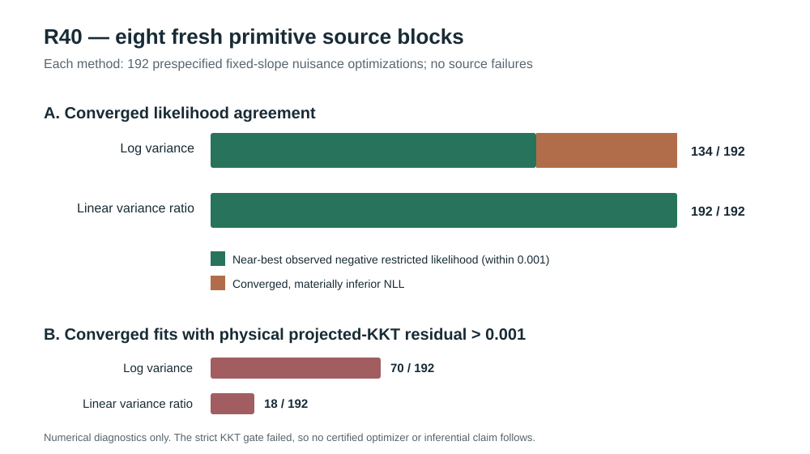

# W3 R40 — fresh-source Gaussian REML nuisance optimizer replication: original results

**Research-only numerical replication; the prespecified strict numerical qualification gate FAILED.** [Draft PR #342](https://github.com/stefanosbalaskas/eyetrajectoriespy/pull/342), stacked on R39 #341, not protected main. [Original scientific GitHub Actions run #38819889969](https://github.com/stefanosbalaskas/eyetrajectoriespy/actions/runs/38819889969) completed **both dedicated jobs successfully** (source-coupling/contract test and original 384-fit study). [Original evidence artifact #12011474333](https://github.com/stefanosbalaskas/eyetrajectoriespy/actions/runs/38819889969/artifacts/12011474333) contains all case records, summary, source-commit, and SHA256 manifest; **all three listed file SHA256 digests independently passed**. The source-commit file records **cce8d1a1a944e13891d255130acd41fc0387bfe5**, GitHub Actions' **pull-request merge checkout**, not the development branch tip. Original source script branch head was **6c9b5c0cadf350c9c6f51a443a46571a31596968** when the study started.

## Prespecified source, fitted likelihood, and denominators

New seed **202610164040**, independent of R37–R39 reused source. **Eight independent primitive Gaussian blocks**, n=24 participants each, original native irregular repeated trials. Each block was evaluated under paired ordinary/extreme predictor supports and true-zero/positive participant random-slope generator states. Genuine exact-zero responses delete the slope innovation while preserving the other Gaussian primitives, observations and predictor values. These are **32 paired source/condition evaluations, not 32 independent primitive draws**.

Two fixed random-slope ratios (exact zero and 0.75 of the observed-only reference), three frozen nuisance initializations (interior, near-lower participant intercept, near-lower trial), and two raw-NLL representations (log positive variances versus direct positive linear variance ratios) used the **same restricted Gaussian likelihood and positive nuisance bounds**. **8 primitive blocks × 2 supports × 2 generator states × 2 fixed slope ratios × 3 starts × 2 representations = 384 planned fits.** All 384 were recorded; no source failures, no missing cases, and **zero declared optimizer nonconvergences**. The independent-source denominator remains **eight blocks**.

## Original numerical outcomes

Near-best means an NLL at most **0.001** above the lowest **successfully observed** fit for the same source/fixed-slope profile across its six starts/methods. It is **not** a globally certified minimum.

| Numerical outcome | Raw log nuisance variances | Raw linear positive nuisance ratios |
|---|---:|---:|
| Recorded / planned | 192/192 | 192/192 |
| Declared convergence | 192/192 | 192/192 |
| Near-best observed NLL | **134/192** | **192/192** |
| Converged to worse NLL | **58/192** | **0/192** |
| Physical projected KKT residual greater than 0.001 | **70/192** | **18/192** |
| Maximum observed inferior NLL gap | **73.473730** | approximately 5.6 × 10⁻⁹ |
| Prespecified strict numerical gate | **FAIL** | **FAIL** |

The **58** log successful-but-inferior endpoints occurred **exclusively** with the near-lower participant-intercept initialization (58/64 starts), across **all eight independent primitive blocks**: between 6 and 8 inferior outcomes per block, with 30 in true-zero and 28 in true-positive source states. Neither the log-interior nor log-near-lower-trial start produced an inferior NLL in these source cells. At maximum, the poor log endpoint exceeded the best observed within-profile restricted NLL by **73.473730**.

The direct positive linear-ratio method attained near-best observed NLL in **192/192** optimizations from every prespecified start. In **58/192** matched same-start comparisons, its NLL was more than **0.001 lower** than the log-coordinate result; the converse occurred **zero** times. The paired linear-minus-log **median** was approximately zero, reflecting many agreeing start/condition pairs. These are paired **numerical calculations**, not 192 independent statistical observations or inferential superiority estimates.

## The negative KKT result still blocks qualification

A physically meaningful projected first-order residual was independently evaluated at the fitted nuisance solutions. **70/192** converged log fits and **18/192** converged linear fits exceeded the predeclared **0.001** physical-coordinate KKT threshold. Largest observed values were approximately **497.07** and **0.01003**, respectively. The 18 linear exceedances occurred across interior (6), near-intercept-lower (5), and near-trial-lower (7) starts.

This is a **strict diagnostic threshold**, not a p-value and not a global-optimum theorem. A better observed NLL and a successful solver return cannot override its negative outcome. The original **failure-inclusive numerical qualification gate is FALSE**; no post hoc relaxation or relabeling is appropriate. The strongest supported finding is that the raw linear-coordinate formulation **consistently avoided the large log-coordinate wrong-basin NLL outcomes** on this particular new eight-block Gaussian source experiment.

## What follows and what does not

Prioritize a numerical **R41** that investigates physical projected-KKT refinement and independent optimizer crosschecks, with every unsuccessful fit preserved, and then externally replicates any improved procedure on fresh independently seeded Gaussian data. Only after such work would formal independent-null variance-component test calibration be interpretable. Work on nuisance-estimation-aware functional CR2 confidence intervals and on separate nominal **90% simultaneous functional bands** remains scientifically unqualified and cannot be inferred from this optimization study.

No chi-square/mixture shortcut, variance significance test, type-I or power claim, functional coefficient interval coverage qualification, supported API, main merge, release tag or PyPI publication is authorized. Scientific issues [#289](https://github.com/stefanosbalaskas/eyetrajectoriespy/issues/289) and [#296](https://github.com/stefanosbalaskas/eyetrajectoriespy/issues/296) remain **open**. All original R20/R22/R33–R39 negative outcomes remain in the W3 evidence record.
