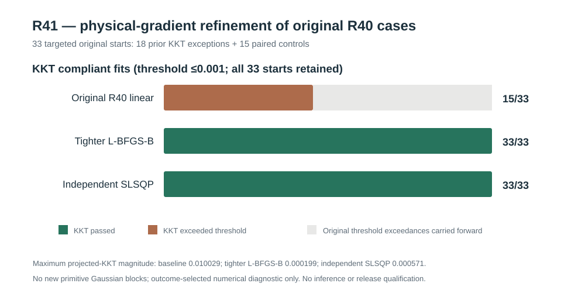

# W3 R41 — original R40 KKT-exception targeted refinement: results

**Research-only, outcome-selected numerical diagnostic. No new independent Gaussian source blocks and no estimator qualification.** [Draft PR #343](https://github.com/stefanosbalaskas/eyetrajectoriespy/pull/343) stacked on R40 #342. [Original scientific workflow #38867700762](https://github.com/stefanosbalaskas/eyetrajectoriespy/actions/runs/38867700762) completed **both dedicated jobs successfully**. [Original evidence artifact #12031857855](https://github.com/stefanosbalaskas/eyetrajectoriespy/actions/runs/38867700762/artifacts/12031857855) includes the original-source targeted case ledger, summary, CI checkout source commit and SHA256 manifest. **All three checksum entries independently passed.** The checkout source-commit was **5ca61ca0df6a444c2dffe9699c0875e7a00eed2f** (GitHub Actions pull-request merge checkout, not this branch's tip).

## Frozen original source and complete outcome-selected sample

The original R40 cases archive from [#12011474333](https://github.com/stefanosbalaskas/eyetrajectoriespy/actions/runs/38819889969/artifacts/12011474333) had **SHA256 cases.json = 7943b6ea869c242ba8b7ee7c00a7025af755f2d9ef7d9e9aaec1e36c4009c349**. Its eight independently generated Gaussian primitive blocks used seed **202610164040**, 24 participants per block, genuine exact-zero or positive random-slope generating states and original native irregular trials.

Of the 192 original R40 raw-linear-variance nuisance optimizations, **18** exceeded the frozen **0.001** physical projected-KKT residual despite optimizer success and near-best observed negative restricted likelihood. The **18 complete exceptions**, spanning 15 unique generating-block/support/state/fixed-slope profile cells, were frozen in R41; one within-profile original KKT-passing start per cell provided **15 deterministic matched controls**. All **33 starts were selected after examining R40 numerical outcomes**. They are **not a representative random sample, 33 independent source replications, or new experimental data**. The R40 generator was replayed exactly; **zero new independent primitive blocks** were generated in R41.

Each original fixed nuisance start was refitted under its identical Gaussian restricted likelihood and strictly positive physical bounds, then separately restarted at the original R40 endpoint using **tighter L-BFGS-B** and a genuinely different **SLSQP solver** under the same analytic likelihood and score. The complete planned **33 × 3 = 99** optimizer evaluations were retained, with **zero replay selection/source mismatches, zero missing records and zero reported optimizer failures or nonconvergences**.

## Original numerical comparison

| Outcome | Original R40 linear | Stricter L-BFGS-B restart | Independent SLSQP restart |
|---|---:|---:|---:|
| Recorded / planned fits | 33/33 | 33/33 | 33/33 |
| Reported successful convergence | 33/33 | 33/33 | 33/33 |
| Physical projected KKT ≤0.001 | **15/33** | **33/33** | **33/33** |
| Original 18 exceptions now passing | **0/18** | **18/18** | **18/18** |
| Maximum successful physical projected KKT | **0.0100291** | **0.0001989** | **0.0005705** |
| Material NLL improvement over baseline (>0.001) | — | 0/33 | 0/33 |
| Material NLL deterioration versus baseline (>0.001) | — | 0/33 | 0/33 |
| Failed or nonconverged optimizer outcomes | **0** | **0** | **0** |

Both independently implemented restart procedures successfully lowered the physical projected-KKT residual for all original R40 exceptions below **the original frozen cutoff**. Neither required a material change to the best observed Gaussian restricted NLL. Among paired successful starts, the refined minus original NLL differences were bounded approximately between **−5.6 × 10⁻⁹ and 9.1 × 10⁻¹³**. This is consistent with **incomplete first-order numerical convergence** rather than a substantively different maximum-likelihood basin in these 18 cases. The original R40 failures have **not** been reclassified: R41 records their original fail status explicitly.

## Scope, scientific boundary and next qualified experiment

This is a strong **same-data numerical repair diagnosis**, not an external validation or a globally certified Gaussian REML covariance estimator. The 18 problematic endpoints were **outcome-selected**, both refinements were **started from earlier solutions**, and R41 used only **the original eight R40 generating blocks**. A statistically interpretable success rate cannot be estimated from the selected 33 numerical starts.

R42 should **freeze an end-to-end candidate algorithm and refusal rule before simulating new independent Gaussian primitive data**, compare original and tightened/rechecked solutions on *all prespecified source cases*, and report every optimizer and physical-KKT exception. That future test must independently include challenging near-lower variance initialization and ideally misspecified working covariance and nonrandom observation processes. Passing further numerical optimization checks is still separate from independent-null boundary-variance inference, fitted-covariance-aware CR2 coefficient uncertainty and nominal **90% pointwise and simultaneous functional coverage**.

**Do not claim** calibrated hypothesis-test p-values, mixture chi-square reference, type-I error/power, corrected CR2 coefficient intervals, valid simultaneous bands, global optimality, public API qualification or release readiness from R41. Original W3 blockers [#289](https://github.com/stefanosbalaskas/eyetrajectoriespy/issues/289) and [#296](https://github.com/stefanosbalaskas/eyetrajectoriespy/issues/296) remain **OPEN**. No protected-main merge, version 1.2 release tag or PyPI publication was undertaken.
