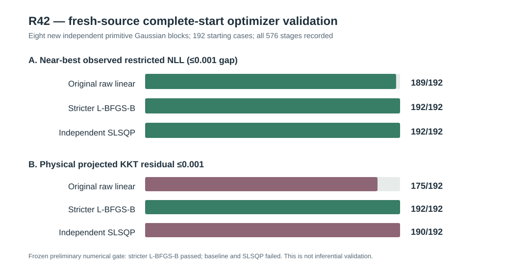

# W3 R42 — fresh independent Gaussian-source KKT refinement: original scientific results

**Research-only original-source numerical study; the stricter L-BFGS-B arm PASSED its frozen numerical-only gate. This does not establish global REML optimality or inferential validity.**

[Draft PR #344](https://github.com/stefanosbalaskas/eyetrajectoriespy/pull/344) is stacked on R41 #343 rather than protected main. [Original R42 scientific Actions run #38872026906](https://github.com/stefanosbalaskas/eyetrajectoriespy/actions/runs/38872026906) completed **both dedicated jobs successfully**: source identity/analytic-contract testing and the full original 576-stage study. [Original evidence archive #12034190101](https://github.com/stefanosbalaskas/eyetrajectoriespy/actions/runs/38872026906/artifacts/12034190101) retains **all 32 source-condition rows, 192 numerical starts, 576 stage records**, summary, original checkout SHA and SHA256 manifest. Independent checksum verification passed **3/3** files: cases.json SHA256 **e85e319b6cb7957c095d261eea5dcf71a4b2babbf8ce3e8b754453e53c2a9df1**, summary.json **e77b55df735995fa2aec130d24e8e6ba86e39440a98a2b844fde8494b733556d**, source-commit.txt **5f7872c4f31650acf298169c05083ed5b9925163757b96e1df0cd67279cc9d67**. The artifact's recorded source-commit is **082c8bf470fb614615313350b31e5d3ca493e4cb**, which is GitHub Actions' **pull-request merge checkout**, not the development branch tip.

## Independently generated source and frozen comparison

The R42 seed **202610164242** differs from R37–R41. **Eight independently generated Gaussian primitive blocks**, each 24 participants, were paired across **ordinary/extreme leverage × exact-zero/positive random-slope states**, preserving original irregular native trial/time/participant patterns. Exact-zero trajectories were generated by **removing the actual Gaussian participant-slope innovation** and reconstructing responses, not merely relabeling the source variance. There were **32 paired source-condition evaluations** but only **eight statistically independent primitive blocks**.

Every source state was evaluated at two fixed random-slope ratios (exact 0 and 0.75 times each source's observed-only residual reference) from three previously frozen observed-data-blind nuisance configurations (interior, intercept variance near lower box bound, trial variance near lower box bound). There were **192 starts**. Each start had the full frozen three-stage evaluation: original R40 raw-NLL linear-variance L-BFGS-B, R41 stricter physical-coordinate L-BFGS-B restart, and an independent SLSQP cross-check from the same baseline endpoint, producing **576/576** original stage records. No source failures, missing stages or optimizer nonconvergences were recorded.

All formulations used the same observed Gaussian restricted likelihood, analytic physical-variance gradient and strictly positive nuisance-variance ratio bounds. All fitted objectives were compared on the original unshifted restricted NLL scale. These are **numerical starts**, not 192 statistically independent method evaluations.

## Results on the original eight-block source

“Near-best” means within the frozen **0.001 restricted NLL** tolerance of the lowest successfully *observed* objective across all three stages and three nuisance starts for a particular source-condition/fixed-slope profile; this does **not** certify a global optimum. The physical-coordinate projected KKT cutoff remains **0.001**.

| Prespecified numerical endpoint | Original raw linear baseline | Stricter L-BFGS-B restart | Independent SLSQP restart |
|---|---:|---:|---:|
| Completed original stage records | 192/192 | 192/192 | 192/192 |
| Converged without explicit refusal | 192/192 | 192/192 | 192/192 |
| Near-best observed restricted NLL | **189/192** | **192/192** | **192/192** |
| Converged at inferior NLL (>0.001 gap) | **3/192** | **0/192** | **0/192** |
| Physical projected KKT ≤0.001 | **175/192** | **192/192** | **190/192** |
| Physical projected KKT >0.001 | **17/192** | **0/192** | **2/192** |
| Worst observed projected KKT among successful fits | **509.32809** | **0.00037304** | **0.00190026** |
| Original frozen numerical-only qualification gate | **FAIL** | **PASS** | **FAIL** |

The original raw-linear L-BFGS-B solver reported success for all starts but nevertheless produced **three materially inferior likelihood endpoints** in different independently generated blocks, with original NLL gaps **19.41859** (block 7, extreme, positive slope, fixed slope ratio 0, interior), **24.76438** (block 5, ordinary, zero slope, fixed ratio 0.75, near-lower-intercept start) and **28.45874** (block 6, extreme, positive slope, fixed ratio 0.75, near-lower-intercept start). Original-baseline KKT failures occurred across **all eight** independently generated primitive blocks (17 total).

The stricter L-BFGS-B restart removed all three large objective disagreements and met the original frozen KKT tolerance on **every one of its 192 starts** (largest reported projected residual **0.00037304**). From identical original starting endpoints, the SLSQP cross-check also removed the three inferior likelihood outcomes, but **two** outcomes retained projected residuals above **0.001** (largest **0.00190026**), in primitive blocks 2 and 3. Those remain explicit negative numerical findings, not silently accepted because their NLL was near-best.

Both restart algorithms improved the baseline NLL by more than 0.001 in **3/192 paired comparisons**; neither had a material NLL worsening beyond 0.001 in any paired comparison. The largest improvement in the stricter L-BFGS-B restart was approximately **28.45874 NLL units**. There were **no optimizer nonconvergences** in this prespecified source. Under the exact numerical-only gate frozen before this simulation, the **stricter L-BFGS-B** arm passed and **both other arms failed**.

## Interpretation, limitations and scientific continuation

The R42 finding advances beyond R41: a **fully prespecified all-start** evaluation on **eight new independent Gaussian primitive source blocks** corroborates the numerical efficacy of the stricter physical-variance-ratio L-BFGS-B restart. The original likelihoods and variance bounds were unchanged. The finding supports using stricter physical-gradient audits and explicit refusals in research implementations rather than relying on ordinary L-BFGS-B success flags.

However, passing the frozen numerical-only experiment does not prove a global maximum, assess recovery under altered covariances or irregular nonrandom gaze loss, or establish an estimator's behavior on empirical eye-tracking data. The eight-block design is still limited, paired within source, and uses only n=24 and two fixed random-slope profile ratios. R43 should stress-test a **frozen complete numerical algorithm and refusal contract** on additional freshly generated blocks, with altered participant counts, incomplete observation processes and covariance misspecification; it must not condition analysis on favorable R42 outcomes. Separate prospective null-calibration of any variance-boundary test and covariance-estimation-aware pointwise functional CR2 inference would still be necessary, followed by **separate nominal 90% whole-function simultaneous band calibration**.

The scientific blockers [#289](https://github.com/stefanosbalaskas/eyetrajectoriespy/issues/289) and [#296](https://github.com/stefanosbalaskas/eyetrajectoriespy/issues/296) remain **OPEN**. No Gaussian variance-component boundary p-values, type-I/power results, CR2 coefficient interval calibration, whole-function coverage claims, supported API promotion, protected-main merge, release tag or PyPI publication are authorized.
