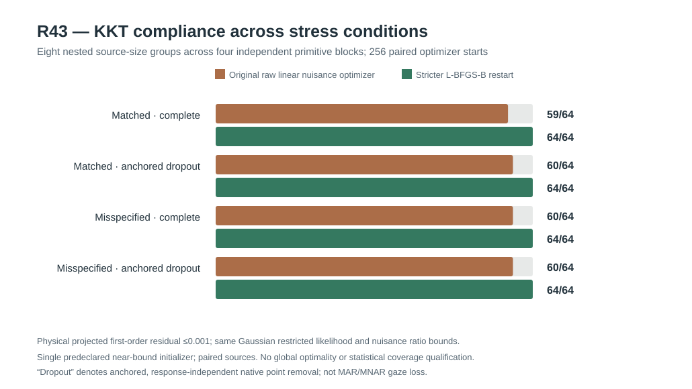

# W3 R43 — fresh-source nested-size, anchored dropout and covariance-family misspecification: original results

**Research-only numerical stress result. The stricter L-BFGS-B restart passed the prespecified numerical-only gate, but Gaussian covariance inference and function-wide confidence intervals remain unqualified.** [Draft PR #345](https://github.com/stefanosbalaskas/eyetrajectoriespy/pull/345) is stacked on R42, not protected main. The [original dedicated scientific run #38874098579](https://github.com/stefanosbalaskas/eyetrajectoriespy/actions/runs/38874098579) passed **both** source-contract tests and its **original 512-stage numerical scientific experiment**. The [original retained case-ledger artifact #12034991817](https://github.com/stefanosbalaskas/eyetrajectoriespy/actions/runs/38874098579/artifacts/12034991817) contains complete cases and summary, GitHub Actions checkout commit, and SHA256 manifest. All **3/3** original file SHA256 checks were independently verified: `cases.json` **aa9ffda9c6d45f83f216138a54e0469ec322dcb51fd9a87a40332342770068a0**, `summary.json` **6e6d038096f8a0584983ee1c5071ac6d1408fd13351824342a3d3b8e9d9ee2b0**, `source-commit.txt` **72657247c2d566adb1da0c24b55238763f494c49b22bb39fa07c2d1eb97d9160**. The recorded GitHub Actions checkout **65c175bc3ac9b75924d6c96221e3f465b78c66be** is a *pull-request merge-checkout SHA*, not the draft branch tip.

## Prospective numerical design and independence

Original R43 seed **202610164343**, distinct from R37–R42, generated **four independent Gaussian primitive blocks**. Each block supplied *nested* n=24 and n=48 participant subsamples, ordinary and extreme predictor support, and **paired exact-zero/positive random-slope sources** reconstructed by removing the actual Gaussian slope innovation in the zero variant. The resulting **64 paired source conditions are not 64 independent Gaussian experiments**. Every trial retained its original asynchronous native time axis.

The observation-process comparison used complete trajectories versus **anchored independent point removal**: interior native observation points retained with fixed probability **0.70**, while native trial endpoints were preserved and at least four timestamps per trial were retained by design. The actual retained fraction averaged **72.0%** across the paired dropout cases (range approximately **70.4–74.6%**). The mask was independent of the response, and was coupled across paired positive/zero generating states and nested participant-count variants. This is neither arbitrary unconditional MCAR across all points nor an observation-dependent **MAR/MNAR** missing-data experiment. No interpolation or simulator-derived truth was inserted into the estimated likelihood.

The fitted Gaussian covariance working family was **matched predictor-scaled participant random slope** versus **deliberately misspecified predictor-independent shared participant slope**. Both analyzed the *same observed source values*; this is working-covariance misspecification, not a different source generator. Original fixed random-slope profile ratios were exactly 0 and 0.75; the sole, predeclared nuisance initialization placed participant-intercept variance near the lower positive box bound. This **one hard initialization** is narrower than the complete multistart R42 study. Both methods used the same original restricted Gaussian negative loglikelihood and analytic gradients, with the original strict positive physical nuisance variance box.

**Original planned denominator:** four independent primitive blocks × two nested n values × two supports × two generating slope states × two observation processes = **64 paired source conditions**, × two working covariance families × two fixed slope ratios = **256 profile pairs**, × original and stricter L-BFGS-B stages = **512/512 original numerical stage records**. There were **no source errors, absent starts or optimizer nonconvergences**.

## Original numerical results

Both physical linear-variance optimizer stages returned near-best observed restricted NLL for **256/256** within-profile paired starts, using the frozen within-pair **0.001** NLL tolerance. In this study, “near-best” is relative only to the two fitted stages per source/profile, not independently certified Gaussian global REML optimum.

| Frozen numerical endpoint | Original R40 raw linear solver | Frozen stricter L-BFGS-B restart |
|---|---:|---:|
| Recorded / planned stage evaluations | **256/256** | **256/256** |
| Reported optimization convergence | **256/256** | **256/256** |
| Near-best within-pair original restricted NLL | **256/256** | **256/256** |
| Physical projected KKT ≤0.001 | **239/256** | **256/256** |
| Physical projected KKT >0.001 | **17/256** | **0/256** |
| Maximum observed physical projected KKT | **0.021801** | **0.000426** |
| Material NLL difference from paired stage >0.001 | **0/256** | **0/256** |
| Prespecified strict within-experiment numerical-only gate | **FAIL** | **PASS** |

The numerical pass rates of the *original* solver varied by working covariance/observation process; the stricter restart met the exact same frozen threshold in **all four strata**:

| Fitted covariance working family | Observation process | Original physical KKT ≤0.001 | Stricter restart physical KKT ≤0.001 |
|---|---|---:|---:|
| Matched predictor-scaled | Complete | 59/64 | **64/64** |
| Matched predictor-scaled | Anchored independent dropout | 60/64 | **64/64** |
| Deliberately misspecified shared slope | Complete | 60/64 | **64/64** |
| Deliberately misspecified shared slope | Anchored independent dropout | 60/64 | **64/64** |

The **17 original KKT exceedances** appeared in **all four primitive source blocks** (counts 5, 4, 2 and 6), among both n=24 (10) and n=48 (7), both generating zero (12) and positive (5) slope states, and both complete (9) and dropout (8) observation conditions. Ten occurred at the fixed random-slope boundary ratio 0 and seven at ratio 0.75. The largest original KKT was **0.02180075**; the largest stricter restart KKT was **0.00042633**, less than the frozen 0.001 limit.

The stricter stage never worsened the raw restricted likelihood by more than 0.001; original restart-minus-baseline NLL differences were approximately **−9.67 × 10⁻⁹ to 0.0**, so no new substantive likelihood basin was uncovered in this small stress design. The repeat finding supports the narrower numerical interpretation that the original raw solver sometimes reported success before satisfying the strict physical first-order condition, while the predeclared stricter restart consistently met it on this source.

## Statistical limitations and next gates

**R43 provides numerical optimizer robustness evidence, not covariance-model correctness.** The Gaussian shared-slope covariance working family was deliberately wrong under positive predictor-scaled source variation. Passing its numerical KKT condition is entirely compatible with biased/miscalibrated uncertainty. Likewise, the anchored random point dropout experiment **does not address response-dependent observation processes or complete-case selection**, the distinct scientific concern in issue [#296](https://github.com/stefanosbalaskas/eyetrajectoriespy/issues/296).

The study also uses only **four independent primitive blocks**, 24/48 participants, a single near-lower nuisance start and two fixed slope ratios. It provides no proof of global REML optimality, no test of realistic non-Gaussian eye-tracking data and no empirical power to establish nominal frequentist inference. The stagewise best-observed objective is not a global optimum certificate.

A sensible **R44** should prospectively separate numerically stable fitted covariance targets from **independently replicated sampling performance**, especially under genuinely response-dependent gaze loss, wrong working covariance, and participant-level selection, retaining full-source denominators. Any variance-component boundary test requires its own independent-null reference/Type-I calibration; any functional CR2 estimator needs independent repeated-source pointwise coverage and a **separate simultaneous whole-function 90% band** assessment.

Scientific blockers [#289](https://github.com/stefanosbalaskas/eyetrajectoriespy/issues/289) and [#296](https://github.com/stefanosbalaskas/eyetrajectoriespy/issues/296) remain **OPEN**. No supported API inference claim, protected-main merge, release tag, or PyPI publication is authorized; original negative R20/R22/R33–R42 results remain on the public research ledger.
