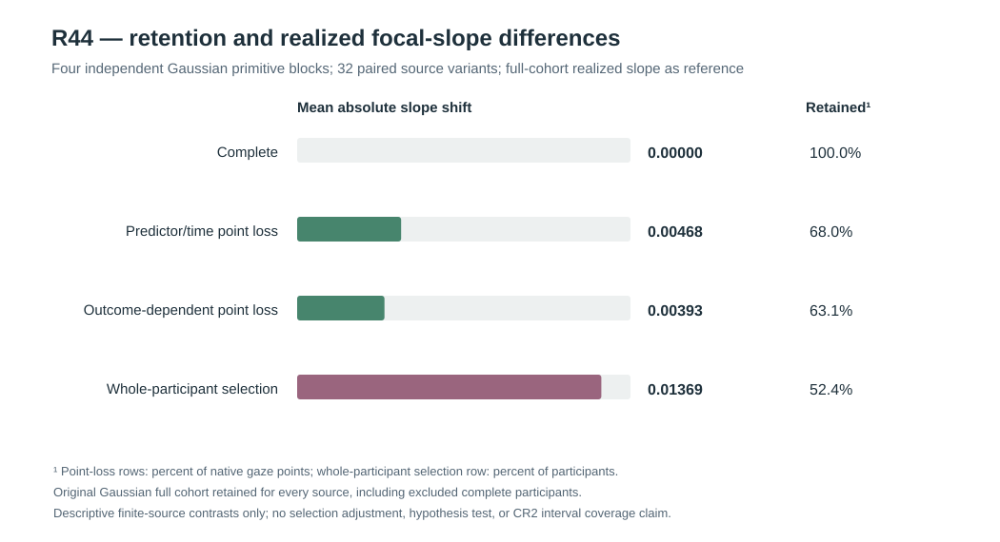

# W3 R44 — response-dependent point loss versus whole-participant selection: original results

**Research-only original-source missingness and selection diagnosis. The frozen stricter physical-coordinate REML optimizer passed the numerical-only gate, but no estimator of the complete-source scientific target has been qualified under nonignorable missingness or selection.** [Draft PR #346](https://github.com/stefanosbalaskas/eyetrajectoriespy/pull/346) is stacked on R43, not protected main. [Original R44 scientific GitHub Actions #38876131765](https://github.com/stefanosbalaskas/eyetrajectoriespy/actions/runs/38876131765) completed **both** source/missingness-contract tests and the original **512-stage** scientific execution. [Original source case-ledger artifact #12036150126](https://github.com/stefanosbalaskas/eyetrajectoriespy/actions/runs/38876131765/artifacts/12036150126) includes complete cases, summary, CI source checkout and `SHA256SUMS`. All three entries independently matched: `cases.json` **c54864f5bd2d43baf791e8b419657f332711e042e290eb5fafedd97b76d92a25**, `summary.json` **30ffc885865226bfaddf8f1a66f39b1b0f031e18176e2f02f8a55faa47e700b7**, and `source-commit.txt` **0067de0d979c6666ca819c6b7c0cd000996ce2c6c1a9492258385c76cc7d1de7**. Its recorded CI checkout SHA **9dbe63c13a20edf65d4bede381f7ccd799c862f6** is a GitHub Actions pull-request merge checkout, not the draft branch tip.

## Scientific estimand and independent source

The new seed **202610164444** generated **four independently drawn Gaussian primitive blocks**, each with nested n=24/n=48 participants and paired ordinary/extreme predictor-support plus exact-zero/positive participant-slope generating states. The zero-variance source **actually omits the Gaussian participant-slope innovation**. The **32 block/size/support/state variants** share source innovations within block; their independent primitive denominator remains **four**.

We preserved three distinct focal regression-slope referents at original prespecified focal time: the **generating full-population conditional mean slope** (known only to the simulator), each block's **realized full-source WLS slope**, and the **retained-data WLS slope** after observation loss or selection. The last two are descriptive realized-data calculations, not coverage confidence intervals. All four mechanisms were applied in parallel to the **same original complete trajectories** so loss was not confused with independent data generation.

## Four observation processes

- **Complete:** native observations, trials and participant identities unchanged.
- **Predictor/time-conditioned point loss (MAR-like):** native interior point retention probabilities depended on observed predictor and native timestamp, which are assumed known when gaze y is missing. Trial endpoints were anchored and each trial retained at least four points by deterministic rescue. This is synthetic observed-variable-dependent loss, not proof of ignorability for real gaze data.
- **Outcome-dependent point loss (MNAR):** interior retention probabilities explicitly depended on the **potentially missing first-dimensional gaze response y itself**. The full latent y was available only to the simulator to generate observation indicators; the fitted model did not see missing y. Endpoints and minimum native trial length were preserved.
- **Latent-outcome-dependent complete-participant selection:** a participant Bernoulli selection probability depended on the **original complete mean latent gaze response over all their trials**. Included participants retained their entire original records; excluded participants disappeared **completely** from the fitted observation matrix, but **not** from the source cohort denominator or full-source reference ledger. No participant redraws or implicit complete-case remapping were allowed.

Original participant counts, retained participant counts, trial counts, native point counts and response-dependence flags are retained in each source case. There were **no source failures**, no participant-selection refusals from fewer than six retained units, and no missing original case records.

## Original source descriptive selection results

All **32 paired source variants × 4 observation processes = 128/128** records were completed. The observed data retention and realized focal-slope differences relative to each matching **realized full-source slope** were:

| Observation mechanism | Mean native point retention | Mean participant retention | Mean signed retained−full focal slope | Mean absolute retained−full focal slope |
|---|---:|---:|---:|---:|
| Complete | 100.0% | 100.0% | 0 | 0 |
| Predictor/time-conditioned point loss | **68.01%** | 100% | **+0.000474** | **0.004679** |
| Missing-outcome-dependent point loss | **63.07%** | 100% | **+0.001490** | **0.003930** |
| Latent-outcome-dependent participant selection | **52.85%** of native points, as a consequence of selecting participants | **52.41%** | **+0.002236** | **0.013689** |

Across these **32 paired condition rows**, complete-participant selection yielded the largest *observed mean absolute finite-source empirical slope displacement*: **0.013689**, compared with **0.004679** for predictor/time-conditioned point loss and **0.003930** for response-dependent point loss. Its largest observed absolute shift was **0.042992**, compared with **0.014423** and **0.013007** for those point-loss processes respectively. Only **10–27** original participants survived participant selection in the observed n24/n48 source variants, and the realized retention proportion varied. Signed means were small because positive and negative finite-sample changes partly canceled; this **must not** be interpreted as evidence of negligible individual-source selection effects.

These values are **descriptive finite-simulation outcomes, not formal population bias estimates**. There are only **four independent primitive generating blocks**, nested participant sizes and paired source variants; the 32 rows are not independent Monte Carlo draws. The study does **not** isolate a causal effect of the missingness class because the mechanisms have deliberately different retention probabilities, and their selection fractions were not matched. Smaller average shift under the outcome-dependent point-loss design does **not** establish that MNAR is less problematic than MAR or that participant selection always has a larger effect.

## Independent numerical optimizer diagnostics on retained data

The original Gaussian predictor-scaled covariance kernel, positive physical nuisance box and fixed random-slope ratios 0 and 0.75 were fitted using **only the retained native responses, predictors, timestamps and trial IDs**, with a single predeclared near-lower-intercept start. The original R40 raw positive-linear-variance nuisance L-BFGS-B and predeclared stricter R41 L-BFGS-B restart were compared at each observed source/fixed-slope profile. **128 observation-process cases × 2 frozen slope ratios × 2 algorithms = 512/512 retained original optimizer-stage records**, without solver refusals or nonconvergence.

| Prespecified numerical endpoint | Original raw linear L-BFGS-B | Stricter L-BFGS-B restart |
|---|---:|---:|
| Recorded / planned solver stages | **256/256** | **256/256** |
| Successful optimizer returns | **256/256** | **256/256** |
| Within-stage-pair near-best original NLL (≤0.001 gap) | **255/256** | **256/256** |
| Physical projected KKT ≤0.001 | **246/256** | **256/256** |
| Physical KKT exceedances | **10/256** | **0/256** |
| Prespecified numerical-only gate | **FAIL** | **PASS** |

The ten original numerical KKT failures consisted of **seven** in complete observation cases and **three** in predictor/time point-loss cases; there were **zero** such baseline failures in the outcome-dependent point-loss and whole-participant selection cases under this exact source and single fixed initialization. The baseline maximum physical projected-KKT was **310.548**, compared with a stricter-restart maximum **0.000243**. The original baseline also had **one** materially inferior NLL endpoint in the complete-data stratum, corrected by the stricter restart. Despite some solver success flags, those original endpoints are not counted as satisfying the frozen numerical tolerance.

The stricter optimizer therefore met the numerical-only gate on all **256** paired profiles on this particular four-block R44 study. That finding concerns **first-order numerical minimization of the fitted likelihood**; an optimizer can be stationary and still estimate the wrong scientific target when the observed sample is selected on latent gaze responses.

## Scope of the conclusion and next scientific work

The R44 observation mechanisms demonstrate why a **complete-source target and an observed selected-data target must not be silently equated**. Repeatedly fitting a stable Gaussian covariance likelihood to the retained responses cannot by itself establish the counterfactual full-cohort focal-slope estimand, valid missingness adjustment, or corrected coverage. The study did **not** fit a missingness model, estimate inverse observation probabilities from observed information, recover excluded latent participant outcomes, develop a selection correction, or calculate frequentist confidence-interval coverage. Moreover, the point-loss designs anchor native endpoints and fix minimum trial length, whereas participant selection excludes entire participant records. These controlled mechanisms do not claim empirical realism across eye-tracking devices.

**R45 should preregister a scientifically explicit estimand and missingness-adjustment candidate, and prospectively evaluate its pointwise functional-coefficient coverage against fixed generating truth under fresh independent primitive source blocks.** Selection models must not use unavailable latent response values in the estimator. A distinct study is then required for nominal **90% simultaneous whole-function coverage**. Any random-slope-variance boundary test separately requires independently simulated null-reference and Type-I calibration; neither task is accomplished by R44.

Scientific blockers [#289](https://github.com/stefanosbalaskas/eyetrajectoriespy/issues/289) and [#296](https://github.com/stefanosbalaskas/eyetrajectoriespy/issues/296) remain **OPEN**. R20/R22/R33–R43 original negative scientific results remain intact. No protected-main merge, public API promotion, version 1.2 release tag or PyPI publication is authorized.
