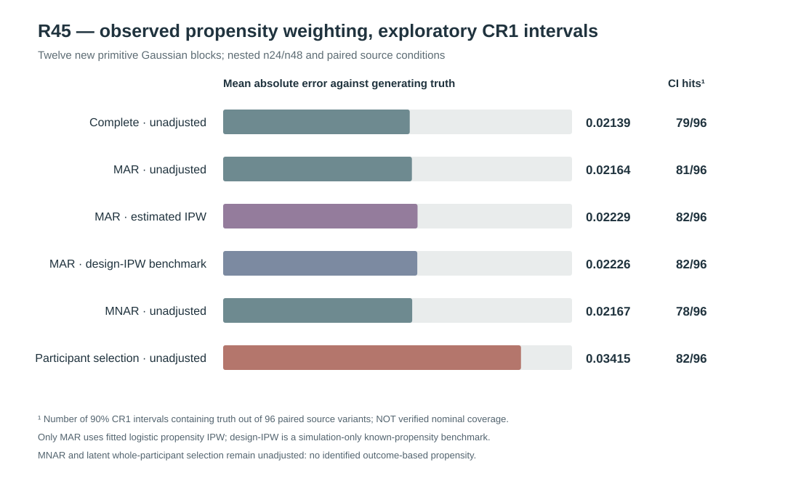

# W3 R45 — observed-data propensity IPW and exploratory pointwise CR1 interval pilot: original results

**Research-only, negative/inconclusive inferential pilot. Neither the fitted propensity-IPW estimator nor the participant-level CR1 confidence intervals are scientifically qualified for nominal 90% pointwise coverage.** [Draft PR #347](https://github.com/stefanosbalaskas/eyetrajectoriespy/pull/347) is stacked on R44 #346, never protected main.

## Original source, integrity and test record

R45's first dedicated [GitHub Actions run #38880454384](https://github.com/stefanosbalaskas/eyetrajectoriespy/actions/runs/38880454384) completed the **original 12-block 576-interval scientific job successfully**, but its independent numerical-contract test job **failed 1 of 8 tests** because an assertion compared all 48 *preallocated* Gaussian primitives to their 24-participant prefix, rather than comparing matching prefixes. This was a **test bug**, not a change to source generation, the observed propensity estimation or the original scientific computations. The test assertion was corrected on the same draft branch without altering the scientific code, and the [corrected dedicated workflow run #38880620456](https://github.com/stefanosbalaskas/eyetrajectoriespy/actions/runs/38880620456) subsequently passed **both** original-source and test jobs. The first failed test remains in the engineering evidence record; it has not been silently reclassified as a pass.

The original [GitHub Actions scientific source artifact #12037038258](https://github.com/stefanosbalaskas/eyetrajectoriespy/actions/runs/38880454384/artifacts/12037038258) retains the complete source/interval case ledger, summary, CI checkout and checksum manifest. All three SHA256 checks independently passed: `cases.json` **6860fd7be2f20f16c86ed63c732f201d259175b6ac327a07849cf6e4f4dc4624**, `summary.json` **70b4a78da1a0cfc211f23657d478ea789fc13912997756d2f199155ca2b616db**, and `source-commit.txt` **26dff11eaeaafc44a532841052e8c9e555e947840e755a4dec9c22fc34ee0693**. The source-commit file records **7be6663a00ebc5ccc31a28caf28f08c7c338c4bc**, a GitHub Actions **PR merge checkout**, not the branch head.

## Source, identified MAR selection process and missingness scope

New Gaussian source master seed **202610164545**, independent of earlier R37–R44 sources; **12 independent Gaussian primitive generating blocks**, each nested n=24/48. Ordinary/extreme predictor support and genuine generating exact-zero/positive participant random-slope conditions were paired within those blocks. This gives **96 paired source variants**, not 96 independent simulation experiments. The primary estimand is the original **generating fixed predictor-slope coefficient at the prespecified focal time**, with the original complete realized empirical focal slope separately retained as a finite-source comparison.

Four observation processes shared the same original latent Gaussian source: complete trajectories; **Bernoulli point loss depending only on recorded predictor and native time** (MAR conditional on observed scheduled design), **Bernoulli point loss depending on the potentially unobserved gaze y itself** (MNAR under the simulation), and **whole-participant exclusion based on the latent complete participant gaze mean**. Native endpoints had retention probability one for the two point-loss processes, and the point-level indicators and original predictor/time schedule were available as auxiliary inputs for MAR propensity estimation; missing gaze values remained `NaN` and were never imputed or supplied to the estimator. Under whole-participant exclusion, the excluded units' entire recording schedules were unavailable to the estimator. The source ledger nevertheless preserved original full-cohort counts and generating truth.

R45 compared:
- Under complete data, participant-balanced observed WLS with an exploratory **cluster CR1 90% t interval**.
- Under the identifiable MAR schedule, **unadjusted observed WLS**, **feasible fitted logistic observed-design propensity IPW** (features `1, |x|/(1+|x|), t`; fitted using `R,x,t` only), and a separately labeled **known design-propensity benchmark IPW** using the synthetic observation policy known to the simulator.
- Under simulated MNAR point loss and latent whole-participant selection, **unadjusted observed WLS only**; there is **no feasible IPW correction** using the unavailable outcome-dependent selection probabilities under this observed-data contract.

All **96 source variants × 4 observation processes = 384/384** source-observation cases and **576/576** prespecified interval fit records completed with **zero source failures, zero observation-process failures and zero interval method refusals**.

## Original exploratory CR1 results

Mean absolute point-estimation error below refers to the *fixed generating true focal slope*. The empirical interval “truth inclusion” column counts nominal 90% participant-cluster CR1 pointwise intervals containing that truth **among 96 paired source variants**, and **is not an independently validated nominal 90% coverage probability**; only **12 primitive blocks** are statistically independent. The CR1 construction does not adjust for Gaussian fitted-covariance estimation or fitted propensity uncertainty and is distinct from the proposed W3 CR2/Satterthwaite workflow.

| Observation process and estimator | Average record retention | Mean absolute focal-slope error | Mean absolute shift relative to full realized cohort | 90% CR1 truth included (pilot only) | Mean interval width |
|---|---:|---:|---:|---:|---:|
| Complete, unadjusted | 100% native points | **0.021394** | 0 | **79/96** | 0.08531 |
| MAR point loss, unadjusted | 66.39% native points | **0.021642** | 0.004182 | **81/96** | 0.08610 |
| MAR point loss, fitted observed-design IPW | 66.39% native points | **0.022289** | 0.005069 | **82/96** | 0.08633 |
| MAR point loss, known design propensity IPW benchmark | 66.39% native points | **0.022258** | 0.005052 | **82/96** | 0.08612 |
| MNAR point loss, unadjusted | 68.62% native points | **0.021674** | 0.003298 | **78/96** | 0.08492 |
| Whole-participant latent selection, unadjusted | **50.82% participants** (50.70% native points) | **0.034147** | 0.028907 | **82/96** | 0.12256 |

**The original MAR comparison did not support a finite-sample improvement from feasible IPW.** Its mean absolute focal error was **0.022289** versus **0.021642** for unadjusted WLS, and the realized-full-cohort discrepancy was **0.005069** versus **0.004182**, respectively. On the 96 paired MAR source variants, feasible IPW produced a smaller absolute generating-truth error on **32/96** cases and a larger error on **64/96**. In the paired nominal 90% CR1 interval containment flags, **80** pairs contained truth under both estimators, **13** missed under both, **two** were missed by unadjusted but contained by IPW, and **one** was contained by unadjusted but missed by IPW. These highly dependent finite-simulation counts do not justify a statistical ranking.

**The fitted MAR propensity was numerically close to the known observed-design benchmark**, despite the absence of finite-source absolute-error improvement: their mean absolute difference in focal point estimates was **0.000244**, with largest absolute difference **0.001903**. The known design probability only used observed schedule/predictor variables; this is a deliberately identified synthetic MAR setting, not a correction for the missing-outcome-driven MNAR process.

Whole-participant selection had the largest exploratory point-estimation discrepancy (0.034147 generating-truth absolute error and 0.028907 realized full-cohort discrepancy), but it also excluded nearly half the original independent participants and gave a substantially wider mean CR1 interval (**0.12256**), so its **82/96** nominal interval hits should **not** be interpreted as robust selection-adjusted coverage. Similarly, the **79/96** complete-source interval hits provide a warning against declaring nominal 90% pointwise calibration in this source; formal coverage requires many more **independent Gaussian primitive blocks** with correctly handled pairwise dependence and predeclared precision.

## Interpretation and still-missing evidence

These outcomes establish **feasibility of an observed-design logistic propensity adjustment under a deliberately identifiable MAR mechanism**, not inferential superiority. A correctly specified propensity score can increase finite-sample variance; cluster CR1 with fitted IPW treated as fixed does not automatically account for the extra nuisance-estimation uncertainty, so empirical interval inclusion is not a calibration test. The no-adjustment results under MNAR and whole-participant latent selection are descriptive failures-of-identification boundaries, **not evidence that those mechanisms are safely ignorable**. The pilot does not compare retention-matched MAR/MNAR/participant-selection processes or estimate missing-outcome selection odds.

**R46** should predeclare a substantially larger independent primitive-block calibration experiment specifically for MAR, compare propensity-estimation-aware uncertainty (e.g. whole-participant bootstrap refitting the propensity model) against naive fixed-weight CR1 intervals, and include propensity misspecification and positivity stress. MNAR and latent participant selection require additional identifying information or explicit sensitivity assumptions; they cannot be repaired by silently applying the MAR estimator. A **separate** R47/R48 programme would still be needed for simultaneous 90% function-wide confidence bands and independent-null random-slope boundary testing.

Scientific blockers [#289](https://github.com/stefanosbalaskas/eyetrajectoriespy/issues/289) and [#296](https://github.com/stefanosbalaskas/eyetrajectoriespy/issues/296) remain **OPEN**, and all original negative R20/R22/R33–R44 evidence remains intact. There has been **no protected-main merge, public inference API qualification, release tag or PyPI publication**.
