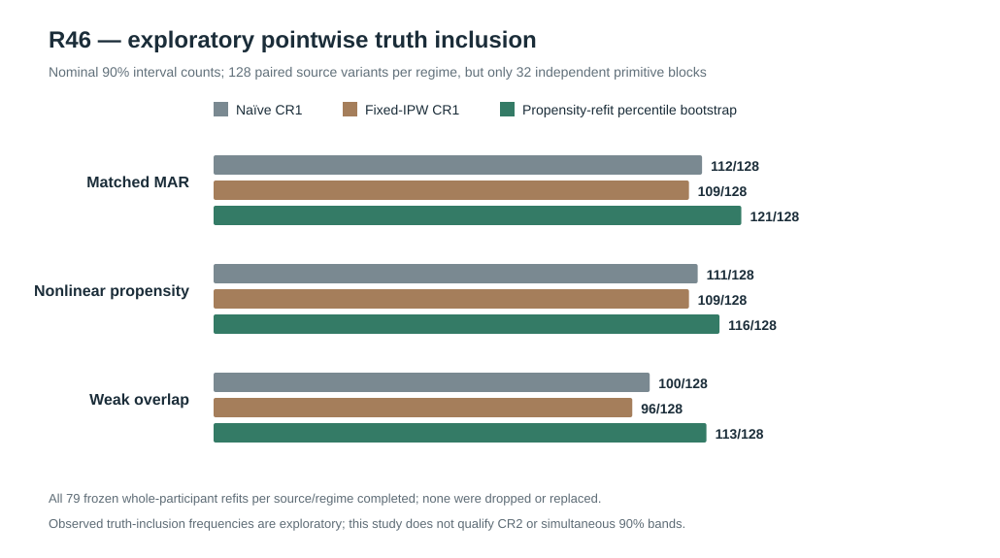

# W3 R46 — new-source propensity-refit bootstrap under MAR misspecification and weak overlap: original results

**Research-only exploratory pointwise interval study. Full original bootstrap source complete. No calibrated CR2 pointwise or simultaneous 90% coverage claim.** [Draft PR #348](https://github.com/stefanosbalaskas/eyetrajectoriespy/pull/348) is stacked on R45 #347, not protected main. The [original corrected-source scientific Actions run #38882774427](https://github.com/stefanosbalaskas/eyetrajectoriespy/actions/runs/38882774427) passed **both** contract and complete-original-source jobs. The [original retained evidence artifact #12037779452](https://github.com/stefanosbalaskas/eyetrajectoriespy/actions/runs/38882774427/artifacts/12037779452) contains complete source/interval/individual-resample records, summary, GitHub Actions checkout commit and checksum manifest. All **three SHA256 digests independently match**: `cases.json` **a1df0ff8b6e14cf6607c80db1f8fc0ee63033790292cbea754b1cb41b2568f2e**, `summary.json` **e2bd3c4117bd8f314f23099be0fd6a1f5253eb86e69148da920c583469030d00**, and `source-commit.txt` **99d25718c5f010b5d5efee37f1603418eb989fbd1d3adb7a73ff06430953e8c9**. The recorded source-commit `5b949d96193418666a1b8916862cbe83c2f2add8` is the GitHub Actions **PR merge checkout SHA**, not the branch head.

## Transparent pre-execution design correction

The [initial R46 workflow #38882504591](https://github.com/stefanosbalaskas/eyetrajectoriespy/actions/runs/38882504591) failed **both** source-contract and original science jobs before any valid source case was produced, because its planned **n=36** participants was not permitted by the inherited Gaussian generator (which accepts n=24, n=48, n=96). The research protocol was **amended to n=24 before the first successful source evaluation**. No simulation outputs from the invalid n=36 run were used; the original failure remains part of the engineering record. The independent generating-block count, three MAR mechanisms, seed, participant-bootstrap frequency, pointwise algorithms, positivity settings and full-denominator refusal contract were retained. The corrected source's numerical results should **not** be represented as if n=36 had been tested.

## Design, independent units and identified missingness assumptions

The corrected study used new master primitive seed **202610164646**, independent observation-mask seed **202610164647**, and bootstrap seed **202610164648**. **32 independent Gaussian primitive blocks**, each **24 participants**, were evaluated in paired ordinary/extreme predictor leverage × actual true-zero/positive Gaussian participant random-slope conditions: **128 paired source variants, not 128 statistically independent generating blocks**. The exact-zero condition removes the Gaussian slope innovation before reconstructing trajectories. All observations retain their native irregular trial schedules.

Three observed-design **MAR** point-retention policies were implemented, with all original native trial endpoints retained and interior Bernoulli indicators available for propensity estimation:

- **Matched additive-logistic MAR**: `logit(p) = 1.2 - 0.9q - 0.7t`, where `q=|x|/(1+|x|)`.
- **Nonlinear propensity misspecification**: additional omitted interaction `-2qt` and time curvature `-1.4(t-.5)^2` in the generating propensity, while the fitted model remains additive in `1,q,t`.
- **Weak overlap**: `logit(p) = -1.5 - 2q - 2.5t`, with substantially lower interior observation probability, and the same fitted additive form.

The three policies use *observed* `x,t` and source-independent dropout uniforms, not missing response values. Original `R,x,t` native schedules remain visible to the feasible propensity estimator even when gaze responses are `NaN`. The independently measured **mean interior observation fractions** were **63.33%, 53.78%, and 4.07%** in the matched, nonlinear and weak-overlap policies, respectively. The weak-overlap fitted raw probabilities reached **0.00457** at retained points, requiring the frozen **0.05** lower probability clip and yielding the maximum allowed inverse weight **20**. This is a numerical/positivity intervention, not evidence of an identified or correctly weighted full-cohort target at the floor.

## All three frozen exploratory 90% pointwise interval methods

For every paired source/regime condition, we retained (i) participant-cluster CR1 limits on naïve observed weighted regression, (ii) participant-cluster CR1 limits on fitted logistic-MAR IPW treating weights as fixed, and (iii) **5%–95% percentile participant-pairs bootstrap limits** computed after refitting the observable `R,x,t` logistic propensity and focal weighted regression in each resample. All source/permutation/method failures and each individual bootstrap status remain in the original case ledger; bootstrap failures cannot be redrawn away.

The prespecified **128 source variants ×3 regimes = 384 observation cases ×3 pointwise interval methods = 1,152/1,152 records**. The bootstrap also retained **384 ×79 = 30,336/30,336 individual successful resample/refit records**. There were **zero source failures, zero observation-regime failures, zero interval method refusals, and zero failed or omitted bootstrap refits**. These 79 replicates per source/regime provide relatively coarse percentile quantiles; they cannot by themselves confer stable nominal coverage.

## Original results: inclusion against fixed generating truth

The “truth inclusion” values count exploratory **nominally 90%** intervals containing the fixed generating focal predictor slope across **128 paired source variants** for each regime. **Only 32 primitive Gaussian blocks are independent**, and there is no formal sampling-calibration validation or multiplicity correction. CR1 ignores estimated propensity uncertainty; the percentile bootstrap refits that propensity but is neither CR2 nor a studentized simultaneous band.

| Observed-design MAR mechanism | Method | Focal absolute error vs generating truth | Mean pointwise interval width | Truth included / 128 |
|---|---|---:|---:|---:|
| Matched logistic | Naïve WLS CR1 | **0.024746** | 0.09969 | 112 |
| Matched logistic | Fitted IPW, fixed-weight CR1 | 0.025085 | 0.10016 | 109 |
| Matched logistic | Propensity-refit participant bootstrap | 0.025085 | **0.10615** | **121** |
| Nonlinear misspecified | Naïve WLS CR1 | **0.023711** | 0.09955 | 111 |
| Nonlinear misspecified | Fitted IPW, fixed-weight CR1 | 0.024175 | 0.09945 | 109 |
| Nonlinear misspecified | Propensity-refit participant bootstrap | 0.024175 | **0.10435** | **116** |
| Weak overlap | Naïve WLS CR1 | 0.064273 | 0.21124 | 100 |
| Weak overlap | Fitted IPW, fixed-weight CR1 | **0.063426** | 0.20987 | 96 |
| Weak overlap | Propensity-refit participant bootstrap | 0.063426 | **0.32777** | **113** |

Across the matched-logit cases, the bootstrap interval contained truth where fixed-weight IPW CR1 missed on **13/128 paired cases**, whereas fixed-weight CR1 contained truth where bootstrap missed on **1/128**. Both contained truth in **108/128** and neither did in **6/128**. The corresponding nonlinear selection counts were **9 bootstrap-only, 2 fixed-only, 107 both, 10 neither**; under weak overlap, **18 bootstrap-only, 1 fixed-only, 95 both, 14 neither**. These comparisons share Gaussian source innovations, and **must not** be treated as independent Bernoulli trials for method-ranking p-values.

The bootstrap intervals were wider on average, especially under weak overlap (**0.32777** versus **0.20987** for fixed-IPW CR1), and included the original fixed generating truth more frequently. Refitting propensity affects the uncertainty construction; by design, it does **not** modify the original fitted-IPW point estimate, which explains identical absolute point errors within the two IPW methods.

**The finite-sample point-estimation result remains negative:** even under matched logistic MAR, the fitted IPW mean absolute error (**0.025085**) exceeded naïve observed WLS (**0.024746**); nonlinear misspecification produced the same ordering (**0.024175** versus **0.023711**). Under weak overlap, all estimators had larger errors and wider intervals, and the clipped fitted-IPW improvement in mean absolute error (**0.063426** versus **0.064273**) is not a general argument for robustness or calibrated coverage.

## Scientific conclusion and qualification boundaries

This source supports a narrow empirical finding: **a participant bootstrap that refits an observed-design MAR propensity produces different and generally wider exploratory pointwise intervals and greater within-source truth inclusion than fixed-weight IPW CR1 under the tested mechanisms**. The result does **not** prove nominal 90% population coverage. The weak-overlap regime is severe and uses probability clipping; an apparently acceptable inclusion count obtained through wide intervals is not evidence that the original full-cohort estimand is consistently identified or efficiently estimated.

The study remains limited to 32 independent primitive source blocks, n=24, only observed-design MAR selection, and 79 percentile resamples. It does not validate fitted-working-covariance CR2 uncertainty, Satterthwaite degrees of freedom, correct Type-I error or power for Gaussian random-slope boundary tests, or nominal **90% simultaneous whole-function** bands. It does not identify response-driven MNAR point loss or whole-participant latent selection, which were explicitly excluded rather than silently corrected.

**Next scientific step:** R47 should independently calibrate a prespecified 90% **pointwise** interval procedure on substantially more independent sources, distinguishing uncertainty due to fitted observation propensity and fitted working covariance, while measuring model-misspecification/positivity failure rates. A separate experiment must address **simultaneous whole-function 90%** coverage; the variance-component null reference needs its own independent-null study.

Scientific blockers [#289](https://github.com/stefanosbalaskas/eyetrajectoriespy/issues/289) and [#296](https://github.com/stefanosbalaskas/eyetrajectoriespy/issues/296) remain **OPEN**, and original R20/R22/R33–R45 unfavorable results remain in the evidence index. No supported API, protected-main merge, release tag or PyPI publication has been authorized.
