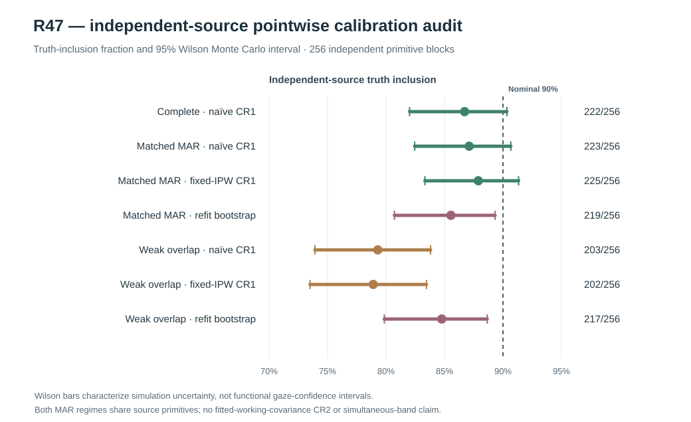

# W3 R47 — independent-block pointwise Monte Carlo calibration audit: original scientific results

**Research-only, prespecified sampling calibration audit. The original source documents undercoverage for the propensity-refitting bootstrap percentile method under the two MAR regimes tested. No fitted-covariance CR2, simultaneous whole-function bands, or release qualification.**

[Draft PR #349](https://github.com/stefanosbalaskas/eyetrajectoriespy/pull/349) is stacked on R46 #348 and does not alter protected main. [Original dedicated Actions science run #38886508732](https://github.com/stefanosbalaskas/eyetrajectoriespy/actions/runs/38886508732) completed **both** the source-contract tests and **the complete independent-source simulation** successfully. [Original evidence artifact #12040110498](https://github.com/stefanosbalaskas/eyetrajectoriespy/actions/runs/38886508732/artifacts/12040110498) includes the entire original source, observed-regime, pointwise interval and resampling case ledger, summary, CI checkout SHA and SHA256 manifest. All **3/3 source-file SHA256 entries have been independently verified**: `cases.json` **119787af2b7468fab5e61f22f45ca37d20f0a115d6513437b09fea6ff5352e60**, `summary.json` **5e05bac4974d40ece5ab681b29affe83b72b877154839df442aecfb010e9f712**, and `source-commit.txt` **3c228539428746136020853c60a53f3dd4f607c8a65ae0ee4bf6ac0771dad3e2**. GitHub Actions' recorded checkout **151c3b94de3a6c726184ad4d942cee776aadc6ed** is its PR merge-checkout commit and must not be confused with the latest draft research-branch head.

## Prospective source, estimand and original accounting

The original preregistered master seed **202610164747**, observed-design Bernoulli seed **202610164748** and participant-resampling seed **202610164749** generated **256 genuinely independent Gaussian primitive source blocks**. In contrast to R45/R46's repeated, paired support-and-truth variants, each block contributed **one fixed generating condition**: **24 participants, ordinary dependent predictor support, and a genuine positive Gaussian participant random-slope** on native irregular gaze trials. Thus each observation regime has **256 independent original source replicates**, and regimes/methods **share** the same sources and must be analyzed as paired. The focal scientific target is the **original generating fixed predictor slope** at the frozen focal time, not the retained-data regression conditional on missingness.

Each complete source was evaluated with (i) **no gaze loss**, (ii) **observed-design matched additive-logistic MAR point loss**, and (iii) **severe weak-overlap additive-logistic MAR point loss**. In MAR cases, the original schedule/participant/trial ID, observed predictor/time and observation indicator remained available for all native timepoints; missing gaze `y` was replaced by `NaN` and could never enter the fitted propensity. Native first/last timestamps were always retained. The mean **interior point-retention fractions** were **63.93% matched MAR** and **4.36% weak overlap**. This is a specifically identified synthetic observed-design MAR problem, **not an MNAR or whole-participant latent selection correction**.

The predeclared estimators were a participant-cluster **CR1** 90% pointwise t interval for complete observations, and under either MAR process naïve observed WLS CR1, fitted observed-only additive-logistic propensity **IPW with CR1 treating estimated weights as fixed**, and a **79-replicate whole-participant pairs percentile IPW interval** refitting the propensity and weighted regression in *every* resample. Full frozen denominator: **256 original generating blocks**, **768 observed-regime cases**, **1,792 method-interval records**, and **40,448 individual bootstrap attempts**. All were retained: **zero source failures, zero observation-process failures, zero failed or refused method intervals and zero unsuccessful bootstrap refits**.

## Original fixed-generating-truth inclusion with independent-source uncertainty

These are *empirical* nominal-90% interval truth-inclusion fractions, calculated using the **all-planned independent primitive-block denominator of 256** within each method/regime, including any failed intervals as uncovered (there were none). Accompanying Wilson limits describe **Monte Carlo uncertainty in empirical inclusion**, not confidence bands for functional gaze coefficients. A 95% Wilson interval which includes 90% would not validate exact nominal coverage; an interval excluding 90% supplies a negative fixed-design calibration signal at this Monte Carlo resolution.

| Prespecified pointwise method and source regime | Truth included | Inclusion rate | 95% Wilson Monte Carlo interval | Includes 90%? | Mean pointwise interval width |
|---|---:|---:|---:|---|---:|
| Complete, naïve participant CR1 | **222/256** | **86.72%** | 82.01–90.34% | Yes | 0.12605 |
| Matched MAR, naïve CR1 | **223/256** | **87.11%** | 82.45–90.67% | Yes | 0.12799 |
| Matched MAR, fixed-weight fitted IPW CR1 | **225/256** | **87.89%** | 83.32–91.34% | Yes | 0.12805 |
| Matched MAR, refit-propensity percentile bootstrap | **219/256** | **85.55%** | **80.71–89.33%** | **No** | 0.12279 |
| Weak overlap, naïve CR1 | **203/256** | **79.30%** | 73.92–83.81% | **No** | 0.22947 |
| Weak overlap, fixed-weight fitted IPW CR1 | **202/256** | **78.91%** | 73.50–83.46% | **No** | 0.22677 |
| Weak overlap, refit-propensity percentile bootstrap | **217/256** | **84.77%** | **79.85–88.65%** | **No** | **0.30742** |

On the matched-MAR source, **the propensity-refit percentile interval fell short of 90%** by this independent-source Wilson diagnostic, even though the original R46 paired-source pilot had shown greater apparent inclusion for the bootstrap method than for fixed-weight IPW CR1. The observed bootstrap inclusion was **219/256** compared with **225/256** for fixed-IPW CR1. Of the 256 original matched-MAR paired cases, **214** included truth under both methods, **26** missed under both, **five** were bootstrap-only inclusions and **11** were fixed-CR1-only inclusions. This comparison does **not** support a general statement that fitted-propensity bootstrap refitting reliably improves coverage.

Under severe weak overlap, the bootstrap provided more truth inclusion than fixed-IPW CR1 (**217/256 versus 202/256**) but also materially wider intervals (**0.30742 versus 0.22677**). Within paired weak-overlap source cases, **199** methods both included truth, **36** both missed, **18** were bootstrap-only and **three** fixed-CR1-only. Nevertheless the bootstrap's **95% Wilson Monte Carlo interval (79.85–88.65%) excludes the nominal 90% target**. Weak overlap thus remains an explicit *inferential failure*, not merely a numerical instability solved by successful bootstrap fits.

Mean absolute error relative to the same fixed generating truth showed the expected absence of a point-estimate change from bootstrap refitting:

| Source regime | Naïve focal MAE | Fitted-IPW focal MAE (identical for fixed CR1 and refit bootstrap) |
|---|---:|---:|
| Complete | 0.03195 | — |
| Matched MAR | 0.03279 | **0.03288** |
| Weak overlap | **0.06632** | 0.06767 |

The extreme sparse regime therefore increased focal error as well as reducing truth-inclusion rates. Bootstrap wider intervals did not establish unbiasedness, robust missingness adjustment or a valid coverage method under the fixed 0.05 positivity clip.

## Scientific implications and boundaries

**R47 changes the interpretation of R46.** R46's 32 primitive Gaussian blocks crossed with paired source support and true-slope conditions yielded exploratory truth-inclusion counts that favored refitting propensity. Once R47 used **256 independent Gaussian blocks in one frozen generating condition**, the same percentile method did **not** outperform fixed-IPW CR1 under correctly specified matched MAR and was itself below nominal 90% by Wilson's Monte Carlo uncertainty diagnostic. Under weak overlap its coverage remained substantially subnominal despite larger width and successfully refitted observation propensities. These findings cannot be generalized to every gaze process or sample size; they do preclude promoting the current fixed-IPW CR1 or percentile bootstrap as a universally calibrated pointwise method.

R47 still uses **only n=24**, one predictor-support condition, positive generating Gaussian participant random slopes, two observed-design MAR mechanisms, and **79 percentile resamples per source**. Neither CR1 nor propensity refitting adjusts functional uncertainty for an estimated Gaussian working covariance through CR2/Satterthwaite degrees of freedom, and neither corrects selection driven by missing responses or selection of entire participants. A 95% Wilson interval is an uncertainty estimate for the **Monte Carlo inclusion fraction**, not a method for constructing valid 90% pointwise scientific intervals. R47 does not test nominal **90% simultaneous whole-function coverage**, nor the random-slope variance-component boundary null reference and Type-I error.

**Next scientific gate:** R48 should target an explicitly covariance-estimation-aware pointwise functional interval construction and independently evaluate its coverage under well-specified Gaussian repeated-trial data, with nuisance estimation and finite-sample CR2/Satterthwaite aspects fully accounted for. This must be done before attempting separate simultaneous whole-function bands or allowing a public API claim. Source-process and positivity failures should remain in the evidence ledger instead of being handled by post hoc selection.

Scientific blockers [#289](https://github.com/stefanosbalaskas/eyetrajectoriespy/issues/289) and [#296](https://github.com/stefanosbalaskas/eyetrajectoriespy/issues/296) remain **OPEN**; all earlier negative R20/R22/R33–R46 numerical and inferential evidence remains intact. No merge to protected main, supported eyetrajectoriespy 1.2 inference API, release tag or PyPI publication was performed.
