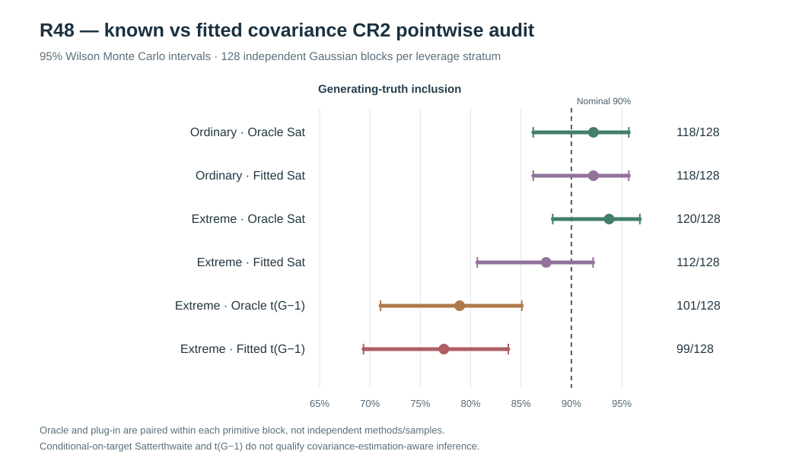

# W3 R48 — independent Gaussian oracle versus observed-REML plug-in CR2: original scientific results

**Research-only original-source inferential falsification. The oracle and fitted working-covariance conditional CR2 intervals differ directionally under extreme leverage; neither is a nuisance-estimation-uncertainty-adjusted 90% pointwise method. No release qualification.**

[Draft PR #350](https://github.com/stefanosbalaskas/eyetrajectoriespy/pull/350) is stacked on R47 #349 rather than protected main. The first dedicated [GitHub Actions scientific run #38890746708](https://github.com/stefanosbalaskas/eyetrajectoriespy/actions/runs/38890746708) produced the **complete original scientific case ledger** and passed its science job, but its **source-contract tests failed 1/7** because a test incorrectly treated the second *trial row* as the second participant. The original Gaussian generator legitimately repeats each participant's predictor across native trials. The test was fixed to index original participant IDs, **without changing the generating source, fitted covariance, CR2 calculation or prespecified denominators**. [Corrected run #38890904146](https://github.com/stefanosbalaskas/eyetrajectoriespy/actions/runs/38890904146) completed **both dedicated jobs successfully**. The first failed test is preserved as an engineering failure, not reclassified.

The original [R48 case-ledger artifact #12041866374](https://github.com/stefanosbalaskas/eyetrajectoriespy/actions/runs/38890746708/artifacts/12041866374) contains every generated source, original REML nuisance fit and numerical conditional CR2 target, together with summary, action checkout and source SHA256 manifest. All three entries independently verified: `cases.json` **3204056a7e196dcac53e750f69eda3f508715aa9554b0d75fc641076b022f292**, `summary.json` **03f4b94813fb38b1a9339793b9e0779f3148a5f2b8eba8bf7c041803234cc6ae**, `source-commit.txt` **3c199bca03bde6f58591c1c373cc295f235659186026fcaefab08dea1cec1e9b**. The source file identifies GitHub Actions PR merge-checkout SHA **72a0165d4e830f9c54e6048247ad2d0a17b1641b**, **not** the research branch tip.

Independently, the corrected [scientific archive #12041762337](https://github.com/stefanosbalaskas/eyetrajectoriespy/actions/runs/38890904146/artifacts/12041762337) also passed **3/3** SHA256 manifest checks. The **original cases.json and summary.json are byte-for-byte identical** across the initially failed-test and corrected-test runs, confirming that the test correction left the source and results unchanged. The expected GitHub Actions merge-checkout SHA alone differs.

## Original independent source and fixed target

Prospectively frozen new primitive seed **202610164848** yielded **128 independently generated Gaussian innovation blocks**, each with **n=24** participants, one original complete native irregular-trial schedule and genuine **positive predictor-dependent Gaussian participant random-slope covariance**. The **ordinary** and **extreme** predictor-support variants share each block's primitive innovations: there are **256 paired source/support cases but only 128 independent primitive generating blocks**, with 128 independent blocks per separate leverage stratum. The extreme design sets the first two participants' predictors to **+3** and **−2.5**, rather than falsely indexing the second native *trial* as participant two.

The original fixed focal predictor-slope generating mean was projected onto the exact weighted Legendre-five native-row regression design before pointwise evaluation, retaining both the projected estimand and the raw original generating focal coefficient separately. Median absolute projection discrepancies were approximately **2.18×10⁻⁸** ordinary and **3.94×10⁻⁸** extreme. These are favorable for this controlled Gaussian mean design but must not be presumed in empirical gaze data.

The **source-generating true covariance** provided the oracle target and **never entered the fitted REML estimator**. The fitted target used the original **observed-outcome-only bounded Gaussian REML** estimator under the *correct* predictor-scaled Gaussian working covariance family. Both targets then entered the **same original R22 scaled-Cholesky CR2 calculation**, evaluated under nominal 90% **conditional Satterthwaite** or conventional **t(G−1)** references. The Satterthwaite df calculated at the fitted target **treats it as known**; neither reference adjusts for sampling uncertainty from fitting the nuisance covariance to the same data.

All **256/256** source cases, **512/512** covariance target CR2 computations and **1,024/1,024** original two-reference interval records were retained, with **zero source failures, zero reported REML nonconvergences, and zero CR2 adjustment refusals**. Nevertheless the historical R25 REML estimator only supplies bounded log-variance optimizer success, not the subsequent R42–R44 strict physical-coordinate KKT/global-likelihood certificate. Max recorded absolute log-gradient values reached approximately **0.0312** in both leverage strata, and a near-lower positive slope-variance box bound was flagged in **16/128** ordinary and **31/128** extreme fits. This limits numerical qualification even though the original scientific workflow executed successfully.

## Original fixed-generating-truth inclusion

Each row reports the original number of nominal-90% **pointwise** intervals containing generating truth among **128 independent Gaussian primitive source blocks** in that leverage stratum. The 95% Wilson limits describe **Monte Carlo uncertainty** in that inclusion fraction, not a scientifically adjusted coefficient confidence interval or function-wide band. Failed intervals would count against the original full denominator; none failed here.

| Source leverage | CR2 target | t reference | Truth included/128 | Empirical fraction | 95% Wilson Monte Carlo interval | Median conditional Sat df |
|---|---|---|---:|---:|---:|---:|
| Ordinary | Known covariance oracle | Conditional Satterthwaite | **118/128** | **92.19%** | **86.22–95.70%** | **10.674** |
| Ordinary | Observed REML plug-in | Conditional Satterthwaite | **118/128** | **92.19%** | **86.22–95.70%** | **10.392** |
| Extreme | Known covariance oracle | Conditional Satterthwaite | **120/128** | **93.75%** | **88.15–96.80%** | **1.703** |
| Extreme | Observed REML plug-in | Conditional Satterthwaite | **112/128** | **87.50%** | **80.66–92.16%** | **2.181** |
| Extreme | Known covariance oracle | Participant t(G−1) | **101/128** | **78.91%** | **71.05–85.08%** | — |
| Extreme | Observed REML plug-in | Participant t(G−1) | **99/128** | **77.34%** | **69.36–83.74%** | — |

Under ordinary leverage, **both known-source oracle and observed REML plug-in produced exactly 118/128 conditional Satterthwaite inclusion decisions**, with **zero within-block disagreements**. The median ratio of fitted to oracle 90%-nominal Satterthwaite half-widths was **0.997**, and median CR2 SE was about **0.03590** under each target. This reassuring empirical agreement is specific to the ordinary leverage design and the conditional reference.

Under extreme leverage, the oracle yielded **120/128** conditional Satterthwaite inclusions, but the fitted plug-in yielded **112/128**. Critically, all **eight paired inclusion disagreements** arose from oracle covering the same Gaussian coefficient while the fitted-target interval failed to cover, in primitive blocks **12, 16, 50, 59, 71, 73, 105 and 106**. Thus the differences were directional **within identical original Gaussian innovation blocks**, not explainable merely by pooling unrelated samples. Median fitted/oracle conditional Satterthwaite interval half-width fell to **0.844** despite median CR2 SE changing only from approximately **0.02533 (oracle)** to **0.02414 (fitted)**; the fitted conditional degrees of freedom rose from **1.703** to **2.181**. The eight individual paired half-width ratios were approximately **0.651–0.924**. In this matched-covariance generating model, replacing the true covariance target with an observed REML plug-in can therefore materially change finite-cluster inference even when both calculations are numerically accepted.

The **conventional t(G−1) reference** produced particularly low empirical truth inclusion under extreme leverage: **101/128 (78.91%) oracle**, **99/128 (77.34%) plug-in**, with both independent-source Wilson bands excluding nominal 90%. This reinforces that a crude fixed participant df is not an interchangeable replacement for coefficient-specific conditional finite-cluster adjustment when leverage is extreme.

## Interpretation and scientific limitations

This is stronger independent-source evidence than R32's 16-block numerical feasibility pilot or R33's 24-block high-leverage comparison. The original outcome establishes **a systematic directional vulnerability** of the conditional REML plug-in relative to its known-covariance oracle in this fixed high-leverage source, while demonstrating no disagreement under ordinary leverage. However, the observed fitted plug-in **87.5%** inclusion has a 95% Wilson interval **80.7–92.2%**, which still contains nominal 90%. Thus the fixed-design plug-in result **does not itself statistically establish undercoverage relative to 90%** at the study's Monte Carlo precision, and no general conclusion of faulty empirical gaze inference across all designs is warranted.

The experiment does **not isolate nuisance-estimation uncertainty as a single causal mechanism**, because fitted variance components, finite-cluster CR2 adjusted geometry, Satterthwaite degrees of freedom and calculated CI widths all respond jointly to observed covariance fitting. Its fitted Satterthwaite reference still ignores nuisance estimation uncertainty. Even oracle covariance pointwise coverage is not globally qualified simply because its 95% Wilson band contains 90%. Both targets are conditional Gaussian working models, the historical REML fit lacks a certified strict physical-coordinate KKT gate and the study has **only n=24**, two paired predictor supports, positive generating slope variance and complete observations.

The next method-development stage should derive a **genuinely nuisance-estimation-aware coefficient interval procedure**, rather than declaring a larger oracle-versus-plug-in study to be one. Its derivation, finite-sample assumptions, numerical-rejection policy, independent-sample pointwise truth coverage and comparison to the oracle must be separately frozen before looking at original results. **Nominal 90% simultaneous whole-function bands** and independently calibrated random-slope variance-boundary tests remain separate scientific gates. Informative MNAR point loss and latent complete-participant selection are also not identified or corrected.

Scientific blockers [#289](https://github.com/stefanosbalaskas/eyetrajectoriespy/issues/289) and [#296](https://github.com/stefanosbalaskas/eyetrajectoriespy/issues/296) remain **OPEN**. Preserve the original negative W3 results through R47 and the first failed-test R48 workflow. No supported eyetrajectoriespy 1.2 public inference API, protected-main merge, release tag or PyPI publication is authorized.
