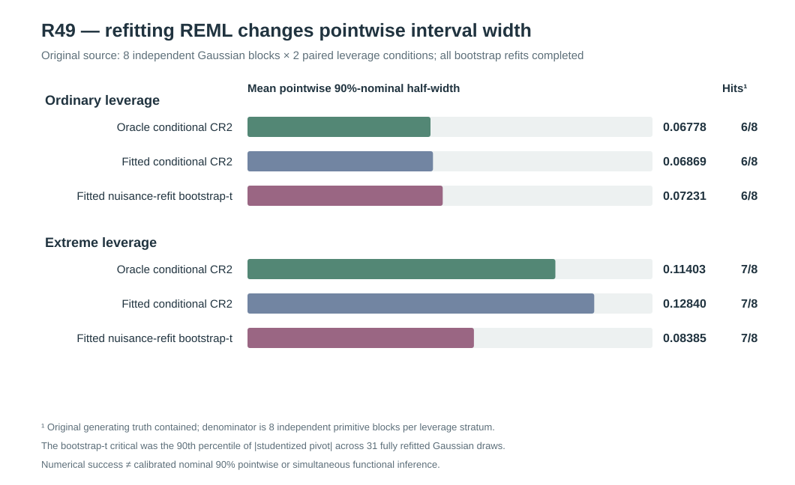

# W3 R49 — covariance-nuisance-refit Gaussian parametric bootstrap-t: original scientific feasibility results

**Research-only original-source numerical feasibility milestone. All prespecified Gaussian covariance re-estimation and refit/bootstrap numerical gates passed, but the proposed bootstrap-t did not improve observed fixed-truth interval inclusion and was substantially narrower under extreme leverage. No nominal 90% inference, simultaneous bands, or release qualification.**

[Draft PR #351](https://github.com/stefanosbalaskas/eyetrajectoriespy/pull/351) is stacked on R48 #350, not protected main. [Original dedicated Actions workflow #38892602851](https://github.com/stefanosbalaskas/eyetrajectoriespy/actions/runs/38892602851) completed both the **four-component gradient/source-contract tests** and the complete **independent Gaussian/bootstrap scientific execution** successfully. The [original independent-source scientific archive #12042139107](https://github.com/stefanosbalaskas/eyetrajectoriespy/actions/runs/38892602851/artifacts/12042139107) preserves every source, pointwise interval, parametric Gaussian draw, estimated nuisance start, objective/KKT outcome, summary and original GitHub Actions source checkout. All three entries in its SHA256 manifest independently verified: `cases.json` **faecdfa87a61377c476637ef295477bf9d8d14ba268b02c646befbe5a5a7ad64**, `summary.json` **db9f57f01fdb254b41d5325dde6409641cb1783c90da4676152990dad9f000d6**, `source-commit.txt` **f1eb82846b6742a821247c8860f664321cee9ef9855e2185d2da2e44b083ab35**. Its CI checkout SHA **7b2219c6759fae5b7540411f0a9d6df5799e3bc2** is a GitHub Actions pull-request merge checkout, **not** the research branch head.

## Prospective original source and estimand

Master Gaussian source seed **202610164949** and Gaussian parametric pseudodata seed **202610164950** were new and separate from R17–R48. The study independently generated **eight Gaussian primitive innovation blocks**, each with **24 participants** and original complete native irregular trials under the **correctly specified predictor-scaled Gaussian random-slope covariance family** with genuinely positive random-slope variance. Ordinary and extreme predictor supports were paired on the *same eight primitive blocks*, giving **16 paired original source cases, but only eight independent source experiments per stratum**. No source from R48 was reused or selected by R48's empirical oracle/fitted-disagreement outcomes.

The fixed predictor-slope estimand is the source's original generating mean projected onto the actual native weighted Legendre-five regression basis and evaluated at its prespecified focal time. The original known covariance only enters the separate oracle reference and **never enters the proposed fitted Gaussian nuisance estimator or any parametric draw**. The fitted point estimate is the native observed-data WLS contrast.

## Proposed algorithm and frozen numerical qualification

The candidate *attempts to incorporate covariance nuisance-estimation uncertainty* through **Gaussian parametric bootstrap-t**, not an analytic corrected Satterthwaite distribution. From the original observed gaze outcomes, estimate all **four** Gaussian variance-component ratios (participant intercept, predictor-scaled participant slope, trial intercept, sensor). Use original Gaussian REML restricted likelihood and analytic score, optimized directly in positive **physical ratio coordinates**, with frozen inherited bounds `[exp(-13.8),exp(7)]`. Each original or simulated fit compares two observed-source-unaware initial positive vectors, **(.1,.1,.1,1)** and **(.6,.3,.3,1)**. Reject a fit unless a successful optimizer gives absolute physical projected gradient/KKT ≤**0.001**, objective reconstruction ≤**1e-6**, and NLL within **0.001** of the lowest observed candidate. Neither local gradient nor two starts certifies a global REML optimum.

Fit original scaled-Cholesky CR2 covariance adjustment and SE using those accepted four components. Compare three 90%-nominal pointwise interval constructions on the same original generating source:

1. Known Gaussian covariance **oracle conditional Satterthwaite** CR2 (simulation-only reference).
2. Observed Gaussian REML **plug-in conditional Satterthwaite** CR2, which still ignores the sampling uncertainty of fitting covariance from the same outcomes.
3. Fitted Gaussian REML **parametric bootstrap-t**: each of exactly **31** independent pseudo-outcomes is drawn as `sqrt(w)(y*−X beta_hat_WLS) ~ N(0,V_hat)` in separate native participant blocks with original participant/trial/time/predictor schedules. The **entire four-dimensional Gaussian nuisance fit** is recomputed using two frozen physical-ratio starts, and the original scaled-Cholesky CR2 standard error is recomputed on the new simulated response. Record the signed studentized pivot `T*=(c'beta_hat_WLS*−c'beta_hat_WLS_orig)/SE_CR2*(fitted covariance on y*)`. The original candidate pointwise interval uses `q_.90(|T*|) × SE_CR2_original` as its half-width, with no redraw after unsuccessful fits.

Thus method three re-estimates the nuisance covariance in its parametric sampling distribution; this is **not a proven nuisance-adjusted CR2 variance formula**, is not the same as an independently calibrated statistical procedure, and does not correct covariance working-family misspecification or informative missingness.

## Original integrity and numerical evidence

All predeclared slots completed. There were **16/16** source cases, **48/48** pointwise method interval records, **496/496** independent Gaussian pseudo-outcome bootstrap attempts, **1,024/1,024** individual positive physical-coordinate REML optimization-start records (two for each original case and every parametric replicate), **zero source refusals**, **zero original nuisance-fit refusals**, and **zero bootstrap refit numerical refusals**. All **1,024** optimizer-start outcomes recorded status `ok`, with no physical projected gradient exceeding the frozen **0.001** threshold. Selected original-fit projected KKT values were all extremely small (maximum approximately **2.41×10⁻⁵**). The two start outcomes were preserved rather than replacing any first-start result by a successful retry.

This is an independent-source numerical feasibility success under a favorable correctly specified Gaussian covariance model. It does **not** establish an acceptable numerical refusal rate under near-zero random-slope variance, severe sensor-floor cases, leverage plus missingness, different covariance families, or empirical gaze devices. In particular, a numerically converged local REML fit is not a global optimum certificate.

## Original interval results: identical inclusion, materially different width

Within **each** original leverage stratum the denominator is **eight independent primitive blocks**, not 16 independent draws. All intervals were calculable, so original unconditional full-denominator and conditional-on-success inclusion fractions coincide. Wilson 95% intervals are very wide: **6/8 = 75.0%, Wilson 40.93–92.85%**, and **7/8 = 87.5%, Wilson 52.91–97.76%**. Both contain nominal 90%, but this is **not evidence of calibrated coverage**.

| Leverage stratum | Method | Truth included/8 | Mean 90%-nominal half-width | Median half-width |
|---|---|---:|---:|---:|
| Ordinary | Oracle conditional CR2 | **6/8** | **0.06778** | 0.06849 |
| Ordinary | Fitted conditional CR2 | **6/8** | **0.06869** | 0.06916 |
| Ordinary | Gaussian nuisance-refit bootstrap-t | **6/8** | **0.07231** | 0.06523 |
| Extreme | Oracle conditional CR2 | **7/8** | **0.11403** | 0.11294 |
| Extreme | Fitted conditional CR2 | **7/8** | **0.12840** | 0.12470 |
| Extreme | Gaussian nuisance-refit bootstrap-t | **7/8** | **0.08385** | 0.06806 |

All methods made **identical inclusion decisions within each source stratum**. Ordinary leverage had source blocks 0 and 3 miss under all three methods. Extreme leverage had source block 4 miss under all three methods. Thus the new parametric bootstrap-t did **not** rescue any miss from fitted conditional CR2 or cause any newly observed miss in this eight-block pilot.

Nevertheless, under extreme leverage the candidate bootstrap-t interval was substantially **narrower** than the fitted conditional CR2: mean half-width **0.08385 versus 0.12840**, with median **0.06806 versus 0.12470**. The conditional fitted CR2 Student-t critical values in the eight extreme sources ranged approximately **2.497–4.867**, whereas the parametric bootstrap-t absolute-pivot 90th percentiles ranged **1.890–3.147**. Under ordinary support the corresponding original critical values are more similar. With only **31** bootstrap draws for each source, the estimated 90th percentile is inherently noisy and can easily be too small or too large. A narrower interval with unchanged empirical inclusion is **not** evidence of improved calibration; it is a specific warning against treating this experimental bootstrap-t as an automatic correction for covariance-estimation uncertainty.

## Scientific interpretation and next gate

R49 advances engineering and mathematical testing beyond R48 by implementing an actual *nuisance-refitting sampling procedure* whose simulated outcomes come from the **observed fitted covariance** and whose uncertainty distribution recomputes REML nuisance components and CR2 SE on every original bootstrap draw. All expected original and re-estimation failures were represented explicitly, and the frozen numerical KKT and NLL gates were satisfied in the current eight-block Gaussian study. This is stronger than simply plugging in a fitted covariance target and applying conditional Satterthwaite degrees of freedom.

It is **not an empirically calibrated 90% pointwise method**. All observed inclusion counts remain between 6/8 and 7/8 and do not distinguish interval methods. Furthermore, the extreme-leverage bootstrap critical values were much smaller than their conditional t counterparts, potentially exposing undercoverage in a larger independent sample. The next scientific gate is a **predeclared R50 larger independent Gaussian calibration** with a materially larger bootstrap quantile sample, optimized computational design, an explicit all-original-block refusal denominator and prospective stress for near-boundary nuisance, leverage and covariance misspecification. The decision rule must not be tuned to the observed eight-source inclusion values.

**Neither simultaneous 90% whole-function inference nor Gaussian random-slope boundary null Type-I/power calibration is addressed**, and no estimator is identified under response-dependent MNAR point loss or latent complete-participant selection. Keep [#289](https://github.com/stefanosbalaskas/eyetrajectoriespy/issues/289) and [#296](https://github.com/stefanosbalaskas/eyetrajectoriespy/issues/296) **OPEN**. Preserve earlier original unfavorable W3 outcomes through R48. No public inference API, protected-main merge, 1.2 release tag or PyPI publication is authorized.
