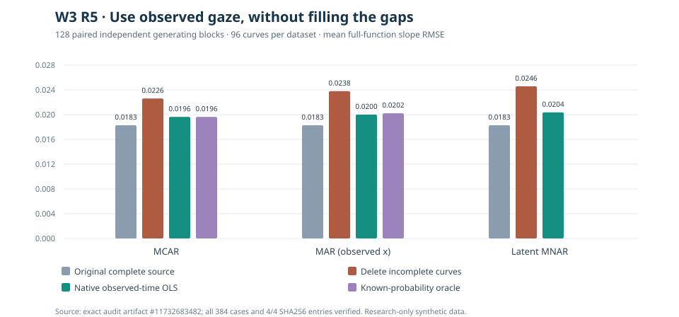

# W3 R5 — native observed-time support under three paired loss mechanisms

!!! warning "Unqualified research-only estimator, not a missing-data correction"
    Retaining genuinely recorded portions of irregular trajectories
    lowered mean full-grid slope-function RMSE relative to deleting
    every incomplete curve in this simulation. It **did not remove
    selection bias at unobserved times**. No irregular-functional-
    regression estimator, missingness correction, bootstrap interval
    or public API has been scientifically qualified or promoted.

## Original source and verification

Original [scientific workflow #38218938160](https://github.com/stefanosbalaskas/eyetrajectoriespy/actions/runs/38218938160)
completed **384/384** prespecified scientific cases, with **zero
fitting/oracle/source-integrity failures and zero missing cases**.
The retained source artifact **`11732683482`**
(`w3-r5-native-observed-support-original-evidence`) contains
`case-ledger.json`, `evidence.json`, the **original Matplotlib
scientific SVG** `source-observed-support.svg`,
`source-commit.txt` and `SHA256SUMS`. The original artifact
was independently downloaded: **all four SHA256 checksums passed**.
Its recorded source checkout SHA is
`9e25fba6a63b02a85e29c8073434b381ead7d701`
(a possible transient pull-request checkout ref).

The predeclared simulation has **128 independently seeded generating
blocks**, 96 independent curves per block, 31 time points and two
response dimensions. Its three mechanisms—MCAR, predictor-dependent
MAR and latent-response-dependent MNAR—reuse **identical generating
source values and dropout uniforms within each block**. Thus the
384 fitted scenarios are **not 384 independent sources**. Every
missing curve loses one contiguous eight-time-point window; native
irregular timestamps retain **only the actually recorded values**.

## Full functional slope recovery

The average root mean squared deviation of the estimated slope
function from the complete generating **truth**, across all time
points and response dimensions, is:

| Generating loss | Complete-source OLS | Delete whole incomplete curves | Regress at exact observed times | Simulation-known-probability IPW |
|---|---:|---:|---:|---:|
| MCAR | 0.01829 | 0.02261 | **0.01963** | 0.01963 |
| MAR on observed condition | 0.01829 | 0.02379 | **0.02001** | 0.02022 |
| Latent-response-dependent MNAR | 0.01829 | 0.02457 | **0.02037** | **Not evaluated: true latent loss probabilities unavailable** |

*The chart and table show deterministic summaries from the
source-audited original case ledger. The original workflow artifact
also retains the complete unmodified scientific SVG. All error
metrics use synthetic normalized response coordinates and should
not be interpreted as gaze-device accuracy or calibrated coverage.*

### What the improved RMSE does and does not mean

The mean functional RMSE reduction versus deleting incomplete curves
was approximately **13.2% for MCAR**, **15.9% for MAR** and
**17.1% for latent MNAR** in these mechanisms. This is primarily
because the time-local estimator uses all recorded curves *outside*
the gap, instead of unnecessarily removing complete observed time
segments from the analysis.

The critical source-invariant checks passed in **128/128 cases per
mechanism**:

- Where **all curves are recorded**, time-local regression has
  exactly the same OLS coefficients as the complete-source reference.
- **Within the recording gap**, the genuinely recorded curves are
  exactly the complete-curve subset. Consequently **time-local OLS
  and the explicit complete-curve OLS have identical coefficients
  there**.
- All 31 time-specific independent-unit support counts matched the
  original recorded timestamp lists, and all native times/values
  remained unchanged. Current supported dense W3 rejected every
  native irregular input rather than quietly imputing it.
- Both full-source and complete-curve dense package fits matched
  separately calculated NumPy least-squares coefficients to the
  2e-10 source numerical tolerance.

Therefore **the observed-data analysis cannot solve selection bias at
locations where the outcome is not observed**. It does not reconstruct
data, identify MNAR mechanisms or qualify a valid confidence band.

## Midpoint selection and oracle sensitivity

Complete-curve deletion minus complete-source slope at the missing
midpoint in the first response dimension yielded these **mean paired
estimate differences**:

| Recording-loss mechanism | Mean midpoint difference | Independent-block bootstrap 95% interval |
|---|---:|---:|
| MCAR | +0.0002 | −0.0022 to +0.0027 |
| MAR on observed condition | +0.0006 | −0.0023 to +0.0034 |
| Latent-response-dependent MNAR | **−0.0214** | **−0.0247 to −0.0181** |

Because native time-local OLS equals whole-curve deletion **inside
the gap**, its midpoint slope differences are identical up to
numerical precision. The latent-MNAR change remains.

A known-probability inverse-observation-weighted estimator was
run **only in simulated MCAR and MAR cases**. It used the **actual
generating probabilities** at missing locations and unity weights
elsewhere, rather than estimating probabilities from observed
recordings. Its slightly **higher** average functional RMSE than
unweighted time-local OLS in the MAR setting (0.02022 vs 0.02001)
does not establish a better or worse weighting method outside this
specific finite-sample generator. MCAR weights are constant at
missing locations, so the unweighted and weighted OLS point
estimates coincide.

**No corresponding MNAR oracle was presented as a usable analytical
option**: the true generating dropout probability depends on a
hidden residual unavailable to the real observer. That prevents
an apparent simulation advantage from being advertised as a
practical missing-data estimator.

## Scope and scientific qualification

The R5 experiment uses one independent curve per source unit and
**exact subsets of the original common time grid**. It does not
test genuinely asynchronous or jittered sampling times, varying
coordinate quality, unbalanced participant trial counts, temporal
mean misspecification, event-triggered dropout or real-world
sensor interruptions. Its calculated slopes have no new valid
SE, confidence interval, hypothesis test or functional mixed-model
interpretation.

Additional independent validation must separately address
asynchronous observation, source hierarchy, missingness assumptions,
uncertainty calibration and meaningful eye-tracking measurements.
The exploratory source calculation is **not made a supported
`eyetrajectoriespy` API**. Do not claim MAR is identifiable without
assumptions, or MNAR can be diagnosed solely from the observed gaze.

[Predeclared R5 protocol](w3-r5-native-observation-support-protocol.md)
· [Open missingness scientific issue #296](https://github.com/stefanosbalaskas/eyetrajectoriespy/issues/296)
· [Separate W3 band-coverage blocker #289](https://github.com/stefanosbalaskas/eyetrajectoriespy/issues/289).

Stable published **1.1.0** remains unchanged; unreleased
`1.2.0rc2.dev0` remains development-only and
`production_release_ready=false`. No publication, release tag,
estimator replacement or automatic promotion.
