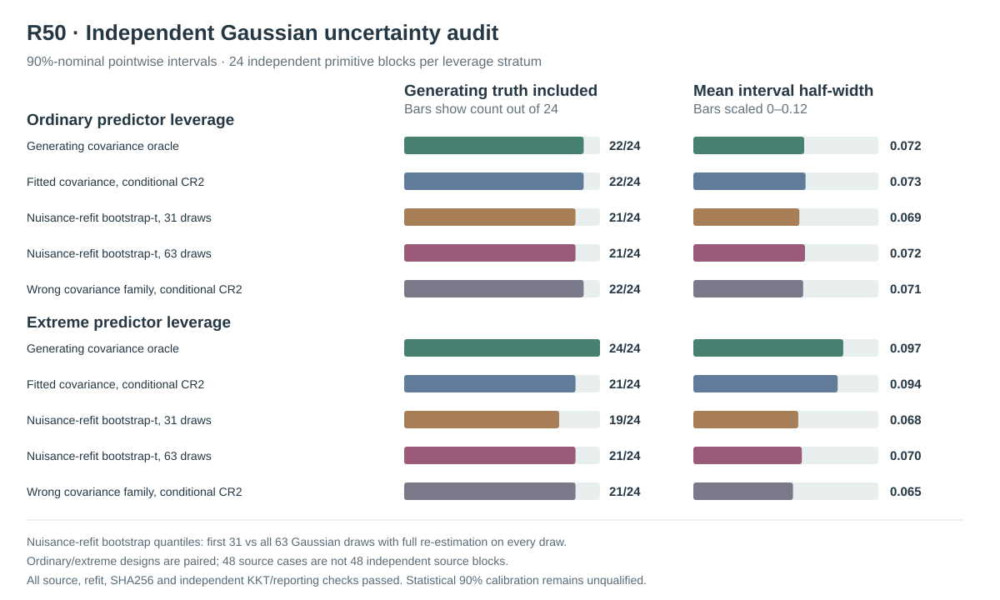

# W3 R50 — independent Gaussian covariance-refit bootstrap: original results and independent evidence audit

**Research-only empirical and numerical study, not nominal-90% pointwise or whole-function inferential qualification.** The prospectively frozen Gaussian experiment in [draft PR #352](https://github.com/stefanosbalaskas/eyetrajectoriespy/pull/352) and the independent read-only audit in [draft PR #353](https://github.com/stefanosbalaskas/eyetrajectoriespy/pull/353) have now both been executed against the original full-denominator source.

## Provenance, original scientific execution and independent reporting verification

[Original scientific GitHub Actions run #38941603543](https://github.com/stefanosbalaskas/eyetrajectoriespy/actions/runs/38941603543) finished **all five dedicated jobs successfully**: source/numerical contracts, three independently sharded Gaussian experiments (blocks 0–7, 8–15, 16–23), and a final exact-source checksum/identity aggregate. Original experimental PR #352 passed **25/25 exact-head CI workflows** with zero reported failures.

The [original complete-source artifact #12064248756](https://github.com/stefanosbalaskas/eyetrajectoriespy/actions/runs/38941603543/artifacts/12064248756) retains all individual case, method, nuisance and bootstrap-refit records together with its recorded original checkout SHA **`5fc96baa07b191593ea3d5db47dc057f2b1aeafe`** (GitHub Actions PR merge-checkout, not research branch head). All three SHA256 hashes were independently checked against the extracted original evidence:

| Original evidence file | Verified SHA256 |
|---|---|
| `cases.json` | `c04f75642ebb0baac5c07f7c87433533fb0898089c7624d0fe1e2999b9ef3c73` |
| `summary.json` | `d43796e124fc76b910bbd08a0478108bfcd4b6844d02fee91948da788470fe99` |
| `source-commit.txt` | `efb472d3aa7c9509aeb694eba04b81bcf018ea99d3f4a50c817e8bb32557a129` |

The independent audit [GitHub Actions run #38945223561](https://github.com/stefanosbalaskas/eyetrajectoriespy/actions/runs/38945223561) completed **4/4 dedicated jobs successfully** (three Python-version fixture-contract jobs and one **read-only analysis of the real original R50 artifact**, not fixtures). The [separate audit artifact #12064802183](https://github.com/stefanosbalaskas/eyetrajectoriespy/actions/runs/38945223561/artifacts/12064802183) reproduces independent source identities, raw evidence checksums, original method statuses, 31/63 absolute studentized-bootstrap quantiles, independent-block Wilson uncertainty, all CR2 inclusion decisions and interval half-widths. The postprocessor also checks original and simulated nuisance fits against the frozen **four-component positive physical variance**, **projected KKT ≤0.001**, **within-observed-best NLL ≤0.001** and objective reconstruction criteria. These recorded-numerical checks do **not** prove global REML optimality.

## Frozen experiment and complete-case accounting

The prospectively specified [R50 protocol](w3-r50-independent-bootstrap-calibration-protocol.md) used **24 new independent Gaussian primitive innovation blocks**, seed **202610165050**, n=24 participants, native irregular repeated trials, a genuine positive predictor-scaled participant random slope, and **two paired predictor leverage variants per primitive block**. The ordinary and extreme source variants share innovations; this is **24 independent generating blocks per separate leverage stratum**, not 48 independent Gaussian draws. The independent Gaussian pseudodata seed was **202610165051**. Gaze outcome observations were complete, deliberately isolating Gaussian covariance estimation from observation selection.

Five methods evaluated the identical projected generating focal slope: (i) known true Gaussian covariance conditional Satterthwaite CR2 oracle; (ii) correctly specified covariance family observed-REML plug-in conditional CR2; (iii) Gaussian four-nuisance-component refit bootstrap-t using the **first 31** of the 63 fixed draws; (iv) the identical method using all **63** draws; and (v) **misspecified `shared_slope` working covariance** fitted with the same original positive-physical REML/KKT/NLL gate and conditional CR2 reference. The oracle covariance is unavailable to all fitted/parametric arms. The bootstrap draws are Gaussian participant-block pseudoresponses from observed fitted WLS mean plus observed-only fitted Gaussian covariance; all four variance components and the original scaled-Cholesky CR2 SE are re-estimated for each draw.

The final exact source retains **48/48 original paired source cases, 240/240 interval method records, 3,024/3,024 individual Gaussian bootstrap refits, and 6,240/6,240 original/refit nuisance optimizer-start records**. There were **zero original source failures, zero original correct-family or misspecified-family nuisance fit refusals, zero bootstrap refusals and zero refused interval records**. Each accepted original or simulated nuisance estimate has at least one recorded solver start meeting the prospective strict projected KKT/NLL conditions. Numerical feasibility alone is neither statistical calibration nor proof of a global REML optimum.

## Original empirical truth inclusion and interval width

Each included-truth numerator uses **all 24 independent primitive blocks** within that leverage design. All five method arms have denominator 24 and no interval refusals. **95% Wilson Monte Carlo intervals** quantify uncertainty in the *empirical interval inclusion frequency*, not in the functional gaze coefficient. These empirical estimates cannot qualify nominal 90% inference at n=24; a Wilson interval containing 90% would not establish correct coverage.

| Predeclared 90%-nominal pointwise method | Ordinary truth included | Ordinary mean half-width | Extreme truth included | Extreme mean half-width |
|---|---:|---:|---:|---:|
| Known covariance oracle conditional CR2 | **22/24** | 0.07187 | **24/24** | 0.09726 |
| Correct-family fitted conditional CR2 | **22/24** | 0.07284 | **21/24** | 0.09363 |
| Correct-family nuisance-refit bootstrap-t, 31 draws | **21/24** | 0.06878 | **19/24** | 0.06806 |
| Correct-family nuisance-refit bootstrap-t, 63 draws | **21/24** | 0.07241 | **21/24** | 0.07038 |
| Wrong-family fitted conditional CR2 | **22/24** | 0.07123 | **21/24** | 0.06466 |

Under **ordinary leverage**, the original oracle, fitted correctly specified conditional CR2 and wrong-family conditional CR2 each included generating truth in **22/24** cases (**91.7%; Wilson 95%: 74.2–97.7%**). Both 31- and 63-draw nuisance-refit bootstraps included truth in **21/24** (**87.5%; Wilson 95%: 69.0–95.7%**), without a single within-block disagreement between the two bootstrap budgets. The median 63-draw/31-draw absolute-pivot critical-value ratio was **1.025**; quantile differences occurred without an inclusion-decision change.

Under **extreme leverage**, the oracle contained generating truth in **24/24** source blocks (**100%; Wilson 95% lower bound 86.2%**), fitted correctly specified conditional CR2 in **21/24** (**87.5%; Wilson 95% 69.0–95.7%**), the first-31-draw nuisance-refit bootstrap-t in **19/24** (**79.2%; Wilson 95% 59.5–90.8%**), the 63-draw method in **21/24** (**87.5%; Wilson 95% 69.0–95.7%**), and misspecified covariance conditional CR2 in **21/24**. The 31- and 63-draw bootstrap methods differed on **exactly two paired source-block inclusion decisions (blocks 10 and 16)**, both changing from missed at 31 draws to included at 63 draws. The median 63/31 critical-value ratio was **1.039**. This supports the sensitivity of short-tail quantile estimation to the bootstrap budget in this high-leverage source, **not** a monotonic guarantee that adding bootstrap draws improves statistical coverage.

The high-leverage bootstrap-t **remained narrower** than correctly specified fitted conditional CR2: 63-draw mean half-width **0.07038** versus **0.09363**, approximately **24.8% smaller on average** when comparing these mean widths; its median same-source fitted-relative half-width ratio was **0.779**. Moreover, the fitted *misspecified* covariance comparator's high-leverage mean half-width was **0.06466**, even narrower than the correct-family conditional interval while containing the same 21/24 generating truths. This prevents interpreting smaller widths as an unambiguous gain in statistical efficiency. The matched source blocks where the oracle covered but correctly specified fitted CR2 missed were **11, 13 and 22**. The same three extreme source blocks were missed under the 63-draw bootstrap; this is a reproducible warning about observed covariance replacement relative to a known-target Gaussian oracle, not a general coverage theorem.

The method selection should **not** be made from the five observed inclusion fractions: the simulation was intentionally exploratory; 24 independent Gaussian blocks and 63 bootstrap draws are not sufficient for stable inferential ranking, the designs are paired, and the Gaussian working family is correctly specified only in the designated reference arm.

## Scientific decision and remaining qualification

**R50 clears its engineering/original-evidence completeness milestone, not its inferential qualification milestone.** An independently implemented postprocessor has confirmed the intact original SHA256 evidence, accepted physical-coordinate REML numerical stages, every recorded Gaussian nuisance refit, all interval calculations and the independent-block Monte Carlo denominators. R49's high-leverage narrowing concern persists; 63 instead of 31 draws changes two high-leverage coverage decisions but still produces materially narrower intervals than correctly specified conditional CR2. The misspecified Gaussian covariance sensitivity produces more interval narrowing without demonstrably superior fixed-source inclusion.

There is **no evidence at this sample size that one procedure is generally calibrated at 90%**, and no new inference API should be selected from this source alone. For a subsequent study, preregister independent source sizes sufficiently large to resolve clinically meaningful coverage deviations, a materially better-resolved bootstrap critical quantile, verified nuisance-parameter/boundary stress cases and power/type-I requirements separately. Scientific development should not present 24 source blocks as 24 independent validation populations across multiple paired scenarios. R50 itself does not assess **90% simultaneous whole-function confidence bands**, random-slope boundary null Type-I and power, MAR/MNAR observation mechanisms or latent complete-participant selection. The positive physical KKT gate is a local first-order check, **not** a mathematical guarantee of a global Gaussian restricted likelihood maximum.

Maintain [scientific blocker #289](https://github.com/stefanosbalaskas/eyetrajectoriespy/issues/289) and [missingness blocker #296](https://github.com/stefanosbalaskas/eyetrajectoriespy/issues/296) **OPEN**, preserve all unfavorable original evidence R20/R22/R33–R49, and keep PRs #352/#353 as research drafts. **No protected-main merge, supported 1.2 inference API, release tag or PyPI publication is authorized.**
