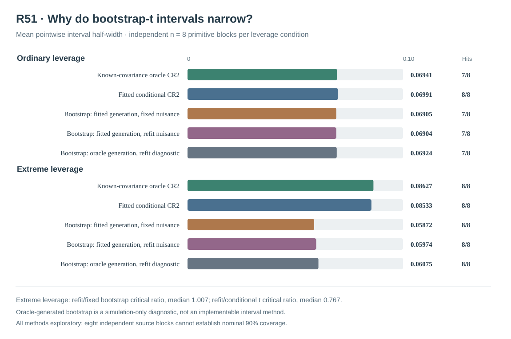

# W3 R51 — paired Gaussian bootstrap-t narrowing mechanisms: original independently recomputed results

**Research-only numerical and mechanistic experiment. It does not establish a valid 90% pointwise confidence interval, simultaneous functional bands, or version 1.2 release qualification.** [Draft PR #354](https://github.com/stefanosbalaskas/eyetrajectoriespy/pull/354) is stacked on the separately audited R50 evidence rather than protected main.

## Original experimental provenance

[Original scientific workflow #38952364476](https://github.com/stefanosbalaskas/eyetrajectoriespy/actions/runs/38952364476) passed **all four dedicated jobs**: source/mathematical contracts, two original Gaussian-generation shards, and the SHA256/exact-source-checkout aggregate. The original results-head on PR #354 passed **25/25 exact-head CI workflows**. The complete [original archive #12070401587](https://github.com/stefanosbalaskas/eyetrajectoriespy/actions/runs/38952364476/artifacts/12070401587) preserves all source cases, Gaussian draws, refitted four-component nuisance optimizations, pointwise interval records, original summary, checkout SHA and SHA256 manifest.

Independent extraction and numerical recomputation verified **3/3 SHA256 source-file digests**:

| Original artifact file | Original SHA256 |
|---|---|
| `cases.json` | `ebecc3982e04a9c349966fa2a0ddef2185bceb63b4004809f9f762a014975ecd` |
| `summary.json` | `8fd565d66d086e3c9e5252d1c2703e05daddaa8ac3c71f8515e8f8690836248e` |
| `source-commit.txt` | `4c2a043934e29d53e78087d7ead4899999df0be92344072e0d01cb1ae169c5aa` |

The source checkout SHA recorded within the original archive is **`03a38611a2eeb585a1139863d1f3010fffb918ea`**, a GitHub Actions PR **merge checkout**, not the research-branch commit. Do not substitute a subsequent documentation commit for that original source identity.

## Source and comparator construction

As prospectively fixed in the [R51 protocol](w3-r51-bootstrap-narrowing-mechanism-protocol.md), the experiment generated **eight genuinely new independent Gaussian primitive source blocks**, master seed **202610165151**, with native irregular trials, **n=24 participants**, positive predictor-scaled participant random-slope covariance and original Legendre-five fixed generating mean. The **ordinary-dependent** and **extreme-dependent** leverage conditions reuse a common primitive innovation within each block; 16 source/support conditions **do not constitute 16 independent source draws**. The Gaussian pseudodata seed was **202610165152**.

For each source/support condition, evaluate five **90%-nominal pointwise exploratory** procedures, all targeting the original native-design-projected generating predictor slope:

1. **Known-source covariance oracle, conditional Satterthwaite CR2:** simulation reference, not available on real gaze data.
2. **Fitted covariance conditional Satterthwaite CR2:** original observed-data Gaussian REML nuisance target treated as known for degrees of freedom.
3. **Fitted-covariance Gaussian generation, frozen nuisance covariance studentization:** participant-block Gaussian pseudoresponses drawn from the original observed fitted WLS mean/covariance, with **the original covariance held fixed** in each pseudo-response CR2 SE.
4. **Identical fitted-covariance Gaussian generation, four-component nuisance-refit studentization:** the **same Gaussian pseudoresponses**, but all four positive physical REML variance components are refitted and CR2 SE recomputed on each draw.
5. **True generating covariance Gaussian generation, four-component nuisance-refit studentization:** same underlying random standard-normal vectors and fitted WLS mean, but with the original simulator covariance only as the **Gaussian pseudodata-generation matrix**. The nuisance fitter and CR2 estimator are still fitted on generated pseudo-observations, without access to oracle covariance. **This arm cannot be implemented on empirical gaze data and is a simulation sensitivity diagnostic only.**

The original reference intervals use the source oracle or fitted conditional CR2 critical value. Each bootstrap-t arm uses the empirical **90th percentile of the absolute studentized pivot from all 63 frozen Gaussian draws**, with no success-conditioned exclusions.

## Independent checks of the exact original evidence

The complete evidence has **16/16 source cases, 80/80 pointwise interval records, 2,016/2,016 Gaussian draw/refit outcomes and 4,064/4,064 two-start physical Gaussian nuisance optimization records**. All original sources, original selected covariance fits and simulated refits were numerically accepted, and **zero Gaussian bootstrap attempts or interval records were refused**. The independently recomputed original interval decisions, generating-truth inclusions, 63-draw quantiles and full-source denominators exactly match the original study summary. The fitted-generation and oracle-generation draw at a given block/support/replicate carry the **same frozen standard-normal seed**, so the comparison is paired rather than across unrelated random draws.

**Important numerical qualification:** While **all 2,032 original or simulated Gaussian nuisance *fits* passed the two-start KKT/NLL acceptance rule**, this does **not** mean every individual solver start passed KKT. All 4,064 individual starts reported optimizer status `ok`, but one intermediate start had physical projected KKT **0.00199891**, above the strict **0.001** limit: independent block **3**, extreme support, fitted-generation bootstrap replicate **25**, `interior` start. The paired `spread` start at the same exact likelihood solution had projected KKT **3.31×10⁻¹¹**, and so the fit met the prospectively fixed rule that accepts an eligible start near the best observed NLL. Both original attempts remain visible. This isolated failure must **not** be relabeled as an all-start KKT pass. First-order numerical stationarity still does not certify global Gaussian REML optimality.

## Original pointwise inclusion and widths

Each inclusion count below uses the **eight independent Gaussian primitive blocks** within that leverage stratum. No estimate of population nominal 90% coverage is qualified, even when all eight source intervals happen to include the generating truth: 8/8 has 95% Wilson Monte Carlo lower limit only **67.6%**, and 7/8 has limits approximately **52.9–97.8%**.

| Experimental method | Ordinary truth included | Ordinary mean half-width | Extreme truth included | Extreme mean half-width |
|---|---:|---:|---:|---:|
| Known-covariance oracle conditional CR2 | **7/8** | 0.06941 | **8/8** | 0.08627 |
| Fitted-covariance conditional CR2 | **8/8** | 0.06991 | **8/8** | 0.08533 |
| Fitted generation, fixed nuisance CR2 bootstrap-t | **7/8** | 0.06905 | **8/8** | **0.05872** |
| Fitted generation, refitted nuisance CR2 bootstrap-t | **7/8** | 0.06904 | **8/8** | **0.05974** |
| Oracle generation, refitted nuisance diagnostic bootstrap-t | **7/8** | 0.06924 | **8/8** | 0.06075 |

In both support regimes there were **zero paired generating-truth inclusion disagreements** between holding covariance fixed in the simulated SE and refitting it in the simulated SE; there were also **zero paired inclusion disagreements** between fitted-generated and oracle-generated refitted bootstrap-t. These eight-block inclusion coincidences are not a statistical equivalence claim.

## What the mechanism experiment indicates

The original frozen 63-draw pivot distributions yield these **paired median absolute-pivot critical-value ratios**, independently recomputed using the original signed simulated studentized pivots:

| Paired mechanism contrast | Ordinary leverage | Extreme leverage |
|---|---:|---:|
| **Nuisance refitted / nuisance fixed**, same fitted-generation pseudo-responses | **1.00008** | **1.00724** |
| **Oracle-generated refit / fitted-generated refit**, same Gaussian innovations | **0.99281** | **1.06283** |
| **Fitted-generated refit / fitted conditional Satterthwaite t reference** | **0.99274** | **0.76651** |

The **central numerical contrast** under extreme leverage is the third ratio: the refitted-bootstrap critical is typically only about **76.7% of the conditional fitted Satterthwaite critical** within the same source. In contrast, **refitting nuisance covariance** on precisely the same fitted-generation pseudodata changes the median critical by only **0.7%**, and replacing the *generation covariance* with the simulator oracle increases the median refitted-bootstrap critical by approximately **6.3%**. Under ordinary leverage the analogous ratios cluster around one, on median.

Therefore R51 supports a narrower and more informative **mechanistic interpretation** than earlier studies: within this controlled Gaussian design, **the large high-leverage interval-width gap is associated mainly with the simulated bootstrap-t reference distribution versus the conditional finite-cluster Satterthwaite reference, rather than with the mechanical step of refitting four variance components inside the bootstrap alone**. The result does **not establish which reference law is statistically correct**. In particular, an extreme conditional Satterthwaite t critical can be large because estimated coefficient-specific effective degrees of freedom are small, while a 63-draw parametric bootstrap absolute-pivot quantile is noisy and relies on a potentially misspecified plug-in covariance and Gaussian assumptions. The true source generating covariance changes both Gaussian pseudo-outcomes and the distribution of fitted nuisance components, preventing a unique causal attribution to a single estimation error.

**Do not conclude** that suppressing Gaussian nuisance refitting is safe, that the narrower bootstrap-t is more efficient, or that oracle-generated pseudo-responses can provide empirical intervals. A critical-value ratio from eight paired Gaussian sources is a diagnosis of these implemented algorithms, not a derived finite-sample confidence interval guarantee or a basis for selecting a production estimator.

## Release and future-work boundary

The next scientifically meaningful step is mathematical: investigate the exact/approximate reference distribution of CR2 with high-leverage time-varying regressors when Gaussian nuisance covariance is estimated, and prespecify conditions in which conditional Satterthwaite and model-based bootstrap-t critical values diverge. More brute-force simulation **without that derivation** would repeat the unresolved mechanism. A later large independent-source validation should be run only after the inferential procedure, target estimand, reference distribution, Gaussian model sensitivity and numerical refusal conditions are frozen.

R51 did not assess simultaneous **90% whole-function** confidence bands, random-slope variance boundary-null type-I error or power, MAR/MNAR outcome-dependent observation loss, or latent participant selection. The originally detected R20/R22/R33–R50 negative results remain intact. Keep [scientific blocker #289](https://github.com/stefanosbalaskas/eyetrajectoriespy/issues/289) and [missingness blocker #296](https://github.com/stefanosbalaskas/eyetrajectoriespy/issues/296) **OPEN**. The R51 branch remains a draft research stack; no stable inference API, protected-main merge, 1.2 release tag or PyPI publication is authorized.
