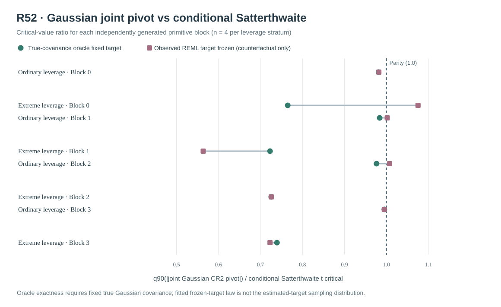

# W3 R52 — exact joint-Gaussian CR2 numerator/score pivotal law: original mathematical reference results

**Research-only mathematical/reference-law evidence. This is not a qualified 90% pointwise interval under estimated Gaussian covariance and does not provide 90% simultaneous whole-function confidence bands.**

## Original source and reproducibility

[Draft research PR #356](https://github.com/stefanosbalaskas/eyetrajectoriespy/pull/356) is stacked on the independently audited R51 branch, not protected main. The [original scientific workflow #38971125248](https://github.com/stefanosbalaskas/eyetrajectoriespy/actions/runs/38971125248) completed **both** dedicated jobs successfully: independent fixed-Gaussian coefficient/score algebra tests and the full prospective Gaussian reference experiment. The [original complete evidence artifact #12077096633](https://github.com/stefanosbalaskas/eyetrajectoriespy/actions/runs/38971125248/artifacts/12077096633) was downloaded and all **3/3** declared SHA256 digests were independently matched to the original bytes:

| Original archive member | Verified SHA256 |
|---|---|
| `cases.json` | `ab527b4a4a8485afaae78b2ce9e4859bf3a1bbf5d20f1d9149ea807d7d8082d0` |
| `summary.json` | `d6319b4455ede05171c7641b59ed3e58bdb7802b6a0ca1d288bf29e211150906` |
| `source-commit.txt` | `414c1ec3c0e6ea72458966f127f438525cc837dc4d4d9efd33131874eaa97c94` |

The original source checkout recorded in the artifact, **`1df58e2c27fbc76daee8d1d27dd8428e95f9fb17`**, is the original GitHub Actions pull-request merge checkout, **not** a later research branch or documentation commit.

## Finite-Gaussian reference derivation

The [prospectively frozen protocol](w3-r52-gaussian-cr2-joint-law-protocol.md) derives the exact known-covariance fixed-design Gaussian pivot algebra rather than assuming a normal numerator independent of a scaled chi-square denominator.

With native weighted fixed design `Z`, contrast `c`, residual projection `R=I-Z(Z'Z)^(-1)Z'` and Gaussian errors `epsilon~N(0,V)`, the fixed-effect contrast error `N=u'epsilon`, `u=Z(Z'Z)^(-1)c`, and every adjusted cluster score `S_i=h_i'epsilon` are jointly Gaussian. The CR2 score vector `S=(S_1,...,S_G)'` uses the original R22 scaled-Cholesky adjustment `A_i`; its squared standard error is **exactly** `sum S_i²`, giving the nonstandard but fully characterized pivot

`T=N/sqrt(sum_i S_i²)`.

The independent R52 implementation forms the joint Gaussian covariance matrix of `(N,S')'` using original **true** source covariance blocks, and the original weighted design. It does not construct the pivotal law by simulating and refitting Gaussian nuisance parameters. The known Gaussian oracle target `Phi=V` has an exactly computable score quadratic expectation, variance and Satterthwaite df from the score covariance spectrum. R52 separately confirmed these moments and the numerator/CR2 score equations against the original R22 implementation. The exact pivotal-law **critical quantile** is then numerically approximated through Gaussian draws from this known covariance.

The experiment also repeats this geometry using the observed-outcome REML covariance estimate **held frozen as a working target**. Crucially, that calculation is **not** an exact law conditional on estimated covariance and is **not** the real sampling distribution of the outcome-dependent fitted-target statistic. True `V` enters the simulated moment covariance; the fitted estimator's sampling variability is omitted. It is a mathematical **counterfactual reference**, not an implementable fixed-nuisance uncertainty correction.

An additional artificial counterfactual zeroes `Cov(N,S)` while retaining `Var(N)` and the complete `Cov(S)`; the same standard-normal Monte Carlo draws are used for pairing. Comparing this critical to the fully correlated joint-law critical measures sensitivity to numerator-score dependence, not a valid independent-normal/chi-square inferential method.

## Prospectively frozen generating and numerical design

New Gaussian innovation master seed **202610165252** and reference Monte Carlo seed **202610165253**, distinct from prior R51 evidence. **Four genuinely new independent Gaussian primitive blocks**, 24 participants each, native irregular repeated trials, positive predictor-scaled Gaussian participant random-slope covariance. Pair ordinary-dependent and extreme-dependent predictor support on each primitive innovation block: **eight paired source/support cases but only four independent primitive blocks per leverage stratum**. The estimand is the original weighted native-design-projected fixed focal predictor slope; the unprojected generating truth is preserved separately.

Each source undergoes the original **true source covariance oracle target** and the **observed-data four-component REML fitted target**, whose original two starts remain subject to the unchanged positive-physical first-order projected **KKT≤0.001** and observed-best **NLL gap≤0.001** rules. For each target form both the full jointly Gaussian and artificially independent-numerator pivot quantiles using **16,384 Gaussian draws per target**. Compute the Gaussian pivot absolute-value 90th percentile with fixed linear interpolation; record 95% binomial order-statistic **Monte Carlo quantile** uncertainty bounds. The exact analytic covariance law is distinct from the finite precision of this numerical quantile estimate.

The full experiment retains **8/8 original paired source cases, 16/16 accepted covariance targets, and 32/32 joint/independence quantile reference records**. There were **zero reported source, fitted-REML target, CR2 identity, joint-positive-semidefinite or Monte Carlo numerical refusals**. The oracle Gaussian score quadratic expectation and moment-matched conditional Satterthwaite degrees of freedom passed the prespecified strict agreement with R22. No statistical coverage claim is made from four independent source blocks.

## Original critical-value results

All ratios below are **median within-source critical-value ratios among four independent primitive blocks per leverage condition**, with the ordinary/extreme versions of each primitive block paired. `q_joint` denotes the 90th percentile of the absolute **correlated Gaussian** focal CR2 pivot, `q_ind` its artificial independent-numerator counterpart with the **same score covariance**, and `t_Sat` the original fixed-target conditional Satterthwaite two-sided nominal 90% t critical.

| Gaussian working-target geometry | Ordinary leverage | Extreme leverage |
|---|---:|---:|
| **Oracle true Gaussian covariance:** `q_joint / t_Sat` | **0.98255** | **0.73245** |
| **Fitted REML covariance held fixed (counterfactual):** `q_joint / t_Sat` | **0.99843** | **0.72426** |
| Oracle covariance: `q_joint / q_ind` | **0.99983** | **0.96099** |
| Fitted covariance held fixed: `q_joint / q_ind` | **0.99974** | **0.96051** |
| Oracle covariance: median maximum `abs(Cor(N,S_i))` | **0.02492** | **0.29297** |
| Oracle covariance: median conditional Satterthwaite df | **11.976** | **1.808** |
| Fitted covariance held fixed: median conditional Satterthwaite df | **12.411** | **1.767** |

The **known-true-covariance oracle** gives a particularly informative reference: under extreme leverage, original Satterthwaite t critical values across the four individual primitive blocks were approximately **2.996, 3.481, 3.256 and 3.044**, while the corresponding correlated-Gaussian pivotal criticals were approximately **2.292, 2.516, 2.362 and 2.250**. This pattern arises even though the covariance target is **known**, the adjustment uses the original correct Gaussian working family, and nuisance components are **not estimated** in the reference law. Thus the high-leverage difference in critical values cannot be explained solely as sampling uncertainty introduced by covariance nuisance refitting.

Under ordinary support, the oracle Satterthwaite reference gave conditional t criticals about **1.760–1.803**, and the direct joint-Gaussian pivotal values about **1.727–1.772**. This is markedly closer to parity, consistent with R51's observation that the two reference approaches diverged primarily under high leverage.

The **artificial independence** comparison suggests a smaller nonzero numerator–score contribution under extreme leverage: the exact correlated pivotal quantile had a median ratio near **0.961** relative to zeroing its numerator-score cross-covariance, while ordinary leverage was essentially at parity. Hence the source of the larger gap to conditional Satterthwaite cannot be reduced to numerator-score independence alone. The score-quadratic spectral shape, moment-matching and actual ratio distribution are integral. These influences are not additively identified by the three ratios.

The four fitted-working-target counterfactual individual source results must not be concealed behind their median: under extreme leverage, one source's numerical correlated-Gaussian-to-conditional-t ratio was **greater than 1** (approximately **1.075**), whereas the other three were approximately **0.564–0.726**. This is variability among fixed design geometries, not independent population evidence of a universal smaller exact-Gaussian reference. The original order-statistic 95% MC quantile intervals had widths approximately **2.5–4.2% of the estimated q90** across conditions, so single-source close-to-one comparisons also contain Monte Carlo quantile error.

## Interpretation relative to R51 and scientific boundary

The original R51 high-leverage nuisance-refit bootstrap / fitted conditional Satterthwaite critical ratio was about **0.767**, whereas the R52 known-Gaussian fixed-target exact-geometry ratio is about **0.732** under a **new** four-source design. The numerical consistency is suggestive of a more fundamental reference-law mismatch at extreme leverage, but the source blocks and constructions are not identical and **these ratios are not an independent proof that R51's fitted bootstrap-t has the correct frequentist sampling distribution**.

The exactness of `Omega` and of the known-covariance fixed-design law does **not** carry over to `Phi_hat(Y)` estimated on the same gaze outcomes. A valid fitted-nuisance inference procedure needs a mathematical treatment of the **joint randomness of the covariance estimator, the coefficient contrast and the CR2 quadratic score**, or a separate independently calibrated full estimator-refitting sampling procedure with adequate Monte Carlo precision and misspecification stress. The new R52 reference makes that gap explicit rather than assuming it is solved by a stronger convergence flag or a more favorable interval width.

R52 does **not** qualify nominal 90% pointwise confidence intervals in empirical gaze data, 90% simultaneous whole-function bands, slope-variance boundary-null Type-I/power inference, Gaussian family misspecification robustness, observation-driven MAR/MNAR attrition or selection of whole participants. Original R20/R22/R33–R51 negative results remain in the record. Keep scientific blocker [#289](https://github.com/stefanosbalaskas/eyetrajectoriespy/issues/289) and missingness blocker [#296](https://github.com/stefanosbalaskas/eyetrajectoriespy/issues/296) **OPEN**. No public inference API promotion, protected-main merge, version 1.2 tag or PyPI publication is authorized.
