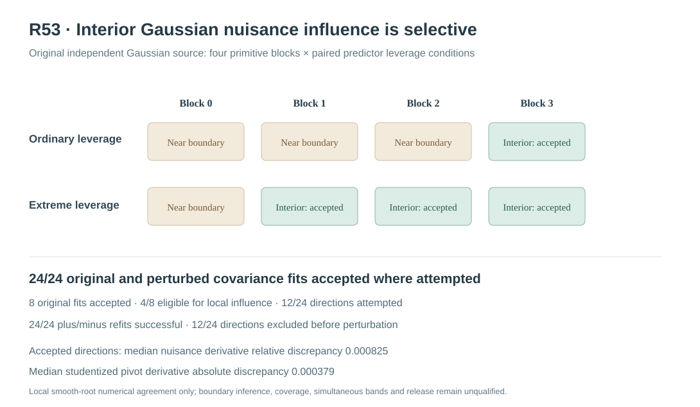

# W3 R53 — local observed-Gaussian REML covariance influence on CR2: original results

**Research-only local smooth-interior derivative experiment.** The Gaussian REML score/Hessian and original CR2 studentized response derivatives passed independent finite-difference tests. In the new original-source experiment, numerical agreement was strong **when** an interior derivative was admissible, but **half the original source cases failed the stricter interior-variance gate**. No general 90% coverage, global likelihood optimality, functional simultaneous band or software release is qualified.

## Scientific evidence provenance and original failure

[Draft PR #357](https://github.com/stefanosbalaskas/eyetrajectoriespy/pull/357) is stacked on the R52 draft research branch rather than protected main. The **first** original-source workflow [#38972673774](https://github.com/stefanosbalaskas/eyetrajectoriespy/actions/runs/38972673774) passed the mathematical regression tests but failed its original evidence-writing job with `TypeError: Object of type ndarray is not JSON serializable`. That is a **reporting-layer engineering failure**, not a statistical result and not a passed original scientific execution. The source experiment, estimator, Gaussian covariance likelihood, seeds, Gaussian CR2, KKT/box gates, perturbation directions and planned denominators were not modified. A narrowly scoped evidence encoder and explicit JSON finite/nonfinite regression test corrected the error.

The corrected [original science workflow #38973010225](https://github.com/stefanosbalaskas/eyetrajectoriespy/actions/runs/38973010225) completed **both dedicated jobs successfully**: the independent analytic derivative/mixed-response-derivative/frozen-CR2 contracts and the full original four-block paired-source numerical experiment.

The [corrected immutable source archive #12076808788](https://github.com/stefanosbalaskas/eyetrajectoriespy/actions/runs/38973010225/artifacts/12076808788) preserves original source cases, each strict two-start fit, four-component estimated Gaussian variance ratios, original score/Hessian/eigen diagnostics where qualified, centered perturbation derivative predictions/refits and their complete refusal slots. Independent extraction confirmed **all 3/3 original SHA256 checksums**:

| Original artifact | Verified SHA256 |
|---|---|
| `cases.json` | `4bcc5be49d90365b25898fa044e23c9704ea2be6de6a68d591fc4ee5b147ba7d` |
| `summary.json` | `e459909c33a5192d4933793938458be854c225c57236c79a2e38c10f72300f44` |
| `source-commit.txt` | `88715b85798d4261b929931aac3369a5603e626a1883979598170400289a75ae` |

The original Actions checkout `11689d8562b061ebd5ac98103f5be26fd94b228f` is a GitHub pull-request **merge checkout**, not the latest documentation-head branch commit. The original unsuccessful run remains part of the engineering record.

## Explicit local method and independent differential checks

The [predeclared mathematical protocol](w3-r53-local-reml-influence-protocol.md) studies the four absolute positive Gaussian covariance components at a selected **interior** local REML stationary point. For native weighted response `y_w`, weighted mean design `Z`, covariance kernels `K_k`, `V(theta)=sum theta_k K_k`, and restricted projection `P=V^-1 -V^-1 Z (Z'V^-1 Z)^-1 Z' V^-1`, negative restricted-Gaussian score satisfies

`s_k=(1/2){tr(PK_k)-y_w'P K_k P y_w}`.

Its **observed** Hessian and mixed response derivative imply the local covariance nuisance Jacobian

`D_y theta_hat = H^-1 [P K_k P y_w]_{k=1,...,4}`

only if the observed Hessian is nonsingular positive definite, the solution is smoothly interior, and the same local root is followed under perturbation. These hypotheses are explicitly **not** fulfilled merely by the L-BFGS-B optimizer reporting convergence.

The original R22 CR2 squared focal standard error `q(y_w,theta)=sum_i(h_i(theta)'y_w)^2` has **direct** weighted-response derivative `2 sum_i(h_i'y_w) h_i` at fixed covariance. Its **estimated-covariance channel** is `(partial_theta q) D_y theta_hat`, with `partial_theta q` independently calculated by central physical-parameter differences of the unmodified R22 implementation. The total studentized statistic response derivative includes both channels. This is a **local first-order functional sensitivity**, not the distribution of a refitted nuisance estimator, a corrected Satterthwaite law, an independently calibrated bootstrap or a valid general confidence interval.

The independent mathematical test job verified: (i) direct dense Gaussian REML score against the original R25/R49 analytic likelihood, (ii) observed physical-coordinate Hessian against numerical score changes in all four dimensions, (iii) score–response mixed derivative against centered raw weighted-response changes, (iv) the exact original R22 CR2 squared-score dependence on the weighted outcome, (v) the fixed-y CR2 covariance derivative, and (vi) finite-safe JSON evidence preservation. No true generating covariance was used to fit or differentiate the observed-only REML nuisance estimator.

## Full original Gaussian source and refusal accounting

New master seed **202610175353** generated **four independent primitive Gaussian source innovations**, n=24 participants each, native irregular trials and a true positive predictor-scaled Gaussian participant random slope. The ordinary and extreme dependent leverage cases reuse primitive Gaussian innovations and therefore are **paired within each block**. New perturbation seed **202610175354** fixed three weighted-response perturbation directions per source. Eight source/support cases **do not constitute eight independent Gaussian blocks**.

The original Gaussian nuisance model converged and passed the strict two-start **physical projected KKT ≤0.001** and NLL-near-best criteria in **8/8 original source cases**. However, the stricter frozen interior eligibility criterion (all physical variance ratios away from the positive box endpoints by factor **20**, positive-definite observed Hessian, condition limit 10⁹, and stable CR2 differentiation) accepted **only 4/8** sources. The other **4/8** sources were explicitly **refused before differentiation because a participant-slope variance estimate lay close to the imposed positive lower variance-ratio boundary**, despite the **source simulator having truly positive slope variance**. The four near-boundary source-component estimates were on the order of **9.1×10⁻⁹ to 1.13×10⁻⁸** in native weighted covariance units. They were **not reclassified as regular interior solutions**.

| Frozen source result | Ordinary leverage | Extreme leverage | Total |
|---|---:|---:|---:|
| Original REML fit numerically accepted | 4/4 | 4/4 | **8/8** |
| Smooth-interior implicit nuisance derivative accepted | 1/4 | 3/4 | **4/8** |
| Interior derivative refused at slope-variance box boundary | 3/4 | 1/4 | **4/8** |
| Fully executed directional perturbations | 3/12 | 9/12 | **12/24** |
| Directional records retained as not attempted | 9/12 | 3/12 | **12/24** |
| Executed plus/minus full REML refits accepted | 6/6 | 18/18 | **24/24** |

The planned denominator remained **8 original source cases, 24 source perturbation directions, 48 plus/minus refit attempt slots and 112 original/perturbed two-start optimizer slots**. Only **24 of the 48** plus/minus refits were legitimately attempted after 12 of the 24 directions were excluded by the originally frozen interior criterion; all attempted refits passed. Counting 8 original REML fits and 24 actually executed perturbation refits gives **32/32 numerically accepted covariance fits among attempted fits**, with **64/112 executed individual optimizer-start records** and **48 intentionally unexecuted slots**. This is **not** a claim that all 56 planned fits or 112 planned starts were successfully performed.

The exact block/support accept/refusal pattern was: block 0 ordinary **refused**, block 0 extreme **refused**; block 1 ordinary **refused**, block 1 extreme **accepted**; block 2 ordinary **refused**, block 2 extreme **accepted**; block 3 ordinary **accepted**, block 3 extreme **accepted**.

## Local derivative agreement among the 12 admissible directions

The original source retained analytical directional changes in all four nuisance components and the studentized focal coefficient, plus the centered full-Gaussian-REML-refit derivatives at `y_w ± h d`. For all **12/12 actually executed directions**, both perturbation refits passed their frozen physical KKT/NLL criteria and original CR2 was computed without numerical refusal.

Independent recalculation from the original immutable case ledger gave:

| Conditional-on-accepted directions numerical discrepancy | Ordinary, 3 directions | Extreme, 9 directions | Overall, 12 directions |
|---|---:|---:|---:|
| Median relative norm discrepancy in `D_y theta_hat × d` | **0.000816** | **0.000835** | **0.000825** |
| Median absolute derivative discrepancy in studentized `D_y T × d` | **0.0000972** | **0.000545** | **0.000379** |

The largest observed relative nuisance directional derivative discrepancy was **0.002169** and the largest absolute studentized focal derivative discrepancy was **0.002958** among all twelve admissible directions. These are encouraging local numerical validation results: the original smooth-interior implicit calculation predicts centered full covariance refits closely **on the subset where its mathematical assumptions were enforced**.

They do **not** establish accuracy near the REML variance boundary, stability for different Gaussian covariance families, or fidelity to the *finite-sample probability distribution* of an estimated-covariance CR2 statistic. Moreover, the ordinary versus extreme summaries have only one and three independent admissible primitive source blocks respectively; they cannot be interpreted as statistically general comparative results.

## Scientific decision

**The R53 hypothesis is only conditionally supported.** We now have a numerical contract for the local observed-score Hessian, physical Gaussian nuisance response Jacobian and its derivative contribution to the CR2 variance and studentized focal pivot at an eligible smooth-interior fit. The first serious finding is the **selection/identification boundary:** even with truly positive source slope variance and successful physical KKT, **half of the simulated observed REML fits approach the artificial zero-variance box boundary and must be excluded from the smooth local inverse-Hessian argument**.

The required subsequent mathematics concerns active-constraint/variance-component-boundary behavior, estimator-root switching and the influence of an outcome-selected covariance solution on the **joint distribution** of coefficient numerator and CR2 residual-score quadratic. An interior Jacobian cannot silently be extrapolated across active bounds. A separate future original-source experiment would need to identify and predeclare active-set or directional cone derivatives and independently test their finite-sample inference; simply relaxing R53's factor-20 box rule to recover the four refused cases would compromise the frozen protocol.

R53 **does not qualify nominal 90% pointwise intervals, 90% simultaneous functional confidence bands, covariance-boundary null Type-I/power tests, global REML maxima, non-Gaussian covariance, MAR/MNAR point-level missingness or latent whole-participant selection**. Preserve R20/R22/R33–R52 negatives and R53's original failed serializer run. Both [#289](https://github.com/stefanosbalaskas/eyetrajectoriespy/issues/289) and [#296](https://github.com/stefanosbalaskas/eyetrajectoriespy/issues/296) remain **OPEN**. The research stack stays off protected main; no supported inference API, 1.2 release tag or PyPI publication is authorized.
