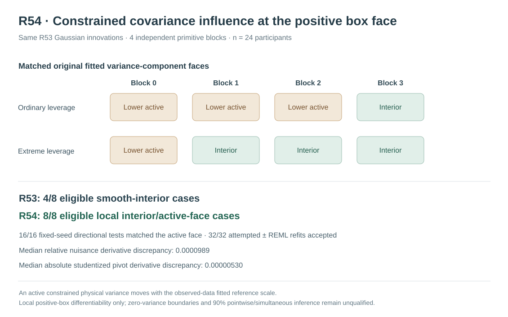

# W3 R54 — moving-bound active-face REML covariance influence: original matched-source results

**Research-only numerical and mathematical mechanism experiment; not a statistically qualified 90% pointwise confidence interval or simultaneous functional band.** R54 reuses, rather than supplements, the original R53 Gaussian source innovations in order to investigate the same four covariance estimates previously excluded from smooth-interior differentiation.

## Scientific provenance and original evidence

[Draft research PR #358](https://github.com/stefanosbalaskas/eyetrajectoriespy/pull/358) is stacked on R53, off protected main. The prospectively frozen [R54 protocol](w3-r54-boundary-active-set-influence-protocol.md) specifies the mathematical active-face derivative, independent response-direction seed, strict KKT sign and reduced Hessian criteria, full two-start refits and refusal denominators.

[Original GitHub Actions scientific workflow #38974627708](https://github.com/stefanosbalaskas/eyetrajectoriespy/actions/runs/38974627708) completed **both dedicated scientific jobs successfully**: independent observed-data reference-bound derivative contracts and full matched R53 Gaussian-source refitting. The [original evidence artifact #12077899310](https://github.com/stefanosbalaskas/eyetrajectoriespy/actions/runs/38974627708/artifacts/12077899310) preserves all original and symmetric-plus/minus physical REML fits, optimizer starts, the active set of each fitted and perturbed covariance, strict signed bound-gradient checks, and paired total CR2 studentized response derivative comparisons.

An independent examination of the immutable archive verified its three SHA256 checksums:

| Original evidence member | SHA256 |
|---|---|
| `cases.json` | `40dd9e448ada9c2a4bf07511eb6db8d104a32dcacae5aa8055e2470868afe13e` |
| `summary.json` | `37702867bfec901d1a1b65bbe9a74af3a0afc16df636aee67673f29fd4238f02` |
| `source-commit.txt` | `78d39203f6526557c579d658f3da18305df7c66060ae55bf072f270644724dc6` |

The source checkout recorded by the original workflow is `d8c933164fd2ef7f0092a94dccc76db69ea6fc44`, a pull-request **merge checkout** rather than the subsequent documentation branch head.

The original R53 [source evidence](https://github.com/stefanosbalaskas/eyetrajectoriespy/actions/runs/38973010225/artifacts/12076808788) is unchanged. R54 **reproduced the eight original R53 generating-source identities and observed covariance fits numerically**, with matching fitted variance-reference scales and component estimates within **10⁻⁶ relative tolerance**. Two repeated local optimizations chose the *other* predeclared near-equivalent starting solution; these are numerical solver-start selection differences, **not** byte-identical optimizer outcomes or eight new generating draws. The new independent random seed **202610175454** applies only to weighted-response perturbation directions, not Gaussian source generation.

## Why the ordinary interior derivative originally refused

In R53, **8/8** observed-data four-component Gaussian REML fits passed the two-start physical projected-gradient and observed-best NLL numerical gates, yet **four** accepted covariance estimates put the participant-slope variance ratio at the imposed positive lower bound `LOW = exp(-13.8) ≈ 1.01563×10⁻⁶`. The corresponding native weighted covariance components were approximately `9.1×10⁻⁹`–`1.13×10⁻⁸`. R53 correctly excluded those cases from its **four-dimensional smooth-interior inverse-Hessian** derivation. An optimizer success flag does not make a boundary-constrained estimator differentiable as an interior stationary root.

An important numerical detail of the original R49 model is that its nuisance components are `theta_k=ratio_k × reference(y)`, where `reference(y)` is the **observed residual mean-square variance scale**. Consequently, a variance component active at the **positive lower ratio bound** is not held at a constant physical value when `y` changes. Writing the weighted response `y_w=sqrt(w)y` and WLS residual projector `R` gives the exact moving-bound derivative:

`D_y reference=(2/n) R diag(1/w) R y_w`, and `D_y theta_active = bound_ratio × D_y reference`.

The new reduced-Hessian implicit derivative uses the **free-component** likelihood score stationarity equation `H_FF D_y theta_F=B_F-H_FA D_y theta_A`. It requires the original active ratio to remain on exactly the same face, strictly signed dimensionless active KKT gradient (absolute margin at least **0.001** in the appropriate sign), interior free ratios and a positive-definite, sufficiently conditioned free Hessian. It then propagates the full constrained derivative through the original R22 CR2 quadratic score and studentized focal coefficient. The original 4-dimensional interior derivative remains mathematically inapplicable to the four boundary sources; R54 offers a **different constrained-face derivative** on a locally stable solution.

## Complete matched-source numerical findings

The original experiment reuses **four independent Gaussian primitive blocks**, n24 participants, with paired ordinary-dependent and extreme-dependent predictor leverage conditions, for eight source/support cases. These are **not new independent population simulation sources** relative to R53. Under the original positive ratio bound, **three ordinary** and **one extreme** cases have the slope component active; the other four have no active fitted covariance component under R54's strict recognition tolerance.

| Planned and observed source/refit category | Ordinary | Extreme | Total |
|---|---:|---:|---:|
| Original Gaussian REML fit numerically accepted | 4/4 | 4/4 | **8/8** |
| Slope ratio at positive lower active face | 3/4 | 1/4 | **4/8** |
| Accepted locally stable free/active-face implicit derivative | 4/4 | 4/4 | **8/8** |
| Eligible original directional comparisons | 8/8 | 8/8 | **16/16** |
| Accepted positive/negative full Gaussian REML refits | 16/16 | 16/16 | **32/32** |
| Observed active-face switches under refitting | 0/8 directions | 0/8 directions | **0/16** |

All **40 planned original and perturbed Gaussian covariance fits** were attempted and accepted by the frozen **two-start fit-level** KKT/NLL gate. The archive contains **80/80 prespecified optimizer-start records**; this does **not** assert that each individual optimizer start independently satisfies KKT or represents the global REML maximum. No source, strict-complementarity, reduced-Hessian or original CR2 covariance identity stage refused. The four active-slope sources' **dimensionless signed lower-face KKT gradients** were all strictly positive, between approximately **0.109 and 0.950**, exceeding the prospectively defined strict-complementarity margin **0.001**.

## Independent case-level derivative audit

The original plus/minus nuisance component values and perturbation magnitudes allow a **second independent calculation** of the 16 empirical physical covariance-direction derivatives. Every reported derivative, relative discrepancy, and studentized pivot derivative discrepancy was recomputed from the original case-level records. For each of the **eight directions originating at active lower-slope cases**, the replayed positive-slope physical variance change matches `LOW×(reference_plus−reference_minus)/(2h)`, independently confirming the moving-reference-bound dependence; the zero-sloped or constant physical-component shortcut would not represent this estimator.

| Conditional numerical discrepancy over accepted local directions | Ordinary (8) | Extreme (8) | All (16) |
|---|---:|---:|---:|
| Median relative four-nuisance-component derivative discrepancy | **0.00008191** | **0.00016489** | **0.00009892** |
| Maximum relative nuisance derivative discrepancy | 0.00036815 | 0.00058091 | **0.00058091** |
| Median absolute studentized CR2 pivot derivative discrepancy | **0.000001137** | **0.000028435** | **0.000005303** |
| Maximum absolute pivot derivative discrepancy | 0.000005526 | 0.00135558 | **0.00135558** |

This is evidence for **accurate local numerical differentiation of the unchanged positive-box REML estimator on these frozen source cases**, including the four originally excluded smooth-interior sources. It is not evidence that the underlying slope variance is truly zero, and because R54 uses smaller directions and its own fixed seed, differences from R53's directional error magnitudes are not a direct same-direction estimator comparison.

The original and perturbed fitted covariance solution may still switch faces or local optimum branches under larger responses, different samples, boundary-null generating covariance, alternate kernels or greater leverage. A positive lower ratio bound is **not equivalent to a structural zero variance component**, and these eight source/support cases provide **no new independent population-level Monte Carlo precision** beyond R53.

## Scientific conclusion and release boundary

R54 supplies a defensible local mathematical extension: the smooth-interior Hessian derivative in R53 is replaced, at a **strictly complementary stable fitted positive face**, by a reduced free-Hessian calculation that explicitly differentiates the **observed outcome-dependent physical variance bound**. The constrained derivative matched full four-component Gaussian REML numerical refits and CR2 pivots for all originally recorded perturbation directions, including the four cases R53 appropriately refused under its different mathematical assumptions.

**The inferential problem remains open.** The study does not derive the **unconditional sampling law** of a covariance estimator that may occupy, depart from or switch between positive-variance faces; it does not supply correct confidence interval critical values at a true zero-variance boundary, a calibrated 90% pointwise fixed-effect interval, a 90% simultaneous function band, or valid boundary-null Type-I/power. It also does not identify MAR/MNAR gaze loss, selection of whole participants on latent outcomes, or robust Gaussian kernel misspecification. It would be incorrect to recategorize the R53 original four interior failures as successful R53 interior tests: those results remain as originally recorded.

Maintain scientific blocker [#289](https://github.com/stefanosbalaskas/eyetrajectoriespy/issues/289) and missingness blocker [#296](https://github.com/stefanosbalaskas/eyetrajectoriespy/issues/296) **OPEN**, preserve negative original studies R20/R22/R33–R53, and keep all work on draft research PRs. **No protected-main merge, public inference API, version 1.2 release tag or PyPI publication is authorized.**
