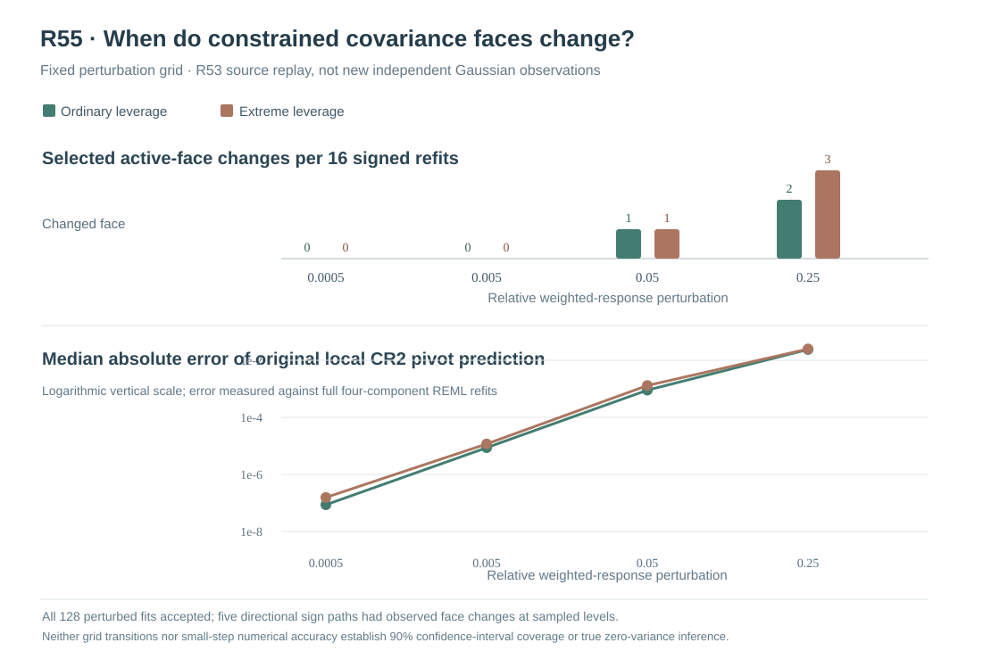

# W3 R55 — selected Gaussian REML active-face transition stress: original fixed-grid results

**Research-only original R53-source replay.** The complete prospective signed perturbation grid and its independent original-source evidence are numerically verified. Neither grid points nor perturbation paths are new independent Gaussian generating-source replications, and none qualify a 90% pointwise or simultaneous confidence interval.

## Original source provenance and exact evidence

[Draft PR #360](https://github.com/stefanosbalaskas/eyetrajectoriespy/pull/360) is stacked on the independently audited R54 research PR #359, with protected main unchanged. The [R55 frozen scientific protocol](w3-r55-active-face-switch-profile-protocol.md) was committed **before running the original stress paths**.

The [original science workflow #39017622414](https://github.com/stefanosbalaskas/eyetrajectoriespy/actions/runs/39017622414) completed **all four dedicated jobs** successfully: source/quantile/refusal contract, two original nonoverlapping source shards and exact-merge-checkout SHA256 complete aggregate. The complete immutable [original artifact #12095781397](https://github.com/stefanosbalaskas/eyetrajectoriespy/actions/runs/39017622414/artifacts/12095781397) contains source-level and direction-level originals and every signed/magnitude refit.

Independently extracting and checking the original aggregate bytewise confirms **3/3 SHA256 digests**:

| Original artifact member | Verified SHA256 |
|---|---|
| `cases.json` | `febda7e51d09194a337fc3b869f8608e05621e57fa41020c82ea5624818b5a8b` |
| `summary.json` | `94207a0d83ba251ac5480ad38bd73ff02f94bfef717ea0334bcdb26d2b5505b5` |
| `source-commit.txt` | `79c62acfe722653c0fafae1b35de07148efd2de7c9cdf2339e06ccca307c1d85` |

The exact original source checkout recorded by GitHub Actions was **`1e0ccce56dd2a70d08fcf1b7fba6ed55627a38f5`**, a **PR merge checkout**, not a subsequent documentation-head commit. The two original shards have separately verified byte-level case digests, `df80b79d1fe3f8b0c397a5c56a75a98fc429c3d39e2822cccbd7e65b193df12b` and `0150a2ff62ac37b74a7e568d65f9aba721baa27adac65d57c4b2369156087cf8`; both recorded exactly that original PR merge checkout.

## Prospective source and intervention

The original **R53 master seed 202610175353** was deliberately **reused**, retaining its **four Gaussian primitive innovation blocks**, native irregular repeated gaze, n24 participants per source and true positive predictor-scaled participant Gaussian slope variance. Ordinary/extreme predictor support remains paired within each primitive innovation block. There are eight paired source/support records, but R55 contributes **zero new independent Gaussian generating blocks** and **no new population coverage Monte Carlo precision**.

New weighted-response direction seed **202610175555** supplied **two fixed unit-RMS directions per source**, both signs at **four prespecified step levels 0.0005, 0.005, 0.05, 0.25**, multiplied by the original weighted-response RMS (with frozen .01 minimum scale). Each response then underwent the **unchanged original R49 four-component physical-positive Gaussian REML**, original two fixed optimizer starts, original physical projected **KKT≤.001**, near-best observed original NLL **≤.001**, original outcome-dependent residual mean-square scaling and scaled-Cholesky R22 CR2. The participant-slope positive box lower ratio was unaltered at **exp(−13.8)**.

The complete failure-inclusive denominator was **8 original source/support cases ×2 directions ×4 levels ×2 signs =128 full perturbed Gaussian REML fits**, plus **8 original fits** = **136 total planned fit records**, each with two prespecified optimizer-start slots = **272 original optimizer-start records**. The original source retained **8/8** accepted original fits, **128/128** accepted perturbed REML and CR2 fits and **272/272** executed solver-start records, with **zero numerical fit/CR2 refusals and zero not-attempted slots**. This does **not** assert that every *individual* optimizer start meets projected-gradient KKT or a global likelihood maximum.

## Active-face changes across fixed stress magnitudes

The active face is defined by the **selected** original or refitted Gaussian variance ratios within the inherited **relative box tolerance 1e−5**. A signed amplitude refit changes face if its selected lower/upper active component sets differ from the baseline original face. Merely selecting a different one of the two numerical starting solutions does not establish a new root or an active-face transition.

Each leverage stratum has 16 signed refits at each amplitude: **four reused primitive blocks ×2 directions ×2 signs**. The source-level original findings were:

| Relative weighted-response step | Ordinary: face changes /16 | Extreme: face changes /16 | Total /32 | Original optimizer starting solution changed /32 |
|---|---:|---:|---:|---:|
| **0.0005** | 0 | 0 | **0** | 12 |
| **0.005** | 0 | 0 | **0** | 17 |
| **0.05** | 1 | 1 | **2** | 14 |
| **0.25** | 2 | 3 | **5** | 10 |

Seven signed-level observations had a different selected face (two at the **0.05** level and five at **0.25**), arising on **five distinct source/direction/sign paths**. The **five first observed discrete transition brackets** were:

| Original source and leverage | Direction and sign | Last observed unchanged step | First observed changed step | Original → changed slope face |
|---|---|---:|---:|---|
| Block 1, ordinary | Direction 1, negative | 0.005 | **0.05** | Lower active → free |
| Block 1, ordinary | Direction 0, negative | 0.05 | **0.25** | Lower active → free |
| Block 2, extreme | Direction 0, positive | 0.005 | **0.05** | Free → lower active |
| Block 1, extreme | Direction 1, positive | 0.05 | **0.25** | Free → lower active |
| Block 2, extreme | Direction 1, negative | 0.05 | **0.25** | Free → lower active |

All other **27/32** signed paths showed **no difference from the original face at the four sampled levels**. These are **discrete observation brackets**, not estimated exact switch thresholds. An intermediate active-face transition and subsequent reversion between sampled levels is not excluded; nor is a different optimum branch at a fixed ratio face. The source replay cannot be used to estimate a population probability of Gaussian covariance face switching.

## CR2 nonlinear prediction errors, including same-face refits

The original predeclared R54 constrained active/free-face Jacobian was recomputed at each original observed source case without changing R53/R54 acceptance conditions. For every signed perturbation, the local Taylor prediction for the **true-source-focal-centered** studentized CR2 pivot was compared with the result of the complete original four-component Gaussian REML refit and recalculated R22 CR2 point/SE. All eight baseline active/free-face Jacobians passed their frozen gates.

The original full-denominator per-stratum medians were:

| Relative step | Ordinary median absolute pivot prediction error | Extreme median absolute pivot prediction error |
|---|---:|---:|
| **0.0005** | 0.0000000864 | 0.0000001560 |
| **0.005** | 0.000008674 | 0.000011706 |
| **0.05** | **0.0008981** | **0.0013083** |
| **0.25** | **0.023822** | **0.024921** |

Independent case-level recalculation shows that the differences are not confined to paths that switch face. At the largest **0.25** perturbation, **five/32** selected faces changed and their median absolute studentized prediction discrepancy was **0.09282**, while **27/32** refits that **retained** their original selected face still had median discrepancy **0.01877**. At **0.05**, the two face-changing refits had median error **0.01290** versus **0.000898** across the thirty stable-face refits.

Thus two different effects are visible without conflation: (i) the original active-face linear derivative need not remain applicable after the estimator changes selected constraint faces; and (ii) the Taylor approximation itself becomes less accurate at larger response perturbations **even when the selected active face remains unchanged**. Changes of optimizer starting label were frequent at **small** perturbations despite zero face changes, confirming that **starting-label changes cannot be used as a proxy for crossing a covariance constraint**.

These descriptive error comparisons have strong within-source dependence: all perturbation points are deterministic transforms of the **same eight original observed Gaussian realizations**, themselves paired into only four independent Gaussian primitive innovations. There is no independent source-level calibration, experimental randomization of leverage or population causal contrast.

## Scientific conclusion and next mathematical limit

R54 established a **strictly complementary local derivative** of a positive constrained physical covariance estimate, accounting for the observed-data reference bound movement. R55 now supplies original finite-path evidence that this local sensitivity has a finite domain of usefulness: larger weighted-response perturbations can move the **selected participant-slope covariance component on or off the positive optimizer box face**, and CR2 Taylor approximation errors increase substantially whether or not a transition occurs.

R55 is **not** a full finite-sample derivation of the selection-dependent Gaussian REML estimator or joint coefficient/adjusted-CR2 quadratic sampling distribution. No inference is established at the true structural random-slope variance zero boundary; the optimizer's **positive ratio lower box** is not a scientific zero-variance component. These fixed direction paths neither characterize the transition probability under genuinely new Gaussian samples nor establish valid nominal **90% pointwise fixed-effect intervals**, **90% simultaneously calibrated whole-function confidence bands**, slope boundary-null Type-I/power, robustness under covariance-family misspecification or response-dependent MAR/MNAR and missing whole-participant selection.

A defensible subsequent methodological step is to derive and numerically check **face-conditional directional/cone derivatives** and root-selection behavior under a constrained Gaussian likelihood, and separately to qualify any eventual inference method on **new independent generating blocks** with a frozen sampling-level coverage protocol. Repeating deterministic paths or accepting an alternative solver start cannot replace this derivation.

Keep scientific issues [#289](https://github.com/stefanosbalaskas/eyetrajectoriespy/issues/289) and [#296](https://github.com/stefanosbalaskas/eyetrajectoriespy/issues/296) **OPEN**. Preserve the complete R20/R22/R33–R54 negative findings and the R53 four smooth-interior refusals. All R55 research is isolated on draft PR #360, without protected-main merge, supported inference API, 1.2 release tag or PyPI publication.
