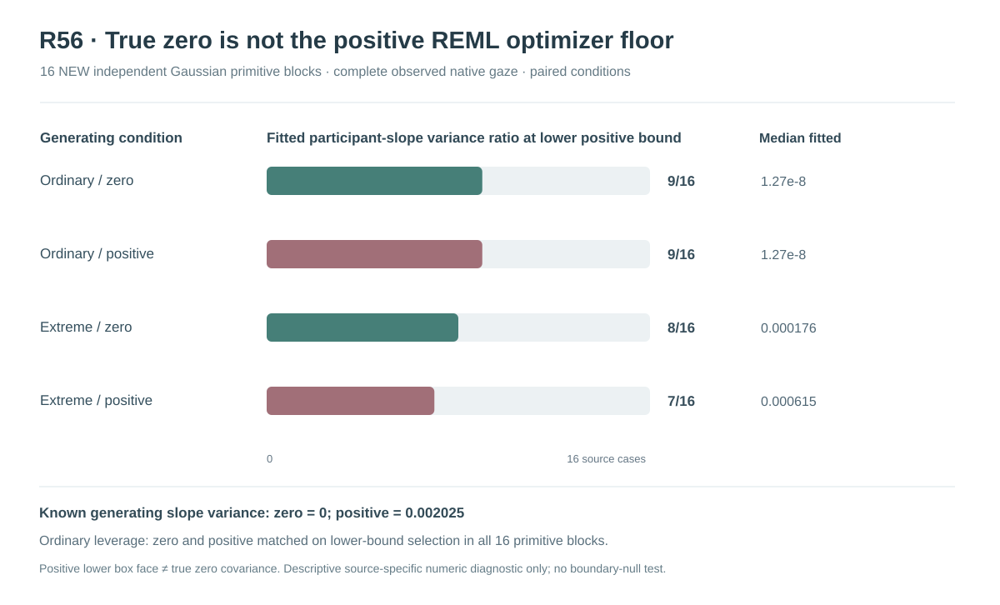

# W3 R56 — independent structural zero versus positive Gaussian participant-slope variance: original results

**Research-only independent-source covariance diagnostic, not a calibrated null test or a qualified inference procedure.** The original 16 generating blocks are newly independent of R53–R55; each ordinary/extreme predictor support and zero/positive random-slope generating condition is **paired on the same primitive innovation block**.

## Original scientific provenance

[Draft PR #362](https://github.com/stefanosbalaskas/eyetrajectoriespy/pull/362) remains stacked on the R55 independent-audit research PR, not protected main. The original [scientific workflow #39019566388](https://github.com/stefanosbalaskas/eyetrajectoriespy/actions/runs/39019566388) completed **6/6 dedicated jobs successfully**, comprising exact true-zero source construction/denominator tests, **four independent original source shards** covering block indices `[0,4)`, `[4,8)`, `[8,12)` and `[12,16)`, and a full original exact-merge-checkout/SHA256 aggregate.

The [original immutable complete-source artifact #12095623333](https://github.com/stefanosbalaskas/eyetrajectoriespy/actions/runs/39019566388/artifacts/12095623333) was independently downloaded, extracted, and all **three source SHA256 manifest entries agreed byte for byte**:

| Original source artifact | Verified SHA256 |
|---|---|
| `cases.json` | `5ebc77b4144aa595791d9b6435045a431e22949a0d79e4e5502ca9e9317b831c` |
| `summary.json` | `53bf046cbc9cb38139b4db673be162287f778f154ee6d05cf3e22fed56f2cd11` |
| `source-commit.txt` | `9822e624550ae596a7ff81cf5dbfe0b44f155a497f33a27b478500dd4cdec16e` |

The checkout SHA recorded by the original GitHub Actions is **`ce84ab53bfcbb09000c57b6f232f59a1f86996aa`**, a GitHub pull-request **merge checkout**, not the later results-article/docs branch head.

The [prospective original R56 protocol](w3-r56-true-zero-slope-protocol.md) freezes the design and release limits. No original Gaussian generating source, Gaussian working-covariance estimator, physical numerical threshold or CR2 calculation was changed after the scientific execution.

## What is newly independent, and what is paired?

New master seed **202610175656** yielded **16 independently generated Gaussian primitive innovation blocks** with n24 original participants, native irregular repeated trajectories, Gaussian participant intercept/trial/sensor components and original focal predictor-slope mean. Each source block supplies ordinary-dependent and extreme-dependent predictor leverage, paired on the *same* primitive innovation matrices. Every block/leverage design also supplies two paired generating outcomes:

- **Structural slope variance zero:** The exact Gaussian participant random-slope term is analytically removed from the positive-source native response, with all fixed-effect means, participant Gaussian intercepts, trial and sensor noise, observation times, weights and clusters unchanged.
- **Genuine positive slope variance:** Retain the original Gaussian participant random-slope contribution `SIGMA_RANDOM_SLOPE×u_i×x_i×(1+.25t)`, with generating slope-component variance **0.002025**, not the original optimizer box bound.

The zero and positive variants share all primitive innovations; the sampled Gaussian slope innovation is **not in the generated zero-state outcome**. Each paired difference is therefore tied to the structural Gaussian slope source rather than newly resampled measurement error. There are **16 independent blocks**, not 64 independent empirical trials.

Each of the **64** complete-native-data case variants fits the **unchanged original observed-only R49 positive-ratio Gaussian REML**. All four positive covariance components are constrained by original selected observed-reference ratio bounds `[exp(−13.8),exp(7)]`. All accepted fits satisfy their original two-start physical KKT/NLL numerical gates. The original CR2 contrast is then computed against the **fitted observed-only covariance**, not a generating oracle. In the **true-zero generating condition**, the original estimator remains *strictly positive* and **cannot output a structural zero participant-slope variance**.

## Full failure-inclusive numerical denominator

Original aggregate verification yields **64/64 source variants generated and recorded, 64/64 original two-start Gaussian REML fits numerically accepted, and 64/64 fitted-covariance scaled-Cholesky CR2 point/SE/conditional degrees-of-freedom evaluations accepted**. There were no reported generation, nuisance-fit or conditional-CR2 refusals; all **128/128 prespecified optimizer start outcome records** are present. This does **not** certify that each individual start independently satisfied the projected KKT, or that the chosen solution is a global Gaussian REML optimum.

The deliberately **descriptive** 90% conditional Satterthwaite nominal-t true-focal inclusion counts were 15/16 under ordinary true zero, 14/16 under ordinary true positive, 15/16 under extreme true zero and 16/16 under extreme true positive. These are **not estimators of a qualified coverage method**: only 16 independent generating blocks are available, working covariance is estimated from the same outcome, the conditional Satterthwaite critical can be misspecified at leverage as shown in R52, and no simultaneous function-wide bands are calculated. They cannot be promoted as valid pointwise 90% coverage evidence.

## Original observed slope lower-face selection

| Leverage and original generating state | Positive slope variance **lower numerical box face** | Median **positive fitted slope variance** | Median fitted slope variance ratio |
|---|---:|---:|---:|
| Ordinary leverage, **true zero** | **9/16** | **1.26686×10⁻⁸** | **1.01563×10⁻⁶** |
| Ordinary leverage, **true positive** | **9/16** | **1.27374×10⁻⁸** | **1.01563×10⁻⁶** |
| Extreme leverage, **true zero** | **8/16** | **0.00017648** | **0.0149935** |
| Extreme leverage, **true positive** | **7/16** | **0.00061491** | **0.0738999** |

The principal scientific negative finding is that **the frequency of selecting the original strictly positive slope ratio box does not clearly distinguish structural zero variance from a positive generating variance** on these 16 source blocks. For ordinary predictor leverage, the lower-face classification was **identical for all sixteen paired zero/positive cases**, including **nine** pairs where both selected the positive lower bound. Under extreme leverage, the selected lower face differed in **nine** paired source cases, with **five** moving from lower bound in zero to free in positive, but **four** moving in the opposite direction (free in zero to lower bound in positive). Selection is neither deterministically nor uniformly aligned with the generating slope state.

The source-specific **paired positive-minus-zero fitted participant-slope variance differences** were quite heterogeneous. In ordinary support, 10/16 were positive and 6/16 negative; their median was approximately **1.56×10⁻¹⁰** while their mean was approximately **0.001085**. In extreme support, 8/16 were positive and 8/16 negative; median approximately **9.58×10⁻¹¹**, mean approximately **0.001249**. The near-zero pairwise medians reflect substantial mass on shared/fitted positive numerical lower faces and opposing source-specific differences, despite some sizable positive fitted differences in individual blocks. **Comparing unpaired group medians is not equivalent to taking the median of the paired within-block differences.**

These outcomes provide a descriptive numerical identifiability warning. They do **not** establish a sensitivity or specificity claim at population scale, a variance-null test Type-I error/power estimate, an optimal optimizer lower-ratio threshold, or a preferred participant recruitment/predictor-leverage design. Source blocks are paired across the four conditions; finite-block uncertainty is large.

## Scientific decision: positive numerical face is not a genuine zero-variance hypothesis test

This source experiment newly distinguishes the **Gaussian generating parameter theta_slope=0** from a positive generating slope variance. However, it leaves the fitted REML alternative **strictly positive** and does not implement a zero-variance nested null likelihood within the estimator's parameter space. A fitted covariance ratio at `exp(−13.8)` is therefore **not** a likelihood-based acceptance of a structural zero slope variance, and its empirical frequency is **not** a test rejection or nonrejection rate.

R56 supports a narrow negative conclusion: on these new paired sources, **the numerical positive lower-box occupancy is an unreliable standalone scientific proxy for true zero slope variance**. That limitation is consistent with R53's false reassurance from solver convergence at a lower face, R54's distinct stable active-face derivative and R55's observed larger-perturbation active-face transitions. It is not evidence that the R49 estimator is inherently unusable or that Gaussian covariance estimation generally cannot recover a random slope under more informative designs.

A rigorous future R57 would have to introduce a **genuine nested likelihood alternative containing exactly zero participant-slope variance**, derive a proper boundary null/reference distribution under constrained variance components, and prospectively evaluate any proposed test on **new independent** simulation blocks, preserving all null-source numerical failures. A boundary-null **test** and a valid fitted-covariance-aware **fixed-effect confidence interval** remain separate qualification requirements. No R56 results justify the latter.

All original R20/R22/R33–R55 favorable/negative evidence remains intact. Scientific issue [#289](https://github.com/stefanosbalaskas/eyetrajectoriespy/issues/289) and observation/missingness issue [#296](https://github.com/stefanosbalaskas/eyetrajectoriespy/issues/296) remain **OPEN**. Research remains in draft PR #362, off protected main; **no supported inference API, eyetrajectoriespy 1.2 release tag or PyPI publication is authorized**.
