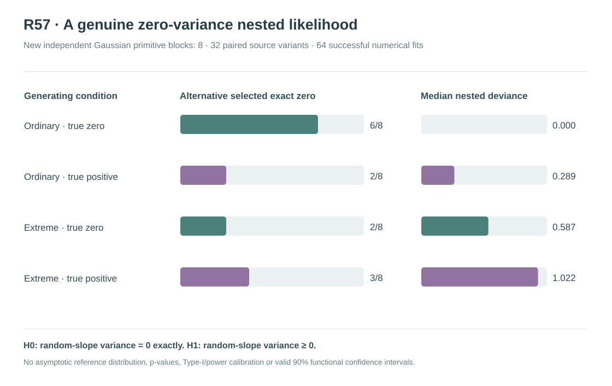

# W3 R57 — exact-zero versus nonnegative nested Gaussian REML: original independent-source results

**Research-only likelihood feasibility study, not a statistical variance-component hypothesis test.** The original numerical experiment defines a genuine structural `theta_slope=0` null and a nested alternative with `theta_slope≥0`, using the same Gaussian covariance kernels and restricted likelihood. It has **not** established a null reference distribution, p-value calibration, fixed-effect pointwise CR2 confidence interval or function-wide simultaneous bands.

## Original evidence and reproducibility

[Draft research PR #364](https://github.com/stefanosbalaskas/eyetrajectoriespy/pull/364) is stacked on the independent R56 evidence audit rather than protected main. The frozen [R57 protocol](w3-r57-nested-zero-nonnegative-reml-protocol.md) declares all source, optimizer, nested likelihood and refusal rules before original source execution.

[Original scientific Actions workflow #39023712112](https://github.com/stefanosbalaskas/eyetrajectoriespy/actions/runs/39023712112) completed **6/6 dedicated jobs successfully**: mathematical/independent-source tests, four independent primitive-block numerical shards and exact-source-checkout SHA256/refusal-denominator aggregation. The immutable [complete original numerical archive #12098250313](https://github.com/stefanosbalaskas/eyetrajectoriespy/actions/runs/39023712112/artifacts/12098250313) was independently downloaded and inspected. **All 3/3 original SHA256 manifest entries match the contained bytes:**

| Original artifact | Verified SHA256 |
|---|---|
| `cases.json` | `4b0acd21512579513ca904d61d0f74912855807f6ac46e4961af706e30ebc726` |
| `summary.json` | `0ef577b86ded44343f18e2c345afbbea47e260883a510fd8393490bdfac7ea4b` |
| `source-commit.txt` | `952626a514e9c9ca347183bd01c00afe77e51d168713af736ada63b3f7684ae2` |

The original source checkout recorded in GitHub Actions was **`d120e5f48978dc7a86e6e400ac402dc42d2a3a59`**, which is an Actions **pull-request merge checkout**, not the later documentation-head branch SHA. The four original nonoverlapping source shards (primitive block index ranges `[0,2)`, `[2,4)`, `[4,6)` and `[6,8)`) have separately verified case SHA256 digests:

- `9302844a27050786aab3a1248a4a998d761fe44d551b08aeddfdc09f4dc03fcc`
- `7a9e3f231d02c95add34fd835ccce75fac19f448c3764bfbd1fc2672751db612`
- `a16fc0c4cfa49fceee26cf2cb7b05cdd50cc1198c1cb88ae9daaa85adf2d78ec`
- `1d049d104c54277d170c4928cc1567a88d47a60d4ffcbf1e156d9369c279b38c`

The original four-shard source identities, seed and checkout hashes agree; no unsuccessful or out-of-universe source was replaced.

## Scientific design and genuine nesting

R56 established that the prior R49 *strictly positive* Gaussian REML lower variance-ratio box was not a reliable proxy for structural random-slope variance zero on sixteen new independent Gaussian generating blocks. R57 consequently tests two **genuinely nested** original Gaussian restricted-likelihood models:

**H0** fixes Gaussian participant random-slope variance `theta_slope=0` **exactly** while optimizing three positive Gaussian participant intercept, trial and sensor covariance variance ratios. The objective uses the existing independently checked R35 exact-zero restricted Gaussian likelihood.

**H1** optimizes the same three nuisance variance components and additionally a **linear nonnegative Gaussian participant-slope variance ratio**, including the exact endpoint zero. The analytic score uses the existing R37 continuous nonnegative-slope restricted Gaussian likelihood. Both apply the same fixed Gaussian mean projection, observed covariance components and observed WLS residual-reference scaling. Independent tests confirm the alternative NLL and three common nuisance scores equal the null model at slope ratio exactly zero, and the alternative has the correct *one-sided slope score* for the active boundary.

Generate **eight new independent Gaussian primitive innovation blocks**, master seed **202610175757**, n24 participants with original native irregular repeated trials, predictor-scaled Gaussian participant random slope and original fixed focal truth. For each block generate paired **ordinary/extreme dependent predictor** support, and within each support pair **true-zero** versus **true-positive** slope generating states by removing only the exact Gaussian participant-slope realization from the positive source. Shared native design, fixed mean, participant intercept/trial/sensor Gaussian innovations and weights remain identical within matched source pairs. The true-positive generating participant-slope variance is **0.002025**, while the true-zero state is mathematically **zero**.

These are **8 independent primitive blocks**, **16 block/support pairs**, and **32 block/support/state variants**, not 32 independent Gaussian innovation draws.

## Original complete strict numerical denominator

For each case perform **two independent fixed-start optimizations of H0** and **four independent fixed-start optimizations of H1**. Each selected solution must pass the original strict optimizer success, independent analytic NLL reconstruction within **10⁻⁶**, projected gradient KKT in **physical ratio coordinates ≤0.001**, and NLL no more than **0.001 above the best evaluated candidate**, including an otherwise rejected numerical start. H1 requires a one-sided projected score constraint at its exact zero boundary.

| Original numerical gate | Planned denominator | Original outcome |
|---|---:|---:|
| Native source/support/generating-state records | 32 | **32/32 complete** |
| H0 true-zero restricted Gaussian REML fits | 32 | **32/32 accepted** |
| H1 nonnegative restricted Gaussian REML fits | 32 | **32/32 accepted** |
| Original separate optimizer-start records | 192 | **192/192 recorded** |
| Nested likelihood-gap comparisons | 32 | **32/32 numerically accepted** |
| Source, model-fit or nested numerical refusals | 32 comparisons | **0** |

This means every original case has both models' **accepted selected candidate** and the complete six-start record. It **does not** assert all 192 individual starts independently satisfy projected KKT, prove the selected REML solution is a global optimum, or qualify a deviance reference law. The **largest selected physical projected-KKT residual** independently recomputed from original case records was approximately **0.00027569**, below the preregistered 0.001 gate.

For every accepted case, retain **raw signed deviance `2(NLL_H0−NLL_H1)`** and a separately labeled nonnegative numerical copy `max(0,raw)`. Three of the raw 32 deviances are negative only by floating-point-scale values of order **10⁻¹²**; the most negative observed is approximately **−5.46×10⁻¹²**, far inside the frozen numerical monotonicity tolerance **−10⁻⁵**. Those raw signs are preserved, not reclassified as evidence against true likelihood nesting.

## Descriptive original nested likelihood findings

| Original generating condition | Accepted H0/H1 comparisons | H1 selected **exact zero** slope variance | Median nonnegative nested deviance |
|---|---:|---:|---:|
| Ordinary leverage, **true zero** | 8/8 | **6/8** | **0.000** |
| Ordinary leverage, **true positive** | 8/8 | **2/8** | **0.289** |
| Extreme leverage, **true zero** | 8/8 | **2/8** | **0.587** |
| Extreme leverage, **true positive** | 8/8 | **3/8** | **1.022** |

The original H1 solution selected the mathematically zero slope variance in **13 of the 32** paired source variants. Those are genuine **fitted zero values**, not an arbitrarily small positive ratio. Nonetheless, selection at zero is **not** equivalent to a statistically valid null-hypothesis decision: under extreme leverage, the fitted zero/nonzero status still overlaps substantially across the true-zero/positive generating sources.

The descriptive median nested deviance was zero under ordinary true-zero sources and tended to be higher under positive generating states, but there were only **eight independent source blocks per support** and all source variants are paired within block. This **does not** estimate Type-I error, rejection probability, statistical power, a p-value distribution or an asymptotic chi-bar-square reference. The 32 accepted gaps do not create 32 independent Monte Carlo experiments.

Unlike R56's fitted **positive** variance lower-ratio occupancy, R57's H1 includes **exact zero**, so the nested model definition is scientifically appropriate for a prospective variance-null test. However, numerical model nesting alone does not calibrate the null sampling distribution, especially with estimated positive nuisance components, irregular repeated measurements and only 24 participants per original block.

## Interpretation, limitations and next statistical qualification

**R57 provides positive numerical feasibility evidence** for an exactly nested structural slope-zero Gaussian REML likelihood and a nonnegative alternative, including an independently checked analytic score at the variance boundary and strict objective/KKT numerical acceptance for the complete frozen source denominator.

**The inferential boundary remains unresolved.** The original model does not establish global REML optimum, a valid finite-sample or asymptotic boundary reference distribution, an independently calibrated likelihood-ratio null rejection frequency, or any corrected CR2 fixed-effect confidence interval. The eight independent source blocks are insufficient to generalize fitted-zero classification or infer power, and the original source experiment did not implement p-values.

A defensible subsequent R58 can freeze a boundary-null calibration protocol using many **new independent zero-variance Gaussian generating blocks**, an explicit candidate critical-reference rule supported by an appropriate mathematical derivation and full numerical-refusal accounting. A separate positive-source power study and an independent final qualification holdout would then be required. If the boundary statistic is unstable or refusing frequently, preserve those outcomes rather than selectively analyzing successful fits. **Even a calibrated variance-null test would not automatically validate nominal 90% pointwise CR2 intervals or 90% simultaneous functional bands**.

Scientific issues [#289](https://github.com/stefanosbalaskas/eyetrajectoriespy/issues/289) and [#296](https://github.com/stefanosbalaskas/eyetrajectoriespy/issues/296) remain **OPEN**. R57 is isolated on a stacked draft research PR; protected main, supported API, 1.2 release tag and PyPI remain unchanged.
