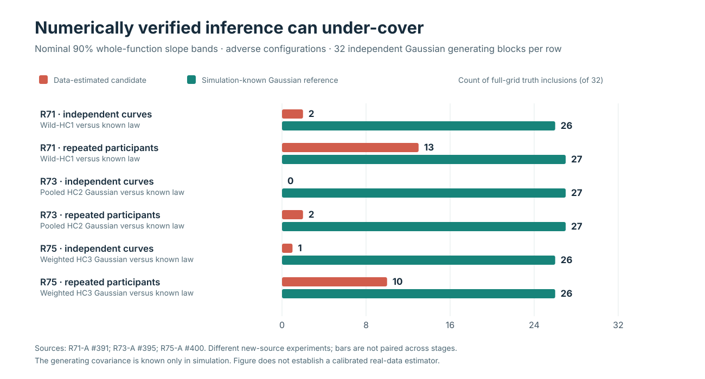
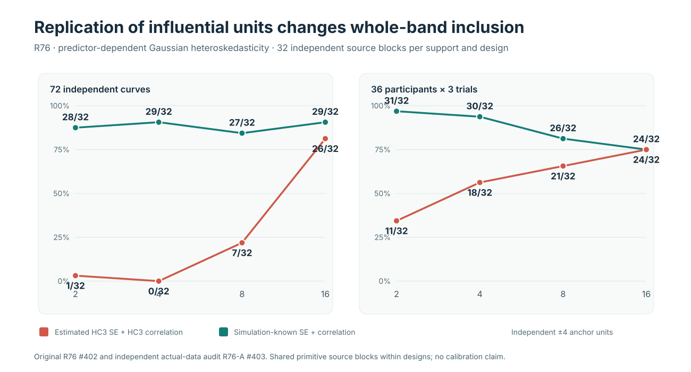
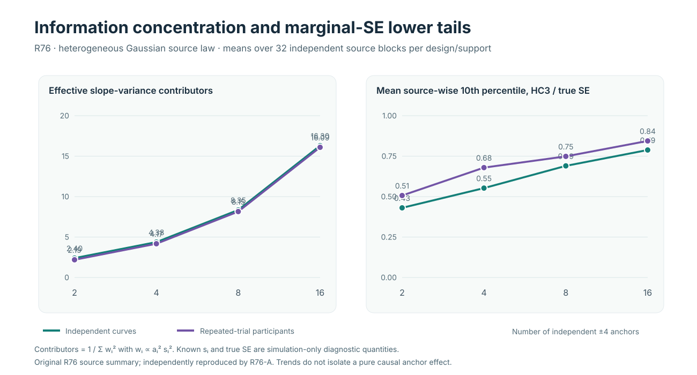

# W3 simultaneous-band calibration: audited evidence and original plots

**Evidence gallery · updated 20 October 2026 · synthetic Gaussian simulations only**

!!! danger "What these figures do not establish"
    The public stable distribution remains **1.1.0**. The plots summarize original simulated source outcomes and independent numerical audits from **unmerged draft research PRs**, not studies on original human-subject eye-tracking recordings. No W3 whole-function confidence band is qualified as generally nominal-90% in this programme. Blocking issues [#289](https://github.com/stefanosbalaskas/eyetrajectoriespy/issues/289) and [#296](https://github.com/stefanosbalaskas/eyetrajectoriespy/issues/296) remain open. Figures do not alter the package API or authorize a PyPI release.

## Figure 1 — R71/R73/R75: estimated procedures compared with generating-law references

[Read the scientific article: when numerically correct simultaneous bands under-cover](../articles/when-w3-simultaneous-bands-undercover.md).

This is a **cross-study descriptive display**, not a paired estimator comparison across R71, R73 and R75. Each reported cell has **32 independent generating source blocks**; different stages generated different synthetic datasets, covariance regimes and/or estimated procedures.

| Original + independent audit | Original scientific source workflow | Total completed source cases | Figure 1 tested conditions and 90% inclusion counts |
|---|---|---:|---|
| R71 / [R71-A #391](https://github.com/stefanosbalaskas/eyetrajectoriespy/pull/391) | [R71 #390](https://github.com/stefanosbalaskas/eyetrajectoriespy/pull/390) | **128/128**, 0 refusals | Extreme leverage: curves wild-HC1 **2/32**, known Gaussian **26/32**; repeated participants **13/32** versus **27/32** |
| R73 / [R73-A #395](https://github.com/stefanosbalaskas/eyetrajectoriespy/pull/395) | [R73 #394](https://github.com/stefanosbalaskas/eyetrajectoriespy/pull/394) | **256/256**, 0 refusals | Extreme leverage + predictor-dependent variance: pooled HC2 Gaussian curves **0/32**, known heterogeneous Gaussian **27/32**; participants **2/32** versus **27/32** |
| R75 / [R75-A #400](https://github.com/stefanosbalaskas/eyetrajectoriespy/pull/400) | [R75 #399](https://github.com/stefanosbalaskas/eyetrajectoriespy/pull/399) | **256/256**, 0 refusals | Extreme leverage + predictor-dependent variance: HC3 estimated SE/HC3 correlation curves **1/32**, known law **26/32**; participants **10/32** versus **26/32** |

All figure bars use **truth-inclusion counts out of 32**, not bootstrap draws or percentages silently substituted for counts. The generating Gaussian covariance is known only to the simulation. R71's extreme curve comparison, for example, is **2 vs 26 successes on different candidate/oracle methods applied to the same 32 original datasets**, whereas R71 and R73 did not reuse source datasets.

## Figure 2 — R76: whole-function truth inclusion by replicated extreme support

[Read the scientific article: how independent leverage support affects coverage](../articles/how-independent-leverage-support-affects-coverage.md).

The independent predictor extremes x=±4 are 2, 4, 8 and 16 **separately simulated independent units**, evenly balanced by sign; other predictors lie in Uniform(−0.95,0.95). The adverse covariance regime scales unit SD by \(1+0.75|x_i|\). This is **32 independent generating source blocks for every design/support/variance condition**; the 512 complete cases across all conditions share paired source blocks.

| x=±4 independent anchors | Curves: estimated HC3 SE + HC3 corr | Curves: known Gaussian | Participants: estimated HC3 SE + HC3 corr | Participants: known Gaussian |
|---:|---:|---:|---:|---:|
| 2 | **1/32** | 28/32 | **11/32** | 31/32 |
| 4 | **0/32** | 29/32 | **18/32** | 30/32 |
| 8 | **7/32** | 27/32 | **21/32** | 26/32 |
| 16 | **26/32** | 29/32 | **24/32** | 24/32 |

## Figure 3 — R76: why source-wise SE diagnostics matter

The first panel plots the generating-law variance concentration index \(N_{\mathrm{eff,var}}=1/\sum_i w_i^2\), where \(w_i\propto a_i^2s_i^2\). The second plots the **mean across 32 source datasets** of each dataset's **10th percentile across 62 slope coordinates** of \(\widehat{\mathrm{SE}}_{HC3}/\mathrm{SE}_{true}\). Both require simulation-known variance or SE, and neither is a validated plug-in diagnostic for real gaze data.

| Independent anchors | Curves \(N_{eff,var}\) | Participants \(N_{eff,var}\) | Curves HC3/true SE lower-tail | Participants HC3/true SE lower-tail |
|---:|---:|---:|---:|---:|
| 2 | 2.398 | 2.192 | 0.431 | 0.507 |
| 4 | 4.376 | 4.174 | 0.553 | 0.679 |
| 8 | 8.347 | 8.152 | 0.690 | 0.749 |
| 16 | 16.297 | 16.095 | 0.788 | 0.844 |

Increasing the number of independently contributing high-leverage units **cochanges regression support, slope precision and source information weights**. The observed improvements support a finite-sample information-concentration mechanism in this experimental law, but do not isolate a pure causal effect or define a universal minimum effective sample size.

## R76 reproducibility and audit ledger

| Evidence identity | Verified result |
|---|---|
| Original prospective source protocol | [R76 draft PR #402](https://github.com/stefanosbalaskas/eyetrajectoriespy/pull/402), research-only |
| Original science workflow | [#39397281090](https://github.com/stefanosbalaskas/eyetrajectoriespy/actions/runs/39397281090), **12/12 science jobs passed** |
| Original immutable evidence | [Artifact #12252397295](https://github.com/stefanosbalaskas/eyetrajectoriespy/actions/runs/39397281090/artifacts/12252397295) |
| Independently implemented numerical audit | [R76-A draft PR #403](https://github.com/stefanosbalaskas/eyetrajectoriespy/pull/403) |
| Independent mandatory source audit workflow | [#39397981410](https://github.com/stefanosbalaskas/eyetrajectoriespy/actions/runs/39397981410), **4/4 science audit jobs passed** |
| Independent archived report | [Artifact #12253250987](https://github.com/stefanosbalaskas/eyetrajectoriespy/actions/runs/39397981410/artifacts/12253250987) |
| Frozen original scientific source checkout | `47bea211279aec9bf547c5239a20976058a7a4a3` |
| Attempted original source cases | **512**; 512 complete, **0 refused** |
| True independent replication unit | **32 generating source blocks per specific design/support/variance cell** |
| Audited maximum-statistic values | **511,488 W3 wild + 511,488 known-correlation Gaussian + 511,488 estimated-HC3-correlation Gaussian = 1,534,464 values** |
| Immutable archive verification | Three SHA256 members plus original source checkout verified |
| Production, inference and missingness qualification | **Not authorized**; [#289](https://github.com/stefanosbalaskas/eyetrajectoriespy/issues/289) and [#296](https://github.com/stefanosbalaskas/eyetrajectoriespy/issues/296) OPEN |

The plot artwork is a vector re-expression of the **independently verified numerical evidence** displayed in the tables above, not a new experiment, an independent replication or a plot of raw human eye-tracking recordings. The SVG files are checked into the documentation tree with the source-count ledger; any changes to the plotted scientific counts require checking against the separately retained source artifacts and independent audit report.

**Reading order:** [Why simultaneous bands under-cover](../articles/when-w3-simultaneous-bands-undercover.md) → [R76 high-leverage replication](../articles/how-independent-leverage-support-affects-coverage.md) → [Scientific evidence dashboard](research-scientific-dashboard.md). Original methodology remains in the research PRs; website publication is not research-code integration or product release.
