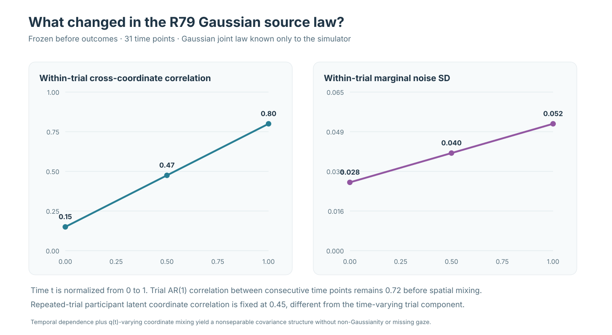
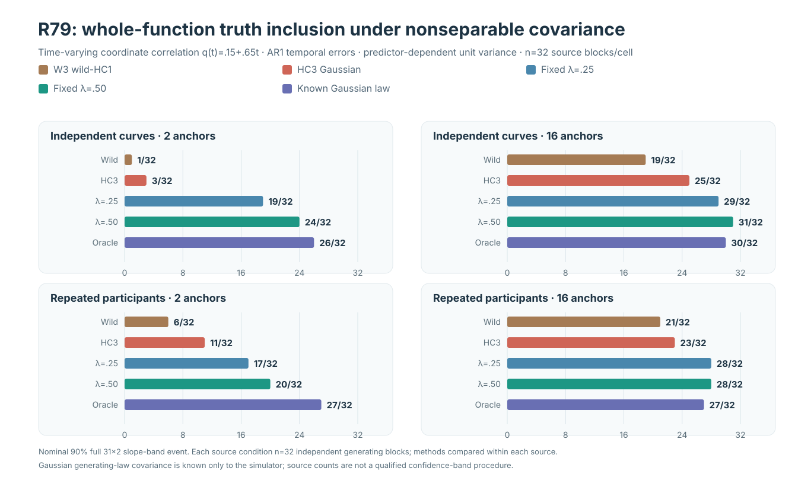
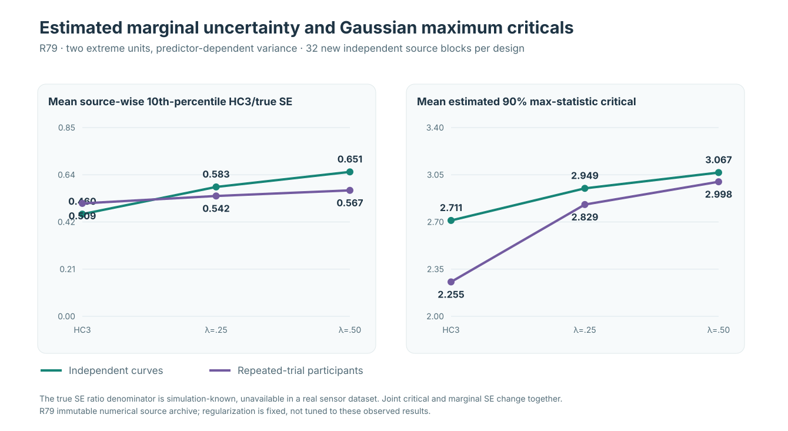

# W3 R79: source provenance and original nonseparable covariance figures

**Research evidence ledger · 20 October 2026 · fully synthetic, Gaussian and unreleased**

!!! danger "Numerical verification, not statistical qualification"
    The original and independent numerical audits validate computational reproduction of source data and reference arrays, **not general nominal-90% coverage**. No real sensor, non-Gaussian, dropout or MNAR data are tested. W3 science blocker #289 and missingness blocker #296 remain OPEN, version 1.2 release HOLD.

## Figure 1: generating-law nonseparable covariance

[Read the R79 scientific article](../articles/w3-nonseparable-coordinate-covariance-r79.md). R79 uses within-trial base Gaussian temporal AR1 rho **.72**, true trial marginal SD **.04(.70+.60t)**, and explicitly varies within-time coordinate correlation **q(t)=.15+.65t**. In the repeated-trial participant configuration, dimension-specific subject latent normals have fixed coordinate correlation **.45**. All generating-law parameters are **simulation known only**.

## Figure 2: source-level whole-slope-function inclusion

The denominator for every plotted condition is **32 genuinely new independent primitive generating blocks**, not the 256 factorial cases and not 999 conditional Gaussian/wild draws.

| Predictor-dependent variance | Curves: 2 anchors | Curves: 16 anchors | Participants: 2 anchors | Participants: 16 anchors |
|---|---:|---:|---:|---:|
| Unmodified W3 wild-HC1 | 1/32 | 19/32 | 6/32 | 21/32 |
| Data-estimated HC3 Gaussian | 3/32 | 25/32 | 11/32 | 23/32 |
| Fixed HC3 regularization λ=.25 | 19/32 | 29/32 | 17/32 | 28/32 |
| Fixed HC3 regularization λ=.50 | 24/32 | 31/32 | 20/32 | 28/32 |
| Source-known Gaussian benchmark | 26/32 | 30/32 | 27/32 | 27/32 |

The **constant-variance falsification cells** are also part of the original complete archive. With only two independent x=±4 extremes, curves HC3, λ=.25, λ=.50 and source-known benchmark include the truth in **16, 21, 25 and 28** of 32 cases, respectively. Corresponding repeated-participant counts are **20, 26, 26 and 30**. With sixteen anchors, the source-aggregated counts remain available for both laws; no result-dependent source case exclusion was made.

## Figure 3: source-wise marginal-SE lower tails and Gaussian critical

For the primary heteroskedastic **two independent extreme units** condition, the source-averaged within-grid 10th percentile of candidate marginal estimated/true slope SE ratios and the source-averaged Gaussian reference criticals are:

| Condition | HC3 | Fixed λ=.25 | Fixed λ=.50 |
|---|---:|---:|---:|
| Curves estimated/true marginal SE low tail | 0.460424 | 0.582731 | 0.650528 |
| Participants estimated/true marginal SE low tail | 0.508616 | 0.542073 | 0.567355 |
| Curves estimated Gaussian critical | 2.711283 | 2.949399 | 3.066560 |
| Participants estimated Gaussian critical | 2.255382 | 2.829268 | 2.998212 |

The known Gaussian true slope SE is **not available for actual recording datasets** and is used here only for diagnosis. The two frozen regularization strengths change both the estimated marginal SE and the correlation/critical-value reference. These plots cannot be interpreted as a universal confidence-band algorithm comparison.

## Original and independent source numerical evidence

| Evidence | Verified provenance |
|---|---|
| Prospective experiment | [R79 draft PR #411](https://github.com/stefanosbalaskas/eyetrajectoriespy/pull/411); frozen source-law and estimator specifications |
| Original scientific source job | [R79 workflow #39483619384](https://github.com/stefanosbalaskas/eyetrajectoriespy/actions/runs/39483619384): **12/12 scientific jobs passed** |
| Immutable original source archive | [Artifact #12292856827](https://github.com/stefanosbalaskas/eyetrajectoriespy/actions/runs/39483619384/artifacts/12292856827) |
| Pinned original simulation checkout | 15bcbe55d42579c9788cd94b9516850b6eabc1b2 |
| Mandatory separately coded replay | [R79-A draft PR #412](https://github.com/stefanosbalaskas/eyetrajectoriespy/pull/412) |
| Independent source audit workflow | [#39483939543](https://github.com/stefanosbalaskas/eyetrajectoriespy/actions/runs/39483939543): **4/4 dedicated jobs passed** |
| Independent audit report | [Artifact #12291983970](https://github.com/stefanosbalaskas/eyetrajectoriespy/actions/runs/39483939543/artifacts/12291983970) |
| Original source case success/failure | **256/256 complete; zero numerical refusals** |
| True independent study source denominator | **32 new generating blocks per design/support/variance cell** |
| Original conditional maximum-statistic archive | **256 cases × 5 references × 999 draws = 1,278,720**, independently reconstructed |
| Whole-grid inclusion outcome | Binary inclusion of all **31×2** generating functional slope coordinates, one event per independent source dataset |
| Five original inferential references | Original wild-HC1; estimated HC3 Gaussian; fixed source-observable λ=.25 and λ=.50; **simulator-known Gaussian joint source law** |
| Scientific qualification | **No general 90% simultaneous confidence validity; no real-gaze/non-Gaussian/MNAR evidence; no public inference API** |

The SVG assets are vector re-expressions of the independently audited original simulation summary and analytic generating law, not newly estimated model fits. Because R78 and R79 were generated using **different** primitive source blocks, any across-study figure comparisons must not be misrepresented as paired source effects.

[Full R79 article](../articles/w3-nonseparable-coordinate-covariance-r79.md) · [Methods companion on two-dimensional gaze covariance](../articles/understanding-nonseparable-gaze-covariance.md) · [Previous R77–R78 ledger](w3-r77-r78-temporal-covariance-figure-ledger.md)
