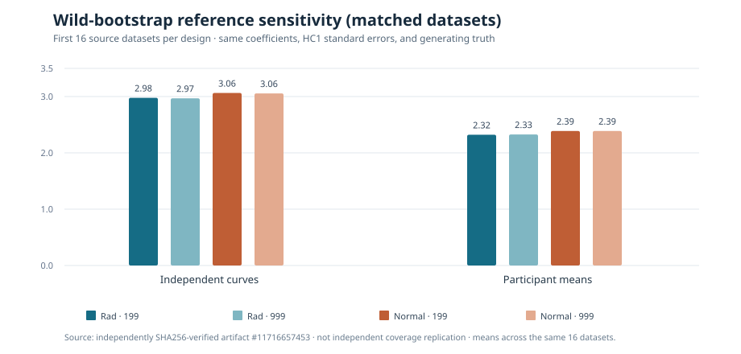

# W3 bootstrap sensitivity: longer sampling alone did not resolve noncoverage

!!! warning "Matched-dataset computational comparison, not a new coverage replication"
    These results reuse the **same first 16 generating datasets per design**
    from the original 64-dataset-per-design [W3 fixed-truth pilot](w3-fixed-truth-uncertainty-pilot-results.md).
    There are **32 source datasets**, not 128 independent datasets; four
    computational bootstrap settings per dataset are paired.

## Original scientific provenance

The original [same-data scientific workflow #38178895466](https://github.com/stefanosbalaskas/eyetrajectoriespy/actions/runs/38178895466)
saved artifact `11716657453` with 32 case records,
`evidence.json`, source head
**`d5aff20e9ac8785e0c8d68c5cb5d3cb0d1ebe25a`** and SHA256 checksums.
Every SHA256 entry was independently verified from the original ZIP.
All **32/32** fitted datasets and **128/128** bootstrap cells completed
with zero fitting/verification exceptions.

Each dataset was held identical across all multiplier and draw-budget
combinations. Every 999-draw simulation verified that its first 199
multipliers exactly matched the corresponding 199-draw simulation.
Independent coefficient/HC1 and maximum-statistic numerical oracles
passed.

| Multiplier × draws | Curve-level (16 fixed datasets): slope truth included | Participant-level (16 fixed datasets): slope truth included |
|---|---:|---:|
| Rademacher × 199 (original) | 10/16 | 11/16 |
| Rademacher × 999 | 10/16 | 11/16 |
| Normal × 199 | 11/16 | 11/16 |
| Normal × 999 | 11/16 | 11/16 |

**199 → 999 draws changed no slope truth-inclusion decision** for
either multiplier in either design. The multiplier substitution changed
just **one** curve-level dataset's inclusion decision at each draw budget,
and none of the participant-level decisions.

### Distribution of maximum-statistic reference cutoffs

| Critical-value mean over the same 16 datasets | Curve-level | Participant-level |
|---|---:|---:|
| Rademacher × 199 | 2.9775 | 2.3215 |
| Rademacher × 999 | 2.9686 | 2.3265 |
| Normal × 199 | 3.0634 | 2.3883 |
| Normal × 999 | 3.0557 | 2.3882 |

*Figure redrawn from the verified original audit. These are conditional
mean critical values for matched source datasets, not Monte Carlo
confidence intervals, relative model accuracy, or statistical evidence
that one multiplier is generally preferable.*

The prespecified mean **999-minus-199** critical-value changes were
−0.00894 (curve-level Rademacher), −0.00772 (curve-level normal),
+0.00499 (participant-level Rademacher) and −0.00004
(participant-level normal). This small matched-data computational
difference suggests **insufficient bootstrap draws alone are not the
leading explanation** for the original 64-block undercoverage.

## Limits and next falsification

This sensitivity does not change the original 64-block coverage results,
and it does not add independent generating datasets. The 16 selected
block indices are too few to claim which multiplier reliably calibrates
90% bands. It tests only one specific slope-function truth, fixed
sample sizes and common-grid Gaussian data models.

Next distinguish finite-sample *statistical* calibration from
bootstrap computational resolution: independently replicated sampling
blocks; sample-size contrast (e.g. larger independent-unit counts);
leverage/studentization; temporally correlated and heteroskedastic
functional errors; and equal-truth paired designs. Preserve
all failed confidence bands and multiple-comparison denominators.

[Scientific blocker #289](https://github.com/stefanosbalaskas/eyetrajectoriespy/issues/289)
remains open. This result does not change the separate
[Bayesian issue #255](https://github.com/stefanosbalaskas/eyetrajectoriespy/issues/255)
or [F5 issue #256](https://github.com/stefanosbalaskas/eyetrajectoriespy/issues/256).
Stable **1.1.0** remains published, development is **`1.2.0rc2.dev0`**,
and there is **no release/publishing authorization**.
