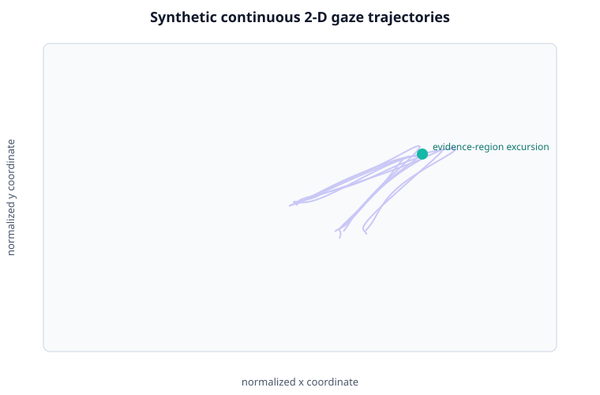
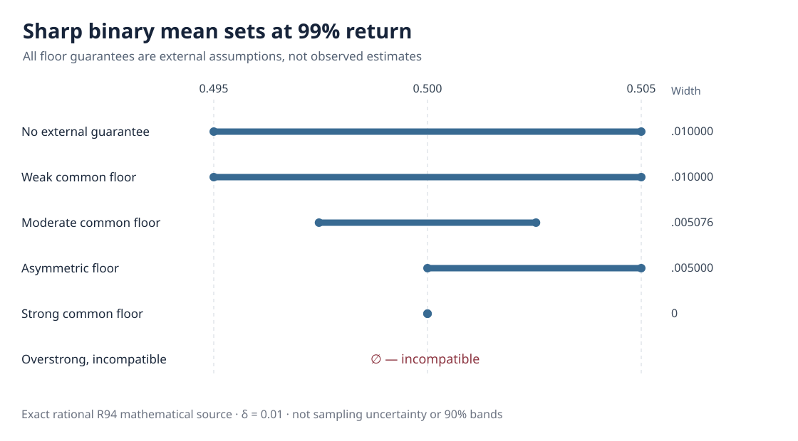

# Scientific figure atlas

[Filter and search selected figures](../tools/figure-explorer.md){ .md-button .md-button--primary } — a source-linked curated view with representation, inference and missingness filters. The full atlas remains below.

Figures are grouped by **the question they answer**, rather than by the order in which they were created. Example plots are deterministic synthetic illustrations. Research plots document specifically frozen experiments and should **not** be generalized beyond their archived assumptions.

## A. Understand the functional gaze representation

- 

  **Time-indexed planar trajectories** — what we preserve instead of collapsing immediately to counts.

  [Representation guide](../concepts/representations.md)

- 

  **Sparse x/y covariance structure** — illustrates modeled covariance, not tracking hardware performance.

  [Sparse FPCA/MFPCA methods](../methods/visual-gallery.md)

## B. Functional inference under stress

[R78 temporal covariance](../articles/w3-temporal-covariance-robustness-r78.md) · [R80 heavy-tailed units](../articles/w3-student-t5-heavy-tail-inference-r80.md) · [Independent figure-ledger archive](../development/research-original-figures.md)

## C. Missingness, audit and exact identified sets

[Missing gaze study](../articles/w3-response-dependent-gaze-loss-r82.md) · [Identification methods](../articles/how-to-read-identification-bounds.md) · [All W3 studies](../research/studies.md)

## D. Compare conditional missing-outcome assumptions

[Why different assumptions change the sharp set](../articles/what-sharpens-missing-gaze-bounds.md). These ratios are analytical population identities, not fitted uncertainty or measured gains.

## Reproducibility

Read the source-specific evidence ledgers before quoting numeric proportions: [R93](../development/w3-r93-original-independent-equivalence-ledger.md), [R94](../development/w3-r94-original-independent-evidence-ledger.md), [R95](../development/w3-r95-original-independent-evidence-ledger.md). See also the [full synthetic workflow visual gallery](../methods/visual-gallery.md).

!!! warning "Do not treat simulation truth-inclusion as validated coverage"
    Whole-slope inclusion under a specified generator is not proof of general nominal frequentist calibration. A population identified set is not a confidence band.
