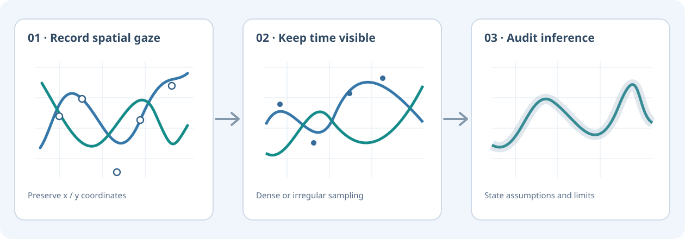
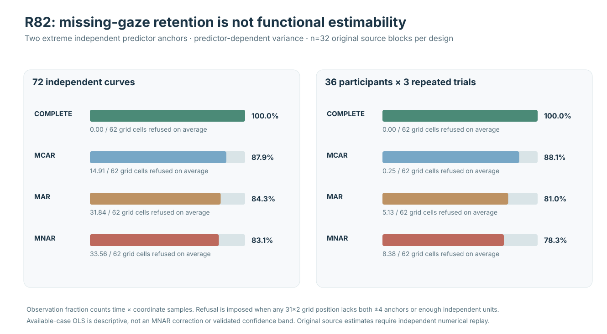

<div class="et-home-intro" markdown>

<div class="et-home-label">Functional eye-tracking analysis · Python 3.11–3.13</div>

# Analyze the trajectory, not just the fixation count.

**eyetrajectoriespy** models gaze as a time-indexed two-coordinate functional process. Work with dense, sparse, irregular and repeated-trial trajectories while keeping the assumptions behind analysis and uncertainty visible.

[Install stable 1.2.0](start/index.md){ .md-button .md-button--primary }
[Try method selector](tools/method-selector.md){ .md-button }
[Research evidence](research/index.md){ .md-button }

<div class="et-micro-status" markdown>
**Published stable:** [1.2.0](releases/1.2.0.md) · **Supported workflows:** ten module-scoped W1–W4 routes · **Research helpers:** E1–E4 remain experimental · **Scientific exclusions:** [#289](https://github.com/stefanosbalaskas/eyetrajectoriespy/issues/289) / [#296](https://github.com/stefanosbalaskas/eyetrajectoriespy/issues/296)
</div>

</div>

<div class="et-landing-visual" markdown>



<small>Conceptual synthetic schematic, not measured human gaze or a performance claim.</small>

</div>

## Start with your data and research question

New to functional gaze analysis? Use the [data-to-method guide](start/data-to-method.md) to identify the independent sampling unit, time grid, estimand and uncertainty scope **before** choosing an estimator. The [quick start](quickstart.md) provides seeded executable examples.

## Interactive research tools

**New:** [Inspect the structure of a gaze CSV in your browser](tools/data-readiness.md){ .md-button .md-button--primary } — read participant/trial support, missing coordinates and timestamps locally without sending data to a server. This is a structural preflight, not an instrument or inference validation.


<div class="grid cards" markdown>

- **Find a suitable analysis route**

  Answer four questions about your time grid, estimand, sampling hierarchy and uncertainty. Receive an interpretable, **non-prescriptive** method starting point.

  [Interactive selector](tools/method-selector.md) · [Ten-route comparison](tools/workflow-comparison.md)

- **Explore a synthetic gaze trajectory**

  Change retained sample support and switch between the spatial path and time-indexed coordinate. Descriptive spread is explicitly **not** a confidence interval.

  [Trajectory explorer](tools/trajectory-explorer.md) · [Runnable synthetic dataset](tutorials/reproducible-starter.md)

- **Search figures and research evidence**

  Filter existing W3 figures and R76–R95 research records without promoting experimental findings to stable package claims.

  [Filter figures](tools/figure-explorer.md) · [Search evidence](tools/evidence-explorer.md)

- **Check documentation provenance**

  Use stable 1.2.0 online docs with release-indexed notes and immutable tagged source references.

  [Documentation versions](versions/index.md)

</div>

## Python ecosystem interoperability

Bring **preprocessed sample tables** from upstream acquisition packages into the existing functional-data contracts without pretending that event detection validates functional inference. A new optional pandas/Polars/Parquet example shows strict source mapping and refuses missing or unequal dense grids.

[Python integrations](integrations/index.md){ .md-button } [Runnable table handoff](integrations/tabular-handoff.md){ .md-button }

## Begin with your scientific question

<div class="grid cards" markdown>

- **Explore variation in continuous gaze paths**

  Use FPCA and planar MFPCA to inspect structured temporal variation.

  [FPCA workflow](workflows/fpca-exploration.md)

- **Analyze sparse or asynchronous recordings**

  Respect irregular sampling and coordinate-specific recorded times.

  [Sparse planar methods](guides/sparse-multivariate-fpca.md) · [Irregular data](guides/irregular-trajectories.md)

- **Examine changing experimental effects**

  Fit interpretable functional regression with explicitly declared support and units.

  [Regression guide](workflows/experimental-functional-regression.md)

- **Model participants and repeated trials**

  Keep cluster structure and repeated observations visible.

  [Mixed-effects workflow](workflows/repeated-trial-mixed-effects.md)

- **Study recurrence and temporal dynamics**

  Report embedding, threshold and time-delay decisions.

  [Recurrence workflow](workflows/nonlinear-recurrence.md)

- **Report auditable decisions**

  Surface preprocessing, model assumptions, scientific contracts and failures.

  [Scientific contracts](concepts/contracts.md) · [Reporting](methods/reporting.md)

</div>

## Released software is not the same as ongoing research

<div class="et-release-grid" markdown>

<div class="et-release-panel" markdown>
<span class="et-eyebrow">Available via pip</span>

### Stable version 1.2.0

The published package includes qualified 1.1 sparse/irregular methods and ten supported W1–W4 workflow routes under `eyetrajectoriespy.workflows`.

```bash
pip install eyetrajectoriespy==1.2.0
```

[PyPI 1.2.0](https://pypi.org/project/eyetrajectoriespy/1.2.0/) · [GitHub v1.2.0](https://github.com/stefanosbalaskas/eyetrajectoriespy/releases/tag/v1.2.0)

[Quick start](quickstart.md) · [Stable API](reference/api.md)
</div>

<div class="et-release-panel et-release-panel--research" markdown>
<span class="et-eyebrow">Scientific limitations</span>

### Released workflows and experimental research

Ten W1–W4 workflow routes are **published stable APIs**. Twelve E1–E4 helpers remain **experimental**, and the W3 whole-function confidence-band and field-MNAR claims are not qualified (issues #289 / #296).

[Research library](research/index.md) · [Release status](news/release-status.md)
</div>

</div>

## Explore scientific evidence

<div class="et-figure-pair" markdown>




</div>

**Read each figure in the context of its source.** R82 shows that apparently high gaze retention can coexist with inadequate independent-unit support. R95 proves conditional sharp *population* bounds given externally justified return assumptions; it does **not** establish the true missing-gaze mechanism or calibrate nominal-90% confidence bands.

[Scientific figure atlas](figures/index.md){ .md-button .md-button--primary }
[Interpret workflow figures](articles/interpreting-workflow-figures.md){ .md-button }
[Study map R76–R95](research/studies.md){ .md-button }

## Latest news

<div class="et-news-strip" markdown>

<div markdown>

**24 October 2026 · Stable 1.2.0 released**

The [GitHub release](https://github.com/stefanosbalaskas/eyetrajectoriespy/releases/tag/v1.2.0) and [PyPI distribution](https://pypi.org/project/eyetrajectoriespy/1.2.0/) passed production publication and exact-version installation checks. Statistical limitations remain explicit.

[Release announcement](news/2026-10-24-release.md) · [Release status](news/release-status.md)
</div>

<div markdown>

**23 October 2026 · R93–R95 research evidence**

Exact observational equivalence, externally assumed completion floors and monotone-return sensitivity, with independently audited records.

[Research update](news/2026-10-23.md) · [Study map](research/studies.md)
</div>

</div>

## Transparent research software

The package starts after gaze has a scientifically interpretable time and coordinate representation. It **complements**, rather than replaces, fixation/saccade detection, instrument-level QC, AOI/scanpath methods and upstream recording workflows.

[Representations](concepts/representations.md) · [Mathematical reference](methods/mathematical-reference.md) · [Workflow guide](workflows/index.md) · [Contribute](contributing.md) · [GitHub](https://github.com/stefanosbalaskas/eyetrajectoriespy)
